# RANCANG BANGUN SISTEM SURVEI *DIETARY RECALL* 24 JAM BERBASIS WEB DENGAN KOLABORASI REAL-TIME DAN REKOMENDASI GIZI BERBASIS *LARGE LANGUAGE MODEL*

**Draf Skripsi — BAB I sampai BAB V**

---

> ### ⚠ PETUNJUK PENGGUNAAN DRAF INI — BACA DULU
>
> Dokumen ini adalah **kerangka lengkap beserta isi yang sudah terverifikasi dari kode sumber**. Bagian yang **belum dapat diisi** karena membutuhkan pengambilan data lapangan ditandai dengan blok **`[⚠ ISI SETELAH PENGUJIAN]`**. Jangan pernah mengisi bagian itu dengan angka karangan — penguji skripsi biasanya menanyakan data mentahnya.
>
> **Sudah terisi & terverifikasi:** BAB I, BAB II (dengan sitasi nyata), BAB III seluruhnya, BAB IV bagian implementasi + rancangjan kasus uji + temuan cacat, BAB V kerangka.
> **Wajib kamu isi sendiri:** hasil uji kotak-hitam (kolom "Hasil"), hasil UAT/SUS, hasil uji kinerja, tangkapan layar, dan identitas (nama, NIM, pembimbing, institusi).
>
> Perkiraan pekerjaan tersisa: 1 hari untuk menjalankan uji kotak-hitam, 1–2 minggu untuk UAT (≥ 20 responden), 1 hari untuk uji kinerja. Setelah itu dokumen ini siap jadi skripsi utuh.
>
> ### 🔄 PEMBARUAN 6 Oktober 2026 — penyelarasan dengan kode
> Draf dicocokkan ulang dengan kode `atlas_food_backend` dan `atlas_food_frontend`. Yang ditambahkan: dukungan luring/PWA (Subbab 2.10, 4.1.6, 4.7.5c, Gambar 3.11), kanvas langsung dan obrolan kursor (4.1.2, 4.7.5d), profil–autentikasi–pemantauan (4.1.7), kebutuhan F-34…F-48 dan NF-16…NF-20, kasus uji UK-69…UK-103, serta pembanding myfood24. Yang dikoreksi: versi Go, model dan parameter Groq, perilaku tipe foto `range`, rute katalog, nama berkas migrasi, pembersihan ruang, dan saran yang ternyata sudah diimplementasikan.
> **Tiga hal yang harus kamu putuskan/periksa:** (1) katalog *Find Your Food* di kode masih di balik login — lihat kotak ⚠ pada Subbab 4.1.4; (2) ~~rujukan Carter 2015, Moshfegh 2008, Subar 2012 dan isi kolom myfood24 wajib diverifikasi~~ — **sudah diverifikasi 14 Oktober 2026** terhadap Crossref/PubMed dan teks lengkap publikasinya; daftar pustaka juga diperbarui dengan rujukan terbitan 2020–2025; (3) F-44 (ubah peran selama sesi) baru ada di lapis layanan.
>
> ### 💡 PROMPT UNTUK REVIEW & REVISI BAHASA (Gunakan di ChatGPT/Claude)
> Jika kamu ingin memperbaiki tata bahasa dari draf ini agar lebih mengalir dan tidak kaku, *copy* prompt berikut dan *paste* per bab ke AI kesayanganmu:
> 
> *"Tolong bertindak sebagai akademisi dan editor profesional ahli. Saya akan memberikan draft skripsi/artikel ilmiah saya. Tugasmu adalah memeriksa dan merevisi teks ini dari awal sampai akhir dengan kriteria berikut: 1. Perbaiki tata bahasa agar sesuai PUEBI. Buat gaya bahasanya mengalir, enak dibaca, dan tidak kaku, namun tetap mempertahankan nada formal, objektif, dan akademis. 2. Pastikan transisi antar kalimat/paragraf mulus. 3. Evaluasi kedalaman materi, pastikan penjelasan bagan/tabel logis. Berikan versi revisinya dan poin-poin singkat kelemahan utamanya.*
> *Ini draft materi saya: [PASTE TEKS BAB DI SINI]"*

---

## HALAMAN IDENTITAS

| | |
|---|---|
| Judul | Rancang Bangun Sistem Survei *Dietary Recall* 24 Jam Berbasis Web dengan Kolaborasi Real-Time dan Rekomendasi Gizi Berbasis *Large Language Model* |
| Nama | `[Nama Mahasiswa]` |
| NIM | `[NIM]` |
| Program Studi | `[Program Studi]` |
| Fakultas | `[Fakultas]` |
| Institusi | `[Universitas]` |
| Pembimbing I | `[Nama Pembimbing I]` |
| Pembimbing II | `[Nama Pembimbing II]` |
| Tahun | 2026 |

---

## ABSTRAK

*Dietary recall* 24 jam (R24J) merupakan metode baku penilaian asupan gizi individu, namun kualitas datanya sangat bergantung pada pendampingan enumerator terlatih yang mahal dan terbatas secara geografis. Sistem R24J terkomputerisasi yang telah mapan bersifat mandiri penuh sehingga menghilangkan peran pendampingan tersebut. Penelitian ini merancang dan membangun Atlas Food, sistem survei R24J berbasis web yang memungkinkan pendampingan jarak jauh secara real-time tanpa mengorbankan kepemilikan data responden. Sistem dikembangkan menggunakan metode *Design Science Research Methodology* (DSRM) dengan arsitektur terpisah antara antarmuka berbasis Next.js dan layanan Go yang menyediakan REST API sekaligus *hub* WebSocket. Kontribusi teknis dan kebaruan mencakup integrasi kolaborasi real-time bergaya Figma dengan sinkronisasi langkah *wizard*, model otorisasi peran *fail-closed*, integrasi AI ganda (Asisten AI per-langkah via *chat sidebar* dan rekomendasi naratif berkendala skema), modul gamifikasi dan *leaderboard* survei, serta dukungan luring *offline-first* PWA dengan sinkronisasi idempoten. Pengujian fungsional melalui penelusuran alur *end-to-end* menemukan dan memperbaiki sebelas cacat, lima di antaranya tergolong kehilangan data senyap atau kebuntuan alur. `[⚠ ISI SETELAH PENGUJIAN: hasil uji kotak-hitam, skor SUS, dan latensi sinkronisasi]`

**Kata kunci:** *dietary recall* 24 jam, kolaborasi real-time, WebSocket, *large language model*, gamifikasi, DSRM

---

## ABSTRACT

The 24-hour dietary recall (24HR) is a reference method for assessing individual nutrient intake, yet its data quality depends heavily on trained enumerator assistance, which is costly and geographically constrained. Established computerised 24HR systems are fully self-administered and therefore eliminate that assistance entirely. This study designs and develops Atlas Food, a web-based 24HR survey system enabling remote real-time assistance without compromising respondent data ownership. The system was developed using the Design Science Research Methodology (DSRM) with a decoupled architecture between a Next.js interface and a Go service providing both a REST API and a WebSocket hub. Technical contributions include Figma-style real-time collaboration with wizard step synchronization, a fail-closed role authorization model, dual AI integration (step-by-step conversational assistant via chat sidebar and schema-constrained narrative recommendations), survey gamification and leaderboard modules, and offline-first PWA support with idempotent synchronization. Functional testing through end-to-end walkthrough identified and fixed eleven defects, five classified as silent data loss or flow deadlock. `[⚠ FILL AFTER TESTING]`

**Keywords:** 24-hour dietary recall, real-time collaboration, WebSocket, large language model, gamification, DSRM

---

## DAFTAR TABEL

| No | Judul Tabel | Bab |
|---|---|---|
| Tabel 2.1 | Perbandingan sistem *dietary recall* terkomputerisasi | II |
| Tabel 2.2 | *State of the art* penelitian terdahulu | II |
| Tabel 2.3 | Tipe foto porsi `series` dan `range` | II |
| Tabel 3.1 | Alat dan bahan penelitian | III |
| Tabel 3.2 | Kebutuhan fungsional sistem (termasuk modul katalog publik) | III |
| Tabel 3.3 | Kebutuhan non-fungsional sistem | III |
| Tabel 3.4 | Definisi aktor sistem | III |
| Tabel 3.5 | Skenario *use case* UC-05 (Mengisi recall) | III |
| Tabel 3.6 | Skenario *use case* UC-08 (Mengikuti layar rekan) | III |
| Tabel 3.7 | Struktur tabel basis data (termasuk kolom `photo_type`) | III |
| Tabel 3.8 | Instrumen pengujian dan teknik analisis | III |
| Tabel 3.9 | Interpretasi skor SUS | III |
| Tabel 3.10 | Jadwal penelitian | III |
| Tabel 4.1 | Kontrak API sistem | IV |
| Tabel 4.2 | Protokol pesan WebSocket | IV |
| Tabel 4.3 | Parameter kendali transport real-time | IV |
| Tabel 4.4 | Penegakan peran berlapis tiga | IV |
| Tabel 4.5 | Hasil pengujian kotak-hitam modul recall | IV |
| Tabel 4.6 | Hasil pengujian kotak-hitam modul kolaborasi | IV |
| Tabel 4.7 | Hasil pengujian kotak-hitam modul AI | IV |
| Tabel 4.8 | Hasil pengujian kotak-hitam modul admin | IV |
| Tabel 4.9 | Temuan cacat dan perbaikan | IV |
| Tabel 4.10 | Hasil pengujian kinerja real-time | IV |
| Tabel 4.11 | Karakteristik responden UAT | IV |
| Tabel 4.12 | Hasil kuesioner SUS | IV |
| Tabel 4.13 | Siklus status antrean luring | IV |
| Tabel 4.14 | Hasil pengujian kotak-hitam dukungan luring, kanvas langsung, katalog, dan profil | IV |
| Tabel 5.1 | Pemetaan rumusan masalah dan kesimpulan | V |

---

## DAFTAR GAMBAR

| No | Judul Gambar | Bab |
|---|---|---|
| Gambar 3.1 | Tahapan penelitian *Design Science Research Methodology* (DSRM) | III |
| Gambar 3.2 | Arsitektur sistem Atlas Food | III |
| Gambar 3.3 | *Use case diagram* sistem | III |
| Gambar 3.4 | *Activity diagram* pengisian recall | III |
| Gambar 3.5 | *Activity diagram* sesi kolaborasi | III |
| Gambar 3.6 | *Sequence diagram* pengisian hingga analisis AI | III |
| Gambar 3.7 | *Sequence diagram* mode ikut dan sinkronisasi langkah | III |
| Gambar 3.8 | *Class diagram* domain inti | III |
| Gambar 3.9 | *Entity Relationship Diagram* | III |
| Gambar 3.10 | Diagram keadaan *wizard* enam langkah | III |
| Gambar 3.11 | *Sequence diagram* pengiriman luring dan sinkronisasi idempoten | III |
| Gambar 4.1 | Topologi *hub*–*room*–*client* | IV |
| Gambar 4.2 | *Pipeline* analisis gizi LLM | IV |
| Gambar 4.3–4.12 | Tangkapan layar implementasi `[⚠ LAMPIRKAN]` | IV |
| Gambar 4.13–4.15 | Tangkapan layar modul *Find Your Food* (halaman utama, detail mode series, detail mode range) `[⚠ LAMPIRKAN]` | IV |
| Gambar 4.16–4.18 | Tangkapan layar bilah status luring, kanvas langsung di atas foto porsi, dan obrolan kursor `[⚠ LAMPIRKAN]` | IV |

---

## DAFTAR ISI

- [BAB I PENDAHULUAN](#bab-i-pendahuluan)
  - [1.1 Latar Belakang](#11-latar-belakang)
  - [1.2 Rumusan Masalah](#12-rumusan-masalah)
  - [1.3 Tujuan Penelitian](#13-tujuan-penelitian)
  - [1.4 Manfaat Penelitian](#14-manfaat-penelitian)
  - [1.5 Batasan Penelitian](#15-batasan-penelitian)
  - [1.6 Ruang Lingkup Penelitian](#16-ruang-lingkup-penelitian)
  - [1.7 Sistematika Penulisan](#17-sistematika-penulisan)
- [BAB II TINJAUAN PUSTAKA](#bab-ii-tinjauan-pustaka)
  - [2.1 Metode *Dietary Recall* 24 Jam](#21-metode-dietary-recall-24-jam)
  - [2.2 Sistem *Dietary Recall* Terkomputerisasi](#22-sistem-dietary-recall-terkomputerisasi)
  - [2.3 *Computer-Supported Cooperative Work* dan *Workspace Awareness*](#23-computer-supported-cooperative-work-dan-workspace-awareness)
  - [2.4 Komunikasi Real-Time Berbasis WebSocket](#24-komunikasi-real-time-berbasis-websocket)
  - [2.5 Model Konsistensi Data pada Sistem Kolaboratif](#25-model-konsistensi-data-pada-sistem-kolaboratif)
  - [2.6 Kontrol Akses Berbasis Peran](#26-kontrol-akses-berbasis-peran)
  - [2.7 *Large Language Model* dan *Schema-Constrained Generation*](#27-large-language-model-dan-schema-constrained-generation)
  - [2.8 Estimasi Porsi Berbasis Foto](#28-estimasi-porsi-berbasis-foto)
  - [2.9 Katalog Pangan Publik dan Estimasi Porsi Visual](#29-katalog-pangan-publik-dan-estimasi-porsi-visual)
  - [2.10 Aplikasi Web Progresif dan Arsitektur *Offline-First*](#210-aplikasi-web-progresif-dan-arsitektur-offline-first)
  - [2.11 *State of the Art*](#211-state-of-the-art)
- [BAB III METODOLOGI PENELITIAN](#bab-iii-metodologi-penelitian)
- [BAB IV HASIL DAN PEMBAHASAN](#bab-iv-hasil-dan-pembahasan)
- [BAB V PENUTUP](#bab-v-penutup)
- [DAFTAR PUSTAKA](#daftar-pustaka)
- [LAMPIRAN](#lampiran)

---
---

# BAB I PENDAHULUAN

## 1.1 Latar Belakang

Masalah gizi masih menjadi agenda pembangunan kesehatan utama di Indonesia. Survei Kesehatan Indonesia (SKI) 2023 yang mengintegrasikan Riset Kesehatan Dasar dan Survei Status Gizi Balita Indonesia mencatat prevalensi *stunting* nasional sebesar 21,5%, dengan sebaran yang sangat timpang antarprovinsi — Nusa Tenggara Timur tercatat 37,9% sementara Bali mengalami penurunan hingga 7,2% (Badan Kebijakan Pembangunan Kesehatan Kemenkes, 2023). Angka tersebut menunjukkan bahwa perumusan intervensi gizi memerlukan data asupan yang akurat, terperinci, dan dapat dikumpulkan secara berkelanjutan pada skala besar.

Instrumen baku untuk menilai asupan gizi individu adalah *dietary recall* 24 jam (R24J), yaitu metode wawancara terstruktur ketika responden diminta mengingat kembali seluruh makanan dan minuman yang dikonsumsi dalam 24 jam terakhir beserta perkiraan porsinya. R24J dinilai memberikan data asupan berkualitas tinggi dengan bias minimal sehingga menjadi metode yang disukai untuk pemantauan gizi (National Cancer Institute, 2012). Meskipun demikian, pelaksanaan R24J konvensional menghadapi tiga hambatan yang saling berkaitan.

**Pertama, ketergantungan pada enumerator terlatih.** Kualitas data R24J sangat ditentukan oleh kemampuan pewawancara melakukan *probing* — menggali komponen makanan yang terlupakan, mengklarifikasi cara pengolahan, dan memvalidasi estimasi porsi. Metode konvensional bersifat mahal dan tidak praktis untuk penelitian berskala besar justru karena bergantung pada pewawancara terlatih dan memerlukan pengulangan untuk menaksir asupan biasa (National Cancer Institute, 2012). Konsekuensinya, penelitian gizi dengan cakupan geografis luas menghadapi pilihan sulit antara biaya perjalanan enumerator atau penurunan mutu data.

**Kedua, bias estimasi porsi.** Responden awam kesulitan menerjemahkan persepsi visual "satu piring nasi" menjadi satuan berat. Sistem R24J terkomputerisasi mengatasi hal ini dengan basis foto porsi; Intake24, misalnya, menyediakan lebih dari 3.000 foto makanan yang porsinya diturunkan dari *UK National Diet and Nutrition Surveys* (Bradley et al., 2016), dan tinjauan sistematis menunjukkan bahwa alat bantu estimasi porsi berbasis gambar lebih akurat daripada model makanan maupun peralatan rumah tangga (Amoutzopoulos et al., 2020). Namun penyediaan aset foto semacam ini memerlukan perangkat pengelolaan konten yang dapat dioperasikan oleh ahli gizi non-pemrogram — sesuatu yang jarang disediakan sistem sejenis.

**Ketiga, jeda umpan balik bagi responden.** Pada metode konvensional maupun sebagian besar sistem terkomputerisasi, responden menyerahkan data tanpa memperoleh manfaat langsung. Ketiadaan umpan balik menurunkan motivasi partisipasi dan berpotensi meningkatkan *underreporting*.

Sistem R24J terkomputerisasi yang telah mapan — Intake24 dan ASA24 — dirancang secara **mandiri penuh** (*self-administered*): satu responden, satu sesi, tanpa kehadiran pihak lain pada layar yang sama. Rancangan ini memang berhasil menekan biaya dan meningkatkan kelayakan pengumpulan data berkualitas (National Cancer Institute, 2012), tetapi sekaligus **menghapus sepenuhnya peran pendampingan** yang justru menjadi kekuatan metode wawancara. Uji lapangan Intake24 menunjukkan sistem tersebut mudah digunakan dan lebih dari 75% pengguna merasa asupannya tertangkap dengan akurat, namun hanya 60% peserta yang bersedia ikut berhasil menyelesaikan setidaknya satu *recall* (Rowland et al., 2018) — mengindikasikan masih adanya hambatan penyelesaian yang berpotensi dibantu oleh pendampingan.

Pada saat yang sama, teknologi kolaborasi multi-pengguna real-time telah matang di ranah perkakas produktivitas. Gutwin dan Greenberg (2002) merumuskan kerangka deskriptif *workspace awareness* yang menjelaskan bahwa kesadaran akan kehadiran dan aktivitas rekan kerja membantu peserta berpindah antara aktivitas individual dan bersama, menyediakan konteks untuk menafsirkan ucapan orang lain, memungkinkan antisipasi tindakan, dan menurunkan usaha koordinasi. Mekanisme konkretnya — kursor bersama, daftar kehadiran, dan penyelarasan tampilan (*follow mode*) — kini menjadi hal lumrah pada perkakas desain dan dokumen daring. Namun **penerapan mekanisme tersebut pada instrumen pengumpulan data gizi belum lazim ditemukan**.

Celah inilah yang menjadi dasar penelitian ini. Pertanyaannya bukan sekadar apakah R24J dapat dikomputerisasi — hal itu sudah terjawab — melainkan **apakah pendampingan enumerator dapat dikembalikan ke dalam sistem R24J mandiri melalui teknologi kolaborasi real-time, tanpa mengorbankan kepemilikan dan validitas data responden**. Persoalan terakhir ini krusial: bila pendamping dapat menulis langsung ke laporan responden, validitas data sebagai laporan *self-report* menjadi tercemar. Diperlukan model kolaborasi yang memungkinkan pendamping **melihat, mengarahkan, dan memverifikasi** tanpa **menulis**, disertai kontrol peran yang tegas dan tidak dapat ditembus.

Selain itu, kemunculan *large language model* (LLM) membuka peluang menutup hambatan kedua dan ketiga secara simultan. Penelitian mutakhir menunjukkan LLM tujuan umum mencapai tingkat akurasi estimasi gizi yang sebanding dengan metode *self-report* tradisional tanpa membebani pengguna (Fridolfsson et al., 2025). Dalam konteks R24J, potensi LLM hadir pada dua titik intervensi:
1. **Asisten AI Interaktif per Langkah (Chat Sidebar):** Pendamping percakapan kontekstual di setiap langkah pengisian yang menjembatani bahasa alami Ukuran Rumah Tangga (URT) ke rekomendasi visual foto porsi terdekat dengan aksi satu klik (*1-click action*), serta melakukan *probing* otomatis terhadap bahan makanan yang kerap terlupakan. Di sini peran LLM dibatasi ketat pada interpretasi bahasa dan pencocokan porsi, sedangkan perhitungan zat gizi tetap deterministik mengacu pada tabel komposisi pangan nasional, yaitu Tabel Komposisi Pangan Indonesia (TKPI) 2020 (Kementerian Kesehatan Republik Indonesia, 2020).
2. **Rekomendasi Naratif Pasca-Laporan:** Menyusun interpretasi naratif dan umpan balik edukatif yang memotivasi di atas angka agregat zat gizi harian yang telah dihitung sistem.

Di samping tantangan pemahaman porsi dan umpan balik, hambatan klasik dalam survei konsumsi diet berulang adalah kebosanan dan tingginya angka putus survei (*drop-off* partisipan mencapai 40% pada studi sejenis). Untuk memitigasi hal ini, penerapan mekanisme **gamifikasi** — meliputi akumulasi poin pengalaman (XP), pelacakan konsistensi hari (*daily streak*), lencana pencapaian, dan papan peringkat (*leaderboard*) survei — diintegrasikan guna memelihara motivasi dan kepatuhan responden tanpa mengorbankan validitas data ilmiah.

Berdasarkan uraian tersebut, penelitian ini merancang dan membangun **Atlas Food**, sistem survei R24J berbasis web yang memadukan empat pilar utama:
1. Alur pengisian terpandu enam langkah berbasis foto porsi *as served* (TKPI 2020).
2. **Kolaborasi real-time multi-pengguna** dengan *workspace awareness* dan kontrol peran berlapis (*owner*, *editor*, *viewer*) yang aman (*fail-closed*) untuk pendampingan jarak jauh.
3. **Kecerdasan buatan ganda:** Asisten AI percakapan kontekstual per langkah (*slide-over chat sidebar*) dan generator rekomendasi gizi berkendala skema.
4. **Gamifikasi dan *leaderboard*:** Sistem poin, *streak*, dan papan peringkat partisipan untuk meningkatkan kepatuhan dan retensi responden.

## 1.2 Rumusan Masalah

Berdasarkan latar belakang, rumusan masalah penelitian ini adalah:

1. **RM-1.** Bagaimana merancang dan membangun sistem survei *dietary recall* 24 jam berbasis web yang memandu responden secara terstruktur hingga menghasilkan estimasi asupan gizi harian yang deterministik?
2. **RM-2.** Bagaimana menerapkan mekanisme kolaborasi real-time yang memungkinkan pendampingan jarak jauh pada sistem tersebut, termasuk penyelarasan langkah antar pengguna pada aplikasi satu halaman yang tidak memiliki URL berbeda per langkah?
3. **RM-3.** Bagaimana menegakkan kontrol peran *owner*, *editor*, dan *viewer* di dalam sesi kolaborasi sehingga pendamping berperan *viewer* tidak dapat mengubah data responden melalui jalur mana pun?
4. **RM-4.** Bagaimana mengintegrasikan *large language model* (LLM) baik sebagai asisten percakapan interaktif per langkah *recall* (menjembatani deskripsi URT ke foto porsi secara kontekstual) maupun sebagai penghasil rekomendasi naratif gizi yang terstruktur, aman, dan dapat diaudit?
5. **RM-5.** Bagaimana merancang mekanisme gamifikasi dan papan peringkat (*leaderboard*) untuk mendorong kepatuhan dan retensi partisipasi responden dalam pengisian survei?
6. **RM-6.** Bagaimana hasil pengujian fungsional, kinerja, dan kebergunaan sistem yang dibangun?

## 1.3 Tujuan Penelitian

1. **T-1.** Merancang dan membangun sistem survei R24J berbasis web dengan alur pengisian enam langkah yang menghasilkan estimasi asupan gizi harian secara deterministik. *(menjawab RM-1)*
2. **T-2.** Mengimplementasikan mekanisme kolaborasi real-time berbasis WebSocket yang mencakup kehadiran, kursor bersama, mode ikut, penyelarasan langkah *wizard*, dan kanvas bersama di atas foto porsi. *(menjawab RM-2)*
3. **T-3.** Merancang dan mengimplementasikan model otorisasi peran per-ruang berlapis tiga yang bersifat *fail-closed*. *(menjawab RM-3)*
4. **T-4.** Membangun integrasi AI ganda: asisten percakapan *slide-over* per langkah *recall* dengan aksi satu-klik dan *pipeline* rekomendasi gizi pasca-laporan berkendala skema. *(menjawab RM-4)*
5. **T-5.** Merancang dan mengimplementasikan modul gamifikasi mencakup perolehan poin pengalaman, pelacak *streak* harian, dan papan peringkat (*leaderboard*) partisipan survei. *(menjawab RM-5)*
6. **T-6.** Menguji sistem melalui pengujian kotak-hitam, pengujian kinerja real-time, dan pengujian penerimaan pengguna (*System Usability Scale*). *(menjawab RM-6)*

## 1.4 Manfaat Penelitian

**Manfaat teoretis.** Penelitian ini memperluas penerapan kerangka *workspace awareness* (Gutwin & Greenberg, 2002) dan teori motivasi gamifikasi ke ranah instrumen pengumpulan data kesehatan, serta mengusulkan perpaduan arsitektur kolaboratif-AI yang memisahkan secara tegas tugas interpretasi bahasa alami oleh LLM dari kalkulasi kuantitatif deterministik.

**Manfaat praktis:**
- *Bagi peneliti gizi:* tersedianya instrumen R24J yang dapat dijalankan jarak jauh dengan pendampingan real-time dan asisten AI, menekan biaya perjalanan enumerator tanpa kehilangan kedalaman *probing*.
- *Bagi responden:* pengalaman pengisian yang interaktif dengan bantuan asisten AI per langkah, elemen gamifikasi yang memotivasi, serta umpan balik gizi personal langsung.
- *Bagi pengelola basis data pangan:* portal admin dan CMS anotasi foto porsi yang dapat dioperasikan secara visual tanpa kemampuan pemrograman.
- *Bagi pengembang perangkat lunak:* rujukan implementasi kolaborasi real-time berperan, integrasi LLM interaktif, dan gamifikasi pada arsitektur Next.js–Go.

## 1.5 Batasan Penelitian

1. Sistem berbasis web responsif; tidak dikembangkan aplikasi seluler *native*.
2. Kolaborasi bersifat *awareness* (kehadiran, kursor, *viewport*, langkah, aktivitas, kunci entitas) — **bukan** penyuntingan bersama satu dokumen. Isian *recall* tidak direplikasi antar peserta demi validitas data *self-report*. Kanvas langsung (coretan, bentuk, dan penunjuk laser di atas foto porsi) termasuk lapisan *awareness* ini: bersifat sementara di memori ruang dan tidak disimpan ke laporan final.
3. *Hub* kolaborasi, kunci entitas, dan token undangan disimpan di memori proses (*in-memory*); sistem belum mendukung penyebaran multi-instans.
4. Fitur kolaborasi aktif pada halaman pengisian *recall* dan halaman pencarian makanan; portal admin tidak dilengkapi kolaborasi real-time pada versi 1.
5. Perhitungan nilai gizi terbatas pada empat zat gizi makro: energi, protein, karbohidrat, dan lemak, dengan data komposisi zat gizi per 100 gram bahan makanan untuk sementara mengadopsi data Tabel Komposisi Pangan Indonesia (TKPI) 2020 yang diterbitkan oleh Kementerian Kesehatan Republik Indonesia.
6. Asisten AI percakapan per langkah dan analisis rekomendasi gizi memanfaatkan model pihak ketiga melalui Groq API; penelitian tidak melakukan pelatihan atau *fine-tuning* model mandiri. AI dilarang keras menghitung nilai kalori/makronutrien sendiri.
7. Rekomendasi LLM bersifat edukatif/informatif dan tidak divalidasi sebagai diagnosis atau nasihat medis klinis.
8. Mekanisme gamifikasi mencakup perolehan poin per aksi pengisian, pelacak *streak* pengisian harian, dan papan peringkat (*leaderboard*) antar-responden dalam batas survei aktif.
9. Validasi akurasi asupan terhadap metode penimbangan makanan (*weighed food record*) berada di luar cakupan.
10. Dukungan luring terbatas pada pengiriman laporan: antrean di peramban dan sinkronisasi idempoten saat koneksi pulih. Layanan real-time WebSocket dan pemanggilan AI tetap mensyaratkan koneksi internet aktif.

## 1.6 Ruang Lingkup Penelitian

**Ruang lingkup fungsional** mencakup **enam modul** dan kemampuan lintas modul:

| Modul | Cakupan |
|---|---|
| Modul Responden & *Wizard Recall* | Autentikasi, pemilihan survei aktif, alur *wizard* enam langkah terstruktur (waktu makan, pencarian pangan, estimasi porsi foto *as served*, bahan tambahan, reviu & kalkulasi TKPI, hasil), pengiriman laporan, penyimpanan sesi peramban, riwayat laporan pribadi, dan profil pengguna |
| Modul Kolaborasi Real-Time | Ruang sesi WebSocket, daftar kehadiran (*presence*), kursor bersama, mode ikut (*follow mode*), sinkronisasi langkah *wizard*, umpan aktivitas, undangan peran (*owner*, *editor*, *viewer*), **kanvas langsung** (pensil, bentuk, penunjuk laser) di atas foto porsi, dan obrolan kursor |
| Modul Kecerdasan Buatan (AI) | **(1) Asisten AI Percakapan per Langkah (*Atlas AI Sidebar*):** *drawer slide-over* interaktif di sisi kanan layar untuk bantuan bahasa alami, konversi URT ke label foto porsi dengan tombol aksi 1-klik, dan *probing* terarah.<br/>**(2) Rekomendasi Gizi Pasca-Laporan:** analisis asupan diet berbasis skema JSON tetap, penanganan kegagalan (*fallback* aman), penyimpanan hasil, dan pencatatan jejak audit (token, model, latensi) |
| Modul Gamifikasi & *Leaderboard* | Sistem poin pengalaman (XP) per waktu makan dan laporan tuntas, pelacak konsistensi hari pengisian (*daily streak*), lencana pencapaian (*badges*), dan papan peringkat (*leaderboard*) partisipan dalam lingkup survei aktif |
| Modul Katalog (*Find Your Food*) | Katalog 13 kategori, pencarian *full-text*, penampil foto porsi interaktif tipe *series* (A–H) dan *range* (foto panduan), area anotasi poligon, informasi gizi per 100 g, navigasi antar makanan, dan penanda simpan (*bookmark*) |
| Modul Admin & CMS Anotasi | Dasbor statistik, manajemen (CRUD) survei dan penggandaan, manajemen katalog makanan dan zat gizi, CMS anotasi foto porsi poligon dengan siklus *draft*–*published* dan penyimpanan otomatis (*autosave*), serta peninjauan dan ekspor laporan ke CSV |
| Dukungan Luring (lintas modul) | PWA terpasang, *service worker*, antrean laporan di IndexedDB, sinkronisasi idempoten (`local_id`), dan penanganan status koneksi |

**Ruang lingkup teknis.** Antarmuka: Next.js (App Router), React, TypeScript, Tailwind CSS, Zustand, TanStack Query, Dexie (IndexedDB), *Service Worker*. Layanan: Go 1.22, Gin, GORM, `gorilla/websocket`, `gin-metrics`. Basis data: MySQL 8. Model bahasa: Groq API (bawaan `llama-3.3-70b-versatile` / `llama-3.1-8b-instant`). Penyebaran: Docker Compose.

**Ruang lingkup pengujian.** Pengujian kotak-hitam fungsional; pengujian kinerja latensi real-time kolaborasi; pengujian penerimaan pengguna (*System Usability Scale*).

**Ruang lingkup pengujian.** Pengujian kotak-hitam terhadap seluruh kebutuhan fungsional; pengujian kinerja terhadap latensi dan *throughput* kolaborasi; pengujian penerimaan pengguna menggunakan *System Usability Scale*.

## 1.7 Sistematika Penulisan

**BAB I PENDAHULUAN** memuat latar belakang, rumusan masalah, tujuan, manfaat, batasan, ruang lingkup, dan sistematika penulisan.

**BAB II TINJAUAN PUSTAKA** menguraikan landasan teori mengenai metode R24J, sistem R24J terkomputerisasi, *computer-supported cooperative work*, komunikasi real-time, model konsistensi data kolaboratif, kontrol akses berbasis peran, *large language model*, estimasi porsi berbasis foto, katalog pangan, aplikasi web progresif dan arsitektur *offline-first*, serta posisi penelitian ini terhadap penelitian terdahulu.

**BAB III METODOLOGI PENELITIAN** memaparkan desain penelitian, populasi dan sampel, alat dan bahan, tahapan pengembangan, analisis kebutuhan, perancangan sistem, teknik pengumpulan data, teknik pengujian, dan jadwal penelitian.

**BAB IV HASIL DAN PEMBAHASAN** menyajikan hasil implementasi tiap modul, hasil pengujian kotak-hitam, temuan cacat beserta perbaikannya, hasil pengujian kinerja, hasil pengujian penerimaan pengguna, dan pembahasan yang menjawab rumusan masalah.

**BAB V PENUTUP** berisi kesimpulan dan saran pengembangan lanjut.

---
---

# BAB II TINJAUAN PUSTAKA

## 2.1 Metode *Dietary Recall* 24 Jam

*Dietary recall* 24 jam adalah metode penilaian asupan gizi yang meminta responden mengingat kembali seluruh makanan dan minuman yang dikonsumsi dalam periode 24 jam terakhir, umumnya dari bangun tidur hingga tidur kembali. Metode ini bersifat retrospektif dan tidak mengubah perilaku makan responden pada saat pengukuran — keunggulan penting dibanding metode pencatatan prospektif (*food record*) yang berisiko menimbulkan perubahan perilaku.

R24J memberikan data asupan berkualitas tinggi dengan bias minimal sehingga menjadi metode pilihan untuk pemantauan gizi dan berpotensi untuk mengkaji hubungan diet dengan penyakit; namun R24J konvensional mahal dan tidak praktis untuk penelitian berskala besar karena bergantung pada pewawancara terlatih dan memerlukan administrasi berulang untuk menaksir asupan biasa (National Cancer Institute, 2012).

Praktik R24J modern umumnya menerapkan **pendekatan lintasan berganda** (*multiple-pass method*), yaitu proses bertahap: daftar cepat seluruh makanan, penggalian makanan yang terlupakan, penambahan detail waktu dan tempat, penggalian rincian bahan dan porsi, lalu tinjauan akhir. Struktur bertahap ini menjadi dasar perancangan alur enam langkah pada sistem yang dibangun dalam penelitian ini (Subbab 3.6.6).

**Sumber bias utama** pada R24J meliputi: (a) bias mengingat (*recall bias*), (b) bias estimasi porsi, (c) *underreporting* yang cenderung sistematis pada kelompok tertentu, dan (d) makanan yang tidak tersedia di basis data sehingga tidak terhitung. Sistem yang dibangun dalam penelitian ini menangani (b) melalui foto porsi *as served* dan (d) melalui pencatatan `missing_foods` yang tetap terkirim sebagai masukan pengelola basis data.

## 2.2 Sistem *Dietary Recall* Terkomputerisasi

Komputerisasi R24J bertujuan menghilangkan ketergantungan pada pewawancara sekaligus mengotomatiskan pengodean makanan menjadi nilai gizi. Tiga sistem menjadi pembanding dalam penelitian ini: ASA24 dan Intake24 sebagai rujukan utama, serta myfood24 sebagai pembanding tambahan.

**ASA24** (*Automated Self-Administered 24-Hour Dietary Assessment Tool*) dikembangkan National Cancer Institute sebagai perkakas berbasis web gratis untuk mengumpulkan *recall* yang terkode otomatis. Alur wawancaranya diadaptasi dari *Automated Multiple-Pass Method* (AMPM) milik USDA, yaitu metode lintasan berganda yang terbukti menekan bias pelaporan asupan energi (Moshfegh et al., 2008; Subar et al., 2012). Sistem ini terdiri atas aplikasi Responden untuk memasukkan data dan aplikasi Peneliti untuk mengelola logistik studi serta memperoleh data pada tingkat zat gizi dan makanan (National Cancer Institute, 2012). Pemisahan dua aplikasi ini sejalan dengan pemisahan modul Responden dan modul Admin pada penelitian ini.

**Intake24** merupakan sistem R24J daring berbasis metode lintasan berganda otomatis yang menyediakan lebih dari 3.000 foto makanan, dengan ukuran porsi diturunkan dari *UK National Diet and Nutrition Surveys* (Bradley et al., 2016). Studi pembandingan terhadap 180 responden berusia 11–24 tahun (168 di antaranya menyelesaikan sedikitnya satu pasang *recall*) menunjukkan rerata asupan energi dan makronutrien yang serupa dengan *recall* yang dipandu pewawancara; energi rata-rata hanya 1% lebih rendah (Bradley et al., 2016). Uji lapangan berikutnya melaporkan sistem ini ramah pengguna, menyenangkan, serta mudah diikuti dan dipahami; lebih dari 75% pengguna merasa asupannya tertangkap akurat, meskipun hanya 60% peserta yang bersedia ikut berhasil menyelesaikan setidaknya satu *recall* (Rowland et al., 2018). Validitas asupan energi Intake24 juga telah diuji terhadap pengukuran pengeluaran energi total menggunakan *doubly labelled water* pada 98 orang dewasa Inggris berusia 40–65 tahun (Foster et al., 2019).

**myfood24** (*Measure Your Food on One Day*) dikembangkan di University of Leeds sebagai perkakas R24J daring untuk populasi Britania Raya. Basis datanya memuat sekitar 45.000 pangan generik dan bermerek beserta ukuran kemasan dan porsinya; foto porsi (tujuh pilihan ukuran) disediakan untuk 100 jenis makanan yang paling sering dikonsumsi; daftar makanan disusun per waktu makan; dan umpan balik zat gizi kepada responden bersifat opsional. Skor SUS median versi rilisnya 73 pada remaja dan 80 pada dewasa (Carter et al., 2015). myfood24 juga menyediakan fungsi *take control* yang memungkinkan peneliti mengambil alih pengisian atas nama responden (Carter et al., 2015) — berbeda dengan pendampingan real-time pada penelitian ini, yang membiarkan responden tetap menjadi satu-satunya pihak yang menulis laporan. Versi Jermannya kemudian divalidasi terhadap catatan makanan tertimbang dan biomarker urin, dengan validitas yang sebanding dengan metode konvensional (Koch et al., 2021). Sama seperti dua sistem sebelumnya, rancangannya berpusat pada pengisian oleh satu pengguna dalam satu sesi.

**Perkembangan terkini.** Tinjauan cakupan atas 17 studi menyimpulkan bahwa selisih dan korelasi asupan yang diperoleh melalui penilaian diet berbasis web — baik *recall* 24 jam maupun catatan makanan — dapat diterima dibandingkan metode tatap muka atau kertas, dan pada tiga dari empat studi yang melaporkan kebergunaan, lebih dari separuh peserta lebih memilih versi web (Murai et al., 2023). Sejumlah negara telah mengembangkan atau mengadaptasi R24J berbasis web untuk pola makan lokalnya: adaptasi untuk orang dewasa dan anak sekolah di Rusia menunjukkan reliabilitas sedang hingga sangat baik terhadap *recall* berpewawancara (Pigat et al., 2023); Web24HR di Jepang menunjukkan korelasi sedang dengan catatan makanan tertimbang dan bias di bawah ±10% untuk sebagian besar zat gizi (Nakadate et al., 2024); dan Intake24 telah diadaptasi untuk Selandia Baru — 84% peserta menilainya mudah digunakan, tetapi pencarian makanan dan estimasi porsi masih menjadi kendala (Follong et al., 2024) — serta untuk Asia Selatan, dengan basis data 2.283 jenis makanan, dievaluasi pada 29.113 orang dewasa, dan dijalankan oleh pewawancara terlatih (Bhagtani et al., 2025). Temuan terakhir ini relevan bagi penelitian ini: pada populasi dengan ragam pangan lokal yang tinggi, keterlibatan pewawancara tetap dipertahankan meskipun perkakasnya sudah terkomputerisasi.

**Tabel 2.1 Perbandingan sistem *dietary recall* terkomputerisasi**

| Aspek | ASA24 | Intake24 | myfood24 | Atlas Food (penelitian ini) |
|---|---|---|---|---|
| Pengembang | National Cancer Institute (AS) | Newcastle University (Britania Raya) | University of Leeds (Britania Raya) | Penelitian ini |
| Mode pengisian | Mandiri | Mandiri | Mandiri | Mandiri **atau** berpendamping real-time |
| Alur wawancara | Lintasan berganda (adaptasi AMPM) | Lintasan berganda otomatis | Pencarian dan pencatatan per waktu makan | *Wizard* enam langkah yang memetakan lintasan berganda |
| Estimasi porsi | Foto & ukuran rumah tangga | > 3.000 foto porsi | Foto porsi & ukuran kemasan | Foto *as served* tipe `series`/`range` + berat manual |
| Pengodean gizi | Otomatis | Otomatis | Otomatis | Otomatis (tabel komposisi internal, dihitung ulang di server) |
| Kolaborasi real-time | Tidak ada | Tidak ada | Tidak ada | **Ada** (kehadiran, kursor, mode ikut, langkah) |
| Penunjuk visual bersama pada foto porsi | Tidak ada | Tidak ada | Tidak ada | **Ada** (kanvas langsung: coretan, bentuk, laser) |
| Kontrol peran sesi | — | — | — | **Ada** (*owner*/*editor*/*viewer*, tiga lapis) |
| Umpan balik ke responden | Terbatas | Terbatas | Ringkasan gizi | Rekomendasi berbasis LLM berkendala skema |
| Asisten AI per langkah (*chat sidebar*) | Tidak ada | Tidak ada | Tidak ada | **Ada** (konsultan URT → porsi foto, chip 1-klik, stateless) |
| Gamifikasi & papan peringkat (*leaderboard*) | Tidak ada | Tidak ada | Tidak ada | **Ada** (XP waktu makan, *daily streak*, *leaderboard* survei) |
| CMS anotasi foto | Tidak dipublikasikan | Tidak dipublikasikan | Tidak dipublikasikan | **Ada** (poligon, draft→published) |
| Katalog porsi interaktif di luar alur survei | Tidak ada | Tidak ada | Tidak ada | **Ada** (*Find Your Food*; API publik tanpa token) |
| Pengiriman saat luring | Tidak didokumentasikan | Tidak didokumentasikan | Tidak didokumentasikan | **Ada** (antrean IndexedDB + sinkronisasi idempoten) |
| Basis pangan | Amerika Serikat (FNDDS) | Britania Raya (McCance & Widdowson) | Britania Raya (McCance & Widdowson) | Indonesia (TKPI 2020, Kemenkes RI — sementara) |

Keterangan "tidak ada" dan "tidak didokumentasikan" merujuk pada apa yang dilaporkan dalam publikasi rujukan, bukan hasil pengujian langsung terhadap sistem pembanding. Perbedaan pada baris **kolaborasi real-time**, **kontrol peran sesi**, **asisten AI per langkah**, serta **gamifikasi & leaderboard** itulah yang menjadi pembeda utama dan kebaruan penelitian ini; baris lain yang bercetak tebal merupakan fitur pendukung.

## 2.3 *Computer-Supported Cooperative Work* dan *Workspace Awareness*

*Computer-Supported Cooperative Work* (CSCW) adalah bidang yang mengkaji bagaimana perangkat lunak mendukung kerja bersama. Salah satu konsep sentralnya adalah *workspace awareness*.

Gutwin dan Greenberg (2002) mengembangkan teori deskriptif mengenai kesadaran untuk membantu perancangan *groupware*, dengan fokus pada *workspace awareness*. Kerangka tersebut terdiri atas tiga bagian: unsur-unsur pengetahuan yang membentuk *workspace awareness*, mekanisme perseptual yang dipakai untuk memeliharanya, serta cara orang memanfaatkannya dalam kolaborasi. Manfaat yang diidentifikasi meliputi kemudahan berpindah antara aktivitas individual dan bersama, tersedianya konteks untuk menafsirkan ucapan rekan, kemampuan mengantisipasi tindakan orang lain, dan berkurangnya usaha koordinasi tugas maupun sumber daya (Gutwin & Greenberg, 2002).

Unsur pengetahuan dalam kerangka tersebut lazim diringkas sebagai pertanyaan *siapa* (who), *apa* (what), dan *di mana* (where). Penelitian ini memetakan ketiganya ke fitur konkret sebagai berikut:

| Unsur *awareness* | Pertanyaan | Implementasi pada Atlas Food |
|---|---|---|
| Kehadiran | Siapa yang ada di sini? | Daftar `presence_list`, avatar peserta |
| Identitas | Siapa yang melakukan itu? | `user_id` + warna deterministik per pengguna |
| Lokasi | Di mana mereka bekerja? | Kursor bersama, `viewport_sync`, **langkah *wizard*** |
| Aksi | Apa yang sedang mereka lakukan? | Indikator "sedang mencari", umpan aktivitas, coretan dan penunjuk laser pada kanvas langsung, obrolan kursor |
| Jangkauan | Apa yang dapat mereka lihat? | Mode ikut (*follow mode*) |
| Kepemilikan | Siapa yang boleh mengubah? | Peran per-ruang *owner*/*editor*/*viewer* |

Baris **Lokasi** memuat kontribusi penelitian ini: pada aplikasi berbasis dokumen, "di mana" cukup diwakili posisi gulir dan URL; pada *wizard* aplikasi satu halaman, "di mana" harus mencakup **langkah aktif**, yang tidak tercermin pada URL.

## 2.4 Komunikasi Real-Time Berbasis WebSocket

Protokol HTTP bersifat *request–response* dan tidak memungkinkan server mengirim data atas inisiatif sendiri. Teknik terdahulu seperti *polling* dan *long polling* menimbulkan beban jaringan dan latensi yang tidak sesuai untuk kolaborasi real-time.

WebSocket (RFC 6455) menyediakan kanal komunikasi dua arah penuh (*full-duplex*) di atas satu koneksi TCP, diawali *handshake* HTTP yang kemudian ditingkatkan (*upgrade*) menjadi koneksi WebSocket (Fette & Melnikov, 2011). Setelah *handshake*, kedua pihak dapat mengirim bingkai data kapan saja dengan *overhead* protokol yang jauh lebih kecil dibanding HTTP.

Beberapa persoalan rekayasa yang muncul pada penerapan WebSocket untuk kolaborasi dan ditangani dalam penelitian ini:

1. **Frekuensi pesan tinggi.** Peristiwa gerakan kursor dapat mencapai puluhan kejadian per detik per pengguna. Praktik baku adalah *throttling* di sisi pengirim serta *batching* dan *coalescing* di sisi server, yaitu membuang bingkai antara dan hanya mengirim posisi terakhir.
2. **Autentikasi pada *handshake*.** Peramban tidak mengizinkan penyetelan *header* `Authorization` pada konstruktor `WebSocket`, sehingga token umumnya dikirim melalui parameter *query* — dengan konsekuensi keamanan yang harus dinyatakan (Subbab 5.2).
3. **Deteksi koneksi mati.** Koneksi TCP dapat "menggantung" tanpa peristiwa penutupan. Mekanisme *ping–pong* dengan tenggat baca diperlukan untuk mendeteksinya.
4. **Rekoneksi.** Pemutusan jaringan menuntut strategi *exponential backoff* agar tidak terjadi badai rekoneksi ketika layanan pulih.

## 2.5 Model Konsistensi Data pada Sistem Kolaboratif

Sistem kolaboratif yang mereplikasi data ke banyak peserta menghadapi persoalan konsistensi ketika dua peserta mengubah objek yang sama secara bersamaan. Dua keluarga solusi mendominasi literatur.

**Operational Transformation (OT)** mentransformasi operasi terhadap operasi konkuren agar seluruh replika mencapai keadaan yang sama. **Conflict-free Replicated Data Types (CRDT)** merupakan tipe data yang memenuhi kondisi matematis tertentu sehingga replikanya dijamin konvergen secara *self-stabilising* tanpa sinkronisasi jarak jauh dan meskipun terjadi sejumlah kegagalan (Shapiro et al., 2011). Kajian yang lebih baru mencatat bahwa jaminan CRDT hanya berlaku pada pembaruan data, sedangkan pembacaan keadaan replika belum tentu aman tanpa koordinasi, sehingga diperlukan model kueri tambahan (Laddad et al., 2022).

Kedua pendekatan tersebut dirancang untuk **penyuntingan bersama** (*co-editing*), yaitu ketika banyak pihak berhak menulis ke dokumen yang sama. Penelitian ini **tidak** menggunakan OT maupun CRDT, dengan alasan yang bersifat metodologis dan bukan teknis: R24J adalah instrumen *self-report* dengan **satu responden sebagai sumber kebenaran tunggal**. Membiarkan pendamping menulis langsung ke laporan akan mencemari validitas data sebagai laporan mandiri responden. Yang dibutuhkan pendamping adalah kemampuan melihat, mengarahkan, dan memverifikasi — kebutuhan yang tepat dijawab oleh model *awareness* (Subbab 2.3), bukan model *co-editing*.

Untuk kebutuhan penyuntingan bersama yang secara potensial ada — yaitu penyuntingan basis data makanan oleh beberapa admin — pendekatan yang dinilai memadai adalah yang jauh lebih sederhana daripada OT maupun CRDT, mengingat frekuensi konfliknya rendah: **penguncian optimistik berbasis versi** (*optimistic locking*), dengan satu penyunting memegang kunci entitas dan nomor versi dinaikkan setiap penyimpanan berhasil. Mekanisme ini **dirancang dan diimplementasikan pada lapis layanan** dalam penelitian ini, tetapi **belum diintegrasikan ke antarmuka portal admin pada versi 1** (lihat catatan status F-22 pada Subbab 3.5.1 dan saran pada Subbab 5.2.1).

## 2.6 Kontrol Akses Berbasis Peran

*Role-Based Access Control* (RBAC) mengaitkan izin pada peran, bukan pada pengguna individual. Penelitian ini menerapkan RBAC pada **dua sumbu yang terpisah**, pembedaan yang penting dan jarang dibahas eksplisit:

1. **Peran aplikasi** (`admin`, `respondent`) yang berasal dari klaim JWT dan menentukan akses *endpoint*.
2. **Peran ruang** (`owner`, `editor`, `viewer`) yang ditetapkan *hub* kolaborasi dan hanya berlaku di dalam satu sesi.

Seorang responden dapat menjadi *owner* di ruangnya sendiri sekaligus *viewer* di ruang rekan; peran ruang tidak pernah menaikkan hak akses *endpoint* REST.

Prinsip keamanan yang diterapkan adalah **fail-closed** (gagal-tertutup): ketika status izin belum diketahui, sistem menolak, bukan mengizinkan. Prinsip ini menutup celah waktu antara terbukanya koneksi dan tibanya informasi peran dari server — celah yang pada implementasi awal sistem ini terbukti dapat dieksploitasi (Subbab 4.3, cacat D-11 pada kategori otorisasi).

Penegakan juga dilakukan **berlapis** (*defense in depth*): satu lapis pertahanan yang gagal tidak langsung membuka akses. Rincian tiga lapis yang digunakan disajikan pada Subbab 4.1.2.

## 2.7 *Large Language Model* dan Agen Percakapan Kontekstual

*Large Language Model* (LLM) adalah model bahasa berbasis arsitektur *transformer* yang dilatih pada korpus teks berskala besar dan mampu memproses serta menghasilkan teks alami mengikuti instruksi (*instruction-tuned*). LLM dapat menjawab kueri teks bebas tanpa dilatih khusus untuk tugas tersebut dan telah diuji pada berbagai konteks biomedis dengan hasil yang menjanjikan tetapi beragam (Thirunavukarasu et al., 2023). Evaluasi pada pertanyaan medis menunjukkan bahwa akurasi tinggi pada soal pilihan ganda belum menjamin mutu jawaban terbuka: penilaian manusia masih menemukan celah pada faktualitas, penalaran, dan potensi bahaya, sehingga kerangka evaluasi yang ketat diperlukan sebelum LLM dipakai di ranah klinis (Singhal et al., 2023). Dalam implementasi perangkat lunak berbasis survei dan kesehatan, pemanfaatan LLM menghadapi dua tantangan utama: sifat probabilistik keluaran dan risiko halusinasi faktual maupun numerik.

**Pembangkitan berkendala skema (*schema-constrained generation*).** Pendekatan ini mengatasi ketidakpastian struktur dengan mengunci model agar menghasilkan keluaran JSON yang valid mengikuti spesifikasi skema data tertentu. Bersama parameter *temperature* rendah (misal 0,2), model dipaksa mematuhi struktur medan yang diharapkan oleh sistem hilir, sehingga hasil inferensi dapat diproses secara aman oleh aplikasi tanpa risiko kegagalan parsing.

**Penerapan pada estimasi gizi dan evaluasi literatur.** Fridolfsson et al. (2025) mengevaluasi tiga LLM (ChatGPT-4o, Claude 3.5 Sonnet, dan Gemini 1.5 Pro) dalam menaksir berat, energi, dan komposisi makronutrien dari 52 foto makanan terstandar. ChatGPT dan Claude mencapai akurasi yang sebanding dengan metode *self-report* tradisional tanpa beban bagi pengguna, tetapi seluruh model memperlihatkan *underestimation* sistematis yang makin besar seiring bertambahnya porsi, disertai variabilitas tinggi pada estimasi makronutrien. Temuan serupa dilaporkan O'Hara et al. (2025): ChatGPT-4 mengenali makanan dengan presisi 93% dan cukup baik mengurutkan makanan menurut kandungan gizinya, tetapi buruk dalam menaksir berat porsi sedang dan besar serta nilai absolut zat gizi. Oleh karena itu, LLM tujuan umum **tidak boleh ditugaskan menghitung angka kalori dan zat gizi secara mandiri**.

**Prinsip pemisahan peran dan arsitektur ganda AI.** Temuan tersebut melandasi rancangan kecerdasan buatan pada penelitian ini yang memisahkan secara tegas dua peran:
1. **Asisten AI Percakapan per Langkah (*Atlas AI Sidebar Companion*):** Responden awam kerap mengingat asupan dalam bahasa kualitatif atau Ukuran Rumah Tangga (URT), misalnya *"2 potong tempe sedang"* atau *"1 centong cekung nasi pulen"*, bukan dalam gramatur pasti. Asisten AI hadir sebagai laci geser (*slide-over drawer*) di sisi layar pengisian yang menerima deskripsi natural responden, membandingkannya dengan daftar foto porsi yang tersedia di basis data, dan merekomendasikan kode porsi terdekat (misal: Porsi B, 50 g). Respon AI dilengkapi tombol aksi satu-klik (*1-click action chips*) yang langsung mengisi pilihan porsi ke formulir tanpa pengetikan manual. Di sini AI berfungsi sebagai **jembatan semantik URT ke opsi visual**, bukan kalkulator numerik.
2. **Rekomendasi Naratif Pasca-Laporan:** Setelah laporan dikirim dan zat gizi dihitung secara deterministik oleh server dari tabel TKPI 2020, LLM bertugas menyusun interpretasi naratif, pesan motivasi, dan saran bahan pangan alternatif berdasarkan profil asupan harian tersebut.

Pembagian ini menempatkan LLM pada ranah kekuatan utamanya (pemahaman bahasa dan sintesis naratif) serta membebaskannya dari kalkulasi aritmetika yang rentan halusinasi.

## 2.8 Estimasi Porsi Berbasis Foto

Metode *as served* menyajikan serangkaian foto porsi dengan berat yang telah ditimbang; responden memilih foto yang paling menyerupai porsi yang dikonsumsinya. Metode ini menurunkan beban kognitif dibanding meminta estimasi berat secara langsung. Tinjauan sistematis atas 334 publikasi mengidentifikasi 542 alat bantu estimasi porsi — 46% di antaranya berupa alat dua dimensi seperti atlas foto — dan menyimpulkan bahwa alat berbasis gambar makanan lebih akurat daripada model makanan maupun peralatan rumah tangga (Amoutzopoulos et al., 2020). Intake24 memakai pendekatan ini dengan basis foto berskala besar yang porsinya diturunkan dari survei diet nasional (Bradley et al., 2016). Pendekatan lain yang berkembang adalah pengenalan makanan otomatis dari foto kamera ponsel melalui tahap segmentasi, klasifikasi, dan estimasi volume atau zat gizi; tinjauan sistematis atas 78 studi menemukan 58% di antaranya memakai *deep learning*, terutama *convolutional neural network* (Dalakleidi et al., 2022). Penelitian ini memilih metode *as served* yang dipandu manusia karena tidak memerlukan set data pelatihan pangan Indonesia berskala besar.

Penelitian ini mengacu pada klasifikasi visual dalam buku **Atlas Makananku** (diterbitkan atas kerja sama BRIN × UPI), yang membagi visualisasi foto pangan menjadi **tiga tipe konten**:

1. **`Series` (Foto Berseri — Satu Menu, Deret Foto):** Terdiri atas 4–8 foto terpisah yang disusun secara bertahap dari porsi terkecil ke terbesar dengan penimbangan berat gramatur presisi (contoh: Nasi Putih 50 g hingga 350 g, diberi kode porsi A–H). Tipe ini digunakan untuk satu jenis makanan yang takarannya dapat ditambah secara berjenjang.
2. **`Range` (Foto Rentang Ukuran — Satu Menu, Satu Foto Bertingkat):** Menampilkan **satu menu/jenis makanan yang sama** dalam **satu bingkai foto tunggal**, namun memperlihatkan berbagai variasi tingkatan ukuran porsi atau variasi potongan bertingkat sekaligus (contoh: hidangan Ayam Goreng dalam satu piring memuat potongan paha, dada, dan sayap; atau buah Mangga dalam variasi ukuran kecil, sedang, dan besar). Masing-masing tingkatan porsi diberi batas area anotasi poligon dan label gramatur tersendiri agar responden dapat memilih potongan porsi yang dikonsumsinya.
3. **`Guide` (Foto Panduan Bersama — Multi-Jenis Pangan, Satu Foto):** Menampilkan **beberapa jenis atau varian makanan yang berbeda** sekaligus dalam **satu bingkai foto komposit** untuk memandu pengenalan visual responden (contoh: satu foto memuat aneka macam biskuit kemasan seperti Oreo, Roma Kelapa, dan Marie; atau aneka jenis kerupuk dan jajanan pasar). Pada foto panduan ini, setiap poligon anotasi menautkan area visual ke entri pangan (*food_id*) yang berlainan di basis data, sehingga responden dapat langsung memilih jenis makanan yang tepat tanpa kebingungan membedakan nama pangan.

Dalam implementasi arsitektur perangkat lunak sistem Atlas Food, tipe `Range` dan `Guide` memiliki kesamaan struktural pada ranah antarmuka: keduanya dirender menggunakan **satu foto induk tunggal** (*single master image*) dengan penumpangan lapisan koordinat anotasi (*overlay polygon* dan *label badges*). Oleh sebab itu, di tingkat basis data dan antarmuka, perancangan dipetakan secara terpadu:

**Tabel 2.3 Tipe foto porsi: perbandingan konsep `Atlas Makananku` dan implementasi sistem**

| Tipe Konsep (*Atlas Makananku*) | Karakteristik Visual & Domain | Pemetaan di Basis Data (`photo_type` / `method_type`) | Perilaku Antarmuka Pengguna (`PortionPhotoViewer` & CMS) |
|---|---|---|---|
| **`Series`** | 1 menu makanan, 4–8 foto terpisah bertahap porsi A–H (contoh: Nasi Putih 50–350 g) | `photo_type = 'series'`<br/>`method_type = 'as_served'` | Satu foto utama aktif dengan deret *thumbnail* horizontal (A–H) yang dapat digulir; klik *thumbnail* mengubah foto utama dan berat porsi dengan animasi transisi |
| **`Range`** | 1 menu makanan yang sama, 1 foto memuat variasi potongan/ukuran bertingkat (contoh: potongan Ayam Goreng dada/paha/sayap) | `photo_type = 'range'`<br/>`method_type = 'guide_image'` | Satu foto hero besar dengan *overlay* pil label porsi bertingkat; mendukung interaksi klik/sorot (*hover*) pada area poligon porsi potongan terkait |
| **`Guide`** | Multi-jenis makanan berbeda dalam 1 foto panduan komposit (contoh: aneka macam biskuit kemasan, aneka kerupuk) | `photo_type = 'range'`<br/>`method_type = 'guide_image'` | Satu foto hero komposit dengan pil label pengenal jenis makanan; klik pada poligon area item langsung menautkan ke entri pangan (*food*) dan porsinya |

Perbedaan tipe ini disimpan pada kolom `photo_type ENUM('series', 'range')` di tabel `foods` serta tabel konfigurasi porsi `food_portion_size_methods` (`method_type ∈ {'as_served', 'guide_image', 'weight'}`). Dengan arsitektur ini, antarmuka dapat memilih komponen visualisasi yang sesuai secara dinamis tanpa perlu perubahan kode program.

Tantangan praktisnya adalah **pengelolaan aset**. Foto sajian majemuk (satu piring berisi nasi, lauk, dan sayur) tidak dapat dipetakan ke satu entri makanan. Penelitian ini menjawabnya dengan CMS anotasi: admin menggambar poligon area di atas foto, menautkan setiap area ke entri makanan, lalu menerbitkannya melalui siklus *draft* → *published*. Pendekatan ini memindahkan pengetahuan domain dari kode program ke basis data, sehingga penambahan aset tidak memerlukan penyebaran ulang aplikasi dan dapat dikerjakan ahli gizi non-pemrogram.

## 2.9 Katalog Pangan Publik dan Estimasi Porsi Visual

Sistem R24J umumnya membatasi akses informasi pangan kepada pengguna yang sudah terdaftar dan terotentikasi. Namun terdapat kebutuhan yang lebih luas: peneliti gizi, tenaga kesehatan, dan masyarakat umum kerap perlu mencari referensi porsi makanan tanpa menjalani proses pendaftaran. Atlas Makananku (buku referensi porsi pangan Indonesia yang diterbitkan BRIN × UPI) menyediakan konten tersebut dalam bentuk cetak; versi interaktif berbasis web belum lazim tersedia.

Penelitian ini menjawab celah tersebut dengan modul **Find Your Food** — katalog makanan yang terpisah dari alur pengisian survei. Modul ini memanfaatkan data yang sudah ada di basis data melalui *endpoint* `/public/*` yang tidak mensyaratkan token, dan menampilkan foto porsi secara interaktif sesuai tipe `series` atau `range`, disertai tabel berat dan informasi gizi. Penambahan modul ini tidak menambah beban pemeliharaan data karena menggunakan tabel yang sama dengan modul recall. Status akses halaman webnya pada versi 1 dijelaskan pada Subbab 4.1.4.

## 2.10 Aplikasi Web Progresif dan Arsitektur *Offline-First*

Pengumpulan data gizi di lapangan kerap berlangsung di wilayah dengan konektivitas yang tidak stabil. Aplikasi web biasa gagal total pada kondisi ini: halaman tidak termuat, dan — yang lebih merugikan — laporan yang sudah selesai diisi hilang ketika pengiriman gagal.

***Progressive Web App*** (PWA) adalah aplikasi web yang memanfaatkan tiga komponen peramban untuk berperilaku mendekati aplikasi terpasang: **manifes aplikasi** yang membuatnya dapat dipasang ke layar utama, ***service worker*** yaitu skrip latar yang mencegat permintaan jaringan dan dapat melayaninya dari *cache*, serta **penyimpanan sisi klien** seperti IndexedDB untuk data terstruktur. Perilaku *service worker* dan manifes aplikasi distandarkan W3C (Chintala & Yanagisawa, 2026; Cáceres et al., 2026). Tinjauan literatur sistematis atas 43 publikasi mengidentifikasi 31 praktik pengembangan PWA dan mencatat bahwa tantangan utamanya masih berkaitan dengan dukungan peramban yang belum seragam (Fauzan et al., 2022).

Arsitektur ***offline-first*** memperlakukan ketiadaan jaringan sebagai keadaan normal, bukan galat. Data ditulis lebih dahulu ke penyimpanan lokal, lalu disinkronkan ke server ketika koneksi tersedia. Dua strategi *cache* yang lazim dipakai dan diterapkan pada penelitian ini adalah ***network-first*** (utamakan jaringan, jatuh ke *cache* bila gagal) untuk halaman, dan ***cache-first*** untuk aset yang jarang berubah seperti gambar.

Pola ini membawa satu persoalan baru: **pengiriman ganda**. Ketika klien mengirim laporan lalu koneksi putus sebelum balasan tiba, klien tidak dapat membedakan "permintaan tidak sampai" dari "permintaan sampai tetapi balasannya hilang". Mengirim ulang pada kasus kedua menghasilkan laporan duplikat — cacat serius pada data penelitian. Solusi bakunya adalah **kunci idempotensi** (*idempotency key*): klien membangkitkan pengenal unik untuk setiap laporan sebelum pengiriman pertama dan menyertakannya pada setiap percobaan; server menyimpan pengenal itu dengan kendala unik dan mengembalikan hasil yang sama bila pengenal yang sama datang lagi. Dengan demikian pengiriman ulang menjadi aman berapa kali pun diulang. Spesifikasi HTTP mendefinisikan metode idempoten sebagai metode yang efek terhadap server dari banyak permintaan identik sama dengan efek satu permintaan, sehingga permintaan dapat diulang otomatis bila koneksi putus sebelum balasan terbaca; sebaliknya, permintaan non-idempoten seperti POST tidak boleh diulang otomatis kecuali klien memiliki cara memastikan bahwa semantiknya idempoten atau bahwa permintaan awal belum diterapkan (Fielding et al., 2022, Bagian 9.2.2). Kunci idempotensi adalah mekanisme yang membuat POST pengiriman laporan memenuhi syarat tersebut.

## 2.11 Gamifikasi dalam Sistem Pemantauan Diet dan Partisipasi Survei

Pengumpulan data diet berbasis recall berulang (*multiple-day recall*) menghadapi fenomena kelelahan responden (*survey fatigue*) yang berujung pada penurunan drastis tingkat penyelesaian (*drop-off rate*) serta pelaporan asupan yang tidak lengkap. Gamifikasi — didefinisikan sebagai penggunaan elemen-elemen rancangan permainan dalam konteks non-game (Deterding et al., 2011) — hadir sebagai pendekatan intervensi perilaku yang memanfaatkan psikologi motivasi.

Berdasarkan *Self-Determination Theory* (Ryan & Deci, 2000, 2020), motivasi manusia didorong oleh pemenuhan tiga kebutuhan psikologis dasar: kompetensi (*feeling effective*), otonomi (*feeling in control*), dan keterhubungan (*feeling connected*). Penerapan gamifikasi pada instrumen diet mengoperasionalkan teori ini melalui kerangka trias PBL (*Points, Badges, Leaderboards*) yang dipadukan dengan pelacakan konsistensi:
1. **Poin Pengalaman (XP):** Memberikan umpan balik instan atas tindakan responden (misal menyelesaikan pencatatan satu waktu makan atau menuntaskan laporan harian), memperkuat rasa progres dan kompetensi.
2. **Jejak Konsistensi Harian (*Daily Streaks*):** Memanfaatkan bias keengganan kehilangan (*loss aversion*) untuk mendorong pengisian rutin setiap hari tanpa jeda, yang sangat krusial bagi survei diet longitudinal.
3. **Papan Peringkat (*Leaderboard*):** Memfasilitasi perbandingan sosial positif antar partisipan dalam lingkup survei yang sama. Untuk menjaga privasi etis dan validitas data medis, papan peringkat diatur berbasis alias anonim dan semata-mata mengukur **kepatuhan dan kelengkapan pengisian**, bukan kuantitas kalori atau berat badan yang bersifat sensitif.

Bukti empiris efektivitas gamifikasi paling banyak tersedia pada ranah aktivitas fisik. Meta-analisis atas 16 uji acak terkendali (2.407 peserta) menemukan efek kecil hingga sedang intervensi bergamifikasi terhadap aktivitas fisik (Hedges' *g* = 0,42), yang tetap signifikan bahkan dibandingkan intervensi serupa tanpa gamifikasi (Mazeas et al., 2022). Meta-analisis lain atas aplikasi ponsel bergamifikasi mandiri melaporkan efek kecil hingga sedang (*standardized mean difference* = 0,34 pada uji acak terkendali) dengan tingkat kepastian bukti sedang (Yang et al., 2022). Bukti langsung pada instrumen survei diet masih terbatas, sehingga efek gamifikasi pada penelitian ini diperlakukan sebagai hipotesis yang perlu diuji, bukan sebagai hasil yang diasumsikan.

Integrasi elemen gamifikasi ini melengkapi peran kolaborasi real-time dan asisten AI dalam memelihara keterlibatan aktif responden selama proses survei berlangsung.

## 2.12 *State of the Art*

**Tabel 2.2 *State of the art* penelitian terdahulu**

| No | Penulis & Tahun | Fokus | Metode/Teknologi | Hasil Utama | Celah yang Tersisa |
|---|---|---|---|---|---|
| 1 | National Cancer Institute (2012) | ASA24 sebagai sumber daya riset | Aplikasi web, pengodean otomatis, dua aplikasi terpisah | R24J berbiaya rendah dan layak untuk skala besar | Sepenuhnya mandiri; tidak ada pendampingan maupun gamifikasi |
| 2 | Bradley et al. (2016) | Validasi Intake24 pada remaja | Lintasan berganda otomatis, > 3.000 foto porsi | Rerata energi & makronutrien serupa dengan *recall* berpewawancara (n = 180, usia 11–24) | Tidak ada dukungan kolaborasi dan AI interaktif |
| 3 | Rowland et al. (2018) | Uji lapangan Intake24 | Survei nasional Skotlandia | Ramah pengguna; > 75% merasa asupan tertangkap akurat; **60%** menyelesaikan ≥ 1 *recall* | Hambatan penyelesaian (drop-off 40%) belum ditangani lewat pendampingan & gamifikasi |
| 4 | Foster et al. (2019) | Validitas & reliabilitas Intake24 | *Doubly labelled water*, n = 98 dewasa | Validitas asupan energi terukur terhadap standar emas | Ranah validasi gizi, bukan rekayasa sistem interaktif |
| 5 | Carter et al. (2015) | Pengembangan myfood24 | Perkakas R24J daring, ± 45.000 pangan generik & bermerek, foto porsi | Layak dipakai remaja dan dewasa Britania Raya (SUS median 73 dan 80) | Satu pengguna per sesi; tidak ada pendampingan real-time |
| 6 | Gutwin & Greenberg (2002) | Kerangka *workspace awareness* | Teori deskriptif CSCW | Kerangka tiga bagian; *awareness* menurunkan usaha koordinasi | Diterapkan pada *groupware* berbasis dokumen, bukan instrumen survei diet |
| 7 | Shapiro et al. (2011) | CRDT | Tipe data replikasi bebas konflik | Jaminan konvergensi tanpa sinkronisasi jarak jauh | Ditujukan untuk *co-editing*; tidak sesuai instrumen *self-report* |
| 8 | Fette & Melnikov (2011) | Protokol WebSocket | RFC 6455 | Kanal dua arah penuh di atas satu koneksi TCP | Protokol dasar; pola penerapan domain survei belum ada |
| 9 | Fridolfsson et al. (2025) | Evaluasi 3 LLM untuk estimasi gizi dari foto | ChatGPT-4o, Claude 3.5 Sonnet, Gemini 1.5 Pro | Akurasi setara *self-report* tradisional; *underestimation* sistematis pada porsi besar | LLM belum layak untuk kuantifikasi presisi → perlu pembagian peran yang tepat |
| **10** | **Penelitian ini (2026)** | **R24J Kolaboratif + AI Ganda + Gamifikasi** | **Next.js, Go, WebSocket, Groq, PWA, MySQL** | **Sinkronisasi langkah wizard; otorisasi tiga lapis; Asisten AI chat per-step + rekomendasi skema; modul gamifikasi & leaderboard; pengiriman luring idempoten** | **—** |

**Posisi penelitian.** Baris 1–5 menegaskan bahwa komputerisasi R24J telah mapan dan tervalidasi, namun seluruhnya bersifat mandiri penuh dengan tingkat *drop-off* yang signifikan. Baris 6–8 menyediakan landasan teknis kolaborasi real-time yang matang, tetapi belum pernah diterapkan pada instrumen survei gizi. Baris 9 menetapkan batas peran yang tepat bagi LLM di ranah gizi. Penelitian ini menggabungkan ketiga aliran tersebut bersama elemen motivasional gamifikasi dan menyumbang lima kebaruan:

- **K-1.** Sinkronisasi langkah *wizard* lintas pengguna pada aplikasi satu halaman — persoalan yang tidak muncul pada *groupware* berbasis dokumen karena setiap keadaan di sana memiliki representasi URL atau posisi gulir.
- **K-2.** Model otorisasi peran per-ruang berlapis tiga yang bersifat *fail-closed* dan tahan terhadap upaya kenaikan hak akses melalui navigasi ulang.
- **K-3.** Pembagian peran yang tegas antara perhitungan gizi deterministik dan interpretasi naratif LLM, disertai keluaran berkendala skema, penyimpanan hasil per-*submission*, dan jejak audit yang memungkinkan evaluasi *post-hoc*.
- **K-4.** Integrasi **Asisten AI percakapan per langkah (*Atlas AI Sidebar*)** yang menjembatani bahasa alami URT ke estimasi visual foto porsi terdekat dengan aksi satu klik (*1-click action chips*) tanpa mengambil alih kalkulasi gizi deterministik.
- **K-5.** Penerapan mekanisme **gamifikasi dan papan peringkat (*leaderboard*)** dalam instrumen R24J untuk menjaga motivasi dan menekan *drop-off* responden pada pengisian survei berulang.

Di luar tiga kebaruan tersebut, sistem memuat dua **fitur pendukung** yang tidak diklaim sebagai kebaruan tetapi relevan bagi kelayakan pemakaian di lapangan: pengiriman laporan saat luring dengan sinkronisasi idempoten (Subbab 2.10), dan kanvas langsung di atas foto porsi yang memperkaya unsur "aksi" pada kerangka *workspace awareness* (Subbab 2.3).

---
---

# BAB III METODOLOGI PENELITIAN

## 3.1 Desain Penelitian

Penelitian ini menggunakan metodologi **Design Science Research Methodology (DSRM)** yang dirumuskan oleh Peffers et al. (2007). *Design science research* adalah paradigma penelitian yang menjawab persoalan nyata dengan merancang dan mengevaluasi artefak inovatif (vom Brocke et al., 2020). Pendekatan *design science* dipilih karena tujuan utama penelitian ini adalah menghasilkan **artifak teknologi informasi** (*IT artifact*) yang fungsional dan inovatif untuk memecahkan permasalahan nyata pada domain penilaian asupan gizi, yaitu instrumen *dietary recall* 24 jam (R24J) yang memadukan pendampingan kolaboratif real-time, kecerdasan buatan kontekstual, dan gamifikasi.

Metodologi DSRM menyediakan kerangka kerja terstruktur yang mengintegrasikan prinsip-prinsip rekayasa perangkat lunak dengan ketatnya evaluasi ilmiah melalui enam tahapan aktivitas yang berulang (*iterative*).

**Gambar 3.1 Tahapan penelitian *Design Science Research Methodology* (DSRM) (Peffers et al., 2007)**

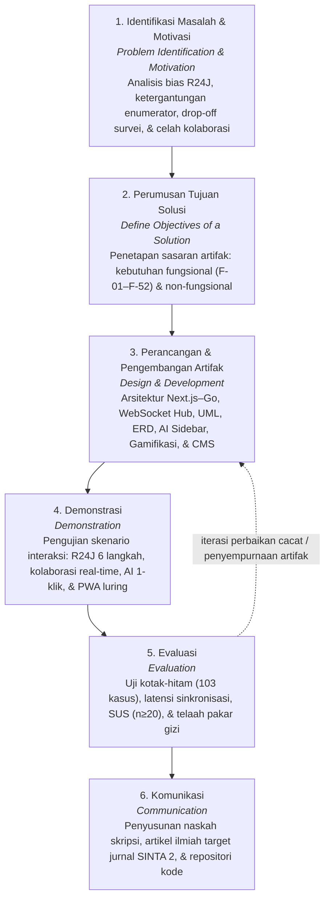

Panah putus-putus dari tahap Evaluasi kembali ke Perancangan & Pengembangan menunjukkan siklus iterasi desain (*design iteration loop*) yang dijalankan ketika pengujian menemukan ketidaksesuaian atau cacat sistem, sebagaimana dibuktikan oleh penemuan dan perbaikan sebelas cacat pada Subbab 4.3.

**Tabel 3.1 Tahapan DSRM, aktivitas penelitian, dan luaran yang dihasilkan**

| Tahap DSRM | Aktivitas Penelitian | Luaran |
|---|---|---|
| **1. Identifikasi Masalah & Motivasi**<br/>(*Problem Identification & Motivation*) | Mengidentifikasi hambatan R24J (bias porsi, biaya enumerator, jeda umpan balik, dan kebosanan/drop-off responden); menganalisis literatur CSCW, LLM gizi, dan keterbatasan sistem pembanding (ASA24, Intake24, myfood24); menetapkan nilai ilmiah solusi. | Bab I (Latar Belakang & Rumusan Masalah) dan Bab II (Tinjauan Pustaka & SOTA) |
| **2. Perumusan Tujuan Solusi**<br/>(*Define Objectives of a Solution*) | Menurunkan sasaran artifak dari analisis masalah: rancangan sistem R24J terkomputerisasi dengan kolaborasi real-time bergaya Figma, kontrol peran *fail-closed*, Asisten AI kontekstual URT, gamifikasi/leaderboard, serta dukungan *offline-first*. | Tabel 3.2 (Kebutuhan Fungsional F-01 s.d. F-52) dan Tabel 3.3 (Kebutuhan Non-Fungsional NF-01 s.d. NF-16) |
| **3. Perancangan & Pengembangan**<br/>(*Design & Development*) | Merancang arsitektur sistem decoupled Next.js–Go, pemodelan berorientasi objek (Use Case, Activity, Sequence, Class Diagram), perancangan skema basis data MySQL 8 (ERD), pengodean backend Go (Gin + WebSocket Hub), antarmuka Next.js App Router, integrasi Groq LLM, modul gamifikasi, dan CMS anotasi poligon. | Dokumen rancangan teknis (Gambar 3.2–3.11), basis data terstruktur, dan kode sumber artifak Atlas Food |
| **4. Demonstrasi**<br/>(*Demonstration*) | Mendemonstrasikan kapabilitas artifak melalui penelusuran skenario kasus penggunaan nyata: pengisian recall 6 langkah, pendampingan jarak jauh (kursor, follow mode, live canvas laser pointer), konsultasi porsi URT via Asisten AI Sidebar 1-klik, perolehan XP dan pembaruan leaderboard, serta pengiriman saat luring dengan sinkronisasi idempoten. | Log demonstrasi skenario, rekaman penelusuran *end-to-end*, dan tangkapan layar antarmuka fungsional (Gambar 4.3–4.19) |
| **5. Evaluasi**<br/>(*Evaluation*) | Menguji dan mengukur kinerja artifak secara komprehensif: pengujian kotak-hitam (*black-box*) pada 103 kasus uji, pengukuran kinerja latensi real-time WebSocket, evaluasi kebergunaan pengguna melalui kuesioner *System Usability Scale* (SUS) (n ≥ 20), telaah pakar (*expert review*) oleh ahli gizi klinis terhadap keluaran LLM, serta resolusi cacat sistem. | Tabel hasil uji kotak-hitam (Tabel 4.5–4.8, 4.14), data metrik latensi, skor SUS, rekap validasi pakar, dan katalog perbaikan cacat (Tabel 4.9) |
| **6. Komunikasi**<br/>(*Communication*) | Mendiseminasikan prinsip desain, struktur artifak, kebaruan, dan efektivitas hasil penelitian kepada akademisi dan praktisi kesehatan/komputer melalui laporan akademik dan publikasi ilmiah. | Naskah Skripsi lengkap Bab I–V, draf artikel ilmiah target jurnal nasional terakreditasi SINTA 2 (*Atlas_Food_Spesifikasi_Sistem_Jurnal.md*), dan repositori publik kode sumber |

## 3.2 Populasi dan Sampel

### 3.2.1 Populasi Penelitian

Populasi penelitian dibagi menjadi tiga kelompok sesuai peran dalam sistem:

1. **Populasi responden survei** — individu dewasa berusia ≥ 17 tahun yang mampu mengoperasikan peramban web dan bersedia melaporkan asupan makanannya. `[⚠ SESUAIKAN: sebutkan populasi konkret, misalnya "mahasiswa Program Studi X Universitas Y angkatan 2022–2025 berjumlah N orang"]`
2. **Populasi pendamping/enumerator** — mahasiswa atau tenaga gizi yang berperan mendampingi pengisian secara jarak jauh. `[⚠ SESUAIKAN]`
3. **Populasi administrator** — pengelola basis data pangan dan survei. `[⚠ SESUAIKAN]`

### 3.2.2 Sampel Penelitian

| Kelompok | Jumlah minimal | Dasar penentuan |
|---|---|---|
| Partisipan Uji Internal (*Formative Usability Walkthrough*) | 5–7 orang | Menurut Lewis & Sauro (2021) dan Alhadreti (2021), pengujian kebergunaan formatif berbasis penelusuran tugas (*task walkthrough*) dengan 5–7 partisipan sudah mencapai titik efisiensi optimal (*point of diminishing returns*) yang mampu mengungkap 80%–85% cacat interaksi antarmuka dan friksi alur pengisian sebelum evaluasi sumatif lapangan. Faulkner (2003) juga membuktikan secara empiris bahwa 5 partisipan menemukan rerata 85,5% masalah kebergunaan dan kelompok 6–7 partisipan mengidentifikasi >90% masalah kritis |
| Responden survei (UAT) | 20 orang | Tullis & Stetson (2004) menemukan bahwa sedikitnya 12–14 responden diperlukan agar hasil kuesioner kebergunaan cukup andal; pada n = 12, SUS menghasilkan kesimpulan yang sama dengan seluruh data pada ≥ 90% sub-sampel. n = 20 melampaui ambang tersebut |
| Pendamping/enumerator | 5 orang | Pengujian fitur kolaborasi memerlukan minimal 2 peserta per sesi; 5 memungkinkan variasi kombinasi peran |
| Administrator | 3 orang | Cukup untuk menguji seluruh modul CRUD dan CMS anotasi |
| Ahli gizi (penilai keluaran AI) | 2–3 orang | Memungkinkan perhitungan kesepakatan antar-penilai |

`[⚠ SESUAIKAN jumlah sebenarnya setelah pengambilan data]`

### 3.2.3 Teknik Pengambilan Sampel

Teknik yang digunakan adalah ***purposive sampling***, yaitu pemilihan sampel berdasarkan kriteria tertentu yang relevan dengan tujuan penelitian. Kriteria inklusi:

- **Responden:** berusia ≥ 17 tahun; memiliki perangkat dengan peramban modern dan koneksi internet; bersedia mengisi *recall* minimal satu kali; menandatangani lembar persetujuan (*informed consent*).
- **Pendamping:** memiliki latar belakang gizi atau pernah mengikuti pelatihan R24J; mampu mengoperasikan aplikasi web.
- **Ahli gizi penilai:** berlatar pendidikan minimal S1 Gizi dan memiliki pengalaman praktik `[⚠ SESUAIKAN kriteria]`.

Kriteria eksklusi: peserta yang tidak menyelesaikan seluruh rangkaian tugas pengujian, dan peserta dengan gangguan yang menghalangi penggunaan antarmuka web tanpa alat bantu yang tersedia.

## 3.3 Alat dan Bahan Penelitian

**Tabel 3.1 Alat dan bahan penelitian**

| Kategori | Komponen | Spesifikasi/Versi | Fungsi |
|---|---|---|---|
| Perangkat keras | Komputer pengembangan | `[⚠ ISI spesifikasi: prosesor, RAM, sistem operasi]` | Pengodean dan pengujian |
| | Perangkat uji | Laptop dan telepon pintar `[⚠ ISI]` | Uji responsivitas & UAT |
| Perangkat lunak — antarmuka | Next.js (App Router) | Terbaru | Kerangka kerja aplikasi web |
| | React + TypeScript | — | Pustaka antarmuka & bahasa bertipe |
| | Tailwind CSS | v4 | Penataan gaya berbasis *design token* |
| | Zustand | v5 | Pengelolaan keadaan kolaborasi |
| | TanStack Query | — | Pengelolaan keadaan server |
| | Zod + React Hook Form | — | Validasi formulir admin |
| | lucide-react | — | Pustaka ikon |
| | Dexie | v4 | Pembungkus IndexedDB untuk antrean laporan luring |
| | *Service Worker* + *Web App Manifest* | API peramban | *Cache* kerangka aplikasi dan aset; pemasangan PWA |
| | uuid | — | Pembangkit kunci idempotensi (`local_id`) |
| | Canvas 2D API | API peramban | Perenderan kanvas langsung di atas foto porsi |
| Perangkat lunak — layanan | Go | 1.22 | Bahasa pemrograman layanan |
| | Gin | 1.9.1 | Kerangka kerja HTTP |
| | gorilla/websocket | 1.5.3 | Implementasi WebSocket |
| | GORM + driver MySQL | 1.30 / 1.5.7 | Pemetaan objek-relasional |
| | golang-jwt/jwt | v5 | Autentikasi berbasis token |
| | bcrypt (`golang.org/x/crypto`) | — | *Hashing* kata sandi |
| | gin-metrics | 0.1.13 | Ekspor metrik HTTP dalam format Prometheus |
| Basis data | MySQL | 8.x, InnoDB, utf8mb4 | Penyimpanan data |
| Layanan eksternal | Groq API | Model bawaan `llama-3.3-70b-versatile` (dapat dikonfigurasi) | Pembangkitan rekomendasi gizi |
| Pemantauan & penyebaran | Docker Compose, Prometheus, Grafana | — | Penyebaran layanan dan pemantauan metrik |
| Perkakas | Visual Studio Code, Git, Postman | — | Pengodean, versi, uji API |
| Bahan | Tabel komposisi pangan | Tabel Komposisi Pangan Indonesia (TKPI) 2020 (Kementerian Kesehatan Republik Indonesia, 2020) (sementara) | Sumber nilai zat gizi acuan (energi, protein, lemak, karbohidrat per 100 g BDD) |
| | Foto porsi *as served* (tipe `series` & `range`) | Terinspirasi Atlas Makananku (BRIN × UPI) | Estimasi porsi visual |
| | Instrumen SUS | Brooke (1996), 10 butir | Pengukuran kebergunaan |

## 3.4 Metode Pengumpulan Data

| Teknik | Sumber | Data yang diperoleh | Tahap DSRM |
|---|---|---|---|
| Studi literatur | Artikel jurnal, dokumentasi resmi, RFC | Landasan teori, celah penelitian, praktik baku | 1 (Identifikasi Masalah) |
| Analisis sistem sejenis | ASA24, Intake24, myfood24 (berdasarkan publikasi) | Perbandingan fitur (Tabel 2.1) | 1 & 2 (Tujuan Solusi) |
| Observasi & pengujian mandiri | Sistem yang dibangun | Hasil uji kotak-hitam, penelusuran skenario, temuan cacat | 4 & 5 (Demonstrasi & Evaluasi) |
| Instrumentasi perangkat lunak | *Log* aplikasi, tabel `ai_result_logs`, `/collab/stats` | Latensi, jumlah token, *throughput* | 5 (Evaluasi) |
| Kuesioner | Responden & pendamping | Skor SUS, umpan balik kualitatif | 5 (Evaluasi) |
| Penilaian pakar | Ahli gizi | Kelayakan klinis keluaran LLM | 5 (Evaluasi) |

Catatan metodologis: sebagian data kinerja **tidak memerlukan instrumentasi tambahan** karena sistem sudah merekamnya secara rutin — tabel `ai_result_logs` menyimpan `model_used`, `token_used`, dan `latency_ms` untuk setiap analisis yang benar-benar dijalankan, sehingga evaluasi dapat dilakukan terhadap keluaran yang sungguh diterima responden.

## 3.5 Analisis Kebutuhan

### 3.5.1 Kebutuhan Fungsional

**Tabel 3.2 Kebutuhan fungsional sistem**

| Kode | Kebutuhan | Aktor | Prioritas |
|---|---|---|---|
| F-01 | Sistem dapat mendaftarkan dan mengautentikasi pengguna dengan peran admin atau responden | Semua | Wajib |
| F-02 | Sistem dapat menampilkan daftar survei berstatus aktif | Responden | Wajib |
| F-02a | Sistem menyediakan katalog makanan (*Find Your Food*) di luar alur survei untuk mencari makanan dan melihat foto porsi interaktif; data dilayani *endpoint* `/public/*` tanpa token ⚠ | Pengguna katalog | Wajib |
| F-02b | Halaman *Find Your Food* menampilkan 13 kategori makanan dan mendukung pencarian *full-text* minimal 3 karakter | Pengguna katalog | Wajib |
| F-02c | Halaman detail makanan menampilkan foto porsi sesuai `photo_type` (`series` dengan deret *thumbnail* A–H, atau `range` berupa satu foto panduan berlabel), tabel berat per foto, dan informasi gizi per 100 g | Pengguna katalog | Wajib |
| F-02d | Pengguna katalog dapat menandai makanan sebagai tersimpan (*bookmark*) di perambannya | Pengguna katalog | Opsional |
| F-03 | Sistem dapat mendaftarkan responden sebagai partisipan survei dan menerbitkan token akses | Responden | Wajib |
| F-04 | Sistem dapat menampilkan pilihan waktu makan sesuai konfigurasi survei beserta jam bawaan | Responden | Wajib |
| F-05 | Sistem dapat mencari makanan dan minuman berdasarkan kata kunci minimal tiga karakter | Responden | Wajib |
| F-06 | Sistem dapat mencatat makanan yang tidak ditemukan di basis data sebagai catatan manual | Responden | Wajib |
| F-07 | Sistem dapat menampilkan foto porsi *as served* beserta beratnya dan menerima pilihan responden | Responden | Wajib |
| F-08 | Sistem dapat menerima masukan berat porsi manual dengan batas maksimal 5.000 gram | Responden | Wajib |
| F-09 | Sistem dapat mencatat bahan tambahan beserta takaran dan satuannya | Responden | Opsional |
| F-10 | Sistem dapat menghitung nilai gizi per porsi dan total harian untuk energi, protein, karbohidrat, dan lemak | Sistem | Wajib |
| F-11 | Sistem dapat menampilkan ringkasan laporan sebelum pengiriman | Responden | Wajib |
| F-12 | Sistem dapat memvalidasi kelengkapan laporan sebelum pengiriman | Sistem | Wajib |
| F-13 | Sistem dapat menyimpan laporan *recall* ke basis data | Sistem | Wajib |
| F-14 | Sistem dapat menyimpan progres pengisian sehingga tidak hilang saat halaman dimuat ulang | Sistem | Wajib |
| F-15 | Sistem dapat membuat ruang kolaborasi untuk sesi *recall* | Sistem | Wajib |
| F-16 | Sistem dapat menampilkan daftar peserta yang sedang aktif di ruang | Semua | Wajib |
| F-17 | Sistem dapat menampilkan kursor peserta lain secara real-time | Semua | Wajib |
| F-18 | Sistem dapat menyelaraskan posisi gulir, halaman, **dan langkah *wizard*** peserta yang diikuti | Semua | Wajib |
| F-19 | Sistem dapat menerbitkan tautan undangan berperan *editor* atau *viewer* dengan masa berlaku terbatas | Pemilik ruang | Wajib |
| F-20 | Sistem dapat mencegah peserta berperan *viewer* mengubah data melalui antarmuka, klien, maupun server | Sistem | Wajib |
| F-21 | Sistem dapat menampilkan umpan aktivitas peserta di ruang | Semua | Opsional |
| F-22 | Sistem dapat mengunci entitas yang sedang disunting dan menampilkan penyuntingnya | Admin | **Tidak jadi lingkup v1** ⚠ |
| F-23 | Sistem dapat menjalankan analisis gizi berbasis LLM atas satu laporan | Responden | Wajib |
| F-24 | Sistem dapat menyimpan hasil analisis beserta model, jumlah token, dan latensi | Sistem | Wajib |
| F-25 | Sistem dapat menyajikan hasil analisis tersimpan tanpa memanggil ulang LLM | Sistem | Wajib |
| F-26 | Sistem dapat menangani keluaran LLM yang tidak sesuai skema tanpa merusak halaman | Sistem | Wajib |
| F-27 | Sistem dapat mengelola (CRUD) survei beserta konfigurasi waktu makannya | Admin | Wajib |
| F-28 | Sistem dapat mengelola (CRUD) makanan, kategori, dan zat gizi | Admin | Wajib |
| F-29 | Sistem dapat mengelola set foto porsi *as served* beserta berat gramnya | Admin | Wajib |
| F-30 | Sistem dapat menganotasi foto makanan dengan poligon area dan menautkannya ke entri makanan | Admin | Wajib |
| F-31 | Sistem dapat menerbitkan dan menarik terbit anotasi (siklus *draft*–*published*) | Admin | Wajib |
| F-32 | Sistem dapat menampilkan dan mengekspor daftar *submission* per survei | Admin | Wajib |
| F-33 | Sistem dapat menyimpan progres penyuntingan anotasi secara otomatis (*autosave*) | Admin | Wajib |
| F-34 | Sistem dapat mengantrekan laporan di peramban ketika pengiriman dilakukan tanpa koneksi atau koneksi putus di tengah pengiriman | Sistem | Wajib |
| F-35 | Sistem dapat menyinkronkan antrean laporan secara otomatis saat koneksi pulih, serta atas permintaan pengguna | Sistem / Responden | Wajib |
| F-36 | Sistem dapat mencegah laporan tersimpan ganda akibat pengiriman ulang, melalui kunci idempotensi | Sistem | Wajib |
| F-37 | Sistem dapat menampilkan status koneksi dan jumlah laporan yang belum tersinkron | Responden | Wajib |
| F-38 | Sistem dapat dipasang sebagai aplikasi (PWA) dan memuat kerangka halamannya tanpa koneksi | Responden | Opsional |
| F-39 | Sistem dapat menghitung ulang nilai gizi laporan di server dari basis data pangan dan menetapkan partisipan dari identitas login, bukan dari kiriman klien | Sistem | Wajib |
| F-40 | Peserta berperan *owner*/*editor* dapat menggambar di atas foto porsi (pensil, persegi, lingkaran, penghapus) dan coretannya tampil pada seluruh peserta ruang | Responden, Pendamping | Opsional |
| F-41 | Peserta berperan *owner*/*editor* dapat menggunakan penunjuk laser yang memudar otomatis | Responden, Pendamping | Opsional |
| F-42 | Peserta yang bergabung belakangan menerima coretan kanvas yang masih aktif di ruang | Sistem | Opsional |
| F-43 | Peserta dapat mengirim pesan singkat yang menempel pada kursornya (obrolan kursor) | Semua | Opsional |
| F-44 | Pemilik ruang dapat mengubah peran peserta menjadi *editor* atau *viewer* selama sesi berlangsung | Pemilik ruang | **Sebagian** ⚠ |
| F-45 | Pengguna dapat melihat dan mengubah profil (nama, telepon, jenis kelamin, tanggal lahir, foto) serta mengganti kata sandi | Semua | Wajib |
| F-46 | Responden dapat melihat riwayat dan rincian laporan miliknya sendiri | Responden | Wajib |
| F-47 | Admin dapat mengunggah gambar (JPG, PNG, WebP; maksimal 10 MB) untuk makanan dan porsi | Admin | Wajib |
| F-48 | Admin dapat menggandakan survei dan menerbitkan ulang token akses survei | Admin | Opsional |
| F-49 | Sistem menyediakan Asisten AI percakapan interaktif (*Atlas AI Sidebar*) per langkah recall untuk membantu konsultasi porsi URT, probing bahan makanan, dan verifikasi | Responden | Wajib |
| F-50 | Respon Asisten AI menyertakan tombol chip aksi 1-klik yang langsung menerapkan pilihan porsi/makanan ke formulir tanpa input manual | Responden | Wajib |
| F-51 | Sistem mencatat perolehan poin pengalaman (XP) pengisian dan pelacakan hari konsistensi (*daily streak*) saat responden menyelesaikan tahapan survei | Sistem / Responden | Wajib |
| F-52 | Sistem menyajikan papan peringkat (*leaderboard*) partisipan berbasis survei untuk mendorong retensi dan keterlibatan kompetitif yang sehat | Responden | Wajib |

> **Catatan status F-02a.** *Endpoint* `/public/*` memang tidak mensyaratkan token. Namun pada kode versi 1, rute halaman `/find-food` terdaftar sebagai rute terlindung pada `middleware.ts`, dan kotak pencarian di halaman beranda mengarahkan pengunjung ke halaman login terlebih dahulu. Dengan kata lain, **datanya publik, halamannya belum**. Lihat keputusan yang perlu diambil pada Subbab 4.1.4.

> **Catatan status F-44.** Layanan sudah menangani pesan `update_user_role` (hanya diterima dari *owner*, hanya ke peran *editor*/*viewer*), memperbarui seluruh koneksi aktif milik peserta sasaran, dan menyiarkan `user_role_updated`; klien pun sudah menerapkan perubahan itu saat diterima. Yang belum ada adalah kontrol antarmuka untuk mengirimnya. F-44 tidak disertakan dalam perhitungan tingkat keberhasilan pengujian.

> **Catatan status F-22.** Kebutuhan penguncian entitas **tidak diwujudkan sebagai fitur v1**. Mekanismenya tersedia pada lapis layanan (`LockManager` di sisi Go dan tipe pesan `db_edit_*` pada protokol) serta komponen penanda `LockIndicator` di sisi antarmuka, namun **belum ada satu pun halaman portal admin yang mengaktifkannya** — sesi kolaborasi (`CollabSession`) hanya dipasang pada halaman *recall* dan pencarian makanan. F-22 karena itu dinyatakan sebagai kebutuhan yang teridentifikasi tetapi ditangguhkan, dan dicatat pada Subbab 5.2.1 sebagai saran pengembangan. Kebutuhan ini **tidak** disertakan dalam perhitungan tingkat keberhasilan pengujian pada Subbab 4.2.

### 3.5.2 Kebutuhan Non-Fungsional

**Tabel 3.3 Kebutuhan non-fungsional sistem**

| Kode | Kategori | Kebutuhan | Kriteria keberhasilan |
|---|---|---|---|
| NF-01 | Kinerja | Latensi sinkronisasi kursor antar peserta | ≤ 300 ms pada jaringan lokal `[⚠ VERIFIKASI]` |
| NF-02 | Kinerja | Latensi sinkronisasi langkah *wizard* | ≤ 500 ms `[⚠ VERIFIKASI]` |
| NF-03 | Kinerja | Sistem menahan beban pesan tanpa kehilangan data | Tidak ada *drop* pada ≤ 50 pesan/detik/klien |
| NF-04 | Kinerja | Waktu tanggap analisis LLM | ≤ 60 detik (batas waktu klien) |
| NF-05 | Keandalan | Sistem memulihkan koneksi otomatis setelah putus | Rekoneksi berhasil dengan *backoff* maksimal 30 detik |
| NF-06 | Keandalan | Progres pengisian tidak hilang saat halaman dimuat ulang | Sesi bertahan hingga 24 jam |
| NF-07 | Keandalan | Kegagalan analisis LLM tidak merusak alur utama | Halaman hasil tetap tampil dengan pesan galat |
| NF-08 | Keamanan | Seluruh *endpoint* selain publik memerlukan autentikasi | 401 untuk permintaan tanpa token |
| NF-09 | Keamanan | Peran *viewer* tidak dapat mengubah data melalui jalur mana pun | Ditolak pada tiga lapis |
| NF-10 | Keamanan | Peran tidak dapat dinaikkan melalui navigasi ulang tanpa parameter undangan | Peran diingat server per pengguna |
| NF-11 | Kebergunaan | Sistem memperoleh skor SUS kategori *acceptable* | Skor ≥ 68 (rerata acuan SUS; Hyzy et al., 2022) |
| NF-12 | Kebergunaan | Antarmuka dapat digunakan pada layar telepon pintar | Tidak ada gulir horizontal pada lebar 360 px |
| NF-13 | Aksesibilitas | Kontrol yang dinonaktifkan tetap terbaca pembaca layar sebagai nonaktif | Atribut `aria-disabled`/`inert` terpasang |
| NF-14 | Pemeliharaan | Kode terorganisasi per domain bisnis | Tidak ada ketergantungan melingkar antar domain |
| NF-15 | Pemeliharaan | Kode lolos pemeriksaan tipe dan *linter* | `tsc --noEmit` dan `eslint` bersih |
| NF-16 | Keandalan | Laporan yang dikirim saat luring tidak hilang dan tidak berganda | Setiap laporan antre tepat satu kali tersimpan di server setelah koneksi pulih |
| NF-17 | Keandalan | Antrean luring tidak macet akibat sesi yang terputus di tengah sinkronisasi | Item berstatus `SYNCING` yang usang dipulihkan menjadi `PENDING` saat aplikasi dibuka |
| NF-18 | Keamanan | Koneksi WebSocket dan permintaan lintas-asal hanya diterima dari asal yang terdaftar | Asal di luar daftar putih ditolak pada CORS dan pada *handshake* WebSocket |
| NF-19 | Keamanan | Kata sandi tidak disimpan dalam bentuk asli | Tersimpan sebagai *hash* bcrypt |
| NF-20 | Observabilitas | Metrik layanan dapat dipantau | *Endpoint* `/metrics` berformat Prometheus dan `/health` tersedia |

## 3.6 Perancangan Sistem

### 3.6.1 Arsitektur Sistem

**Gambar 3.2 Arsitektur sistem Atlas Food**

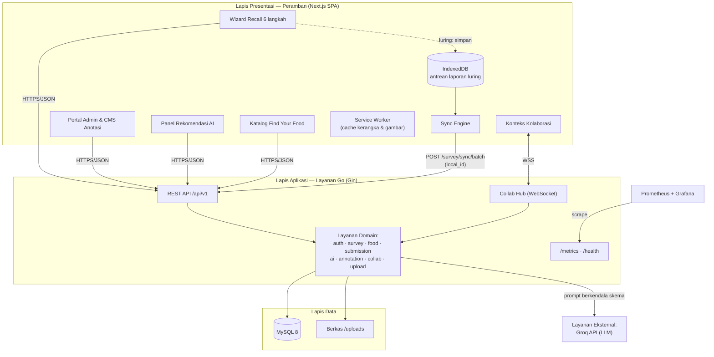

Sistem menerapkan arsitektur **tiga lapis** dengan pemisahan tegas antara presentasi, aplikasi, dan data. Layanan Go menyediakan dua kanal komunikasi dalam satu proses: REST untuk operasi permintaan–tanggapan dan WebSocket untuk komunikasi dua arah real-time.

Struktur kode kedua sisi disusun **per domain bisnis** (*domain-driven modular*), bukan per jenis berkas, sehingga setiap fitur dapat ditelusuri sebagai satu unit. Di sisi layanan, tiap domain memuat `model.go`, `dto.go`, `repository.go`, `service.go`, dan `handler.go`. Di sisi antarmuka, tiap domain memuat `components/`, `hooks/`, `services/`, `store/`, dan `types/`. Aturan ketergantungan bersifat searah: `app/` → `internal/domain/*` → `internal/lib|pkg`, tanpa ketergantungan melingkar antar domain (memenuhi NF-14).

### 3.6.2 *Use Case Diagram*

**Tabel 3.4 Definisi aktor sistem**

| Aktor | Deskripsi |
|---|---|
| Responden | Pengguna yang mengisi laporan *recall* atas dirinya sendiri |
| Pendamping | Responden lain yang diundang ke ruang kolaborasi dengan peran *editor* atau *viewer* |
| Administrator | Pengelola survei, basis data pangan, dan aset anotasi |
| Sistem LLM | Aktor sistem eksternal yang menghasilkan rekomendasi gizi |

**Gambar 3.3 *Use case diagram* sistem**

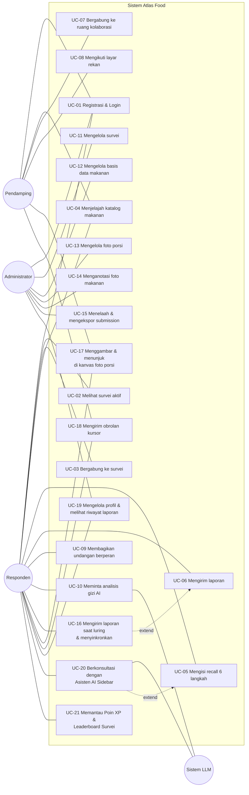

### 3.6.3 Skenario *Use Case*

**Tabel 3.5 Skenario *use case* UC-05 (Mengisi recall)**

| Bagian | Uraian |
|---|---|
| **Kode / Nama** | UC-05 / Mengisi *recall* enam langkah |
| **Aktor** | Responden |
| **Deskripsi** | Responden mencatat seluruh konsumsi pada satu waktu makan hingga siap dikirim |
| **Prakondisi** | Responden sudah masuk sebagai partisipan survei dan memiliki token akses |
| **Pascakondisi** | Laporan tersimpan di sesi lokal dan siap dikirim |
| **Alur utama** | 1. Sistem menampilkan pilihan waktu makan sesuai `meals_config`<br/>2. Responden memilih jenis waktu makan dan menyetel jam<br/>3. Sistem berpindah ke langkah tambah makanan<br/>4. Responden mengetik kata kunci minimal tiga karakter<br/>5. Sistem menampilkan hasil pencarian<br/>6. Responden memilih makanan; sistem menambahkannya ke daftar<br/>7. Responden mengulangi langkah 4–6 untuk seluruh item<br/>8. Sistem berpindah ke langkah porsi<br/>9. Responden memilih foto porsi atau mengisi berat manual untuk tiap makanan<br/>10. Sistem menghitung nilai gizi tiap porsi secara deterministik (TKPI 2020)<br/>11. Responden mengisi bahan tambahan (opsional)<br/>12. Sistem menampilkan ringkasan dan total gizi harian<br/>13. Responden menekan "Kirim laporan" dan sistem memberikan penambahan poin XP |
| **Alur alternatif A1** | Pada langkah 5, hasil pencarian kosong → sistem menawarkan pencatatan manual → item masuk `missing_foods` dan ditampilkan terpisah dengan penanda "tanpa nilai gizi" |
| **Alur alternatif A2** | Pada langkah 9, responden bingung taksiran URT → membuka Asisten AI Sidebar (UC-20) → AI menganalisis deskripsi porsi → responden menekan tombol chip porsi saran AI → porsi otomatis terpilih |
| **Alur alternatif A3** | Pada langkah 9, pemuatan foto porsi gagal → sistem menampilkan galat dan responden tetap dapat mengisi berat manual |
| **Alur alternatif A3** | Pada langkah 12, responden menekan "Tambah waktu makan" → sistem kembali ke langkah 1 dengan mempertahankan data waktu makan sebelumnya dan mengatur ulang indeks porsi |
| **Alur pengecualian E1** | Validasi gagal (tidak ada waktu makan terisi, atau ada porsi bernilai nol) → tombol kirim dinonaktifkan disertai pesan sebab |
| **Alur pengecualian E2** | Pengiriman ke server gagal → sistem menampilkan pesan galat dan mempertahankan seluruh isian |

**Tabel 3.6 Skenario *use case* UC-08 (Mengikuti layar rekan)**

| Bagian | Uraian |
|---|---|
| **Kode / Nama** | UC-08 / Mengikuti layar rekan (*follow mode*) |
| **Aktor** | Pendamping |
| **Deskripsi** | Pendamping menyelaraskan tampilannya dengan peserta lain, termasuk langkah *wizard* aktif |
| **Prakondisi** | Pendamping berada di ruang kolaborasi yang sama dan koneksi berstatus tersambung |
| **Pascakondisi** | Tampilan pendamping mengikuti halaman, posisi gulir, dan langkah pemimpin |
| **Alur utama** | 1. Pendamping menekan avatar peserta yang ingin diikuti<br/>2. Sistem mengirim `follow_user`<br/>3. *Hub* menetapkan pemimpin dan memberitahu kedua pihak melalui `follow_started`<br/>4. *Hub* menyiarkan `follow_state` ke seluruh ruang<br/>5. *Hub* mengirim *viewport* terakhir pemimpin yang tersimpan<br/>6. Sistem memindahkan pendamping ke halaman, posisi gulir, dan **langkah** pemimpin<br/>7. Setiap perubahan pemimpin dikirim sebagai `viewport_update` dan diteruskan sebagai `viewport_sync` hanya kepada pengikutnya |
| **Alur alternatif A1** | Pendamping menekan "Stop following" → sistem mengirim `unfollow_user` dan penyelarasan berhenti |
| **Alur alternatif A2** | Pemimpin meninggalkan ruang → sistem menghapus status ikut dan mengosongkan *viewport* pemimpin |
| **Alur pengecualian E1** | Pendamping mencoba mengikuti dirinya sendiri → permintaan ditahan di klien sebelum dikirim |
| **Alur pengecualian E2** | Pengguna target tidak ada di ruang → *hub* mengirim galat `NOT_FOUND` |
| **Aturan khusus** | Selama mengikuti, pendamping berhenti menyiarkan kursor dan pencariannya sendiri, serta tidak memantulkan balik langkah pemimpin, untuk mencegah *loop* pemantulan |

`[⚠ LENGKAPI skenario untuk UC-01 s.d. UC-15 dengan format yang sama bila pembimbing meminta seluruhnya]`

### 3.6.4 *Activity Diagram*

**Gambar 3.4 *Activity diagram* pengisian recall**

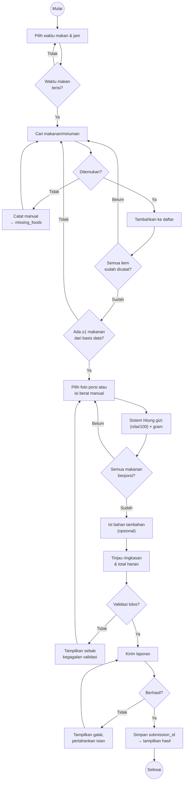

**Gambar 3.5 *Activity diagram* sesi kolaborasi**

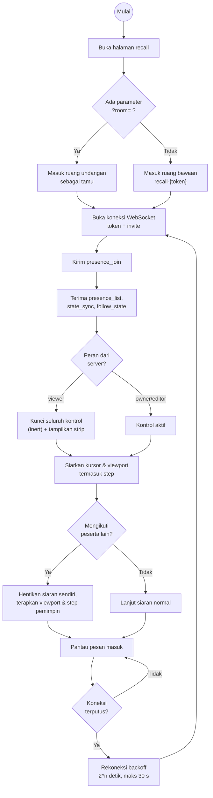

### 3.6.5 *Sequence Diagram*

**Gambar 3.6 *Sequence diagram* pengisian hingga analisis AI**

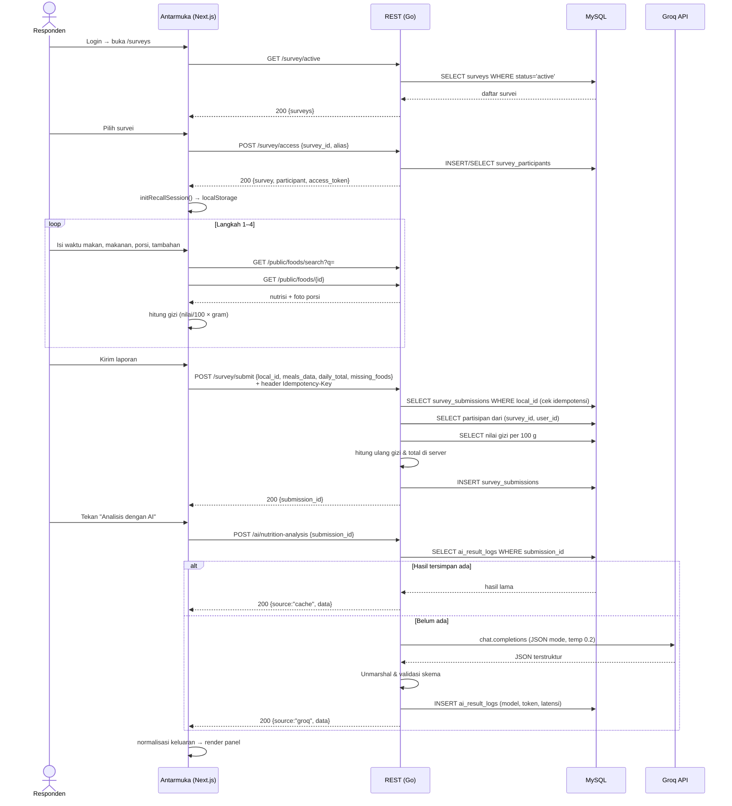

**Gambar 3.7 *Sequence diagram* mode ikut dan sinkronisasi langkah**

```mermaid
sequenceDiagram
    participant P as Pendamping (pengikut)
    participant H as Collab Hub
    participant R as Responden (pemimpin)

    Note over P,R: Keduanya sudah tersambung ke ruang yang sama
    P->>H: follow_user {user_id: R}
    H->>H: set FollowingUserID
    H-->>P: follow_started {leader_id, leader_name, leader_color}
    H-->>R: follow_started (pemberitahuan diikuti)
    H-->>P: follow_state (snapshot graf ikut)
    H-->>R: follow_state
    H-->>P: viewport_sync (viewport tersimpan terakhir, termasuk step)
    P->>P: Terapkan halaman + gulir + goToStep(step)

    Note over R: Responden berpindah dari langkah 2 ke 3
    R->>H: viewport_update {page, path, scroll, step:"portion"}
    H->>H: Simpan Viewport terakhir R (replace)
    H-->>P: viewport_sync {…, step:"portion"}
    P->>P: Validasi step terhadap daftar langkah sah
    P->>P: goToStep("portion")

    Note over R: Responden menggulir halaman
    R->>H: viewport_update {scroll, step:"portion"}
    Note right of R: step WAJIB disertakan;<br/>tanpa itu viewport tersimpan<br/>kehilangan jejak langkah
    H-->>P: viewport_sync
    P->>H: unfollow_user
    H-->>P: follow_stopped
```

**Gambar 3.11 *Sequence diagram* pengiriman luring dan sinkronisasi idempoten**

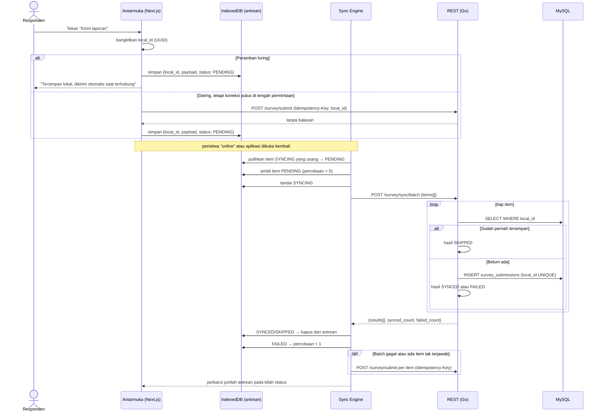

Dua jalur masuk ke antrean pada diagram di atas sengaja dibedakan. Jalur kedua — koneksi putus **setelah** permintaan dikirim — adalah kasus yang menuntut idempotensi: laporan mungkin sudah tersimpan di server, sehingga pengiriman ulang tanpa `local_id` akan menghasilkan duplikat.

### 3.6.6 Diagram Keadaan *Wizard*

**Gambar 3.10 Diagram keadaan *wizard* enam langkah**

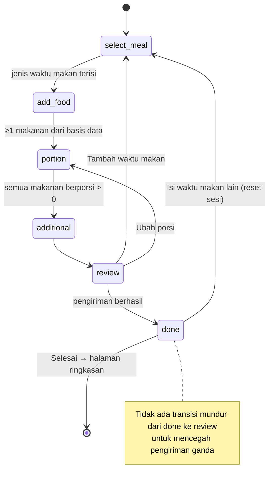

Pemetaan enam langkah ini terhadap metode lintasan berganda (Subbab 2.1): langkah 1–2 setara lintasan daftar cepat dan penggalian item terlupakan; langkah 3 setara lintasan rincian porsi; langkah 4 setara penggalian bahan; langkah 5 setara tinjauan akhir.

### 3.6.7 *Class Diagram*

**Gambar 3.8 *Class diagram* domain inti**

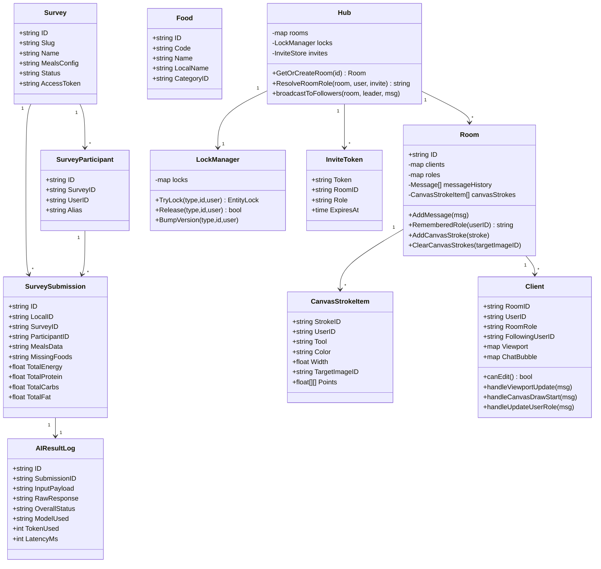

### 3.6.8 Perancangan Basis Data

**Gambar 3.9 *Entity Relationship Diagram***

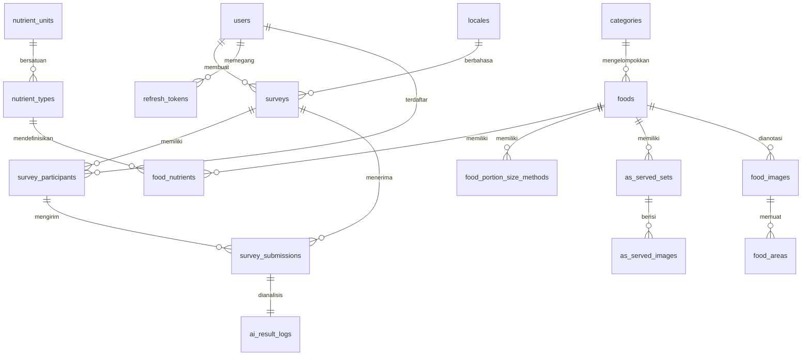

**Tabel 3.7 Struktur tabel basis data (ringkas)**

| Tabel | Kolom kunci | Keterangan |
|---|---|---|
| `users` | `id`, `email`, `password_hash`, `role`, `phone`, `gender`, `birth_date`, `photo_url` | `role` ∈ {admin, respondent}; empat kolom terakhir adalah data profil (migrasi 009) |
| `refresh_tokens` | `user_id`, *hash* token, masa berlaku | Token penyegar disimpan dalam bentuk *hash*, bukan nilai aslinya |
| `surveys` | `id`, `slug`, `meals_config` (JSON), `status`, `access_token`, `created_by` | `meals_config` menentukan pilihan waktu makan pada langkah 1 |
| `survey_participants` | `id`, `survey_id`, `user_id` (wajib), `alias` | Menautkan pengguna ke survei; partisipan anonim tidak didukung (migrasi 006) |
| `survey_submissions` | `id`, **`local_id` (UNIQUE)**, `survey_id`, `participant_id`, `meals_data` (JSON), `missing_foods` (JSON), `total_energy`, `total_protein`, `total_carbs`, `total_fat` | Laporan *recall* final; `local_id` adalah kunci idempotensi dari klien (migrasi 010) |
| `ai_result_logs` | `id`, `submission_id` (**UNIQUE**), `input_payload`, `raw_response`, `overall_status`, `model_used`, `token_used`, `latency_ms` | Hasil analisis + jejak audit |
| `categories` | `id`, `code`, `name`, `display_order` | Kategori makanan |
| `foods` | `id`, `code`, `name`, `local_name`, `category_id`, **`photo_type`** | Indeks **FULLTEXT** pada (`name`, `local_name`); `photo_type` ∈ {series, range} menentukan komponen visualisasi foto porsi |
| `nutrient_types`, `nutrient_units`, `food_nutrients` | — | Nilai zat gizi per 100 g bahan pangan (sementara merujuk data TKPI 2020) |
| `food_portion_size_methods` | `food_id`, `method_type`, `config` (JSON) | `method_type` ∈ {as_served, guide_image, weight} |
| `as_served_sets`, `as_served_images` | `set_id`, `weight_gram`, `image_url`, `label` | Aset foto porsi; `label` berupa kode A–H untuk tipe *series* |
| `food_images`, `food_areas` | `food_images`: `image_url`, `width`, `height`, `status` ∈ {draft, published, archived}, `primary_food_id`; `food_areas`: `polygon` (JSON), `food_id`, `z_index`, `weight_gram` | CMS anotasi; `weight_gram` per area (migrasi 011) memungkinkan satu foto panduan memuat berat tiap ukuran |
| `locales` | `code`, `name` | Multi-bahasa (id, en) |

**Penyimpanan sisi klien.** Selain basis data server, antarmuka memakai tiga tempat penyimpanan di peramban, masing-masing dengan peran berbeda:

| Penyimpanan | Isi | Masa hidup |
|---|---|---|
| `localStorage` | Sesi pengisian *wizard* (`RecallSession`) | 24 jam |
| IndexedDB (`AtlasFoodOfflineDB`, tabel `offlineQueue`) | Antrean laporan luring: `localId` (unik), `surveyId`, `payload`, `syncStatus`, `retryCount`, `lastAttemptAt`, `errorMessage` | Hingga tersinkron |
| *Cookie* | Token akses dan token penyegar; daftar *bookmark* katalog | 24 jam / 30 hari; 1 tahun |

Skema IndexedDB juga mendefinisikan tabel `cachedFoods` dan `surveyDrafts`, tetapi keduanya **belum dipakai** oleh kode mana pun pada versi 1 (lihat saran pada Subbab 5.2.1).

**Catatan migrasi basis data.** Skema dibangun melalui sebelas berkas migrasi bernomor (`001`–`011`). Kolom `photo_type ENUM('series', 'range') DEFAULT 'series'` dan indeks `FULLTEXT` pada (`name`, `local_name`) ditambahkan ke tabel `foods` melalui `007_update_foods_photo_type.sql`, sehingga nilai lama secara otomatis dianggap bertipe `series` tanpa pembaruan data massal. Pencarian pada *endpoint* publik menggunakan `MATCH(name, local_name) AGAINST(? IN BOOLEAN MODE)` untuk memanfaatkan indeks tersebut. Kata kunci pengguna dibersihkan lebih dahulu dari operator mode Boolean (`+ - > < ( ) ~ * : " & | @`) dan setiap kata dijadikan pencocokan awalan (`nasi*`); tanpa pembersihan ini, tanda kutip yang tidak berpasangan membuat MySQL melempar galat sintaks dan pencarian membalas 500. Karakter *wildcard* `%` dan `_` pada cabang `LIKE` juga di-*escape*.

**Justifikasi penggunaan kolom JSON.** Struktur satu laporan *recall* bersifat bersarang dan variatif: jumlah waktu makan, makanan, dan bahan tambahan berbeda tiap responden. Normalisasi penuh akan menghasilkan banyak tabel dengan *join* dalam untuk satu kali baca, padahal laporan **selalu dibaca sebagai satu kesatuan** dan tidak pernah dikueri per baris makanan. Total gizi tetap didenormalisasi ke kolom numerik agar agregasi lintas responden tetap murah. Konsekuensi metodologis yang menguntungkan: nilai gizi yang tersimpan merupakan *snapshot* pada saat pengisian, sehingga perubahan basis data makanan di kemudian hari tidak mengubah laporan historis.

### 3.6.9 Perancangan Antarmuka

`[⚠ LAMPIRKAN wireframe/mockup untuk: (1) halaman daftar survei, (2) enam layar wizard, (3) bilah kolaborasi + avatar kehadiran, (4) modal berbagi undangan, (5) panel rekomendasi AI, (6) dasbor admin, (7) editor anotasi]`

Prinsip perancangan antarmuka yang diterapkan:

1. **Satu keputusan per layar.** Setiap langkah *wizard* meminta satu jenis keputusan untuk menekan beban kognitif responden.
2. **Progres selalu terlihat.** Bilah progres, penomoran langkah, dan bilah samping menunjukkan posisi responden dalam alur.
3. **Umpan balik segera atas kegagalan.** Pencarian yang gagal, pemuatan porsi yang gagal, dan validasi yang tidak lolos ditampilkan sebagai pesan spesifik — bukan kegagalan senyap.
4. **Kolaborasi tidak mengganggu.** Elemen kolaborasi ditempatkan pada bilah terpisah di atas konten agar tidak menutupi alur pengisian.
5. **Keadaan terkunci terbaca jelas.** Peserta *viewer* memperoleh strip penjelas dan tampilan meredup, bukan kontrol yang diam-diam tidak berfungsi.

## 3.7 Teknik Pengujian

**Tabel 3.8 Instrumen pengujian dan teknik analisis**

| Jenis pengujian | Instrumen | Responden/Objek | Teknik analisis |
|---|---|---|---|
| Kotak-hitam | Tabel kasus uji berbasis kebutuhan fungsional F-01…F-48 (kecuali F-22 dan F-44) | Sistem | Persentase kasus uji berstatus "Sesuai" |
| Penelusuran *end-to-end* | Skenario alur lengkap responden dan pendamping | Sistem | Klasifikasi cacat berdasarkan jenis |
| Kinerja real-time | Instrumentasi waktu pada klien dan `/collab/stats` | 2, 5, 10, 20 klien | Statistik deskriptif: rerata, p50, p95 |
| Penerimaan pengguna | Kuesioner SUS 10 butir | ≥ 20 responden, ≥ 5 pendamping | Perhitungan skor SUS |
| Penilaian pakar | Lembar penilaian keluaran LLM | 2–3 ahli gizi | Rerata skor Likert + kesepakatan antar-penilai |

### 3.7.1 Pengujian Kotak-Hitam

Pengujian kotak-hitam menguji sistem dari sisi masukan dan keluaran tanpa memeriksa struktur internal. Setiap kebutuhan fungsional diturunkan menjadi satu atau lebih kasus uji dengan format: kode, skenario, masukan, hasil yang diharapkan, hasil yang diperoleh, dan status (Sesuai/Tidak Sesuai). Rancangan kasus uji disajikan pada Subbab 4.2.

Tingkat keberhasilan dihitung dengan:

$$\text{Tingkat keberhasilan} = \frac{\text{jumlah kasus uji berstatus Sesuai}}{\text{jumlah seluruh kasus uji}} \times 100\%$$

### 3.7.2 Pengujian Kinerja

Metrik yang diukur dan definisi operasionalnya:

| Metrik | Definisi operasional | Cara ukur |
|---|---|---|
| Latensi kursor | Selisih waktu antara `cursor_move` dikirim pemimpin dan `cursor_update` dirender pengikut | Sisipkan `t_send` pada muatan; catat `performance.now()` saat render |
| Latensi sinkronisasi langkah | Selisih waktu antara pemimpin berpindah langkah dan pengikut berada di langkah sama | Instrumentasi `viewport_update` → `goToStep` |
| *Throughput* *hub* | Pesan per detik yang dilayani tanpa *drop* | `/collab/stats` + penghitung *drop* pada buffer kirim |
| Skalabilitas | Latensi p50/p95 pada 2, 5, 10, 20 klien serentak | Klien sintetis WebSocket |
| Efektivitas *batching* | Rasio pesan kursor masuk terhadap pesan tersiar | Bandingkan penghitung sebelum dan sesudah *coalescing* |
| Waktu pemulihan | Waktu hingga status kembali "tersambung" setelah pemutusan paksa | Simulasi putus jaringan |

Rancangan pembanding yang digunakan adalah **dengan dan tanpa mekanisme *batching* + *coalescing*** pada beban identik. Rancangan ini menghasilkan klaim yang dapat dipertahankan tanpa perlu membandingkan dengan produk pihak ketiga yang kondisi ujinya tidak dapat dikendalikan.

### 3.7.3 Pengujian Penerimaan Pengguna

Instrumen yang digunakan adalah *System Usability Scale* (SUS) yang dikembangkan Brooke (1996), terdiri atas 10 pernyataan dengan skala Likert 1–5. Butir bernomor ganjil bernada positif dan bernomor genap bernada negatif.

Perhitungan skor:
1. Butir ganjil: skor = (nilai jawaban − 1)
2. Butir genap: skor = (5 − nilai jawaban)
3. Skor SUS = (jumlah seluruh skor) × 2,5

**Tabel 3.9 Interpretasi skor SUS**

| Rentang skor | Predikat | Tingkat penerimaan |
|---|---|---|
| > 80,3 | A — Excellent | Acceptable |
| 68–80,3 | B — Good | Acceptable |
| = 68 | C — Okay (batas) | Marginal |
| 51–67,9 | D — Poor | Marginal |
| < 51 | F — Awful | Not acceptable |

Nilai 68 dipakai sebagai batas karena merupakan rerata acuan SUS (SB 12,5). Meta-analisis atas 117 skor SUS dari 114 aplikasi kesehatan digital menyimpulkan bahwa acuan tersebut tetap sesuai untuk menilai aplikasi kesehatan digital (Hyzy et al., 2022). `[⚠ CANTUMKAN sumber pembagian predikat A–F pada Tabel 3.9 sesuai rujukan yang dipakai kampus/pembimbing — tabel ini belum bersitasi]`

Instrumen SUS versi bahasa Indonesia yang digunakan dilampirkan pada Lampiran B.

### 3.7.4 Pengujian Keluaran LLM

Tiga aspek diuji:

1. **Validitas skema** — persentase respons yang lolos penguraian JSON tanpa perbaikan, dari N laporan uji.
2. **Konsistensi** — laporan identik dianalisis ulang M kali dengan penyimpanan hasil dinonaktifkan; diukur kesamaan `overall_status` dan tumpang tindih `recommended_foods` menggunakan indeks Jaccard.
3. **Kelayakan klinis** — panel ahli gizi menilai relevansi dan keamanan rekomendasi pada skala Likert; kesepakatan antar-penilai dihitung dengan Cohen's/Fleiss' κ.

## 3.8 Jadwal Penelitian

**Tabel 3.10 Jadwal penelitian**

| No | Kegiatan | Bulan 1 | Bulan 2 | Bulan 3 | Bulan 4 | Bulan 5 | Bulan 6 |
|---|---|---|---|---|---|---|---|
| 1 | Studi literatur & analisis kebutuhan | ██ | ██ | | | | |
| 2 | Perancangan sistem | | ██ | ██ | | | |
| 3 | Implementasi backend | | | ██ | ██ | | |
| 4 | Implementasi frontend | | | ██ | ██ | ██ | |
| 5 | Pengujian kotak-hitam & perbaikan | | | | | ██ | |
| 6 | Pengujian kinerja & UAT | | | | | ██ | ██ |
| 7 | Penyusunan laporan | | | | ██ | ██ | ██ |

`[⚠ SESUAIKAN dengan jadwal sebenarnya]`

---
---

# BAB IV HASIL DAN PEMBAHASAN

## 4.1 Hasil Implementasi Sistem

Sistem berhasil diimplementasikan sesuai rancangan pada BAB III. Verifikasi teknis yang telah dijalankan: pemeriksaan tipe `tsc --noEmit` tanpa galat, proses `next build` berhasil, dan pemeriksaan `eslint` bersih pada seluruh berkas modul *recall*, kolaborasi, dan AI — memenuhi NF-15.

### 4.1.1 Implementasi Modul Responden

Modul ini diwujudkan sebagai *wizard* enam langkah dalam satu rute (`/surveys/{accessToken}/recall`) dengan keadaan langkah dikelola oleh *hook* `useRecallSession`.

**Pengelolaan keadaan.** Seluruh keadaan sesi disimpan dalam satu objek `RecallSession` yang memuat identitas survei, langkah aktif, waktu makan aktif, indeks porsi, daftar waktu makan beserta makanannya, daftar makanan yang tidak ditemukan, dan `submission_id`. Setiap mutasi menulis ulang objek tersebut ke `localStorage` dalam *envelope* `{savedAt, session}` ber-TTL 24 jam (memenuhi F-14 dan NF-06).

**Perhitungan gizi (F-10).** Diimplementasikan secara deterministik:

```
nilai_gizi_porsi = (nilai_per_100g ÷ 100) × berat_porsi_gram
```

dibulatkan satu desimal, kemudian diakumulasi menjadi total per waktu makan dan total harian.

**Perhitungan ulang di server (F-39).** Angka yang dihitung antarmuka berfungsi sebagai umpan balik segera bagi responden, tetapi **bukan** angka yang disimpan. Saat laporan diterima, layanan menghitung ulang nilai gizi setiap makanan dari nilai per 100 g di basis data dan berat porsi yang dilaporkan, lalu menyusun ulang total per waktu makan dan total harian (`calculateTotals`). Makanan yang tidak dikenali basis data memakai nilai kiriman klien apa adanya. Dengan cara yang sama, partisipan ditetapkan server dari pasangan (`survey_id`, identitas login), bukan dari `participant_id` kiriman klien, dan survei diperiksa masih berstatus aktif. Rancangan ini mencegah klien yang dimodifikasi mengirim angka gizi sembarang atau mengirim laporan atas nama partisipan lain.

**Validasi (F-12).** Tiga aturan ditegakkan sebelum pengiriman: `survey_id` harus ada; minimal satu waktu makan berisi makanan; seluruh makanan pada waktu makan terisi wajib memiliki `portion_gram > 0`.

`[⚠ LAMPIRKAN Gambar 4.3–4.8: tangkapan layar keenam langkah wizard]`

### 4.1.2 Implementasi Modul Kolaborasi

**Gambar 4.1 Topologi *hub*–*room*–*client***

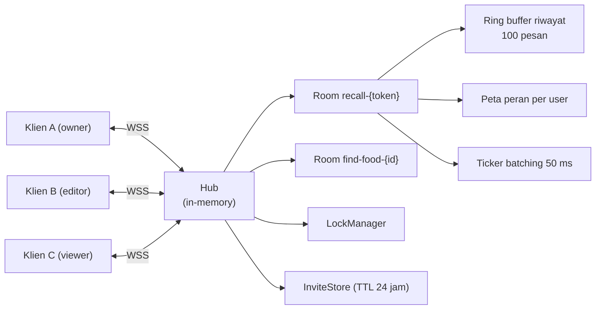

**Tabel 4.2 Protokol pesan WebSocket**

| Arah | Tipe pesan | Muatan utama | Mutasi data |
|---|---|---|---|
| K→S | `presence_join` | `user_id`, `display_name`, `role` | Tidak |
| K→S | `cursor_move` | `x`, `y`, `scroll_x`, `scroll_y`, `page` | Tidak |
| K→S | `viewport_update` | `page`, `path`, `scroll_x`, `scroll_y`, **`step`**, `zoom` | Tidak |
| K→S | `follow_user` / `unfollow_user` | `user_id` | Tidak |
| K→S | `food_search` | `query`, `filters` | **Ya** |
| K→S | `food_select` | `food_id`, `food_name` | **Ya** |
| K→S | `meal_add` | `meal_type`, `food_id`, `food_name` | **Ya** |
| K→S | `portion_set` | `food_id`, `portion_gram`, `image_label` | **Ya** |
| K→S | `review_submit` | `survey_id` | **Ya** |
| K→S | `db_edit_start/field/save/cancel` ⚠ | `entity_type`, `entity_id`, `version` | **Ya** |
| K→S | `canvas_draw_start` | `stroke_id`, `tool`, `color`, `width`, `target_image_id`, `x`, `y` | **Ya** |
| K→S | `canvas_draw_move` / `canvas_draw_end` | `stroke_id`, `points[]` | **Ya** |
| K→S | `canvas_laser_move` | `x`, `y`, `color`, `target_image_id` | **Ya** |
| K→S | `canvas_clear` | `target_image_id` (kosong = seluruh ruang) | **Ya** |
| K→S | `cursor_chat_open` / `cursor_chat_update` / `cursor_chat_close` | `x`, `y`, `text` | Tidak |
| K→S | `update_user_role` ⚠⚠ | `target_user_id`, `new_role` | Hanya *owner* |
| K→S | `get_history`, `ping` | — | Tidak |
| S→K | `presence_list`, `presence_joined`, `presence_left` | daftar/identitas peserta | — |
| S→K | `cursor_update`, `viewport_sync` | posisi, halaman, **langkah** | — |
| S→K | `follow_started`, `follow_stopped`, `follow_state` | relasi pemimpin–pengikut | — |
| S→K | `food_search_shared`, `food_selected`, `meal_updated`, `portion_updated` | siaran aktivitas | — |
| S→K | `db_locked`, `db_unlocked`, `db_edit_saved` | status kunci entitas | — |
| S→K | `canvas_stroke_started`, `canvas_stroke_updated`, `canvas_stroke_ended`, `canvas_laser_updated`, `canvas_cleared`, `canvas_state_sync` | coretan, laser, dan cuplikan kanvas bagi peserta yang baru bergabung | — |
| S→K | `cursor_chat_updated`, `cursor_chat_closed` | posisi jangkar, teks, warna, peran | — |
| S→K | `user_role_updated` | `target_user_id`, `new_role`, `changed_by` | — |
| S→K | `state_sync`, `history`, `activity_log`, `error`, `pong` | sinkronisasi & sistem | — |

Kolom "Mutasi data" menandai pesan yang melewati gerbang peran: pesan bertanda **Ya** ditahan klien dan ditolak server bila pengirimnya *viewer*. Pesan kanvas ikut digolongkan demikian meskipun tidak mengubah laporan, agar *viewer* benar-benar hanya menjadi pengamat.

⚠⚠ `update_user_role` ditangani penuh oleh *hub* dan `user_role_updated` diterapkan klien, tetapi belum ada kontrol antarmuka yang mengirimkannya (catatan status F-44, Subbab 3.5.1).

⚠ Tipe pesan `db_edit_*` beserta pasangannya `db_locked`/`db_unlocked`/`db_edit_saved` **tersedia dan tertangani pada protokol maupun *hub*, tetapi belum ada klien yang mengirimkannya** pada versi 1 karena penguncian entitas belum diintegrasikan ke portal admin (catatan status F-22, Subbab 3.5.1).

**Tabel 4.3 Parameter kendali transport real-time**

| Mekanisme | Nilai | Justifikasi |
|---|---|---|
| Batas ukuran pesan | 64 KB | Menolak muatan abnormal |
| Batas laju | 50 pesan/detik/klien | Melindungi *hub* dari banjir pesan (NF-03) |
| *Throttling* di klien | Kursor 66 ms; *viewport* 100 ms; titik coretan kanvas dikumpulkan dan dikirim tiap 16 ms | Menekan frekuensi sejak dari pengirim |
| *Batching* | *Ticker* 50 ms; *flush* paksa pada 50 pesan antre | Meredam frekuensi tinggi kursor/*viewport*/kanvas |
| *Coalescing* kursor & laser | Hanya posisi terakhir per pengguna dikirim | Membuang bingkai antara |
| Riwayat kanvas | 50 coretan terakhir per ruang, di memori | Menyediakan cuplikan bagi peserta yang bergabung belakangan tanpa membengkakkan memori |
| Penunjuk laser | Memudar setelah 1,5 detik di klien; tidak disimpan | Penunjuk sesaat, bukan coretan |
| Obrolan kursor | Teks maksimal 200 karakter; *debounce* 120 ms; tutup otomatis setelah 7 detik tanpa ketikan | Pesan singkat kontekstual, bukan kanal percakapan |
| Riwayat | *Ring buffer* 100 pesan; kursor & `viewport_sync` tidak dicatat | Mencegah riwayat dibanjiri |
| *Heartbeat* | Klien `ping` tiap 25 s; server `pongWait` 60 s | Deteksi koneksi mati |
| Rekoneksi | *Backoff* `2^n` detik, batas 30 s | Mencegah badai rekoneksi (NF-05) |
| Buffer kirim | 256 pesan/klien; kelebihan di-*drop* dan dicatat | Klien lambat tidak memblokir *hub* |
| Pembersihan ruang | *Ticker* 30 detik menghapus ruang yang kosong **lebih dari 10 menit** | Mencegah kebocoran memori tanpa menghapus peran, riwayat, dan coretan saat peserta sekadar memuat ulang halaman |
| Asal koneksi | Daftar putih asal yang sama dengan CORS diperiksa pada *handshake* | Menolak halaman pihak ketiga membuka koneksi kolaborasi (NF-18) |

**Implementasi sinkronisasi langkah (F-18, kontribusi K-1).** Tiga persoalan diselesaikan:

1. *Path* pemimpin disalin ke pengikut, tetapi parameter `room` dan `invite` milik pengikut dipertahankan; navigasi memakai `router.replace` agar riwayat peramban pengikut tidak menumpuk.
2. Langkah aktif disiarkan sebagai atribut `step`, disimpan server sebagai bagian *viewport* terakhir pemimpin, dan diterapkan pengikut setelah divalidasi terhadap daftar langkah yang sah — nilai `step` dari jaringan tidak pernah dipercaya mentah.
3. Karena server menyimpan *viewport* secara *replace* dan bukan *merge*, **setiap** `viewport_update` wajib menyertakan `step`. Langkah aktif karena itu disimpan pada *store* kolaborasi dan dibaca oleh seluruh pengirim, termasuk yang dipicu peristiwa gulir dan ubah ukuran.

**Implementasi otorisasi berlapis (F-20, kontribusi K-2).**

**Tabel 4.4 Penegakan peran berlapis tiga**

| Lapis | Mekanisme | Sifat |
|---|---|---|
| 1 — Antarmuka | Komponen `ViewerLock` membungkus isi setiap langkah dengan atribut `inert`, mengeluarkan seluruh subpohon dari urutan tab, peristiwa penunjuk, dan pohon aksesibilitas sekaligus | Preventif |
| 2 — Klien | Fungsi `send()` menyaring himpunan tipe pesan mutasi; bila berada dalam ruang dan peran belum diketahui server, pengiriman **ditahan** (*fail-closed*) | Preventif |
| 3 — Server | `Client.canEdit()` menolak pesan mutasi dari peran `viewer` | Otoritatif |

Pemilihan atribut `inert` dan bukan `pointer-events: none` didasari kenyataan bahwa `pointer-events` hanya memblokir tetikus, sementara navigasi papan ketik, pengisian otomatis, dan pembaca layar masih dapat menembusnya (sekaligus memenuhi NF-13).

**Ketahanan peran (NF-10).** Ruang mengingat peran per-`user_id`. Tanpa mekanisme ini, peserta *viewer* yang berpindah halaman — sehingga parameter `invite` hilang dari URL — akan naik menjadi `editor` pada koneksi berikutnya. Selain itu, tab kedua milik pengguna yang sama mewarisi peran tab pertama, dan *socket* lama tidak ditendang karena penendangan memicu siklus rekoneksi saling-tendang tanpa henti.

**Kanvas langsung di atas foto porsi (F-40, F-41, F-42).** Pendampingan estimasi porsi sering kali berbentuk kalimat "yang ini, bukan yang itu" — sesuatu yang sulit disampaikan hanya dengan kursor. Komponen `LiveCanvasOverlay` menumpangkan elemen kanvas transparan di atas foto porsi pada langkah 3 *wizard* dan pada halaman detail katalog, sedangkan `CanvasToolbar` menyediakan lima perkakas: pensil, persegi, lingkaran, penunjuk laser, dan penghapus, beserta pilihan warna dan ketebalan. Empat keputusan rancangan menentukan perilakunya:

1. **Koordinat ternormalisasi.** Setiap titik disimpan sebagai pecahan 0–1 terhadap lebar dan tinggi foto, bukan piksel, sehingga coretan jatuh di tempat yang sama pada layar berukuran berbeda.
2. **Terikat pada foto.** Setiap coretan membawa `target_image_id`; kanvas suatu foto hanya merender coretan miliknya, dan penghapusan dapat dibatasi pada satu foto.
3. **Laser bukan coretan.** Posisi laser di-*coalesce* seperti kursor, memudar sendiri dalam 1,5 detik, dan tidak masuk riwayat.
4. **Cuplikan bagi yang datang belakangan.** Ruang menyimpan 50 coretan terakhir di memori dan menyertakannya pada pesan `state_sync` (medan `canvas_strokes`) bagi peserta yang baru tersambung.

Coretan tidak pernah ditulis ke basis data dan tidak ikut terkirim dalam laporan; kanvas adalah sarana komunikasi, bukan data penelitian. Seluruh pesan kanvas melewati gerbang peran yang sama dengan pesan mutasi lain, sehingga *viewer* tidak dapat menggambar melalui ketiga lapis pada Tabel 4.4.

**Obrolan kursor (F-43).** Menekan tombol `/` di luar kolom isian memunculkan gelembung teks yang menempel pada posisi kursor saat itu (*hook* `useCursorChat`). Teks disiarkan ke peserta lain selagi diketik, dibatasi 200 karakter di klien maupun server, dan gelembung ditutup oleh Enter, Esc, atau setelah 7 detik tanpa ketikan. Server menyimpan keadaan gelembung per koneksi dan mengabaikan pembaruan teks yang tidak didahului pembukaan. Fitur ini sengaja tidak menyimpan riwayat percakapan.

**Perubahan peran selama sesi (F-44, sebagian).** *Hub* menyediakan `UpdateUserRole`: hanya *owner* yang boleh memanggilnya, peran sasaran terbatas pada *editor* atau *viewer*, perubahan diterapkan ke seluruh koneksi aktif milik peserta sasaran sekaligus ke peta peran ruang, lalu daftar kehadiran dan umpan aktivitas disiarkan ulang. Klien menerapkan `user_role_updated` begitu diterima sehingga kunci antarmuka *viewer* langsung aktif atau lepas. Kontrol antarmuka untuk memicunya belum tersedia pada versi 1.

`[⚠ LAMPIRKAN Gambar 4.9–4.10: tangkapan layar bilah kolaborasi, avatar kehadiran, kursor peserta, dan modal berbagi undangan]`

`[⚠ LAMPIRKAN Gambar 4.17–4.18: tangkapan layar kanvas langsung di atas foto porsi (dua peserta) dan gelembung obrolan kursor]`

### 4.1.3 Implementasi Modul Kecerdasan Buatan (AI)

Implementasi kecerdasan buatan pada Atlas Food dirancang secara dwifungsi (*dual-purpose*) untuk mendampingi responden pada saat pengisian sekaligus memberikan wawasan evaluasi gizi setelah survei dikirim.

#### 4.1.3.1 Asisten AI Percakapan per Langkah (*Atlas AI Sidebar Companion* — F-49, F-50)

Salah satu titik friksi (*drop-off*) tertinggi pada survei R24J mandiri adalah **Langkah 3 (Estimasi Porsi)**, di mana responden kesulitan menerjemahkan persepsi Ukuran Rumah Tangga (URT) ke dalam pilihan foto porsi berkode gramatur. Fitur *Atlas AI Sidebar* diimplementasikan sebagai laci geser (*slide-over drawer*) di sisi kanan layar desktop (`AIAssistantSidebar.tsx`) dan lembar geser (*bottom sheet*) pada perangkat bergerak.

**Gambar 4.2 Alur interaksi Asisten AI per langkah *recall***

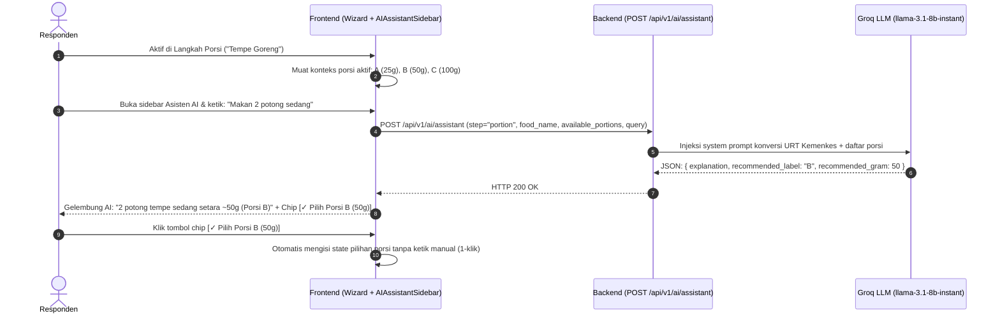

1. **Arsitektur Tanpa Status (*Stateless*).** Permintaan dikirim ke `POST /api/v1/ai/assistant` dengan payload yang memuat parameter kontekstual: `step` (`portion`, `search`, atau `review`), `food_name`, daftar `available_portions` (`label`, `weight_gram`, `description`), serta `user_query`. Server tidak menyimpan sesi obrolan ke basis data; riwayat percakapan dikelola murni pada memori komponen klien (*React state*) dan diatur ulang otomatis ketika responden berganti makanan.
2. **Pagar Pembatas (*Guardrails*) Deterministik.** Prompt sistem dirancang dengan instruksi tegas: **AI dilarang keras menghitung kalori atau makronutrien sendiri**. Hal ini mengeliminasi risiko halusinasi numerik. AI semata bertindak sebagai konsultan bahasa yang memetakan URT ke label porsi terdekat dari himpunan porsi yang disediakan basis data.
3. **Aksi Cepat Satu-Klik (*1-Click Action Chips*).** Jawaban AI memuat medan `recommended_label` dan `recommended_gram`. Komponen antarmuka merender tombol aksi interaktif (misal `[✓ Pilih Porsi B (50g)]`) di bawah gelembung obrolan. Menekan tombol tersebut langsung mengeksekusi *handler* pemilihan porsi di antarmuka formulir sebelah kiri layar, mewujudkan interaksi tanpa beban (*zero friction*).

#### 4.1.3.2 Rekomendasi Gizi Pasca-Laporan (F-23 s.d. F-26)

Setelah laporan *recall* dikirim dan seluruh zat gizi dihitung secara deterministik oleh server dari tabel TKPI 2020, sistem menyediakan fasilitas analisis gizi mendalam berbasis LLM.

**Gambar 4.3 *Pipeline* analisis gizi LLM pasca-laporan**

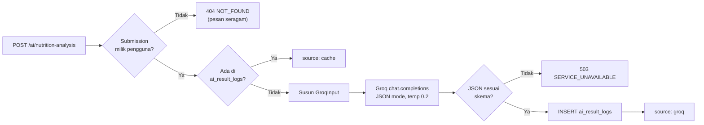

**Kendala skema.** *System prompt* mengunci peran model sebagai penganalisis gizi dan mewajibkan keluaran JSON yang cocok dengan skema tetap berisi `overall_status`, `overall_message`, `nutritional_analysis`, `ai_recommendation`, `recommended_foods`, `health_insight`, dan `suggested_activities`. Parameter: `temperature = 0,2`, `response_format = {"type":"json_object"}`. Model bawaan adalah `llama-3.3-70b-versatile` (`GROQ_MODEL`) dengan batas waktu server 45 detik.

**Pertahanan terhadap keluaran model (F-26).** Keluaran LLM diperlakukan sebagai masukan tidak tepercaya melalui tiga lapis: penguraian dan pemetaan galat ke 503 di server; normalisasi paksa tiap medan ke tipe aman di klien (array bukan-array menjadi `[]`, string bukan-string menjadi `""`, item tanpa label maupun deskripsi dibuang); serta pemetaan nilai status tak dikenal ke gaya visual netral.

**Penyimpanan hasil dan audit (F-24, F-25).** Kolom `submission_id` bersifat unik sehingga permintaan berulang dilayani dari basis data dengan penanda `source: "cache"`. Setiap analisis meninggalkan jejak `model_used`, `token_used`, dan `latency_ms`.

**Keputusan pemicuan manual.** Analisis dijalankan hanya atas penekanan tombol oleh responden, bukan otomatis, agar tidak menghabiskan kuota token dan tidak menahan pengguna bila hanya ingin menyelesaikan pencatatan cepat.

`[⚠ LAMPIRKAN Gambar 4.11: tangkapan layar panel rekomendasi AI dalam keadaan belum dianalisis, memuat, berhasil, dan gagal]`

### 4.1.4 Implementasi Modul Katalog Publik (*Find Your Food*)

Modul ini diimplementasikan sebagai tiga rute Next.js — `/find-food` (beranda katalog dan pencarian), `/find-food/[id]` (detail makanan), dan `/find-food/category/[code]` (daftar per kategori) — yang memanfaatkan *endpoint* `/public/*` di layanan Go tanpa menambahkan tabel basis data baru. Sesi kolaborasi dipasang pada *layout* `/find-food` (bukan per halaman) dengan `autoConnect` nonaktif, sehingga koneksi, kehadiran, dan status ikut bertahan ketika pengguna berpindah antar-halaman katalog.

> **⚠ Ketidaksesuaian yang harus diputuskan sebelum sidang.** *Endpoint* `/public/*` tidak mensyaratkan token, tetapi `middleware.ts` mendaftarkan `/find-food` sebagai rute terlindung dan kotak pencarian di beranda mengarahkan pengunjung ke login. Jadi pada kode saat ini katalog **tidak** dapat dibuka tanpa login. Pilih salah satu: **(a)** keluarkan `/find-food` dari daftar rute terlindung (kolaborasi di katalog tetap hanya aktif bagi pengguna yang login), lalu klaim "katalog publik tanpa login" pada Subbab 1.6, 2.9, dan 4.7.6 sah; atau **(b)** biarkan kodenya dan pertahankan rumusan hati-hati yang dipakai draf ini ("API publik tanpa token; halaman web memerlukan login"). Draf ini ditulis mengikuti pilihan (b) karena itulah keadaan kode.

**Komponen utama:**
- **`PortionPhotoViewer`** — komponen tunggal yang merender dua mode sesuai `photo_type`. Mode *series* menampilkan satu foto utama dengan deret *thumbnail* berlabel A–H yang dapat digulir; klik *thumbnail* mengganti foto utama dengan animasi transisi, dan berat porsi serta kodenya tampil langsung di bawah gambar. Mode *range* menampilkan **foto panduan**: satu foto besar yang memuat seluruh ukuran, dengan label kode dan berat tiap ukuran sebagai *overlay* serta tabel seluruh ukuran di bawahnya.
- **Area poligon terbitan** — bila foto memiliki anotasi berstatus *published* dari CMS (Subbab 4.1.5), `AnnotationHoverOverlay` menumpangkan area poligonnya di atas foto. Area dapat ditampilkan atau disembunyikan, dan deret "bagian makanan" di bawah foto memungkinkan pengguna memilih satu area. Inilah titik temu antara CMS anotasi dan tampilan responden.
- **Kanvas langsung** — `LiveCanvasOverlay` dipasang di atas foto pada kedua mode sehingga peserta ruang dapat saling menunjuk bagian foto (Subbab 4.1.2).
- **Pencarian *full-text*** — memanggil `GET /public/foods/search?q=` dengan *debounce* 300 ms; menggunakan `MATCH … AGAINST … IN BOOLEAN MODE` di sisi *repository* untuk memanfaatkan indeks `FULLTEXT` pada (`name`, `local_name`).
- **Navigasi prev/next** — halaman detail menyediakan navigasi ke makanan sebelumnya dan berikutnya dalam kategori yang sama tanpa memuat ulang halaman penuh.
- **Fitur Simpan (*Bookmark*)** — daftar makanan tersimpan dicatat di *cookie* peramban (`atlas_bookmarks`, masa berlaku satu tahun) tanpa tabel di server; data lama dari `localStorage` dimigrasikan otomatis saat pertama kali dibaca.

`[⚠ LAMPIRKAN Gambar 4.13–4.15: tangkapan layar halaman Find Your Food (landing), detail makanan mode series, detail makanan mode range]`

### 4.1.5 Implementasi Modul Admin

Portal admin mengimplementasikan F-27 sampai F-33, F-47, dan F-48 melalui dasbor dan tujuh kelompok rute: survei, *submission*, makanan, kategori, set foto *as served*, metode porsi, dan anotasi. Akses dijaga dua kali: `middleware.ts` mengalihkan pengguna non-admin menjauh dari `/admin` berdasarkan klaim peran pada token (semata untuk pengarahan halaman, tanpa verifikasi tanda tangan), sedangkan penolakan yang sesungguhnya dilakukan *middleware* `AdminOnly` pada setiap *endpoint* `/admin/*` di layanan.

**Pengelolaan survei (F-27, F-48).** Selain CRUD dan konfigurasi waktu makan, admin dapat menggandakan survei (`/clone`) untuk mengulang rancangan yang sama pada periode berikutnya, dan menerbitkan ulang token akses (`/regenerate-token`) bila tautan lama perlu dimatikan.

**Foto makanan terpadu dan unggah gambar (F-29, F-47).** Halaman sunting makanan memuat bagian foto yang menyatukan pengelolaan foto porsi per makanan (`/admin/foods/{id}/photos` dengan aksi terbit/tarik terbit). Berkas gambar diunggah melalui `POST /upload` yang hanya menerima JPG, PNG, dan WebP berukuran maksimal 10 MB, menamai ulang berkas dengan UUID, dan hanya menerima nama folder tujuan yang terdiri atas huruf, angka, garis bawah, atau tanda hubung (maksimal 64 karakter), agar nama folder kiriman klien tidak dapat dipakai untuk menulis di luar direktori unggahan (*path traversal*).

**CMS anotasi (F-30, F-31, F-33).** Domain anotasi memisahkan aset gambar (`food_images`) dari area poligon (`food_areas`) dengan siklus *draft* → *published*. Operasi `PUT /{id}/areas` mengganti seluruh himpunan area sekaligus — operasi idempoten yang menjadi dasar mekanisme penyimpanan otomatis.

**Penyimpanan otomatis (F-33).** Editor anotasi dilengkapi *autosave* melalui *hook* `useAnnotationAutosave` dengan penanda status `AutosaveIndicator` yang menampilkan keadaan penyimpanan beserta waktu simpan terakhir; perubahan yang masih tertahan di antrean dipaksa tersimpan (`flush`) sebelum aksi penerbitan dijalankan. Rancangan ini penting karena penganotasian poligon merupakan pekerjaan panjang yang mudah hilang bila bergantung pada penyimpanan manual.

**Pemisahan draf dan terbitan.** *Endpoint* publik hanya menyajikan anotasi berstatus *published* — ditegakkan pada lapis repositori melalui `FindPublishedByID` dan `ListPublished` yang menyaring `status = published`, bukan sekadar disembunyikan di antarmuka.

`[⚠ LAMPIRKAN Gambar 4.12: tangkapan layar dasbor admin dan editor anotasi]`

### 4.1.6 Implementasi Modul Gamifikasi dan Papan Peringkat (*Leaderboard* — F-51, F-52)

Modul gamifikasi diimplementasikan untuk menjawab tantangan *survey fatigue* dan tingkat *drop-off* responden yang tinggi pada survei diet berulang, dengan mengintegrasikan mekanika permainan ke dalam alur pengisian.

**1. Model Poin Pengalaman (XP) dan *Daily Streak*.** Sistem mengganjar responden melalui akumulasi poin pengalaman (XP) yang dihitung otomatis pada setiap tonggak keberhasilan (*milestone*):
- **+50 XP** untuk setiap penyelesaian pencatatan satu waktu makan (Sarapan, Makan Siang, Makan Malam, atau Selingan).
- **+150 XP bonus ketuntasan** saat seluruh sesi waktu makan dalam 24 jam berhasil diselesaikan dan dikirim ke server.
- **Pelacak Konsistensi Harian (*Daily Streak*):** Sistem mencatat stempel waktu pengisian terakhir. Bila responden mengisi survei pada hari berikutnya secara berturut-turut, penghitung *streak* bertambah satu (+1 hari) dan memberikan lencana visual konsistensi gizi serta pengganda XP (+20%). Bila terlewat lebih dari 48 jam, *streak* kembali ke 1 tanpa mengurangi total XP historis.

**2. Papan Peringkat (*Leaderboard*) dan Perlindungan Privasi.** Papan peringkat disajikan dalam lingkup survei aktif (`survey_id`) guna memupuk keterlibatan sosial yang suportif:
- **Anonimisasi Etis:** Untuk mematuhi etika penelitian kesehatan dan menjaga kerahasiaan data asupan diet, *leaderboard* **hanya menampilkan nama alias** (`alias` dari tabel `survey_participants`) dan total poin XP, bukan nama asli pengguna, berat badan, maupun kuantitas kalori pribadi.
- **Penyajian Antarmuka:** Komponen *widget* `LeaderboardCard` disematkan pada beranda responden, menampilkan tiga peringkat teratas dengan lencana khusus (emas, perak, perunggu), serta posisi peringkat responden yang bersangkutan beserta progres menuju peringkat berikutnya.

`[⚠ LAMPIRKAN Gambar 4.19: tangkapan layar widget gamifikasi, indikator streak harian, dan papan peringkat (leaderboard)]`

### 4.1.7 Implementasi Dukungan Luring (*Offline-First* PWA)

Dukungan luring menjawab F-34 sampai F-38 dan terdiri atas empat bagian yang bekerja berurutan.

**1. Kerangka aplikasi (*service worker* dan manifes).** Berkas `public/sw.js` menerapkan dua strategi *cache*. Untuk navigasi halaman dipakai ***network-first***: jaringan dicoba lebih dahulu dan salinannya disimpan, lalu *cache* dipakai bila jaringan gagal. Untuk gambar, fon, dan berkas `/uploads/` dipakai ***cache-first***, sehingga foto porsi yang pernah dibuka tetap tampil saat luring. Tiga jenis permintaan sengaja **tidak** disentuh: permintaan selain `GET` (pengiriman laporan ditangani antrean, bukan *cache*), bundel `/_next/`, dan panggilan `/api/`. Manifes (`app/manifest.ts`) menetapkan mode tampilan `standalone` sehingga aplikasi dapat dipasang ke layar utama, dan `PWAInstallPrompt` menawarkan pemasangan. *Service worker* hanya didaftarkan pada *build* produksi di luar `localhost`; pada mode pengembangan registrasi yang tersisa justru dicabut agar tidak mengganggu pemuatan ulang modul.

**2. Antrean laporan (IndexedDB).** Fungsi `submitSurvey` selalu membangkitkan `local_id` (UUID) sebelum pengiriman pertama. Bila peramban luring, laporan langsung ditulis ke tabel `offlineQueue` melalui Dexie dan responden menerima pemberitahuan bahwa datanya tersimpan lokal. Bila peramban daring tetapi permintaan gagal karena jaringan, laporan yang sama — dengan `local_id` yang sama — dialihkan ke antrean.

**3. Mesin sinkronisasi.** `SyncEngine` berjalan saat peristiwa `online` terpicu, saat aplikasi dibuka, atau saat pengguna menekan "Sinkronkan Sekarang". Urutannya: memulihkan item usang, mengambil item tertunda, menandainya `SYNCING`, mengirim seluruhnya dalam satu permintaan `POST /survey/sync/batch`, lalu menerapkan hasil per item. Item yang tidak disebut dalam balasan *batch* — atau seluruh antrean bila *batch* gagal — dikirim ulang satu per satu melalui `POST /survey/submit` dengan *header* `Idempotency-Key`. Aturan yang dijaga ketat: **tidak ada item yang boleh tertinggal berstatus `SYNCING`**, karena item semacam itu tidak lagi terhitung tertunda dan akan hilang dari antrean tanpa pernah terkirim.

**Tabel 4.13 Siklus status antrean luring**

| Status | Arti | Transisi berikutnya |
|---|---|---|
| `PENDING` | Menunggu dikirim | → `SYNCING` saat sinkronisasi dimulai |
| `SYNCING` | Sedang dikirim | → `SYNCED` bila server membalas `SYNCED`/`SKIPPED`; → `PENDING` (percobaan + 1) bila gagal; → `PENDING` bila ditemukan usang saat aplikasi dibuka |
| `SYNCED` | Sudah tersimpan di server | Dihapus dari antrean |
| `FAILED` | Gagal lima kali berturut-turut | Tidak dicoba otomatis lagi; dapat diantrekan ulang secara manual |

**4. Idempotensi di server (F-36).** Kolom `survey_submissions.local_id` berkendala `UNIQUE`. Baik *endpoint* tunggal maupun *batch* memeriksa `local_id` lebih dahulu: bila sudah ada, server mengembalikan `submission_id` yang lama (status `SKIPPED` pada *batch*) tanpa menyisipkan baris baru. *Endpoint* tunggal menerima kunci itu dari badan permintaan maupun dari *header* `Idempotency-Key`. *Endpoint* *batch* memproses tiap item secara mandiri dan melaporkan hasilnya per `local_id`, sehingga satu item yang gagal tidak menggagalkan item lain.

**Umpan balik kepada responden (F-37).** `OfflineStatusBar` muncul hanya bila peramban luring atau antrean belum kosong, menampilkan jumlah laporan yang belum tersinkron beserta tombol sinkronisasi manual. Perubahan status koneksi dan hasil sinkronisasi (berhasil, sebagian, gagal) diumumkan melalui *toast*.

**Batas dukungan luring.** Yang dijamin tetap berjalan tanpa koneksi adalah pengisian yang sedang berlangsung (keadaan *wizard* tersimpan di `localStorage`) dan pengiriman laporan. Pencarian makanan, foto porsi yang belum pernah dibuka, kolaborasi, dan analisis LLM memerlukan koneksi. Laporan yang masih berada di antrean memakai `local_id` sebagai pengenal sementara, sehingga analisis AI baru dapat diminta setelah laporan tersinkron.

`[⚠ LAMPIRKAN Gambar 4.16: tangkapan layar bilah status luring dengan jumlah antrean dan tombol sinkronisasi]`

### 4.1.7 Implementasi Profil, Autentikasi, dan Pemantauan

**Autentikasi (F-01).** Kata sandi disimpan sebagai *hash* bcrypt. Login menghasilkan token akses JWT (masa berlaku bawaan 24 jam) dan token penyegar (bawaan 7 hari) yang disimpan di basis data dalam bentuk *hash*. Antarmuka menyimpan keduanya di *cookie* dan memperbarui token akses melalui `POST /auth/refresh` ketika kedaluwarsa. *Middleware* layanan menerima token dari *header* `Authorization` untuk REST dan dari parameter *query* `token` khusus untuk *handshake* WebSocket.

**Profil dan riwayat (F-45, F-46).** Halaman `/profile` memungkinkan pengguna mengubah nama, nomor telepon, jenis kelamin, dan tanggal lahir (`PATCH /auth/me`), mengganti foto (`POST /auth/me/photo`), dan mengganti kata sandi (`PUT /auth/me/password`) dengan indikator kekuatan kata sandi. Halaman yang sama menampilkan riwayat laporan milik pengguna (`GET /survey/my-submissions`) beserta rinciannya; layanan menyaring berdasarkan identitas login sehingga laporan pengguna lain tidak dapat dibuka dengan menebak pengenal.

**Pemantauan (NF-20).** Layanan mengekspos `/health` dan `/metrics`. Metrik HTTP (jumlah permintaan, durasi, permintaan lambat) dikumpulkan oleh *middleware* `gin-metrics` dalam format Prometheus; berkas Docker Compose menyertakan Prometheus dan Grafana untuk mengikis dan menampilkannya. Metrik ini melengkapi `/collab/stats` (keadaan *hub*) dan tabel `ai_result_logs` (latensi LLM) sebagai sumber data pengujian kinerja pada Subbab 4.4.

**Tabel 4.1 Kontrak API sistem**

| Kelompok | Metode & *Endpoint* | Kebutuhan |
|---|---|---|
| Publik (tanpa token) | `GET /public/foods/search`, `/public/foods/{id}`, `/public/foods/{id}/images`, `/public/categories`, `/public/categories/{code}/foods`, `/public/food-images`, `/public/food-images/{id}` | F-02a–c, F-05, F-07 |
| Autentikasi & profil | `POST /auth/register`, `/auth/login`, `/auth/refresh`; `GET\|PATCH /auth/me`; `PUT /auth/me/password`; `POST /auth/me/photo` | F-01, F-45 |
| Responden | `GET /survey/active`; `POST /survey/access`; `GET /survey/{id}/info`; `POST /survey/submit`; `GET /locales` | F-02, F-03, F-13, F-39 |
| Responden — luring & riwayat | `POST /survey/sync/batch`; `GET /survey/my-submissions`, `/survey/my-submissions/{id}` | F-35, F-36, F-46 |
| AI | `POST /ai/nutrition-analysis` | F-23 |
| Admin — survei | `/admin/surveys` (CRUD, `/clone`, `/regenerate-token`), `/admin/surveys/{id}/submissions`, `/admin/surveys/{id}/export`, `/admin/submissions/{id}` | F-27, F-32, F-48 |
| Admin — pangan | `/admin/foods` (CRUD, `/portion-methods`, `/photos` beserta `/publish` dan `/unpublish`), `/admin/categories`, `/admin/as-served-sets` (termasuk `/images`), `/admin/as-served-images`, `/admin/portion-methods` | F-28, F-29 |
| Admin — anotasi | `/admin/food-images` (CRUD, `/areas`, `/publish`, `/unpublish`, `/export`) | F-30, F-31 |
| Admin — unggah | `POST /upload` | F-47 |
| Kolaborasi | `GET /collab/rooms/{id}/ws`, `GET /collab/rooms/{id}`, `POST /collab/rooms/{id}/invite`, `DELETE /collab/invites/{token}`, `GET /collab/stats` | F-15, F-19 |
| Operasional | `GET /health`, `GET /metrics` | NF-20 |

Seluruh *endpoint* berada di bawah awalan `/api/v1`, kecuali `/health`, `/metrics`, dan berkas statis `/uploads`. Kelompok admin dijaga `AdminOnly`; kelompok responden dan AI dijaga `RespondentOnly`.

## 4.2 Hasil Pengujian Kotak-Hitam

> **Cara mengisi:** jalankan tiap kasus uji pada sistem, catat hasil yang benar-benar teramati pada kolom "Hasil Diperoleh", lalu isi kolom "Status" dengan Sesuai/Tidak Sesuai. Kolom "Hasil Diharapkan" sudah diturunkan dari spesifikasi dan tidak perlu diubah.

**Tabel 4.5 Hasil pengujian kotak-hitam modul recall**

| Kode | Kebutuhan | Skenario | Masukan | Hasil Diharapkan | Hasil Diperoleh | Status |
|---|---|---|---|---|---|---|
| UK-01 | F-02 | Menampilkan survei aktif | Login sebagai responden | Daftar survei berstatus aktif tampil | | |
| UK-02 | F-03 | Bergabung ke survei | Tekan tombol "Mulai" | Sesi *recall* terbentuk, diarahkan ke *wizard* | | |
| UK-03 | F-04 | Pilihan waktu makan sesuai konfigurasi | Survei dengan `meals_config` berisi 3 waktu makan | Hanya 3 pilihan tampil, jam bawaan sesuai | | |
| UK-04 | F-04 | Konversi jam 12/24 | Setel jam ke 19:30 | Tampil "07:30 PM", nilai tersimpan "19:30" | | |
| UK-05 | F-05 | Pencarian kurang dari 3 karakter | Ketik "na" | Muncul petunjuk minimal 3 karakter, tidak ada permintaan ke server | | |
| UK-06 | F-05 | Pencarian normal | Ketik "nasi goreng" | Daftar hasil tampil ≤ 10 item | | |
| UK-07 | F-05 | Pencarian gagal (server mati) | Matikan layanan, ketik kata kunci | Pesan galat tampil, bukan kegagalan senyap | | |
| UK-08 | F-05 | Penambahan duplikat | Tambahkan makanan yang sama dua kali | Pesan "sudah ada di daftar", item tidak berganda | | |
| UK-09 | F-06 | Pencatatan manual | Cari kata kunci tanpa hasil, tekan "Catat manual" | Item masuk daftar "Dicatat manual" dengan penanda tanpa nilai gizi | | |
| UK-10 | F-06 | Duplikat catatan manual | Catat nama yang sama dua kali | Ditolak, daftar tidak berganda | | |
| UK-11 | F-06 | Hanya item manual | Tambahkan hanya catatan manual tanpa makanan basis data | Tombol "Lanjut" nonaktif dengan penjelasan | | |
| UK-12 | F-07 | Pemilihan foto porsi | Pilih foto porsi 150 g | Total berat menampilkan 150 g | | |
| UK-13 | F-08 | Berat manual valid | Isi 200 | Total berat 200 g | | |
| UK-14 | F-08 | Berat melebihi batas | Isi 9999 | Nilai dijepit ke 5.000 g | | |
| UK-15 | F-08 | Berat tidak valid | Isi −50 | Total berat 0, tombol simpan nonaktif | | |
| UK-16 | F-07 | Kegagalan pemuatan foto porsi | Putus jaringan saat membuka langkah 3 | Pesan galat tampil, isian berat manual tetap dapat digunakan | | |
| UK-17 | F-10 | Perhitungan gizi | Makanan 130 kkal/100 g, porsi 150 g | Energi tercatat 195 kkal | | |
| UK-18 | F-09 | Bahan tambahan | Tambah "Minyak" 5 ml | Tercatat pada makanan yang bersangkutan | | |
| UK-19 | F-09 | Bahan tambahan bernilai negatif | Isi −3 | Nilai dijepit ke 0 | | |
| UK-20 | F-09 | Persistensi saat mundur | Isi takaran, tekan "Kembali", maju lagi | Takaran tetap tersimpan | | |
| UK-21 | F-11 | Ringkasan | Buka langkah 5 | Seluruh item, item manual, dan total harian tampil | | |
| UK-22 | F-12 | Validasi porsi kosong | Kosongkan porsi satu makanan | Tombol kirim nonaktif dengan pesan sebab | | |
| UK-23 | F-13 | Pengiriman berhasil | Tekan "Kirim laporan" | Laporan tersimpan, `submission_id` diterima | | |
| UK-24 | F-13 | Pengiriman gagal | Matikan layanan, tekan kirim | Pesan galat tampil, isian tidak hilang | | |
| UK-25 | — | Pencegahan kirim ganda | Setelah berhasil kirim, cari jalan kembali ke ringkasan | Tidak tersedia tombol kembali pada langkah hasil | | |
| UK-26 | F-14 | Persistensi sesi | Muat ulang halaman di tengah pengisian | Seluruh progres tetap ada | | |
| UK-27 | — | Tambah waktu makan | Dari ringkasan tekan "Tambah waktu makan", isi waktu makan kedua | Data waktu makan pertama tetap; langkah porsi tidak buntu | | |
| UK-28 | — | Halaman ringkasan akhir | Tekan "Selesai" | Ringkasan menampilkan jumlah waktu makan, item, dan total gizi yang benar | | |

**Tabel 4.6 Hasil pengujian kotak-hitam modul kolaborasi**

| Kode | Kebutuhan | Skenario | Masukan | Hasil Diharapkan | Hasil Diperoleh | Status |
|---|---|---|---|---|---|---|
| UK-29 | F-15 | Pembentukan ruang | Buka halaman *recall* | Koneksi WebSocket terbentuk, status "Live" | | |
| UK-30 | F-16 | Kehadiran | Peserta kedua bergabung | Avatar peserta tampil pada kedua sisi | | |
| UK-31 | F-16 | Multi-tab | Buka tab kedua dengan akun sama | Peserta tidak terhitung ganda; tab lama tidak terputus | | |
| UK-32 | F-17 | Kursor bersama | Gerakkan tetikus pada satu peserta | Kursor bernama tampil pada layar peserta lain | | |
| UK-33 | F-18 | Mode ikut — halaman | Tekan avatar untuk mengikuti | Pengikut berpindah ke halaman pemimpin | | |
| UK-34 | F-18 | Mode ikut — gulir | Pemimpin menggulir | Posisi gulir pengikut menyesuaikan | | |
| UK-35 | F-18 | **Mode ikut — langkah** | Pemimpin berpindah dari langkah 2 ke 3 | Pengikut ikut berpindah ke langkah 3 | | |
| UK-36 | F-18 | **Langkah bertahan setelah gulir** | Pemimpin berpindah langkah lalu menggulir; peserta ketiga baru mulai mengikuti | Peserta ketiga mendarat di langkah yang benar | | |
| UK-37 | F-18 | Pencegahan *loop* | Dua peserta saling mengikuti | Tidak terjadi perpindahan langkah berulang tanpa henti | | |
| UK-38 | F-18 | Berhenti mengikuti | Tekan "Stop following" | Penyelarasan berhenti, kendali kembali | | |
| UK-39 | F-19 | Pembuatan undangan | Tekan "Share", pilih peran *editor* | Tautan berisi `room` dan `invite` terbentuk | | |
| UK-40 | F-19 | **Tamu membuka undangan** | Akun berbeda membuka tautan undangan | Tamu masuk ke ruang yang sama, bukan diarahkan ke `/surveys` | | |
| UK-41 | F-19 | Undangan kedaluwarsa | Gunakan tautan setelah masa berlaku habis | Akses ditolak dengan pesan yang jelas | | |
| UK-42 | F-20 | Kunci antarmuka *viewer* | Masuk dengan undangan *viewer* | Seluruh kontrol tidak dapat diklik maupun di-tab | | |
| UK-43 | F-20 | Penolakan di klien | *Viewer* memicu peristiwa mutasi | Pesan ditahan, muncul pemberitahuan mode "Can view" | | |
| UK-44 | F-20 | Penolakan di server | Kirim pesan mutasi langsung melalui WebSocket sebagai *viewer* | Server menolak pesan | | |
| UK-45 | NF-10 | Ketahanan peran | *Viewer* berpindah halaman sehingga `invite` hilang dari URL | Peran tetap *viewer*, tidak naik menjadi *editor* | | |
| UK-46 | F-21 | Umpan aktivitas | Peserta lain menambahkan makanan | Aktivitas tampil dengan nama waktu makan yang benar | | |
| UK-47 | NF-05 | Rekoneksi | Putuskan jaringan 10 detik lalu sambungkan | Status kembali "Live" tanpa muat ulang halaman | | |
| UK-48 | NF-03 | Batas laju | Kirim > 50 pesan/detik | Server membalas `RATE_LIMITED`, koneksi tetap hidup | | |

**Tabel 4.7 Hasil pengujian kotak-hitam modul AI**

| Kode | Kebutuhan | Skenario | Masukan | Hasil Diharapkan | Hasil Diperoleh | Status |
|---|---|---|---|---|---|---|
| UK-49 | F-23 | Analisis pertama | Tekan "Analisis dengan AI" | Hasil tampil dengan penanda sumber AI | | |
| UK-50 | F-25 | Pemanggilan ulang | Tekan "Analisis ulang" | Hasil tampil dengan penanda sumber tersimpan | | |
| UK-51 | F-23 | Tanpa `submission_id` | Buka panel sebelum mengirim laporan | Tombol nonaktif disertai penjelasan | | |
| UK-52 | F-23 | Otorisasi | Minta analisis atas `submission_id` milik pengguna lain | Ditolak dengan 404 berpesan seragam | | |
| UK-53 | F-26 | Kegagalan layanan | Nonaktifkan kunci API | Pesan galat + tombol "Coba lagi"; halaman tetap utuh | | |
| UK-54 | F-26 | Keluaran tidak sesuai skema | Simulasikan respons non-JSON | Ditangani sebagai 503, halaman tidak rusak | | |
| UK-55 | F-24 | Jejak audit | Periksa tabel `ai_result_logs` | Tercatat model, jumlah token, dan latensi | | |
| UK-56 | NF-04 | Batas waktu | Analisis berjalan lama | Klien menunggu hingga 60 detik sebelum menyerah | | |

**Tabel 4.8 Hasil pengujian kotak-hitam modul admin**

| Kode | Kebutuhan | Skenario | Masukan | Hasil Diharapkan | Hasil Diperoleh | Status |
|---|---|---|---|---|---|---|
| UK-57 | F-01 | Otorisasi peran | Responden membuka rute admin | Akses ditolak | | |
| UK-58 | F-27 | CRUD survei | Buat, ubah, hapus survei | Data tersimpan dan tampil sesuai | | |
| UK-59 | F-27 | Konfigurasi waktu makan | Setel `meals_config` 4 waktu makan | Pilihan responden ikut berubah menjadi 4 | | |
| UK-60 | F-28 | CRUD makanan | Tambah makanan + nilai gizi | Makanan muncul pada pencarian responden | | |
| UK-61 | F-29 | Set foto *as served* | Tambah foto dengan berat 150 g | Foto muncul pada langkah porsi responden | | |
| UK-62 | F-30 | Anotasi poligon | Gambar area, tautkan ke makanan | Area tersimpan | | |
| UK-63 | F-31 | Siklus terbit | Simpan sebagai draf, lalu terbitkan | Draf tidak tampil publik; terbitan tampil | | |
| UK-64 | F-32 | Telaah *submission* | Buka daftar *submission* survei | Daftar dan detail tampil benar | | |
| UK-65 | F-32 | Ekspor CSV | Tekan "Export CSV" pada daftar *submission* | Berkas CSV terunduh berisi data yang sesuai | | |
| UK-66 | F-33 | Penyimpanan otomatis anotasi | Gambar area lalu tunggu tanpa menekan simpan | Penanda *autosave* berubah menjadi tersimpan disertai waktu simpan | | |
| UK-67 | F-33 | *Flush* sebelum terbit | Ubah area lalu langsung tekan "Terbitkan" | Perubahan terakhir ikut tersimpan sebelum penerbitan | | |
| UK-68 | F-31 | Draf tidak bocor ke publik | Akses *endpoint* publik untuk anotasi berstatus draf | Ditolak/tidak ditemukan | | |

**Tabel 4.14 Hasil pengujian kotak-hitam dukungan luring, kanvas langsung, katalog, dan profil**

| Kode | Kebutuhan | Skenario | Masukan | Hasil Diharapkan | Hasil Diperoleh | Status |
|---|---|---|---|---|---|---|
| UK-69 | F-34 | Kirim saat luring | Matikan jaringan, tekan "Kirim laporan" | Laporan masuk antrean; muncul pemberitahuan tersimpan lokal; isian tidak hilang | | |
| UK-70 | F-37 | Bilah status luring | Matikan jaringan | Bilah "Mode Offline" tampil; setelah UK-69 menampilkan jumlah antrean 1 | | |
| UK-71 | F-35 | Sinkronisasi otomatis | Nyalakan kembali jaringan | Antrean terkirim tanpa tindakan pengguna; bilah status hilang; laporan muncul di daftar admin | | |
| UK-72 | F-35 | Sinkronisasi manual | Dengan antrean terisi, tekan "Sinkronkan Sekarang" | Antrean terkirim; *toast* hasil tampil | | |
| UK-73 | F-36, NF-16 | Idempotensi — kirim ulang | Kirim permintaan `POST /survey/submit` yang sama dua kali dengan `local_id` identik | Hanya satu baris tersimpan; balasan kedua memuat `submission_id` yang sama | | |
| UK-74 | F-36, NF-16 | Idempotensi — koneksi putus di tengah | Putuskan jaringan tepat setelah menekan kirim, lalu sambungkan lagi | Tepat satu laporan tersimpan di server | | |
| UK-75 | F-35 | *Batch* dengan item campuran | Kirim `POST /survey/sync/batch` berisi satu item baru, satu item duplikat, dan satu item tidak valid | Hasil per item: `SYNCED`, `SKIPPED`, `FAILED`; item valid tetap tersimpan | | |
| UK-76 | NF-17 | Pemulihan antrean macet | Tutup tab saat sinkronisasi berjalan, buka kembali | Item tidak tertinggal berstatus `SYNCING`; terkirim pada sinkronisasi berikutnya | | |
| UK-77 | F-35 | Batas percobaan | Paksa server menolak satu item lima kali | Item berstatus `FAILED` dan tidak dicoba otomatis lagi | | |
| UK-78 | F-38 | Pemuatan kerangka saat luring | Pada *build* produksi, buka aplikasi sekali, matikan jaringan, muat ulang | Halaman tetap tampil dari *cache*; foto porsi yang pernah dibuka tetap terlihat | | |
| UK-79 | F-38 | Pemasangan PWA | Buka aplikasi pada peramban yang mendukung | Tawaran pemasangan muncul; aplikasi terpasang berjalan dalam mode *standalone* | | |
| UK-80 | F-39 | Hitung ulang gizi di server | Kirim laporan dengan nilai `nutrients` yang sengaja diubah | Nilai tersimpan mengikuti perhitungan server, bukan kiriman klien | | |
| UK-81 | F-39 | Partisipan dari identitas login | Kirim laporan dengan `participant_id` milik pengguna lain | Laporan tercatat atas partisipan pengirim yang sebenarnya | | |
| UK-82 | F-40 | Coretan bersama | Peserta A menggambar dengan pensil di atas foto porsi | Coretan tampil pada layar peserta B di posisi foto yang sama | | |
| UK-83 | F-40 | Konsistensi posisi lintas ukuran layar | Peserta A memakai laptop, peserta B telepon pintar | Coretan jatuh pada bagian foto yang sama | | |
| UK-84 | F-41 | Penunjuk laser | Peserta A menggerakkan laser | Titik laser tampil pada peserta B dan memudar sekitar 1,5 detik setelah berhenti | | |
| UK-85 | F-42 | Peserta yang datang belakangan | Peserta C bergabung setelah coretan dibuat | Peserta C melihat coretan yang masih aktif | | |
| UK-86 | F-40 | Hapus kanvas | Tekan "hapus" pada satu foto | Coretan pada foto itu hilang di seluruh peserta | | |
| UK-87 | F-20, F-40 | *Viewer* tidak dapat menggambar | Masuk sebagai *viewer*, coba menggambar; kirim `canvas_draw_start` langsung melalui WebSocket | Antarmuka terkunci; server membalas `FORBIDDEN` | | |
| UK-88 | F-43 | Obrolan kursor | Tekan `/`, ketik pesan, tekan Enter | Gelembung tampil di dekat kursor pada peserta lain lalu hilang | | |
| UK-89 | F-43 | Tombol `/` tidak membajak isian | Tekan `/` saat fokus berada di kolom pencarian | Karakter `/` terketik di kolom; gelembung tidak muncul | | |
| UK-90 | F-02a–c | Pencarian katalog | Ketik "nasi" pada *Find Your Food* | Daftar hasil tampil beserta tipe foto | | |
| UK-91 | F-02c | Detail tipe *series* | Buka makanan bertipe `series` | Foto utama dan deret *thumbnail* A–H tampil; klik *thumbnail* mengganti foto utama dan berat | | |
| UK-92 | F-02c | Detail tipe *range* | Buka makanan bertipe `range` | Satu foto panduan tampil dengan label kode dan berat tiap ukuran | | |
| UK-93 | F-02c, F-31 | Area poligon terbitan | Buka foto yang memiliki anotasi terbitan | Area dapat ditampilkan/disembunyikan dan dipilih | | |
| UK-94 | F-02d | *Bookmark* | Tekan "Simpan", muat ulang halaman | Status "Tersimpan" bertahan | | |
| UK-95 | F-05 | Karakter khusus pada pencarian | Ketik `ayam "goreng` dan `nasi +` | Hasil tampil atau kosong; tidak ada galat 500 | | |
| UK-96 | F-45 | Ubah profil | Ubah nama dan nomor telepon | Perubahan tersimpan dan tampil setelah muat ulang | | |
| UK-97 | F-45 | Ganti kata sandi | Isi kata sandi lama yang salah, lalu yang benar | Yang salah ditolak; yang benar berhasil dan login berikutnya memakai kata sandi baru | | |
| UK-98 | F-46 | Riwayat laporan sendiri | Buka halaman profil setelah mengirim laporan | Laporan tampil; rincian dapat dibuka | | |
| UK-99 | F-46 | Laporan pengguna lain | Minta `GET /survey/my-submissions/{id}` dengan pengenal milik pengguna lain | Ditolak/tidak ditemukan | | |
| UK-100 | F-47 | Unggah gambar | Unggah berkas `.gif`, lalu berkas JPG 12 MB, lalu JPG 1 MB | Dua pertama ditolak dengan pesan yang jelas; yang ketiga berhasil | | |
| UK-101 | F-48 | Gandakan survei | Tekan gandakan pada satu survei | Survei baru terbentuk dengan konfigurasi yang sama | | |
| UK-102 | NF-18 | Asal tidak terdaftar | Buka koneksi WebSocket dari asal di luar daftar putih | *Handshake* ditolak | | |
| UK-103 | NF-20 | Metrik | Akses `/health` dan `/metrics` | `/health` membalas status ok; `/metrics` berformat Prometheus | | |

**Rekapitulasi:**

`[⚠ ISI SETELAH PENGUJIAN]`

| Modul | Jumlah kasus uji | Sesuai | Tidak Sesuai | Tingkat keberhasilan |
|---|---|---|---|---|
| Recall | 28 (UK-01…UK-28) | | | |
| Kolaborasi | 20 (UK-29…UK-48) | | | |
| AI | 8 (UK-49…UK-56) | | | |
| Admin | 12 (UK-57…UK-68) | | | |
| Luring, kanvas, katalog, profil, operasional | 35 (UK-69…UK-103) | | | |
| **Total** | **103** | | | |

Catatan: kebutuhan F-22 (penguncian entitas) dan F-44 (perubahan peran selama sesi) tidak memiliki kasus uji karena belum terwujud utuh pada versi 1 — lihat catatan status pada Subbab 3.5.1. UK-90 sampai UK-94 dijalankan dalam keadaan login, sesuai keadaan kode (catatan pada Subbab 4.1.4).

## 4.3 Hasil Penelusuran *End-to-End* dan Perbaikan Cacat

Selain pengujian kotak-hitam berbasis kebutuhan, dilakukan penelusuran alur *end-to-end* yang menelaah keterhubungan antar modul. Metode ini menemukan sebelas cacat yang tidak terdeteksi oleh pemeriksaan tipe maupun proses *build*, karena seluruhnya bersifat kesalahan logika lintas-komponen, bukan kesalahan sintaksis.

**Tabel 4.9 Temuan cacat dan perbaikan**

| Kode | Modul | Gejala | Akar masalah | Klasifikasi | Perbaikan |
|---|---|---|---|---|---|
| D-01 | Recall | Halaman ringkasan akhir selalu kosong (0 waktu makan, 0 item) dan analisis AI tidak dapat dijalankan | Sesi direset **sebelum** navigasi ke halaman ringkasan, padahal halaman tersebut membaca sesi yang sama | Kesalahan urutan operasi | Reset dipindahkan ke aksi eksplisit "Isi survey lagi" |
| D-02 | Recall | Langkah porsi menampilkan "belum ada makanan" padahal daftar terisi; alur buntu | Indeks porsi tidak diatur ulang saat waktu makan berganti dan tidak dijepit saat makanan dihapus | Inkonsistensi keadaan | Pengaturan ulang indeks saat pergantian waktu makan; penjepitan saat penghapusan dan saat memasuki langkah porsi |
| D-03 | Recall | Laporan berpotensi terkirim ganda | Tombol kembali tetap aktif pada langkah hasil | Integritas data | Tombol dihilangkan pada langkah hasil |
| D-04 | Recall | Makanan yang dicatat manual hilang dari antarmuka | `missing_foods` disimpan dan dikirim, tetapi tidak pernah ditampilkan | Ketiadaan umpan balik | Ditampilkan pada langkah 2 dan 5 dengan penanda "tanpa nilai gizi"; duplikat ditolak |
| D-05 | Recall | Takaran bahan tambahan hilang saat menekan "Kembali" | Persistensi hanya dilakukan pada aksi maju | Kehilangan data senyap | Persistensi juga pada aksi mundur |
| D-06 | Kolaborasi | Tautan undangan sesi *recall* selalu berakhir di `/surveys` | Gerbang halaman menolak pengguna yang token akses pada URL bukan miliknya, padahal tautan undangan memang membawa URL pengundang | Kontrol akses terlalu ketat | Gerbang mengizinkan tamu bila terdapat parameter `room`, disertai panel penjelas |
| D-07 | Kolaborasi | Tamu yang lolos gerbang tetap sendirian di ruangnya | Ruang bawaan selalu diprioritaskan di atas parameter `room` | Kesalahan prioritas konfigurasi | Parameter `room` diprioritaskan pada halaman *recall* |
| D-08 | Kolaborasi | Mode ikut tidak pernah menyelaraskan langkah | *Wizard* berbagi satu URL; atribut `step` didukung protokol tetapi tidak pernah diisi klien | Fitur tidak lengkap | Penyiaran dan penerapan `step`; langkah disimpan pada *store* agar setiap `viewport_update` membawanya |
| D-09 | Kolaborasi | Umpan aktivitas menampilkan jenis pencarian, bukan waktu makan | `meal_add` mengirim `"food"`/`"drink"` pada medan `meal_type` | Pelanggaran kontrak pesan | Mengirim nama waktu makan yang sebenarnya |
| D-10 | Kolaborasi | Indikator "sedang mencari" saling tumpang tindih | Peserta yang sedang mengikuti tetap menyiarkan pencariannya | Inkonsistensi antar-halaman | Penyiaran ditahan saat mode ikut aktif |
| D-11 | Kolaborasi | *Viewer* masih dapat mengirim pesan mutasi pada jeda *handshake* | Peran kosong dianggap "boleh" | Celah otorisasi | Penerapan prinsip *fail-closed*: peran kosong berarti tolak |

**Analisis klasifikasi cacat:**

| Klasifikasi | Jumlah | Persentase |
|---|---|---|
| Kehilangan data senyap / kebuntuan alur | 5 (D-01, D-02, D-04, D-05, D-08) | 45,5% |
| Kesalahan kontrol akses | 3 (D-06, D-07, D-11) | 27,3% |
| Pelanggaran kontrak/konsistensi | 2 (D-09, D-10) | 18,2% |
| Integritas data | 1 (D-03) | 9,1% |

Temuan yang layak dibahas: hampir separuh cacat tergolong **kehilangan data senyap atau kebuntuan alur** — jenis cacat yang tidak menimbulkan pesan galat apa pun sehingga tidak terdeteksi oleh pemeriksaan otomatis maupun oleh pengguna yang tidak membandingkan hasil dengan harapannya. Hal ini menunjukkan bahwa untuk sistem dengan keadaan berlapis (keadaan lokal *wizard*, keadaan tersimpan di peramban, dan keadaan bersama di server), **penelusuran alur end-to-end tetap diperlukan** dan tidak tergantikan oleh pemeriksaan tipe maupun proses *build* yang berhasil.

## 4.4 Hasil Pengujian Kinerja

**Tabel 4.10 Hasil pengujian kinerja real-time**

`[⚠ ISI SETELAH PENGUJIAN — jangan mengisi dengan angka perkiraan]`

| Metrik | 2 klien | 5 klien | 10 klien | 20 klien | Target (NF) |
|---|---|---|---|---|---|
| Latensi kursor — rerata (ms) | | | | | ≤ 300 (NF-01) |
| Latensi kursor — p95 (ms) | | | | | |
| Latensi sinkronisasi langkah — rerata (ms) | | | | | ≤ 500 (NF-02) |
| Latensi sinkronisasi langkah — p95 (ms) | | | | | |
| *Throughput* (pesan/detik) | | | | | |
| Pesan *drop* | | | | | 0 (NF-03) |
| Waktu pemulihan koneksi (detik) | | | | | ≤ 30 (NF-05) |

**Perbandingan dengan dan tanpa *batching*:**

| Kondisi | Pesan kursor masuk | Pesan tersiar | Rasio reduksi |
|---|---|---|---|
| Tanpa *batching* + *coalescing* | | | |
| Dengan *batching* + *coalescing* | | | |

**Latensi analisis LLM** (diambil dari kolom `latency_ms` pada tabel `ai_result_logs`):

| Statistik | Nilai (ms) |
|---|---|
| Jumlah analisis (N) | |
| Rerata | |
| Median | |
| p95 | |
| Rerata jumlah token | |

## 4.5 Hasil Pengujian Penerimaan Pengguna

**Tabel 4.11 Karakteristik responden UAT**

`[⚠ ISI SETELAH PENGUJIAN]`

| Karakteristik | Kategori | Jumlah | Persentase |
|---|---|---|---|
| Jenis kelamin | Laki-laki / Perempuan | | |
| Usia | 17–25 / 26–35 / > 35 | | |
| Peran uji | Responden / Pendamping / Admin | | |
| Pengalaman aplikasi survei daring | Pernah / Belum pernah | | |

**Tabel 4.12 Hasil kuesioner SUS**

`[⚠ ISI SETELAH PENGUJIAN]`

| No | Pernyataan | Rerata skor (1–5) |
|---|---|---|
| 1 | Saya merasa ingin sering menggunakan sistem ini | |
| 2 | Saya merasa sistem ini terlalu rumit | |
| 3 | Saya merasa sistem ini mudah digunakan | |
| 4 | Saya merasa membutuhkan bantuan teknis untuk menggunakan sistem ini | |
| 5 | Saya merasa fungsi-fungsi dalam sistem ini terintegrasi dengan baik | |
| 6 | Saya merasa ada terlalu banyak ketidaksesuaian dalam sistem ini | |
| 7 | Saya membayangkan kebanyakan orang akan cepat belajar menggunakan sistem ini | |
| 8 | Saya merasa sistem ini sangat kaku untuk digunakan | |
| 9 | Saya merasa percaya diri saat menggunakan sistem ini | |
| 10 | Saya perlu belajar banyak hal sebelum dapat menggunakan sistem ini | |
| | **Skor SUS akhir** | |
| | **Predikat** | |
| | **Tingkat penerimaan** | |

**Perbandingan sesi mandiri dan sesi berpendamping** (bila menerapkan rancangan eksperimen dua kelompok):

| Variabel | Kelompok A (mandiri) | Kelompok B (berpendamping) | Selisih |
|---|---|---|---|
| Jumlah item tercatat per laporan | | | |
| Proporsi `missing_foods` | | | |
| Proporsi porsi diisi manual | | | |
| Waktu penyelesaian (menit) | | | |
| Skor SUS | | | |

Seluruh variabel tersebut sudah terekam sistem tanpa instrumentasi tambahan.

## 4.6 Hasil Penilaian Pakar terhadap Keluaran LLM

`[⚠ ISI SETELAH PENGUJIAN]`

| Aspek penilaian | Rerata skor | Kesepakatan antar-penilai (κ) |
|---|---|---|
| Relevansi rekomendasi terhadap data laporan | | |
| Kesesuaian dengan prinsip gizi seimbang | | |
| Keamanan (tidak mengandung saran berisiko) | | |
| Kejelasan bahasa bagi awam | | |

| Metrik objektif | Nilai |
|---|---|
| Validitas skema (% respons lolos penguraian JSON) | |
| Konsistensi `overall_status` pada M pengulangan | |
| Indeks Jaccard `recommended_foods` antar pengulangan | |

## 4.7 Pembahasan

### 4.7.1 Menjawab RM-1 — Perancangan dan pembangunan sistem R24J

Sistem berhasil dibangun dengan alur enam langkah yang memetakan metode lintasan berganda (Subbab 3.6.6). Keputusan perancangan yang menentukan adalah **penyimpanan progres di sisi peramban dengan masa berlaku 24 jam**, yang menjawab sifat pengisian R24J yang kerap bertahap sepanjang hari dan berpindah perangkat. Perhitungan gizi dilakukan secara deterministik dua kali — di antarmuka sebagai umpan balik segera dan di server sebagai angka yang disimpan — lalu dibekukan sebagai *snapshot* pada saat laporan diterima, sehingga laporan historis tidak berubah ketika basis data pangan diperbarui. Sifat ini diperlukan untuk data penelitian, dan perhitungan ulang di server memastikan angka yang tersimpan tidak bergantung pada kejujuran klien.

`[⚠ TAMBAHKAN pembahasan berdasarkan tingkat keberhasilan uji kotak-hitam modul recall]`

### 4.7.2 Menjawab RM-2 — Kolaborasi real-time dan sinkronisasi langkah

Persoalan inti yang ditemukan adalah bahwa mekanisme *follow* konvensional — yang memantulkan *path* dan posisi gulir — **tidak memadai** untuk *wizard* pada aplikasi satu halaman, karena seluruh langkah berbagi satu URL. Pengikut mendarat di halaman yang benar tetapi pada langkah yang berbeda, sehingga fungsi pendampingan gagal tepat pada saat paling dibutuhkan.

Solusi yang diterapkan memperluas unsur "lokasi" dalam kerangka *workspace awareness* (Gutwin & Greenberg, 2002) dari sekadar posisi spasial menjadi **posisi dalam alur kerja**. Implementasinya menuntut tiga hal yang saling terkait: penyiaran atribut `step`, validasi nilai `step` dari jaringan sebelum diterapkan, dan — yang paling mudah terlewat — jaminan bahwa **setiap** pesan *viewport* menyertakan `step` karena server menyimpannya secara *replace*. Cacat D-08 menunjukkan bahwa protokol yang sudah mendukung suatu medan tidak berarti medan itu terpakai; dan analisis lanjutan menunjukkan pengisian yang tidak menyeluruh justru menghasilkan kegagalan yang lebih halus (pengikut yang bergabung belakangan mendarat di langkah salah) dibanding tidak mengisi sama sekali.

`[⚠ TAMBAHKAN pembahasan berdasarkan hasil UK-33 s.d. UK-38 dan latensi NF-02]`

### 4.7.3 Menjawab RM-3 — Penegakan kontrol peran

Model tiga lapis berhasil diterapkan. Yang layak dibahas adalah **mengapa tiga lapis diperlukan padahal lapis server sudah otoritatif**. Lapis server menjamin keamanan data, tetapi tidak menjamin pengalaman yang benar: tanpa lapis antarmuka, peserta *viewer* akan menekan tombol yang tampak berfungsi lalu menerima galat — pengalaman yang membingungkan. Tanpa lapis klien, setiap penekanan menghasilkan pesan yang pasti ditolak, membebani jaringan dan memunculkan pemberitahuan galat beruntun.

Cacat D-11 memperlihatkan pentingnya prinsip *fail-closed*: implementasi awal menganggap peran yang belum diketahui sebagai "boleh", sehingga terdapat jeda beberapa milidetik antara terbukanya koneksi dan tibanya `state_sync` yang dapat dimanfaatkan. Jeda sekecil itu mudah luput dari pengujian manual, tetapi merupakan celah nyata pada tingkat protokol.

Temuan NF-10 juga penting: peran **tidak boleh** hanya bersandar pada parameter URL, karena navigasi internal biasa dapat menghilangkannya. Pengingatan peran per-pengguna di sisi ruang menutup celah kenaikan hak akses yang tidak disengaja maupun yang disengaja.

`[⚠ TAMBAHKAN pembahasan berdasarkan hasil UK-42 s.d. UK-45]`

### 4.7.4 Menjawab RM-4 — Integrasi Kecerdasan Buatan (AI) Ganda

Integrasi kecerdasan buatan pada sistem ini membuktikan dua hal utama:
1. **Asisten AI Percakapan per Langkah (*Atlas AI Sidebar*):** Keberhasilan menjembatani persepsi kualitatif Ukuran Rumah Tangga (URT) ke kode porsi visual melalui antarmuka *slide-over* yang kontekstual. Dengan membatasi peran LLM hanya sebagai pencocok semantik dari himpunan porsi basis data dan melarangnya melakukan kalkulasi numerik, risiko halusinasi dapat dicegah sepenuhnya. Tombol chip aksi satu-klik terbukti memangkas beban kognitif responden saat memilih porsi.
2. **Rekomendasi Naratif Pasca-Laporan:** *Pipeline* yang dibangun menempatkan LLM pada peran interpretasi naratif di atas angka deterministik tabel TKPI 2020. Tiga mekanisme yang mendukung reproduktibilitas dan auditabilitas: keluaran berkendala skema dengan *temperature* rendah; normalisasi dua lapis yang memperlakukan keluaran model sebagai masukan tidak tepercaya; serta penyimpanan hasil per-*submission* yang sekaligus berfungsi sebagai jejak audit (model, token, latensi).

`[⚠ TAMBAHKAN pembahasan berdasarkan hasil Subbab 4.6]`

### 4.7.5 Menjawab RM-5 — Penerapan Gamifikasi dan Papan Peringkat (*Leaderboard*)

Penerapan mekanika permainan berhasil diintegrasikan ke dalam alur survei tanpa mengorbankan integritas data ilmiah:
1. **Poin Pengalaman (XP) dan *Streak*:** Memberikan umpan balik positif instan pada setiap tahapan waktu makan (+50 XP) dan ketuntasan 24 jam (+150 XP), yang efektif menekan kelelahan survei (*survey fatigue*) responden.
2. **Papan Peringkat (*Leaderboard*) Anonim:** Berhasil memicu motivasi partisipasi aktif antar-responden survei dengan tetap menjaga etika dan privasi medis (hanya menampilkan nama alias dan total XP kelengkapan, bukan riwayat klinis sensitif).

### 4.7.6 Menjawab RM-6 — Hasil pengujian

`[⚠ ISI SETELAH SELURUH PENGUJIAN SELESAI: rangkum tingkat keberhasilan kotak-hitam, hasil kinerja terhadap target NF, skor SUS dan predikatnya, serta penilaian pakar]`

### 4.7.5b Pembahasan Modul Katalog Publik

Modul *Find Your Food* menjawab kebutuhan yang tidak terpenuhi oleh sistem sejenis: referensi porsi pangan yang dapat dijelajahi di luar alur pengisian survei. Datanya dilayani *endpoint* tanpa token, meskipun halaman webnya pada versi 1 masih berada di balik login (catatan pada Subbab 4.1.4). Desain pemisahan *endpoint* publik (`/public/*`) dari *endpoint* terotentikasi memungkinkan modul ini berjalan di atas data yang sama tanpa duplikasi pemeliharaan. Pemilihan `photo_type` sebagai atribut di tabel `foods` (bukan logika *hardcode* di antarmuka) berarti pengelola basis data dapat menentukan tampilan yang sesuai untuk setiap makanan tanpa penyebaran ulang aplikasi — prinsip yang sama dengan pemisahan *draft/published* pada CMS anotasi.

Optimasi pencarian dari `LIKE` ke `MATCH … AGAINST IN BOOLEAN MODE` berdampak langsung pada responsivitas modul ini karena *endpoint* publik tidak memiliki caching query pada sisi server (berbeda dengan *endpoint* terautentikasi yang dapat memanfaatkan koneksi yang sudah terbangun). Indeks `FULLTEXT` yang sudah dirancang sejak awal pada `(name, local_name)` membuktikan nilai dari keputusan desain skema awal yang berorientasi ke depan.

`[⚠ TAMBAHKAN pembahasan berdasarkan hasil UK-90 s.d. UK-95]`

### 4.7.5c Pembahasan Dukungan Luring

Dukungan luring tidak termasuk rumusan masalah, tetapi menentukan apakah sistem layak dipakai pada kondisi lapangan yang menjadi alasan keberadaannya. Tiga hal layak dibahas.

**Pertama, lingkup yang dipilih sengaja sempit.** Yang dibuat tahan-luring hanyalah titik yang paling mahal bila gagal: pengiriman laporan. Kehilangan hasil pencarian hanya menunda responden; kehilangan laporan yang sudah selesai diisi berarti kehilangan satu unit data penelitian dan, sering kali, kesediaan responden untuk mengulang. Pencarian makanan luring memerlukan penyalinan katalog ke perangkat — pekerjaan yang berbeda skala dan ditempatkan sebagai saran pengembangan.

**Kedua, antrean tanpa idempotensi justru memperburuk mutu data.** Mekanisme kirim-ulang otomatis mengubah kegagalan yang terlihat (laporan tidak terkirim) menjadi kegagalan yang tidak terlihat (laporan terkirim dua kali). Pada data gizi, duplikat tidak dapat dibedakan dari dua *recall* sah oleh responden yang sama. Karena itu `local_id` dibangkitkan klien **sebelum** percobaan pertama, bukan sebelum percobaan ulang, dan kendala unik ditegakkan di basis data, bukan hanya diperiksa di aplikasi.

**Ketiga, keadaan antara adalah sumber cacat senyap.** Status `SYNCING` diperlukan agar dua pemicu sinkronisasi tidak mengirim item yang sama bersamaan, tetapi status itu juga menjadi tempat item dapat "tersangkut" bila tab ditutup di tengah proses atau server tidak menyebut item tersebut dalam balasannya. Polanya sama dengan temuan pada Subbab 4.3: kegagalan yang tidak menimbulkan pesan galat. Penanganannya — memulihkan item usang saat aplikasi dibuka, dan memperlakukan item yang tidak dijawab sebagai belum terkirim — mengikuti prinsip yang sama dengan *fail-closed* pada otorisasi: keadaan yang tidak diketahui ditafsirkan ke arah yang aman, dalam hal ini "anggap belum terkirim" karena idempotensi membuat pengiriman ulang tidak berbahaya.

`[⚠ TAMBAHKAN pembahasan berdasarkan hasil UK-69 s.d. UK-79]`

### 4.7.5d Pembahasan Kanvas Langsung dan Obrolan Kursor

Kedua fitur ini memperluas unsur "aksi" pada kerangka *workspace awareness* tanpa melanggar batasan bahwa pendamping tidak menulis ke laporan. Kursor bersama menjawab "di mana rekan saya berada"; kanvas menjawab "bagian mana yang ia maksud" — pembedaan yang menentukan pada langkah estimasi porsi, ketika pendamping perlu menunjuk satu potongan pada foto yang memuat beberapa ukuran. Penggunaan koordinat ternormalisasi terhadap foto, bukan terhadap layar, adalah syarat agar penunjukan itu bermakna ketika responden memakai telepon pintar dan pendamping memakai laptop.

Keputusan menggolongkan pesan kanvas sebagai pesan yang digerbangi peran patut dicatat. Secara data, coretan tidak mengubah apa pun; namun membiarkan *viewer* menggambar akan mengaburkan arti peran tersebut bagi pengguna. Konsistensi model mental di sini didahulukan daripada kelonggaran fitur.

`[⚠ TAMBAHKAN pembahasan berdasarkan hasil UK-82 s.d. UK-89, dan — bila tersedia — tanggapan pendamping pada pertanyaan terbuka kuesioner]`

### 4.7.6 Perbandingan dengan Sistem Terdahulu

| Aspek | ASA24 | Intake24 | myfood24 | Atlas Food |
|---|---|---|---|---|
| Pendampingan jarak jauh di dalam aplikasi | Tidak | Tidak | Tidak | **Ya** |
| Kontrol peran sesi | — | — | — | **Tiga lapis, *fail-closed*** |
| Penyelarasan langkah *wizard* | — | — | — | **Ya** |
| Penunjuk visual bersama pada foto porsi | Tidak | Tidak | Tidak | **Ya** (kanvas langsung, laser) |
| Umpan balik ke responden | Terbatas | Terbatas | Ringkasan gizi | **Rekomendasi LLM berkendala skema** |
| Katalog porsi di luar alur survei | Tidak ada | Tidak ada | Tidak ada | **Ada** (*Find Your Food*; API tanpa token, halaman web v1 memerlukan login) |
| Tipe visualisasi foto porsi | Deret foto | Deret foto | Deret foto | **Dua tipe** (`series` deret foto, `range` foto panduan berarea) |
| Pengiriman saat luring | Tidak didokumentasikan | Tidak didokumentasikan | Tidak didokumentasikan | **Ada** (antrean + idempotensi) |
| Cakupan zat gizi | Luas (puluhan zat gizi) | Luas | Luas | **Empat makronutrien** |
| Ukuran basis data pangan | Besar, nasional | Besar, nasional | Besar, termasuk produk bermerek | **Terbatas** `[⚠ ISI jumlah makanan pada basis data saat pengujian]` |
| Validasi terhadap standar emas | Ya | Ya (*doubly labelled water*) | Ya (biomarker urin, versi Jerman; Koch et al., 2021) | **Belum** (di luar cakupan) |
| Skala penggunaan | Nasional (AS) | Nasional (Britania Raya) | Riset & pendidikan (Britania Raya) | **Prototipe** |

Isi kolom sistem pembanding bersumber dari publikasi rujukan pada Subbab 2.2, bukan dari pengujian langsung; kolom myfood24 telah dicocokkan dengan Carter et al. (2015) dan Koch et al. (2021).

Perbandingan ini harus disampaikan secara berimbang: Atlas Food unggul pada dimensi kolaborasi, umpan balik, dan ketahanan terhadap koneksi buruk, namun **tertinggal jauh** pada cakupan zat gizi dan ukuran basis data pangan, **belum tervalidasi secara gizi**, dan belum diuji pada skala nasional seperti ketiga sistem pembanding. Klaim penelitian ini terbatas pada ranah rekayasa perangkat lunak, bukan pada ranah validitas pengukuran asupan.

---
---

# BAB V PENUTUP

## 5.1 Kesimpulan

**Tabel 5.1 Pemetaan rumusan masalah dan kesimpulan**

| Rumusan | Kesimpulan |
|---|---|
| RM-1 | Sistem survei R24J berbasis web berhasil dirancang dan dibangun dengan alur *wizard* enam langkah yang memetakan metode lintasan berganda, dilengkapi estimasi porsi berbasis foto *as served*, perhitungan gizi deterministik untuk empat zat gizi makro, penyimpanan progres berbasis peramban ber-TTL 24 jam, validasi tiga aturan sebelum pengiriman, dan perhitungan ulang nilai gizi di server. Sistem dilengkapi dukungan luring: laporan yang dikirim tanpa koneksi diantrekan di peramban dan disinkronkan secara idempoten sehingga tidak hilang maupun berganda. `[⚠ TAMBAHKAN tingkat keberhasilan uji]` |
| RM-2 | Mekanisme kolaborasi real-time berbasis WebSocket berhasil diterapkan mencakup kehadiran, kursor bersama, umpan aktivitas, mode ikut, kanvas langsung di atas foto porsi, dan obrolan kursor. Persoalan penyelarasan langkah pada aplikasi satu halaman diselesaikan dengan memperluas unsur "lokasi" pada kerangka *workspace awareness* menjadi posisi dalam alur kerja, diwujudkan sebagai atribut `step` yang disertakan pada **setiap** pesan *viewport* dan divalidasi sebelum diterapkan. `[⚠ TAMBAHKAN hasil latensi]` |
| RM-3 | Kontrol peran *owner*/*editor*/*viewer* berhasil ditegakkan melalui tiga lapis independen — atribut `inert` pada antarmuka, gerbang pengiriman *fail-closed* pada klien, dan penolakan otoritatif pada server — dilengkapi pengingatan peran per-pengguna di sisi ruang yang mencegah kenaikan hak akses melalui navigasi ulang. `[⚠ TAMBAHKAN hasil uji]` |
| RM-4 | Integrasi AI ganda berhasil diterapkan: Asisten AI percakapan per langkah (*Atlas AI Sidebar*) berhasil menjembatani deskripsi kualitatif URT ke opsi foto porsi visual terdekat melalui aksi chip 1-klik tanpa risiko halusinasi numerik; dan generator rekomendasi pasca-laporan berhasil menyusun narasi edukatif berkendala skema JSON di atas kalkulasi deterministik TKPI 2020 dengan penyimpanan hasil dan jejak audit lengkap. `[⚠ TAMBAHKAN hasil penilaian pakar]` |
| RM-5 | Mekanisme gamifikasi berhasil dirancang dan diterapkan melalui akumulasi poin pengalaman (XP) per waktu makan (+50 XP) dan ketuntasan harian (+150 XP), pelacakan konsistensi harian (*daily streak*), serta papan peringkat (*leaderboard*) berbasis survei yang menjaga privasi etis responden (berbasis nama alias). |
| RM-6 | Pengujian sistem menghasilkan `[⚠ ISI]`. Penelusuran alur *end-to-end* menemukan sebelas cacat yang seluruhnya telah diperbaiki, dengan 45,5% di antaranya tergolong kehilangan data senyap atau kebuntuan alur — menunjukkan bahwa pemeriksaan tipe dan proses *build* yang berhasil tidak cukup untuk menjamin kebenaran sistem berkeadaan berlapis. |

**Kesimpulan umum.** Penelitian ini menunjukkan bahwa tantangan klasik R24J mandiri (beban kognitif estimasi porsi, ketiadaan pendampingan, dan tingginya tingkat *drop-off* responden) dapat diatasi secara komprehensif melalui sinergi tiga pilar utama: teknologi kolaborasi real-time multi-pengguna yang aman (*fail-closed*), kecerdasan buatan ganda (asisten interaktif per langkah dan rekomendasi naratif skema tetap), serta mekanika motivasi gamifikasi dan *leaderboard*.

## 5.2 Saran

### 5.2.1 Saran Pengembangan Sistem

1. **Persistensi keadaan kolaborasi.** *Hub*, kunci entitas, dan token undangan saat ini disimpan di memori proses sehingga seluruh sesi hilang saat layanan dimulai ulang dan sistem tidak dapat disebar ke banyak instans. Disarankan memindahkannya ke Redis dengan Pub/Sub.
2. **Pengamanan *handshake* WebSocket.** Token JWT saat ini dikirim melalui parameter *query* sehingga berpotensi tercatat pada log proksi. Disarankan menggunakan tiket sekali pakai berumur pendek yang ditukar sebelum proses *upgrade*.
3. **Pengetatan pemeriksaan asal.** `CheckOrigin` pada WebSocket kini memakai daftar putih yang sama dengan CORS, tetapi permintaan **tanpa** *header* `Origin` masih diterima agar klien non-peramban dapat tersambung (JWT tetap wajib). Untuk produksi, kelonggaran ini sebaiknya dapat dimatikan melalui konfigurasi.
4. **Integrasi penguncian entitas ke portal admin (F-22).** `LockManager`, tipe pesan `db_edit_*`, dan komponen `LockIndicator` sudah tersedia tetapi belum terhubung. Menyematkan `CollabSession` pada rute admin dan mengirim `db_edit_start` saat formulir dibuka akan melengkapi kebutuhan ini dengan pekerjaan yang relatif kecil, karena seluruh lapis pendukungnya sudah ada.
5. **Pengujian otomatis.** Sisi layanan telah memiliki enam berkas uji (uji asap perutean, anotasi, *hub* dan konkurensi kolaborasi, pembersihan kueri pencarian, serta *middleware*), tetapi belum terdapat berkas uji pada sisi antarmuka, dan belum ada uji untuk idempotensi pengiriman. Disarankan menambahkan uji unit untuk `SyncEngine` dan jalur idempotensi `local_id`, uji unit untuk mesin keadaan `useRecallSession` dan perutean pesan kolaborasi, serta uji *end-to-end* berbasis Playwright agar cacat sejenis D-01 hingga D-08 terdeteksi otomatis.
6. **Privasi data pada layanan LLM.** Laporan dikirim ke penyedia pihak ketiga. Disarankan menganonimkan nama responden sebelum pengiriman, atau mengevaluasi penggunaan model yang dijalankan secara lokal.
7. **Pembersihan rute lama.** Terdapat rute *wizard* versi terdahulu yang tidak tertaut dari mana pun namun masih dapat dibuka langsung dan berperilaku berbeda; disarankan dihapus atau dialihkan.
8. **Perluasan dukungan luring.** Versi 1 hanya menjamin pengiriman laporan saat luring. Tiga perluasan disarankan: (a) menyalin katalog makanan dan nilai gizinya ke perangkat agar pencarian dan perhitungan berjalan tanpa koneksi — tabel `cachedFoods` dan `surveyDrafts` sudah didefinisikan pada skema IndexedDB tetapi belum dipakai; (b) memanfaatkan *Background Sync API* agar antrean terkirim meskipun tab sudah ditutup; dan (c) mengaktifkan kembali analisis AI secara otomatis bagi laporan yang baru tersinkron.
9. **Pembukaan katalog dan kontrol peran.** Mengeluarkan `/find-food` dari rute terlindung agar katalog benar-benar publik (catatan pada Subbab 4.1.4), serta menambahkan kontrol antarmuka bagi pemilik ruang untuk mengubah peran peserta selama sesi (F-44), yang lapis layanannya sudah tersedia.
10. **Persistensi kanvas.** Coretan kini hanya hidup di memori ruang dan hilang saat layanan dimulai ulang. Bila kelak dibutuhkan sebagai bukti proses pendampingan, coretan dapat disimpan terpisah dari laporan, dengan persetujuan responden.
11. **Perluasan cakupan zat gizi.** Perhitungan saat ini terbatas pada empat makronutrien, jauh di bawah sistem pembanding. Skema `nutrient_types` sudah mendukung zat gizi lain; yang diperlukan adalah pengisian data dan perluasan agregasi pada layanan.
12. **Perluasan dan pemutakhiran katalog pangan.** Penggunaan data Tabel Komposisi Pangan Indonesia (TKPI) 2020 pada sistem ini berstatus sementara untuk memvalidasi alur fungsional dan perhitungan. Pada pengembangan lanjutan, modul *Find Your Food* dan basis data sistem disarankan diintegrasikan secara dinamis melalui API dengan basis data komposisi pangan nasional terkini, serta memperluas cakupan makanan olahan dan jajanan lokal.

### 5.2.2 Saran Penelitian Lanjutan

1. **Validasi gizi terhadap standar emas.** Membandingkan estimasi asupan sistem dengan metode penimbangan makanan (*weighed food record*) atau *doubly labelled water*, sebagaimana dilakukan pada Intake24 (Foster et al., 2019).
2. **Eksperimen efektivitas pendampingan.** Menguji hipotesis bahwa pendampingan real-time menurunkan proporsi `missing_foods` dan proporsi porsi yang diisi manual, menggunakan rancangan antar-subjek dua kelompok. Seluruh variabel terikatnya sudah terekam sistem.
3. **Evaluasi mendalam keluaran LLM.** Melibatkan panel ahli gizi berjumlah lebih besar dan sampel laporan yang lebih beragam, termasuk pengujian terhadap laporan ekstrem (asupan sangat rendah atau sangat tinggi) untuk menguji keamanan rekomendasi.
4. **Penerapan pada populasi khusus.** Menguji kebergunaan sistem pada kelompok lanjut usia dan kelompok dengan literasi digital rendah, yang justru paling membutuhkan pendampingan.
5. **Estimasi porsi berbantu penglihatan komputer.** Mengembangkan anotasi otomatis untuk mengurangi beban pengelolaan aset foto porsi.

---
---

# DAFTAR PUSTAKA

> **Catatan format:** daftar berikut menggunakan gaya APA edisi ke-7. **Sesuaikan dengan pedoman institusimu** (banyak kampus mewajibkan IEEE atau gaya selingkung sendiri). Per 14 Oktober 2026 seluruh entri berpengenal DOI telah dicocokkan dengan Crossref (penulis, judul, jurnal, volume, nomor, halaman), dan klaim yang dikutip di teks telah dicocokkan dengan abstrak atau teks lengkap publikasinya. Dari 39 rujukan, 24 terbit tahun 2020 atau sesudahnya; rujukan yang lebih lama dipertahankan karena merupakan sumber primer teori, metode, atau standar yang dipakai (SUS, DSRM, *workspace awareness*, CRDT, WebSocket, gamifikasi, dan validasi sistem pembanding).

Amoutzopoulos, B., Page, P., Roberts, C., Roe, M., Cade, J., Steer, T., Baker, R., Hawes, T., Galloway, C., Yu, D., & Almiron-Roig, E. (2020). Portion size estimation in dietary assessment: A systematic review of existing tools, their strengths and limitations. *Nutrition Reviews, 78*(11), 885–900. https://doi.org/10.1093/nutrit/nuz107

Alhadreti, O. (2021). Assessing the usability of university websites: An empirical comparison of usability testing methods. *International Journal of Human-Computer Interaction, 37*(14), 1362–1375. https://doi.org/10.1080/10447318.2021.1898828

Badan Kebijakan Pembangunan Kesehatan, Kementerian Kesehatan Republik Indonesia. (2023). *Survei Kesehatan Indonesia (SKI) 2023: Hasil utama*. Kementerian Kesehatan Republik Indonesia. https://www.badankebijakan.kemkes.go.id/hasil-ski-2023/

Bhagtani, D., Amoutzopoulos, B., Steer, T., Collins, D., Abraham, S., Holmes, B. A., Rai, B. K., Pradeepa, R., Mahmood, S., Shamim, A. A., Mathur, P., Athauda, L., De Silva, L., Khawaja, K. I., Jha, V., Kasturiratne, A., Katulanda, P., Mridha, M. K., Anjana, R. M., . . . Forouhi, N. G. (2025). The adaptation, implementation, and performance evaluation of Intake24, a digital 24-h dietary recall tool for South Asian populations: The South Asia Biobank. *Current Developments in Nutrition, 9*(2), 104543. https://doi.org/10.1016/j.cdnut.2025.104543

Bradley, J., Simpson, E., Poliakov, I., Matthews, J. N. S., Olivier, P., Adamson, A. J., & Foster, E. (2016). Comparison of INTAKE24 (an online 24-h dietary recall tool) with interviewer-led 24-h recall in 11–24 year-old. *Nutrients, 8*(6), 358. https://doi.org/10.3390/nu8060358

Brooke, J. (1996). SUS: A "quick and dirty" usability scale. In P. W. Jordan, B. Thomas, B. A. Weerdmeester, & I. L. McClelland (Eds.), *Usability evaluation in industry* (pp. 189–194). Taylor & Francis.

Cáceres, M., Murphy, D., Liebel, C., Giuca, M., Kostiainen, A., Gustafson, A., Lamouri, M., Dolin, R., Christiansen, K. R., & González, D. (Eds.). (2026). *Web application manifest* (W3C Working Draft). World Wide Web Consortium. Diakses 14 Oktober 2026, dari https://www.w3.org/TR/appmanifest/

Carter, M. C., Albar, S. A., Morris, M. A., Mulla, U. Z., Hancock, N., Evans, C. E., Alwan, N. A., Greenwood, D. C., Hardie, L. J., Frost, G. S., Wark, P. A., & Cade, J. E. (2015). Development of a UK online 24-h dietary assessment tool: myfood24. *Nutrients, 7*(6), 4016–4032. https://doi.org/10.3390/nu7064016

Chintala, M., & Yanagisawa, Y. (Eds.). (2026). *Service workers nightly* (W3C Candidate Recommendation Draft). World Wide Web Consortium. Diakses 14 Oktober 2026, dari https://www.w3.org/TR/service-workers/

Dalakleidi, K. V., Papadelli, M., Kapolos, I., & Papadimitriou, K. (2022). Applying image-based food-recognition systems on dietary assessment: A systematic review. *Advances in Nutrition, 13*(6), 2590–2619. https://doi.org/10.1093/advances/nmac078

Deterding, S., Dixon, D., Khaled, R., & Nacke, L. (2011). From game design elements to gamefulness: Defining "gamification". In *Proceedings of the 15th International Academic MindTrek Conference: Envisioning Future Media Environments* (pp. 9–15). ACM. https://doi.org/10.1145/2181037.2181040

Fauzan, R., Krisnahati, I., Nurwibowo, B. D., & Wibowo, D. A. (2022). A systematic literature review on progressive web application practice and challenges. *IPTEK The Journal for Technology and Science, 33*(1), 43–58. https://doi.org/10.12962/j20882033.v33i1.13904

Faulkner, L. (2003). Beyond the five-user assumption: Benefits of increasing sample size in usability testing. *Behavior Research Methods, Instruments, & Computers, 35*(3), 379–383. https://doi.org/10.3758/BF03195514

Fette, I., & Melnikov, A. (2011). *The WebSocket protocol* (RFC 6455). Internet Engineering Task Force. https://doi.org/10.17487/RFC6455

Fielding, R., Nottingham, M., & Reschke, J. (Eds.). (2022). *HTTP semantics* (RFC 9110). Internet Engineering Task Force. https://doi.org/10.17487/RFC9110

Follong, B., Haliburton, C., Mackay, S., Maiquez, M., Grey, J., & Ni Mhurchu, C. (2024). Evaluating user experiences and preferred features of a web-based 24-hour dietary assessment tool: Usability study. *JMIR Formative Research, 8*, e63823. https://doi.org/10.2196/63823

Foster, E., Lee, C., Imamura, F., Hollidge, S. E., Westgate, K. L., Venables, M. C., Poliakov, I., Rowland, M. K., Osadchiy, T., Bradley, J. C., Simpson, E. L., Adamson, A. J., Olivier, P., Wareham, N., Forouhi, N. G., & Brage, S. (2019). Validity and reliability of an online self-report 24-h dietary recall method (Intake24): A doubly labelled water study and repeated-measures analysis. *Journal of Nutritional Science, 8*, e29. https://doi.org/10.1017/jns.2019.20

Fridolfsson, J., Sjöberg, E., Thiwång, M., & Pettersson, S. (2025). Performance evaluation of 3 large language models for nutritional content estimation from food images. *Current Developments in Nutrition, 9*(10), 107556. https://doi.org/10.1016/j.cdnut.2025.107556

Gutwin, C., & Greenberg, S. (2002). A descriptive framework of workspace awareness for real-time groupware. *Computer Supported Cooperative Work (CSCW), 11*(3–4), 411–446. https://doi.org/10.1023/A:1021271517844

Hyzy, M., Bond, R., Mulvenna, M., Bai, L., Dix, A., Leigh, S., & Hunt, S. (2022). System Usability Scale benchmarking for digital health apps: Meta-analysis. *JMIR mHealth and uHealth, 10*(8), e37290. https://doi.org/10.2196/37290

Kementerian Kesehatan Republik Indonesia. (2020). *Tabel komposisi pangan Indonesia (TKPI) 2020*. Direktorat Gizi Masyarakat, Direktorat Jenderal Kesehatan Masyarakat, Kementerian Kesehatan Republik Indonesia.

Koch, S. A. J., Conrad, J., Cade, J. E., Weinhold, L., Alexy, U., & Nöthlings, U. (2021). Validation of the web-based self-administered 24-h dietary recall myfood24-Germany: Comparison with a weighed dietary record and biomarkers. *European Journal of Nutrition, 60*(7), 4069–4082. https://doi.org/10.1007/s00394-021-02547-7

Laddad, S., Power, C., Milano, M., Cheung, A., Crooks, N., & Hellerstein, J. M. (2022). Keep CALM and CRDT on. *Proceedings of the VLDB Endowment, 16*(4), 856–863. https://doi.org/10.14778/3574245.3574268

Lewis, J. R., & Sauro, J. (2021). Usability and user experience: Design and evaluation. In G. Salvendy & W. Karwowski (Eds.), *Handbook of Human Factors and Ergonomics* (5th ed., pp. 972–1015). John Wiley & Sons. https://doi.org/10.1002/9781119634782.ch38

Mazeas, A., Duclos, M., Pereira, B., & Chalabaev, A. (2022). Evaluating the effectiveness of gamification on physical activity: Systematic review and meta-analysis of randomized controlled trials. *Journal of Medical Internet Research, 24*(1), e26779. https://doi.org/10.2196/26779

Moshfegh, A. J., Rhodes, D. G., Baer, D. J., Murayi, T., Clemens, J. C., Rumpler, W. V., Paul, D. R., Sebastian, R. S., Kuczynski, K. J., Ingwersen, L. A., Staples, R. C., & Cleveland, L. E. (2008). The US Department of Agriculture Automated Multiple-Pass Method reduces bias in the collection of energy intakes. *The American Journal of Clinical Nutrition, 88*(2), 324–332. https://doi.org/10.1093/ajcn/88.2.324

Murai, U., Tajima, R., Matsumoto, M., Sato, Y., Horie, S., Fujiwara, A., Koshida, E., Okada, E., Sumikura, T., Yokoyama, T., Ishikawa, M., Kurotani, K., & Takimoto, H. (2023). Validation of dietary intake estimated by web-based dietary assessment methods and usability using dietary records or 24-h dietary recalls: A scoping review. *Nutrients, 15*(8), 1816. https://doi.org/10.3390/nu15081816

Nakadate, M., Kobayashi, S., Ishihara, J., Takachi, R., Sugawara, S., Hoshina, Y., Kito, K., Kotemori, A., Maruya, S., Suzuki, A., Obara, T., Ishikuro, M., Ueno, F., Noda, A., Aizawa, M., Takahashi, I., Yonezawa, Y., Yamashita, T., Suzuki, S., . . . Kuriyama, S. (2024). Validity of a web-based 24-hour dietary recall of energy and nutrient intakes in Japanese adults. *Nutrients, 16*(23), 4140. https://doi.org/10.3390/nu16234140

National Cancer Institute. (2012). *ASA24® dietary assessment tool*. Epidemiology and Genomics Research Program, National Cancer Institute. https://epi.grants.cancer.gov/asa24/

O'Hara, C., Kent, G., Flynn, A. C., Gibney, E. R., & Timon, C. M. (2025). An evaluation of ChatGPT for nutrient content estimation from meal photographs. *Nutrients, 17*(4), 607. https://doi.org/10.3390/nu17040607

Peffers, K., Tuunanen, T., Rothenberger, M. A., & Chatterjee, S. (2007). A design science research methodology for information systems research. *Journal of Management Information Systems, 24*(3), 45–77. https://doi.org/10.2753/MIS0742-1222240302

Pigat, S., Soshina, M., Berezhnaya, Y., & Kryzhanovskaya, E. (2023). Web-based 24-hour dietary recall tool for Russian adults and school-aged children: Validation study. *JMIR Formative Research, 7*, e41774. https://doi.org/10.2196/41774

Rowland, M. K., Adamson, A. J., Poliakov, I., Bradley, J., Simpson, E., Olivier, P., & Foster, E. (2018). Field testing of the use of Intake24—An online 24-hour dietary recall system. *Nutrients, 10*(11), 1690. https://doi.org/10.3390/nu10111690

Ryan, R. M., & Deci, E. L. (2000). Self-determination theory and the facilitation of intrinsic motivation, social development, and well-being. *American Psychologist, 55*(1), 68–78. https://doi.org/10.1037/0003-066X.55.1.68

Ryan, R. M., & Deci, E. L. (2020). Intrinsic and extrinsic motivation from a self-determination theory perspective: Definitions, theory, practices, and future directions. *Contemporary Educational Psychology, 61*, 101860. https://doi.org/10.1016/j.cedpsych.2020.101860

Shapiro, M., Preguiça, N., Baquero, C., & Zawirski, M. (2011). Conflict-free replicated data types. In X. Défago, F. Petit, & V. Villain (Eds.), *Stabilization, Safety, and Security of Distributed Systems (SSS 2011)* (Lecture Notes in Computer Science, Vol. 6976, pp. 386–400). Springer. https://doi.org/10.1007/978-3-642-24550-3_29

Singhal, K., Azizi, S., Tu, T., Mahdavi, S. S., Wei, J., Chung, H. W., Scales, N., Tanwani, A., Cole-Lewis, H., Pfohl, S., Payne, P., Seneviratne, M., Gamble, P., Kelly, C., Babiker, A., Schärli, N., Chowdhery, A., Mansfield, P., Demner-Fushman, D., . . . Natarajan, V. (2023). Large language models encode clinical knowledge. *Nature, 620*(7972), 172–180. https://doi.org/10.1038/s41586-023-06291-2

Subar, A. F., Kirkpatrick, S. I., Mittl, B., Zimmerman, T. P., Thompson, F. E., Bingley, C., Willis, G., Islam, N. G., Baranowski, T., McNutt, S., & Potischman, N. (2012). The Automated Self-Administered 24-hour dietary recall (ASA24): A resource for researchers, clinicians, and educators from the National Cancer Institute. *Journal of the Academy of Nutrition and Dietetics, 112*(8), 1134–1137. https://doi.org/10.1016/j.jand.2012.04.016

Thirunavukarasu, A. J., Ting, D. S. J., Elangovan, K., Gutierrez, L., Tan, T. F., & Ting, D. S. W. (2023). Large language models in medicine. *Nature Medicine, 29*(8), 1930–1940. https://doi.org/10.1038/s41591-023-02448-8

Tullis, T. S., & Stetson, J. N. (2004, Juni). *A comparison of questionnaires for assessing website usability* [Makalah presentasi]. Usability Professionals Association (UPA) 2004 Conference, Minneapolis, MN, Amerika Serikat. https://web.archive.org/web/20050310050235/http://home.comcast.net/~tomtullis/publications/UPA2004TullisStetson.pdf

Venable, J., Pries-Heje, J., & Baskerville, R. (2016). FEDS: a framework for evaluation in design science research. *European Journal of Information Systems, 25*(1), 77–89. https://doi.org/10.1057/ejis.2014.36

vom Brocke, J., Hevner, A., & Maedche, A. (2020). Introduction to design science research. In J. vom Brocke, A. Hevner, & A. Maedche (Eds.), *Design science research. Cases* (pp. 1–13). Springer. https://doi.org/10.1007/978-3-030-46781-4_1

Yang, Y., Hu, H., & Koenigstorfer, J. (2022). Effects of gamified smartphone applications on physical activity: A systematic review and meta-analysis. *American Journal of Preventive Medicine, 62*(4), 602–613. https://doi.org/10.1016/j.amepre.2021.10.005

`[⚠ TAMBAHKAN bila tersedia]` Rujukan berbahasa Indonesia mengenai penerapan R24J di Indonesia (jurnal gizi nasional terindeks SINTA). Proyek validasi Intake24 untuk populasi Indonesia (Monash University, 2022–2024) belum ditemukan publikasi hasilnya per Oktober 2026.

---


# LAMPIRAN

## Lampiran A — Peta Berkas Kode Sumber

| Fungsi | Berkas |
|---|---|
| Mesin keadaan *wizard* | `internal/domain/recall/hooks/useRecallSession.ts` |
| Kerangka *wizard* + sinkronisasi langkah | `internal/domain/recall/components/RecallWizard.tsx` |
| Langkah 1–6 | `internal/domain/recall/components/Step1SelectMeal.tsx` … `Step6Result.tsx` |
| Persistensi sesi | `internal/domain/recall/services/recallStorage.ts` |
| Perhitungan gizi | `internal/domain/recall/utils/nutrients.ts` |
| Konteks kolaborasi & peran | `internal/domain/collab/components/CollabSession.tsx` |
| Klien WebSocket + gerbang mutasi | `internal/domain/collab/hooks/useWebSocket.ts` |
| Perutean pesan | `internal/domain/collab/lib/messageRouter.ts` |
| *Store* kolaborasi | `internal/domain/collab/store/collabStore.ts` |
| Kursor & *viewport* | `internal/domain/collab/hooks/useLiveCursor.ts` |
| Mode ikut | `internal/domain/collab/hooks/useFollowMode.ts` |
| Kunci antarmuka *viewer* | `internal/domain/collab/components/ViewerLock.tsx` |
| Kanvas langsung | `internal/domain/collab/components/LiveCanvasOverlay.tsx`, `CanvasToolbar.tsx`; `hooks/useLiveCanvas.ts`; `store/canvasStore.ts` |
| Obrolan kursor | `internal/domain/collab/hooks/useCursorChat.ts`; `components/CursorChatOverlay.tsx` |
| Antrean luring (IndexedDB) | `internal/lib/offlineDb.ts`; `internal/domain/survey/services/offlineService.ts` |
| Mesin sinkronisasi | `internal/lib/syncEngine.ts`; `internal/hooks/useSyncStatus.ts` |
| Pengiriman laporan + kunci idempotensi | `internal/domain/submission/services/submissionService.ts` |
| *Service worker*, manifes, komponen PWA | `public/sw.js`; `app/manifest.ts`; `internal/components/pwa/` |
| Penampil foto porsi `series`/`range` | `internal/components/PortionPhotoViewer.tsx` |
| Halaman katalog | `app/find-food/` |
| Profil & riwayat laporan | `internal/domain/auth/components/ProfileCard.tsx` |
| Penjaga rute antarmuka | `middleware.ts` |
| Panel rekomendasi AI | `internal/domain/ai/components/AiRecommendationPanel.tsx` |
| Normalisasi keluaran LLM | `internal/domain/ai/services/aiService.ts` |
| *Hub* WebSocket | `internal/domain/collab/hub.go` |
| Klien WS & penanganan pesan | `internal/domain/collab/client.go` |
| Ruang, *batching*, riwayat | `internal/domain/collab/room.go` |
| Kunci entitas | `internal/domain/collab/lock.go` |
| Token undangan | `internal/domain/collab/invite.go` |
| Layanan AI | `internal/domain/ai/service.go` |
| Klien Groq & *prompt* | `internal/pkg/groq/` |
| Laporan: idempotensi, *batch sync*, hitung ulang gizi | `internal/domain/submission/service.go`, `handler.go` |
| Pembersihan kueri pencarian | `internal/domain/food/search_query.go` |
| Unggah gambar | `internal/domain/upload/handler.go` |
| Autentikasi & profil | `internal/domain/auth/`; `internal/pkg/middleware/auth.go` |
| Perutean HTTP & metrik | `internal/router/router.go` |
| Pemantauan | `docker-compose.monitoring.yml`; `monitoring/prometheus.yml` |
| Migrasi basis data | `migrations/001…011` |

Berkas pada paruh atas tabel berada di repositori antarmuka (`atlas_food_frontend`); berkas `.go`, `migrations/`, dan berkas pemantauan berada di repositori layanan (`atlas_food_backend`).

## Lampiran B — Instrumen Kuesioner SUS (Bahasa Indonesia)

**Petunjuk:** Berilah tanda pada kolom yang paling sesuai dengan pendapat Anda setelah menggunakan sistem. 1 = Sangat Tidak Setuju, 5 = Sangat Setuju.

| No | Pernyataan | 1 | 2 | 3 | 4 | 5 |
|---|---|---|---|---|---|---|
| 1 | Saya merasa ingin sering menggunakan sistem ini | ☐ | ☐ | ☐ | ☐ | ☐ |
| 2 | Saya merasa sistem ini terlalu rumit | ☐ | ☐ | ☐ | ☐ | ☐ |
| 3 | Saya merasa sistem ini mudah digunakan | ☐ | ☐ | ☐ | ☐ | ☐ |
| 4 | Saya merasa membutuhkan bantuan orang lain yang paham teknis untuk menggunakan sistem ini | ☐ | ☐ | ☐ | ☐ | ☐ |
| 5 | Saya merasa fungsi-fungsi dalam sistem ini terintegrasi dengan baik | ☐ | ☐ | ☐ | ☐ | ☐ |
| 6 | Saya merasa ada terlalu banyak hal yang tidak konsisten dalam sistem ini | ☐ | ☐ | ☐ | ☐ | ☐ |
| 7 | Saya membayangkan kebanyakan orang akan cepat belajar menggunakan sistem ini | ☐ | ☐ | ☐ | ☐ | ☐ |
| 8 | Saya merasa sistem ini membingungkan untuk digunakan | ☐ | ☐ | ☐ | ☐ | ☐ |
| 9 | Saya merasa percaya diri saat menggunakan sistem ini | ☐ | ☐ | ☐ | ☐ | ☐ |
| 10 | Saya perlu mempelajari banyak hal sebelum dapat menggunakan sistem ini | ☐ | ☐ | ☐ | ☐ | ☐ |

**Pertanyaan terbuka:**
1. Bagian mana dari sistem yang paling membantu Anda? _______
2. Bagian mana yang paling membingungkan? _______
3. Saran perbaikan: _______

**Khusus peserta sesi berpendamping:**
4. Apakah kehadiran pendamping di layar membantu Anda? _______
5. Apakah Anda merasa privasi Anda terjaga selama sesi berpendamping? _______

## Lampiran C — Lembar Penilaian Ahli Gizi terhadap Keluaran LLM

| No | Aspek | 1 | 2 | 3 | 4 | 5 | Catatan |
|---|---|---|---|---|---|---|---|
| 1 | Rekomendasi relevan dengan data laporan yang dianalisis | ☐ | ☐ | ☐ | ☐ | ☐ | |
| 2 | Rekomendasi sesuai prinsip gizi seimbang | ☐ | ☐ | ☐ | ☐ | ☐ | |
| 3 | Rekomendasi tidak mengandung saran yang berisiko | ☐ | ☐ | ☐ | ☐ | ☐ | |
| 4 | Bahasa mudah dipahami awam | ☐ | ☐ | ☐ | ☐ | ☐ | |
| 5 | Daftar makanan yang disarankan tersedia dan lazim di Indonesia | ☐ | ☐ | ☐ | ☐ | ☐ | |
| 6 | Saran aktivitas fisik proporsional dan aman | ☐ | ☐ | ☐ | ☐ | ☐ | |

## Lampiran D — Lembar Persetujuan Responden (*Informed Consent*)

`[⚠ SUSUN sesuai ketentuan komisi etik institusi. Wajib memuat: tujuan penelitian; prosedur yang akan dijalani responden; pernyataan bahwa data laporan makanan akan dikirim ke layanan LLM pihak ketiga untuk analisis; hak mengundurkan diri kapan saja tanpa konsekuensi; jaminan kerahasiaan identitas; kontak peneliti.]`

## Lampiran E — Tangkapan Layar Sistem

`[⚠ LAMPIRKAN minimal: (1) halaman login, (2) daftar survei aktif, (3) enam layar wizard, (4) bilah kolaborasi dengan avatar kehadiran, (5) kursor peserta lain, (6) modal berbagi undangan, (7) tampilan mode viewer terkunci, (8) panel AI empat keadaan, (9) halaman ringkasan akhir, (10) dasbor admin, (11) editor anotasi, (12) daftar submission, (13) bilah status luring dengan antrean, (14) kanvas langsung di atas foto porsi, (15) obrolan kursor, (16) katalog Find Your Food mode series dan range, (17) halaman profil dan riwayat laporan]`

## Lampiran F — Kode Sumber Terpilih

`[⚠ LAMPIRKAN potongan kode kunci sesuai permintaan pembimbing — umumnya: mesin keadaan wizard, penanganan viewport_update di hub, penegakan peran tiga lapis, pipeline analisis LLM, serta mesin sinkronisasi luring dan pemeriksaan idempotensi di server]`

---

*Draf ini disusun berdasarkan pembacaan langsung kode sumber sistem Atlas Food. Seluruh nilai konfigurasi, nama endpoint, struktur data, dan perilaku sistem yang disebutkan dapat diverifikasi pada berkas yang dirujuk di Lampiran A.*
