# RANCANG BANGUN SISTEM SURVEI _DIETARY RECALL_ 24 JAM BERBASIS WEB DENGAN KOLABORASI REAL-TIME DAN REKOMENDASI GIZI BERBASIS _LARGE LANGUAGE MODEL_

---

## HALAMAN SAMPUL

<div align="center">

# RANCANG BANGUN SISTEM SURVEI _DIETARY RECALL_ 24 JAM BERBASIS WEB DENGAN KOLABORASI REAL-TIME DAN REKOMENDASI GIZI BERBASIS _LARGE LANGUAGE MODEL_

<br/>

### SKRIPSI

diajukan untuk memenuhi sebagian dari syarat untuk memperoleh gelar Sarjana Komputer pada Program Studi Ilmu Komputer

<br/>
<br/>

**Oleh:**  
**[NAMA LENGKAP MAHASISWA]**  
**NIM. [NOMOR INDUK MAHASISWA]**

<br/>
<br/>
<br/>

**PROGRAM STUDI ILMU KOMPUTER**  
**FAKULTAS PENDIDIKAN MATEMATIKA DAN ILMU PENGETAHUAN ALAM**  
**UNIVERSITAS PENDIDIKAN INDONESIA**  
**BANDUNG**  
**2026**

</div>

---

## HALAMAN JUDUL

<div align="center">

# RANCANG BANGUN SISTEM SURVEI _DIETARY RECALL_ 24 JAM BERBASIS WEB DENGAN KOLABORASI REAL-TIME DAN REKOMENDASI GIZI BERBASIS _LARGE LANGUAGE MODEL_

<br/>

Oleh  
**[NAMA LENGKAP MAHASISWA]**  
Sebuah skripsi yang diajukan untuk memenuhi salah satu syarat memperoleh gelar Sarjana Komputer (S.Kom.) pada Fakultas Pendidikan Matematika dan Ilmu Pengetahuan Alam

<br/>
<br/>

© [Nama Mahasiswa] 2026  
Universitas Pendidikan Indonesia  
Hak Cipta dilindungi undang-undang.  
Skripsi ini tidak boleh diperbanyak seluruhnya atau sebagian, dengan dicetak ulang, difotokopi, atau cara lainnya tanpa izin dari penulis.

</div>

---

## LEMBAR PERNYATAAN KEASLIAN

Dengan ini saya menyatakan bahwa skripsi dengan judul:

**"Rancang Bangun Sistem Survei _Dietary Recall_ 24 Jam Berbasis Web dengan Kolaborasi Real-Time dan Rekomendasi Gizi Berbasis _Large Language Model_"**

beserta seluruh isinya adalah benar-benar karya saya sendiri. Saya tidak melakukan penjiplakan atau pengutipan dengan cara-cara yang tidak sesuai dengan etika keilmuan yang berlaku dalam masyarakat akademik.

Atas pernyataan ini, saya siap menanggung risiko/sanksi yang dijatuhkan kepada saya apabila di kemudian hari ditemukan adanya pelanggaran terhadap etika keilmuan dalam karya saya ini, atau ada klaim dari pihak lain terhadap keaslian karya saya ini sesuai dengan peraturan perundang-undangan yang berlaku.

<br/>

Bandung, [Tanggal Bulan] 2026  
Yang membuat pernyataan,

<br/>
<br/>
<br/>

**[Nama Lengkap Mahasiswa]**  
NIM. [Nomor Induk Mahasiswa]

---

## LEMBAR PENGESAHAN

<div align="center">

### [NAMA LENGKAP MAHASISWA]

**RANCANG BANGUN SISTEM SURVEI _DIETARY RECALL_ 24 JAM BERBASIS WEB DENGAN KOLABORASI REAL-TIME DAN REKOMENDASI GIZI BERBASIS _LARGE LANGUAGE MODEL_**

disetujui dan disahkan oleh:

</div>

<br/>

**Pembimbing I,**

<br/>
<br/>
<br/>

**<u>[Nama Lengkap Pembimbing I beserta Gelar]</u>**  
NIP. [NIP Pembimbing I]

<br/>

**Pembimbing II,**

<br/>
<br/>
<br/>

**<u>[Nama Lengkap Pembimbing II beserta Gelar]</u>**  
NIP. [NIP Pembimbing II]

<br/>

<div align="center">

Mengetahui,  
**Ketua Program Studi Ilmu Komputer**  
Fakultas Pendidikan Matematika dan Ilmu Pengetahuan Alam  
Universitas Pendidikan Indonesia

<br/>
<br/>
<br/>

**<u>[Nama Ketua Program Studi beserta Gelar]</u>**  
NIP. [NIP Ketua Program Studi]

</div>

---

## KATA PENGANTAR

Puji dan syukur penulis panjatkan ke hadirat Tuhan Yang Maha Esa atas limpahan rahmat, hidayah, dan karunia-Nya sehingga skripsi yang berjudul **"Rancang Bangun Sistem Survei _Dietary Recall_ 24 Jam Berbasis Web dengan Kolaborasi Real-Time dan Rekomendasi Gizi Berbasis _Large Language Model_"** ini dapat diselesaikan dengan baik. Skripsi ini disusun guna memenuhi sebagian persyaratan akademik untuk memperoleh gelar Sarjana Komputer pada Program Studi Ilmu Komputer, Fakultas Pendidikan Matematika dan Ilmu Pengetahuan Alam, Universitas Pendidikan Indonesia.

Penulis menyadari sepenuhnya bahwa penyusunan skripsi ini tidak terlepas dari bimbingan, dorongan, arahan, serta bantuan moril dan materiil dari berbagai pihak. Oleh karena itu, pada kesempatan ini penulis menyampaikan rasa hormat dan terima kasih yang sebesar-besarnya kepada:

1. **Rektor Universitas Pendidikan Indonesia**, beserta jajaran pimpinan universitas yang telah memberikan sarana dan prasarana dalam menempuh pendidikan.
2. **Dekan Fakultas Pendidikan Matematika dan Ilmu Pengetahuan Alam**, Universitas Pendidikan Indonesia beserta jajaran pimpinan fakultas.
3. **Ketua Program Studi Ilmu Komputer**, Fakultas Pendidikan Matematika dan Ilmu Pengetahuan Alam, Universitas Pendidikan Indonesia atas arahan, fasilitas, dan dukungan akademik yang diberikan.
4. **[Nama Dosen Pembimbing I beserta Gelar]**, selaku Dosen Pembimbing I yang telah meluangkan waktu, memberikan bimbingan teknis, arahan akademis, serta kritik konstruktif yang berharga selama proses penyusunan skripsi ini.
5. **[Nama Dosen Pembimbing II beserta Gelar]**, selaku Dosen Pembimbing II yang senantiasa memberikan bimbingan, masukan, motivasi, dan ketelitian telaah metodologis dalam penyempurnaan skripsi ini.
6. **Bapak dan Ibu Dosen Program Studi Ilmu Komputer FPMIPA UPI**, yang telah mendidik dan membagikan ilmu pengetahuan yang tak ternilai selama masa perkuliahan.
7. **Tim Peneliti Pusat Riset Kesehatan Masyarakat dan Gizi, Badan Riset dan Inovasi Nasional (BRIN)**, khususnya tim kolaborator buku referensi porsi pangan *Atlas Makananku*, atas kerja sama riset, penyediaan domain data gizi, serta keterlibatan aktif dalam proses evaluasi artefak.
8. **Keluarga tercinta, khususnya kedua orang tua dan sanak keluarga**, atas doa yang tulus tiada henti, kasih sayang, kesabaran, serta pengorbanan dan dukungan moral maupun materiil yang senantiasa mengiringi setiap langkah penulis.
9. **Rekan-rekan mahasiswa Program Studi Ilmu Komputer**, serta seluruh pihak yang tidak dapat penulis sebutkan satu per satu, yang telah memberikan bantuan, diskusi produktif, dan kebersamaan yang hangat selama masa studi.

Penulis menyadari bahwa skripsi ini masih jauh dari kesempurnaan akibat keterbatasan wawasan dan pengalaman penulis. Oleh sebab itu, kritik dan saran yang membangun senantiasa diharapkan demi penyempurnaan karya di masa mendatang. Akhir kata, penulis berharap semoga skripsi ini dapat memberikan manfaat nyata bagi pengembangan ilmu pengetahuan, praktisi kesehatan masyarakat, serta dunia teknologi informasi.

<br/>

Bandung, [Bulan Tahun] 2026  
<br/>
<br/>
Penulis

---

## ABSTRAK

_Dietary recall_ 24 jam (R24J) merupakan metode baku penilaian asupan gizi individu, namun kualitas datanya sangat bergantung pada pendampingan enumerator terlatih yang mahal dan terbatas secara geografis. Sistem R24J terkomputerisasi yang telah mapan bersifat mandiri penuh sehingga menghilangkan peran pendampingan tersebut. Penelitian ini merancang dan membangun Atlas Food, sistem survei R24J berbasis web yang memungkinkan pendampingan jarak jauh secara real-time tanpa mengorbankan kepemilikan data responden. Sistem dikembangkan menggunakan kerangka _Design Research Methodology_ (DRM) yang mencakup empat tahap (_Research Clarification_, _Descriptive Study I_, _Prescriptive Study_, dan _Descriptive Study II_) serta diintegrasikan dengan enam sprint _Scrum_ pada tahap perancangan dan pembangunan, dengan arsitektur terpisah antara antarmuka berbasis Next.js dan layanan Go yang menyediakan REST API sekaligus _hub_ WebSocket. Tiga kontribusi teknis dihasilkan: (1) mekanisme sinkronisasi langkah _wizard_ lintas pengguna pada aplikasi satu halaman melalui perluasan atribut `step` pada pesan _viewport_; (2) model otorisasi peran per-ruang berlapis tiga yang menegakkan peran _owner_, _editor_, dan _viewer_ pada lapis antarmuka, klien, dan server secara _fail-closed_; serta (3) _pipeline_ rekomendasi gizi berbasis _large language model_ dengan keluaran berkendala skema, penyimpanan hasil per-_submission_, dan jejak audit model, token, serta latensi. Sebagai pendukung interaksi visual, sistem dilengkapi kanvas anotasi langsung di atas foto porsi serta fitur obrolan kursor efemeral sebagai sarana penunjuk bagi pendamping. Pengujian fungsional dan evaluasi artefak dilakukan melalui penelusuran alur _end-to-end_, 92 kasus uji kotak-hitam, benchmarking latensi, dan evaluasi kebergunaan terfokus bersama 5–7 orang evaluator pakar dari Pusat Riset Kesehatan Masyarakat dan Gizi BRIN.

**Kata kunci:** _design research methodology_, _dietary recall_ 24 jam, kolaborasi real-time, WebSocket, _large language model_, Atlas Makananku

---

## ABSTRACT

The 24-hour dietary recall (24HR) is a reference method for assessing individual nutrient intake, yet its data quality depends heavily on trained enumerator assistance, which is costly and geographically constrained. Established computerised 24HR systems are fully self-administered and therefore eliminate that assistance entirely. This study designs and develops Atlas Food, a web-based 24HR survey system enabling remote real-time assistance without compromising respondent data ownership. The system was developed using the Design Research Methodology (DRM) framework comprising four stages (Research Clarification, Descriptive Study I, Prescriptive Study, and Descriptive Study II), integrated with six Scrum sprints during system development, adopting a decoupled architecture between a Next.js interface and a Go service providing both a REST API and a WebSocket hub. Three technical contributions are produced: (1) a cross-user wizard step synchronisation mechanism for single-page applications through an extended `step` attribute on viewport messages; (2) a three-layer per-room authorisation model enforcing owner, editor, and viewer roles at the interface, client, and server layers in a fail-closed manner; and (3) a large-language-model-based nutrition recommendation pipeline with schema-constrained output, per-submission result caching, and an audit trail of model, token, and latency. In support of visual interactions, the system provides a live annotation canvas over portion photographs and an ephemeral cursor chat feature that serves as a pointing aid for the assistant. Functional testing and artefact evaluation are conducted through end-to-end walkthroughs, 92 black-box test cases, latency benchmarking, and usability assessment with 5–7 expert evaluators from the Research Center for Public Health and Nutrition BRIN.

**Keywords:** design research methodology, 24-hour dietary recall, real-time collaboration, WebSocket, large language model, Atlas Makananku

---

## DAFTAR ISI

- [HALAMAN SAMPUL](#halaman-sampul)
- [HALAMAN JUDUL](#halaman-judul)
- [LEMBAR PERNYATAAN KEASLIAN](#lembar-pernyataan-keaslian)
- [LEMBAR PENGESAHAN](#lembar-pengesahan)
- [KATA PENGANTAR](#kata-pengantar)
- [ABSTRAK](#abstrak)
- [ABSTRACT](#abstract)
- [DAFTAR ISI](#daftar-isi)
- [DAFTAR TABEL](#daftar-tabel)
- [DAFTAR GAMBAR](#daftar-gambar)
- [DAFTAR LAMPIRAN](#daftar-lampiran)
- [BAB I PENDAHULUAN](#bab-i-pendahuluan)
  - [1.1 Latar Belakang](#11-latar-belakang)
  - [1.2 Rumusan Masalah](#12-rumusan-masalah)
  - [1.3 Tujuan Penelitian](#13-tujuan-penelitian)
  - [1.4 Manfaat Penelitian](#14-manfaat-penelitian)
  - [1.5 Batasan Penelitian](#15-batasan-penelitian)
  - [1.6 Ruang Lingkup Penelitian](#16-ruang-lingkup-penelitian)
  - [1.7 Definisi Operasional](#17-definisi-operasional)
  - [1.8 Struktur Organisasi Skripsi](#18-struktur-organisasi-skripsi)
- [BAB II TINJAUAN PUSTAKA](#bab-ii-tinjauan-pustaka)
  - [2.1 Metode _Dietary Recall_ 24 Jam](#21-metode-dietary-recall-24-jam)
  - [2.2 Sistem _Dietary Recall_ Terkomputerisasi](#22-sistem-dietary-recall-terkomputerisasi)
  - [2.3 _Computer-Supported Cooperative Work_ dan _Workspace Awareness_](#23-computer-supported-cooperative-work-dan-workspace-awareness)
  - [2.4 Komunikasi Real-Time Berbasis WebSocket](#24-komunikasi-real-time-berbasis-websocket)
  - [2.5 Model Konsistensi Data pada Sistem Kolaboratif](#25-model-konsistensi-data-pada-sistem-kolaboratif)
  - [2.6 Kontrol Akses Berbasis Peran](#26-kontrol-akses-berbasis-peran)
  - [2.7 _Large Language Model_ dan Rekomendasi Berkendala Skema](#27-large-language-model-dan-rekomendasi-berkendala-skema)
  - [2.8 Estimasi Porsi Berbasis Foto](#28-estimasi-porsi-berbasis-foto)
  - [2.9 Katalog Pangan Publik dan Estimasi Porsi Visual](#29-katalog-pangan-publik-dan-estimasi-porsi-visual)
  - [2.10 _State of the Art_](#210-state-of-the-art)
- [BAB III METODOLOGI PENELITIAN](#bab-iii-metodologi-penelitian)
  - [3.1 Desain Penelitian](#31-desain-penelitian)
  - [3.2 Prosedur Penelitian](#32-prosedur-penelitian)
  - [3.3 Lingkungan dan Alat Pengembangan](#33-lingkungan-dan-alat-pengembangan)
  - [3.4 Metode Pengumpulan Data](#34-metode-pengumpulan-data)
  - [3.5 Analisis Kebutuhan](#35-analisis-kebutuhan)
    - [3.5.1 Kebutuhan Fungsional](#351-kebutuhan-fungsional)
    - [3.5.2 Kebutuhan Non-Fungsional](#352-kebutuhan-non-fungsional)
  - [3.6 Perancangan Sistem](#36-perancangan-sistem)
    - [3.6.1 Arsitektur Sistem](#361-arsitektur-sistem)
    - [3.6.2 _Use Case Diagram_](#362-use-case-diagram)
    - [3.6.3 Skenario _Use Case_](#363-skenario-use-case)
    - [3.6.4 _Activity Diagram_](#364-activity-diagram)
    - [3.6.5 _Sequence Diagram_](#365-sequence-diagram)
    - [3.6.6 Diagram Keadaan _Wizard_ Enam Langkah](#366-diagram-keadaan-wizard-enam-langkah)
    - [3.6.7 _Class Diagram_](#367-class-diagram)
    - [3.6.8 Perancangan Basis Data](#368-perancangan-basis-data)
    - [3.6.9 Perancangan Antarmuka](#369-perancangan-antarmuka)
  - [3.7 Teknik Pengujian](#37-teknik-pengujian)
    - [3.7.1 Pengujian Kotak-Hitam](#371-pengujian-kotak-hitam)
    - [3.7.2 Pengujian Kinerja](#372-pengujian-kinerja)
    - [3.7.3 Pengujian Penerimaan Pengguna](#373-pengujian-penerimaan-pengguna)
    - [3.7.4 Pengujian Keluaran LLM](#374-pengujian-keluaran-llm)
  - [3.8 Jadwal Penelitian](#38-jadwal-penelitian)
- [BAB IV HASIL DAN PEMBAHASAN](#bab-iv-hasil-dan-pembahasan)
  - [4.1 Hasil Implementasi Sistem](#41-hasil-implementasi-sistem)
    - [4.1.1 Implementasi Modul Responden](#411-implementasi-modul-responden)
    - [4.1.2 Implementasi Modul Kolaborasi](#412-implementasi-modul-kolaborasi)
    - [4.1.3 Implementasi Modul Kecerdasan Buatan (AI)](#413-implementasi-modul-kecerdasan-buatan-ai)
    - [4.1.4 Implementasi Modul Katalog Publik (_Find Your Food_)](#414-implementasi-modul-katalog-publik-find-your-food)
    - [4.1.5 Implementasi Modul Admin](#415-implementasi-modul-admin)
    - [4.1.6 Implementasi Profil, Autentikasi, dan Pemantauan](#416-implementasi-profil-autentikasi-dan-pemantauan)
  - [4.2 Hasil Pengujian Kotak-Hitam](#42-hasil-pengujian-kotak-hitam)
  - [4.3 Hasil Penelusuran _End-to-End_ dan Perbaikan Cacat](#43-hasil-penelusuran-end-to-end-dan-perbaikan-cacat)
  - [4.4 Hasil Pengujian Kinerja](#44-hasil-pengujian-kinerja)
  - [4.5 Hasil Pengujian Penerimaan Pengguna](#45-hasil-pengujian-penerimaan-pengguna)
  - [4.6 Hasil Penilaian Pakar terhadap Keluaran LLM](#46-hasil-penilaian-pakar-terhadap-keluaran-llm)
  - [4.7 Pembahasan](#47-pembahasan)
    - [4.7.1 Menjawab RM-1 — Sistem R24J dan Estimasi Porsi Visual (`Series`, `Range`, `Guide`)](#471-menjawab-rm-1--sistem-r24j-dan-estimasi-porsi-visual-series-range-guide)
    - [4.7.2 Menjawab RM-2 — Kolaborasi Real-Time dan Kontrol Peran _Fail-Closed_](#472-menjawab-rm-2--kolaborasi-real-time-dan-kontrol-peran-fail-closed)
    - [4.7.3 Menjawab RM-3 — Rekomendasi Gizi LLM dan Evaluasi Sistem](#473-menjawab-rm-3--rekomendasi-gizi-llm-dan-evaluasi-sistem)
    - [4.7.4 Pembahasan Modul Katalog Publik](#474-pembahasan-modul-katalog-publik)
    - [4.7.5 Pembahasan Kanvas Langsung dan Obrolan Kursor](#475-pembahasan-kanvas-langsung-dan-obrolan-kursor)
    - [4.7.6 Perbandingan dengan Sistem Terdahulu](#476-perbandingan-dengan-sistem-terdahulu)
- [BAB V PENUTUP](#bab-v-penutup)
  - [5.1 Kesimpulan](#51-kesimpulan)
  - [5.2 Saran](#52-saran)
    - [5.2.1 Saran Pengembangan Sistem](#521-saran-pengembangan-sistem)
    - [5.2.2 Saran Penelitian Lanjutan](#522-saran-penelitian-lanjutan)
- [DAFTAR PUSTAKA](#daftar-pustaka)
- [LAMPIRAN](#lampiran)

---

## DAFTAR TABEL

| No         | Judul Tabel                                                      | Bab |
| ---------- | ---------------------------------------------------------------- | --- |
| Tabel 2.1  | Perbandingan sistem _dietary recall_ terkomputerisasi            | II  |
| Tabel 2.2  | _State of the art_ penelitian terdahulu                          | II  |
| Tabel 2.3  | Klasifikasi tipe foto porsi pada sistem Atlas Food               | II  |
| Tabel 3.1  | Alat dan bahan penelitian                                        | III |
| Tabel 3.2  | Kebutuhan fungsional sistem (termasuk modul katalog publik)      | III |
| Tabel 3.3  | Kebutuhan non-fungsional sistem                                  | III |
| Tabel 3.4  | Definisi aktor sistem                                            | III |
| Tabel 3.5  | Skenario _use case_ UC-05 (Mengisi recall)                       | III |
| Tabel 3.6  | Skenario _use case_ UC-08 (Mengikuti layar rekan)                | III |
| Tabel 3.7  | Struktur tabel basis data (termasuk kolom `photo_type`)          | III |
| Tabel 3.8  | Instrumen pengujian dan teknik analisis                          | III |
| Tabel 3.9  | Interpretasi skor SUS                                            | III |
| Tabel 3.10 | Jadwal penelitian                                                | III |
| Tabel 4.1  | Kontrak API sistem                                               | IV  |
| Tabel 4.2  | Protokol pesan WebSocket                                         | IV  |
| Tabel 4.3  | Parameter kendali transport real-time                            | IV  |
| Tabel 4.4  | Penegakan peran berlapis tiga                                    | IV  |
| Tabel 4.5  | Hasil pengujian kotak-hitam modul recall                         | IV  |
| Tabel 4.6  | Hasil pengujian kotak-hitam modul kolaborasi                     | IV  |
| Tabel 4.7  | Hasil pengujian kotak-hitam modul AI                             | IV  |
| Tabel 4.8  | Hasil pengujian kotak-hitam modul admin                          | IV  |
| Tabel 4.9  | Temuan cacat dan perbaikan                                       | IV  |
| Tabel 4.10 | Hasil pengujian kinerja real-time                                | IV  |
| Tabel 4.11 | Karakteristik responden UAT                                      | IV  |
| Tabel 4.12 | Hasil kuesioner SUS                                              | IV  |
| Tabel 4.13 | Hasil pengujian kotak-hitam kanvas langsung, katalog, dan profil | IV  |
| Tabel 5.1  | Pemetaan rumusan masalah dan kesimpulan                          | V   |

---

## DAFTAR GAMBAR

| No               | Judul Gambar                                                                                                  | Bab |
| ---------------- | ------------------------------------------------------------------------------------------------------------- | --- |
| Gambar 3.1       | Alur Design Research Methodology (Blessing & Chakrabarti, 2009)                                               | III |
| Gambar 3.2       | Arsitektur sistem Atlas Food                                                                                  | III |
| Gambar 3.3       | _Use case diagram_ sistem                                                                                     | III |
| Gambar 3.4       | _Activity diagram_ pengisian recall                                                                           | III |
| Gambar 3.5       | _Activity diagram_ sesi kolaborasi                                                                            | III |
| Gambar 3.6       | _Sequence diagram_ pengisian hingga analisis AI                                                               | III |
| Gambar 3.7       | _Sequence diagram_ mode ikut dan sinkronisasi langkah                                                         | III |
| Gambar 3.8       | _Class diagram_ domain inti                                                                                   | III |
| Gambar 3.9       | _Entity Relationship Diagram_                                                                                 | III |
| Gambar 3.10      | Diagram keadaan _wizard_ enam langkah                                                                         | III |
| Gambar 4.1       | Topologi _hub_–_room_–_client_                                                                                | IV  |
| Gambar 4.2       | _Pipeline_ analisis gizi LLM pasca-laporan                                                                    | IV  |
| Gambar 4.4–4.9   | Tangkapan layar langkah 1–6 _wizard recall_ `[⚠ LAMPIRKAN]`                                                   | IV  |
| Gambar 4.10–4.11 | Tangkapan layar bilah kolaborasi, kehadiran, kursor, dan modal undangan `[⚠ LAMPIRKAN]`                       | IV  |
| Gambar 4.12      | Tangkapan layar panel rekomendasi AI `[⚠ LAMPIRKAN]`                                                          | IV  |
| Gambar 4.13–4.15 | Tangkapan layar modul _Find Your Food_ (halaman utama, detail mode series, detail mode range) `[⚠ LAMPIRKAN]` | IV  |
| Gambar 4.16      | Tangkapan layar dasbor admin dan editor anotasi `[⚠ LAMPIRKAN]`                                               | IV  |
| Gambar 4.17–4.18 | Tangkapan layar kanvas langsung di atas foto porsi dan obrolan kursor `[⚠ LAMPIRKAN]`                         | IV  |

---

## DAFTAR LAMPIRAN

| No         | Judul Lampiran                                                |
| ---------- | ------------------------------------------------------------- |
| Lampiran A | Peta Berkas Kode Sumber Sistem                                |
| Lampiran B | Instrumen Kuesioner _System Usability Scale_ (Versi Indonesia) |
| Lampiran C | Lembar Penilaian Pakar Gizi terhadap Keluaran LLM             |
| Lampiran D | Lembar Persetujuan Responden (_Informed Consent_)             |
| Lampiran E | Dokumentasi Tangkapan Layar Sistem                            |
| Lampiran F | Berkas Kode Sumber Terpilih                                   |

---

---

# BAB I PENDAHULUAN

## 1.1 Latar Belakang

Masalah gizi masih menjadi agenda pembangunan kesehatan utama di Indonesia. Survei Kesehatan Indonesia (SKI) 2023 yang mengintegrasikan Riset Kesehatan Dasar dan Survei Status Gizi Balita Indonesia mencatat prevalensi _stunting_ nasional sebesar 21,5%, dengan sebaran yang sangat timpang antarprovinsi — Nusa Tenggara Timur tercatat 37,9% sementara Bali mengalami penurunan hingga 7,2% (Badan Kebijakan Pembangunan Kesehatan Kemenkes, 2023). Angka tersebut menunjukkan bahwa perumusan intervensi gizi memerlukan data asupan yang akurat, terperinci, dan dapat dikumpulkan secara berkelanjutan pada skala besar.

Instrumen baku untuk menilai asupan gizi individu adalah _dietary recall_ 24 jam (R24J), yaitu metode wawancara terstruktur ketika responden diminta mengingat kembali seluruh makanan dan minuman yang dikonsumsi dalam 24 jam terakhir beserta perkiraan porsinya. R24J dinilai memberikan data asupan berkualitas tinggi dengan bias minimal sehingga menjadi metode yang disukai untuk pemantauan gizi (National Cancer Institute, 2012). Meskipun demikian, pelaksanaan R24J konvensional menghadapi tiga hambatan yang saling berkaitan.

**Pertama, ketergantungan pada enumerator terlatih.** Kualitas data R24J sangat ditentukan oleh kemampuan pewawancara melakukan _probing_ — menggali komponen makanan yang terlupakan, mengklarifikasi cara pengolahan, dan memvalidasi estimasi porsi. Metode konvensional bersifat mahal dan tidak praktis untuk penelitian berskala besar justru karena bergantung pada pewawancara terlatih dan memerlukan pengulangan untuk menaksir asupan biasa (National Cancer Institute, 2012). Konsekuensinya, penelitian gizi dengan cakupan geografis luas menghadapi pilihan sulit antara biaya perjalanan enumerator atau penurunan mutu data.

**Kedua, bias estimasi porsi.** Responden awam kesulitan menerjemahkan persepsi visual "satu piring nasi" menjadi satuan berat. Sistem R24J terkomputerisasi mengatasi hal ini dengan basis foto porsi; Intake24, misalnya, menyediakan lebih dari 3.000 foto makanan yang porsinya diturunkan dari _UK National Diet and Nutrition Surveys_ (Bradley et al., 2016), dan tinjauan sistematis menunjukkan bahwa alat bantu estimasi porsi berbasis gambar lebih akurat daripada model makanan maupun peralatan rumah tangga (Amoutzopoulos et al., 2020). Namun penyediaan aset foto semacam ini memerlukan perangkat pengelolaan konten yang dapat dioperasikan oleh ahli gizi non-pemrogram — sesuatu yang jarang disediakan sistem sejenis.

**Ketiga, jeda umpan balik bagi responden.** Pada metode konvensional maupun sebagian besar sistem terkomputerisasi, responden menyerahkan data tanpa memperoleh manfaat langsung. Ketiadaan umpan balik menurunkan motivasi partisipasi dan berpotensi meningkatkan _underreporting_.

Sistem R24J terkomputerisasi yang telah mapan — Intake24 dan ASA24 — dirancang secara **mandiri penuh** (_self-administered_): satu responden, satu sesi, tanpa kehadiran pihak lain pada layar yang sama. Rancangan ini memang berhasil menekan biaya dan meningkatkan kelayakan pengumpulan data berkualitas (National Cancer Institute, 2012), tetapi sekaligus **menghapus sepenuhnya peran pendampingan** yang justru menjadi kekuatan metode wawancara. Uji lapangan Intake24 menunjukkan sistem tersebut mudah digunakan dan lebih dari 75% pengguna merasa asupannya tertangkap dengan akurat, namun hanya 60% peserta yang bersedia ikut berhasil menyelesaikan setidaknya satu _recall_ (Rowland et al., 2018) — mengindikasikan masih adanya hambatan penyelesaian yang berpotensi dibantu oleh pendampingan.

Pada saat yang sama, teknologi kolaborasi multi-pengguna real-time telah matang di ranah perkakas produktivitas. Gutwin dan Greenberg (2002) merumuskan kerangka deskriptif _workspace awareness_ yang menjelaskan bahwa kesadaran akan kehadiran dan aktivitas rekan kerja membantu peserta berpindah antara aktivitas individual dan bersama, menyediakan konteks untuk menafsirkan ucapan orang lain, memungkinkan antisipasi tindakan, dan menurunkan usaha koordinasi. Mekanisme konkretnya — kursor bersama, daftar kehadiran, dan penyelarasan tampilan (_follow mode_) — kini menjadi hal lumrah pada perkakas desain dan dokumen daring. Namun **penerapan mekanisme tersebut pada instrumen pengumpulan data gizi belum lazim ditemukan**.

Celah inilah yang menjadi dasar penelitian ini. Pertanyaannya bukan sekadar apakah R24J dapat dikomputerisasi — hal itu sudah terjawab — melainkan **apakah pendampingan enumerator dapat dikembalikan ke dalam sistem R24J mandiri melalui teknologi kolaborasi real-time, tanpa mengorbankan kepemilikan dan validitas data responden**. Persoalan terakhir ini krusial: bila pendamping dapat menulis langsung ke laporan responden, validitas data sebagai laporan _self-report_ menjadi tercemar. Diperlukan model kolaborasi yang memungkinkan pendamping **melihat, mengarahkan, dan memverifikasi** tanpa **menulis**, disertai kontrol peran yang tegas dan tidak dapat ditembus.

Selain itu, kemunculan _large language model_ (LLM) membuka peluang menutup hambatan ketiga — jeda umpan balik bagi responden. Penelitian mutakhir menunjukkan LLM tujuan umum mencapai tingkat akurasi estimasi gizi yang sebanding dengan metode _self-report_ tradisional tanpa membebani pengguna (Fridolfsson et al., 2025), namun lemah dalam menaksir berat porsi secara presisi. Oleh karena itu, perhitungan zat gizi tetap dilakukan secara deterministik di server mengacu pada Tabel Komposisi Pangan Indonesia (TKPI) 2020 (Kementerian Kesehatan Republik Indonesia, 2020) dan acuan Angka Kecukupan Gizi (AKG) Permenkes RI Nomor 28 Tahun 2019, sedangkan LLM berperan menyusun interpretasi naratif dan umpan balik edukatif pasca-laporan di atas angka agregat harian tersebut.

Berdasarkan uraian tersebut, penelitian ini merancang dan membangun **Atlas Food**, sistem survei R24J berbasis web yang memadukan tiga pilar utama:

1. **Alur pengisian terpandu enam langkah** berbasis estimasi porsi foto _as served_ (BRIN / Atlas Makananku) dan perhitungan gizi deterministik TKPI 2020.
2. **Kolaborasi real-time multi-pengguna** dengan _workspace awareness_ dan kontrol peran berlapis (_owner_, _editor_, _viewer_) yang aman (_fail-closed_) untuk pendampingan jarak jauh.
3. **Rekomendasi gizi naratif berbasis LLM** berkendala skema JSON di atas kalkulasi deterministik dan acuan AKG PMK No. 28 Tahun 2019, lengkap dengan penyimpanan hasil dan jejak audit.

## 1.2 Rumusan Masalah

Berdasarkan latar belakang, rumusan masalah penelitian ini adalah:

1. **RM-1.** Bagaimana merancang dan membangun sistem survei _dietary recall_ 24 jam berbasis web yang mengintegrasikan tiga tipe visualisasi foto porsi _as served_ terpadu (`series`, `range`, dan `guide`) beserta pengelolaan anotasi visual dan perhitungan asupan zat gizi makro secara deterministik?
2. **RM-2.** Bagaimana menerapkan mekanisme kolaborasi real-time berbasis WebSocket untuk pendampingan jarak jauh — mencakup penyelarasan langkah pada aplikasi satu halaman serta penegakan kontrol peran berlapis tiga (`owner`, `editor`, `viewer`) secara _fail-closed_ — sehingga pendamping tidak dapat mengubah data responden?
3. **RM-3.** Bagaimana mengintegrasikan _large language model_ (LLM) berkendala skema JSON untuk menyusun rekomendasi gizi pasca-laporan mengacu pada Angka Kecukupan Gizi (Permenkes RI Nomor 28 Tahun 2019) tanpa mengambil alih kalkulasi deterministik, serta bagaimana hasil evaluasi fungsional, kinerja, dan kebergunaan sistem bersama tim ahli BRIN?

## 1.3 Tujuan Penelitian

1. **T-1.** Merancang dan membangun sistem survei R24J berbasis web dengan alur enam langkah, tiga tipe foto porsi terpadu (`series`, `range`, `guide`), CMS anotasi poligon, dan kalkulasi gizi deterministik. _(menjawab RM-1)_
2. **T-2.** Mengimplementasikan mekanisme kolaborasi real-time berbasis WebSocket (kehadiran, kursor bersama, mode ikut, penyelarasan langkah, kanvas bersama) dengan model otorisasi peran berlapis tiga yang bersifat _fail-closed_. _(menjawab RM-2)_
3. **T-3.** Membangun _pipeline_ rekomendasi gizi pasca-laporan berbasis LLM berkendala skema JSON sesuai acuan AKG Permenkes RI Nomor 28 Tahun 2019, serta mengevaluasi fungsionalitas, kinerja, dan kebergunaan (_System Usability Scale_) bersama tim ahli Pusat Riset Kesehatan Masyarakat dan Gizi BRIN. _(menjawab RM-3)_

## 1.4 Manfaat Penelitian

**Manfaat teoretis.** Penelitian ini memperluas penerapan kerangka _workspace awareness_ (Gutwin & Greenberg, 2002) ke ranah instrumen pengumpulan data kesehatan, serta mengusulkan pemisahan arsitektur yang tegas antara kalkulasi kuantitatif deterministik dan interpretasi naratif oleh LLM.

**Manfaat praktis:**

- _Bagi peneliti gizi:_ tersedianya instrumen R24J yang dapat dijalankan jarak jauh dengan pendampingan real-time, menekan biaya perjalanan enumerator tanpa kehilangan kedalaman _probing_.
- _Bagi responden:_ pengalaman pengisian terpandu foto porsi _as served_ serta umpan balik rekomendasi gizi personal langsung sesuai profil AKG PMK No. 28 Tahun 2019.
- _Bagi pengelola basis data pangan:_ portal admin dan CMS anotasi foto porsi yang dapat dioperasikan secara visual tanpa kemampuan pemrograman.
- _Bagi pengembang perangkat lunak:_ rujukan implementasi kolaborasi real-time berperan dan integrasi LLM interaktif pada arsitektur Next.js–Go.

## 1.5 Batasan Penelitian

1. Sistem berbasis web responsif; tidak dikembangkan aplikasi seluler _native_.
2. Kolaborasi bersifat _awareness_ (kehadiran, kursor, _viewport_, langkah, aktivitas, kunci entitas) — **bukan** penyuntingan bersama satu dokumen. Isian _recall_ tidak direplikasi antar peserta demi validitas data _self-report_. Kanvas langsung (coretan, bentuk, dan penunjuk laser di atas foto porsi) termasuk lapisan _awareness_ ini: bersifat sementara di memori ruang dan tidak disimpan ke laporan final.
3. _Hub_ kolaborasi, kunci entitas, dan token undangan disimpan di memori proses (_in-memory_); sistem belum mendukung penyebaran multi-instans.
4. Fokus utama penelitian adalah alur pengisian _dietary recall_ 24 jam (termasuk kolaborasi real-time, kanvas anotasi di atas foto porsi `series`/`range`/`guide`, obrolan kursor, dan rekomendasi gizi LLM); modul katalog _Find Your Food_ berperan sebagai referensi pendukung di luar alur survei, sementara portal admin tidak dilengkapi kolaborasi real-time pada versi 1.
5. Perhitungan nilai gizi terbatas pada empat zat gizi makro: energi, protein, karbohidrat, dan lemak, dengan data komposisi zat gizi per 100 gram bahan makanan untuk sementara mengadopsi data Tabel Komposisi Pangan Indonesia (TKPI) 2020 yang diterbitkan oleh Kementerian Kesehatan Republik Indonesia.
6. Analisis rekomendasi gizi memanfaatkan model pihak ketiga melalui Groq API; penelitian tidak melakukan pelatihan atau _fine-tuning_ model mandiri. AI dilarang keras menghitung nilai kalori/makronutrien sendiri.
7. Rekomendasi LLM bersifat edukatif/informatif dan tidak divalidasi sebagai diagnosis atau nasihat medis klinis.
8. Validasi akurasi asupan terhadap metode penimbangan makanan (_weighed food record_) berada di luar cakupan.
9. Sistem beroperasi secara daring penuh (_strictly online-only_) melalui peramban web modern dan mensyaratkan koneksi internet aktif untuk seluruh interaksi survei, sinkronisasi WebSocket real-time, maupun pemanggilan inferensi AI.

## 1.6 Ruang Lingkup Penelitian

**Ruang lingkup fungsional** mencakup **lima modul utama** dan kemampuan lintas modul:

| Modul                             | Cakupan                                                                                                                                                                                                                                                                                                                                                                                                                                     |
| --------------------------------- | ------------------------------------------------------------------------------------------------------------------------------------------------------------------------------------------------------------------------------------------------------------------------------------------------------------------------------------------------------------------------------------------------------------------------------------------- |
| Modul Responden & _Wizard Recall_ | Autentikasi, pemilihan survei aktif, alur _wizard_ enam langkah terstruktur (waktu makan, pencarian pangan, estimasi porsi foto _as served_, bahan tambahan, reviu & kalkulasi TKPI, hasil), pengiriman laporan, penyimpanan sesi peramban, riwayat laporan pribadi, dan profil pengguna                                                                                                                                                    |
| Modul Kolaborasi Real-Time        | Ruang sesi WebSocket, daftar kehadiran (_presence_), kursor bersama, mode ikut (_follow mode_), sinkronisasi langkah _wizard_, umpan aktivitas, undangan peran (_owner_, _editor_, _viewer_), **kanvas langsung** (pensil, bentuk, penunjuk laser) di atas foto porsi, dan obrolan kursor                                                                                                                                                   |
| Modul Kecerdasan Buatan (AI)      | **Rekomendasi Gizi Pasca-Laporan:** analisis asupan diet berbasis skema JSON tetap mengacu pada AKG PMK No. 28 Tahun 2019 (berdasarkan jenis kelamin dan tanggal lahir responden), penanganan kegagalan (_fallback_ aman), penyimpanan hasil, dan pencatatan jejak audit (token, model, latensi) |
| Modul Katalog (_Find Your Food_)  | Katalog 13 kategori, pencarian _full-text_, penampil foto porsi interaktif tipe _series_ (A–H) dan _range_ (foto panduan), area anotasi poligon, informasi gizi per 100 g, navigasi antar makanan, dan penanda simpan (_bookmark_)                                                                                                                                                                                                          |
| Modul Admin & CMS Anotasi         | Dasbor statistik, manajemen (CRUD) survei dan penggandaan, manajemen katalog makanan dan zat gizi, CMS anotasi foto porsi poligon dengan siklus _draft_–_published_ dan penyimpanan otomatis (_autosave_), serta peninjauan dan ekspor laporan ke CSV                                                                                                                                                                                       |

**Ruang lingkup teknis.** Antarmuka: Next.js (App Router), React, TypeScript, Tailwind CSS, Zustand, TanStack Query. Layanan: Go 1.22, Gin, GORM, `gorilla/websocket`, `gin-metrics`. Basis data: MySQL 8. Model bahasa: Groq API (bawaan `llama-3.3-70b-versatile`). Penyebaran: Docker Compose.

**Ruang lingkup pengujian.** Pengujian kotak-hitam terhadap seluruh kebutuhan fungsional; pengujian kinerja terhadap latensi dan _throughput_ kolaborasi; evaluasi kebergunaan pengguna menggunakan _System Usability Scale_ (SUS) bersama tim ahli BRIN.

## 1.7 Definisi Operasional

Untuk menyamakan pemahaman istilah yang digunakan dalam penelitian ini:

1. **_Dietary Recall_ 24 Jam (R24J):** Metode pengumpulan data konsumsi pangan individu secara retrospektif untuk mencatat seluruh makanan dan minuman beserta porsinya dalam 24 jam terakhir.
2. **Foto Porsi _As Served_ (`Series`, `Range`, `Guide`):** Metode penaksiran porsi visual berbasis foto terstandar: `series` menyajikan satu menu dalam deret foto bertahap (A–H), `range` menyajikan satu menu dengan variasi ukuran/potongan dalam satu bingkai foto, dan `guide` menyajikan beberapa varian/jenis makanan dalam satu bingkai foto komposit.
3. **Kolaborasi _Real-Time_ Berkesadaran Ruang:** Mekanisme pendampingan jarak jauh berbasis WebSocket yang menampilkan kehadiran peserta, kursor bersama, penyelarasan langkah pengisian, dan penunjuk kanvas tanpa menyalin atau mengubah isian laporan responden.
4. **Otorisasi _Fail-Closed_:** Prinsip pengendalian akses yang secara bawaan menolak tindakan penyuntingan apabila peran pengguna belum terverifikasi atau hanya berstatus `viewer`.
5. **Rekomendasi Gizi Berkendala Skema:** Keluaran naratif dari _large language model_ (LLM) yang dikunci ke struktur JSON tetap di atas hasil perhitungan gizi deterministik (TKPI 2020) dan acuan AKG (Permenkes RI Nomor 28 Tahun 2019).

## 1.8 Struktur Organisasi Skripsi

Penulisan skripsi ini disusun dalam lima bab dengan struktur dan sistematika pembahasan sebagai berikut:

1. **BAB I PENDAHULUAN**  
   Membahas latar belakang masalah terkait urgensi survei asupan gizi R24J di Indonesia, keterbatasan metode mandiri penuh, rumusan masalah, tujuan penelitian, manfaat teoretis dan praktis, batasan penelitian, ruang lingkup pengembangan sistem, serta struktur organisasi penulisan skripsi.

2. **BAB II TINJAUAN PUSTAKA**  
   Menguraikan landasan teori yang mendasari penelitian, meliputi metode _dietary recall_ 24 jam dan pendekatan lintasan berganda (_multiple-pass method_), telaah komparatif sistem terkomputerisasi terdahulu (ASA24, Intake24, myfood24), konsep _Computer-Supported Cooperative Work_ (CSCW) dan kerangka _workspace awareness_, protokol komunikasi real-time WebSocket, model konsistensi data kolaboratif, kontrol akses berbasis peran (RBAC), pemanfaatan _large language model_ (LLM) dan agen percakapan kontekstual berkendala skema, metode estimasi porsi visual foto _as served_, katalog pangan publik, serta tinjauan posisi kebaruan penelitian (_state of the art_).

3. **BAB III METODOLOGI PENELITIAN**  
   Menjelaskan pendekatan _Design Research Methodology_ (DRM) yang diintegrasikan dengan kerangka kerja tangkas _Scrum_, lingkungan dan alat pengembangan, metode pengumpulan data, analisis kebutuhan fungsional dan non-fungsional, perancangan arsitektur sistem modular terpisah (Next.js dan Go), pemodelan sistem menggunakan diagram UML (_use case_, _activity_, _sequence_, _class_), _entity relationship diagram_ (ERD), diagram mesin keadaan _wizard_, perancangan basis data relasional MySQL, serta instrumen dan teknik pengujian sistem.

4. **BAB IV HASIL DAN PEMBAHASAN**  
   Menyajikan hasil implementasi sistem Atlas Food pada modul utama, hasil verifikasi fungsional melalui pengujian kotak-hitam (_black-box testing_) terhadap 92 kasus uji, temuan dan klasifikasi cacat logika hasil penelusuran _end-to-end_, hasil pengujian kinerja real-time, evaluasi kebergunaan menggunakan _System Usability Scale_ (SUS), penilaian pakar gizi terhadap keluaran rekomendasi AI, serta pembahasan komprehensif yang menjawab ketiga rumusan masalah penelitian.

5. **BAB V PENUTUP**  
   Memuat kesimpulan umum dan pemetaan jawaban spesifik atas setiap rumusan masalah yang diajukan, keterbatasan artefak yang dikembangkan, serta saran rekomendasi pengembangan teknis sistem dan arah penelitian lanjutan di masa mendatang.

---

---

# BAB II TINJAUAN PUSTAKA

## 2.1 Metode _Dietary Recall_ 24 Jam

_Dietary recall_ 24 jam adalah metode penilaian asupan gizi yang meminta responden mengingat kembali seluruh makanan dan minuman yang dikonsumsi dalam periode 24 jam terakhir, umumnya dari bangun tidur hingga tidur kembali. Metode ini bersifat retrospektif dan tidak mengubah perilaku makan responden pada saat pengukuran — keunggulan penting dibanding metode pencatatan prospektif (_food record_) yang berisiko menimbulkan perubahan perilaku.

R24J memberikan data asupan berkualitas tinggi dengan bias minimal sehingga menjadi metode pilihan untuk pemantauan gizi dan berpotensi untuk mengkaji hubungan diet dengan penyakit; namun R24J konvensional mahal dan tidak praktis untuk penelitian berskala besar karena bergantung pada pewawancara terlatih dan memerlukan administrasi berulang untuk menaksir asupan biasa (National Cancer Institute, 2012).

Praktik R24J modern umumnya menerapkan **pendekatan lintasan berganda** (_multiple-pass method_), yaitu proses bertahap: daftar cepat seluruh makanan, penggalian makanan yang terlupakan, penambahan detail waktu dan tempat, penggalian rincian bahan dan porsi, lalu tinjauan akhir. Struktur bertahap ini menjadi dasar perancangan alur enam langkah pada sistem yang dibangun dalam penelitian ini (Subbab 3.6.6).

**Sumber bias utama** pada R24J meliputi: (a) bias mengingat (_recall bias_), (b) bias estimasi porsi, (c) _underreporting_ yang cenderung sistematis pada kelompok tertentu, dan (d) makanan yang tidak tersedia di basis data sehingga tidak terhitung. Sistem yang dibangun dalam penelitian ini menangani (b) melalui foto porsi _as served_ dan (d) melalui pencatatan `missing_foods` yang tetap terkirim sebagai masukan pengelola basis data.

## 2.2 Sistem _Dietary Recall_ Terkomputerisasi

Komputerisasi R24J bertujuan menghilangkan ketergantungan pada pewawancara sekaligus mengotomatiskan pengodean makanan menjadi nilai gizi. Tiga sistem menjadi pembanding dalam penelitian ini: ASA24 dan Intake24 sebagai rujukan utama, serta myfood24 sebagai pembanding tambahan.

**ASA24** (_Automated Self-Administered 24-Hour Dietary Assessment Tool_) dikembangkan National Cancer Institute sebagai perkakas berbasis web gratis untuk mengumpulkan _recall_ yang terkode otomatis. Alur wawancaranya diadaptasi dari _Automated Multiple-Pass Method_ (AMPM) milik USDA, yaitu metode lintasan berganda yang terbukti menekan bias pelaporan asupan energi (Moshfegh et al., 2008; Subar et al., 2012). Sistem ini terdiri atas aplikasi Responden untuk memasukkan data dan aplikasi Peneliti untuk mengelola logistik studi serta memperoleh data pada tingkat zat gizi dan makanan (National Cancer Institute, 2012). Pemisahan dua aplikasi ini sejalan dengan pemisahan modul Responden dan modul Admin pada penelitian ini.

**Intake24** merupakan sistem R24J daring berbasis metode lintasan berganda otomatis yang menyediakan lebih dari 3.000 foto makanan, dengan ukuran porsi diturunkan dari _UK National Diet and Nutrition Surveys_ (Bradley et al., 2016). Studi pembandingan terhadap 180 responden berusia 11–24 tahun (168 di antaranya menyelesaikan sedikitnya satu pasang _recall_) menunjukkan rerata asupan energi dan makronutrien yang serupa dengan _recall_ yang dipandu pewawancara; energi rata-rata hanya 1% lebih rendah (Bradley et al., 2016). Uji lapangan berikutnya melaporkan sistem ini ramah pengguna, menyenangkan, serta mudah diikuti dan dipahami; lebih dari 75% pengguna merasa asupannya tertangkap akurat, meskipun hanya 60% peserta yang bersedia ikut berhasil menyelesaikan setidaknya satu _recall_ (Rowland et al., 2018). Validitas asupan energi Intake24 juga telah diuji terhadap pengukuran pengeluaran energi total menggunakan _doubly labelled water_ pada 98 orang dewasa Inggris berusia 40–65 tahun (Foster et al., 2019).

**myfood24** (_Measure Your Food on One Day_) dikembangkan di University of Leeds sebagai perkakas R24J daring untuk populasi Britania Raya. Basis datanya memuat sekitar 45.000 pangan generik dan bermerek beserta ukuran kemasan dan porsinya; foto porsi (tujuh pilihan ukuran) disediakan untuk 100 jenis makanan yang paling sering dikonsumsi; daftar makanan disusun per waktu makan; dan umpan balik zat gizi kepada responden bersifat opsional. Skor SUS median versi rilisnya 73 pada remaja dan 80 pada dewasa (Carter et al., 2015). myfood24 juga menyediakan fungsi _take control_ yang memungkinkan peneliti mengambil alih pengisian atas nama responden (Carter et al., 2015) — berbeda dengan pendampingan real-time pada penelitian ini, yang membiarkan responden tetap menjadi satu-satunya pihak yang menulis laporan. Versi Jermannya kemudian divalidasi terhadap catatan makanan tertimbang dan biomarker urin, dengan validitas yang sebanding dengan metode konvensional (Koch et al., 2021). Sama seperti dua sistem sebelumnya, rancangannya berpusat pada pengisian oleh satu pengguna dalam satu sesi.

**Perkembangan terkini.** Tinjauan cakupan atas 17 studi menyimpulkan bahwa selisih dan korelasi asupan yang diperoleh melalui penilaian diet berbasis web — baik _recall_ 24 jam maupun catatan makanan — dapat diterima dibandingkan metode tatap muka atau kertas, dan pada tiga dari empat studi yang melaporkan kebergunaan, lebih dari separuh peserta lebih memilih versi web (Murai et al., 2023). Sejumlah negara telah mengembangkan atau mengadaptasi R24J berbasis web untuk pola makan lokalnya: adaptasi untuk orang dewasa dan anak sekolah di Rusia menunjukkan reliabilitas sedang hingga sangat baik terhadap _recall_ berpewawancara (Pigat et al., 2023); Web24HR di Jepang menunjukkan korelasi sedang dengan catatan makanan tertimbang dan bias di bawah ±10% untuk sebagian besar zat gizi (Nakadate et al., 2024); dan Intake24 telah diadaptasi untuk Selandia Baru — 84% peserta menilainya mudah digunakan, tetapi pencarian makanan dan estimasi porsi masih menjadi kendala (Follong et al., 2024) — serta untuk Asia Selatan, dengan basis data 2.283 jenis makanan, dievaluasi pada 29.113 orang dewasa, dan dijalankan oleh pewawancara terlatih (Bhagtani et al., 2025). Temuan terakhir ini relevan bagi penelitian ini: pada populasi dengan ragam pangan lokal yang tinggi, keterlibatan pewawancara tetap dipertahankan meskipun perkakasnya sudah terkomputerisasi.

**Tabel 2.1 Perbandingan sistem _dietary recall_ terkomputerisasi**

| Aspek                                          | ASA24                                                    | Intake24                                                                         | myfood24                                                                 | Atlas Food (penelitian ini)                                                                 |
| ---------------------------------------------- | -------------------------------------------------------- | -------------------------------------------------------------------------------- | ------------------------------------------------------------------------ | ------------------------------------------------------------------------------------------- |
| Pengembang                                     | National Cancer Institute (AS)                           | Newcastle Univ. / Cambridge Univ. (Britania Raya)                                | University of Leeds / Dietary Assessment Ltd                             | Penelitian ini                                                                              |
| Arsitektur _Backend_                           | Terpusat terkelola NCI (Java/.NET, basis data FNDDS)     | Layanan API _open-source_ (Scala/Play Framework, Kotlin, PostgreSQL)             | _Cloud SaaS_ terkelola komersial (API berbasis web, McCance & Widdowson) | Layanan modular Go (Gin) + _hub_ WebSocket _in-memory_ + MySQL (TKPI 2020)                  |
| Mode pengisian                                 | Mandiri penuh                                            | Mandiri penuh (atau wawancara tatap muka)                                        | Mandiri penuh (fitur _take control_ ambil alih layar)                    | Mandiri **atau** berpendamping _real-time_                                                  |
| Alur wawancara                                 | Lintasan berganda (adaptasi AMPM)                        | Lintasan berganda otomatis                                                       | Pencarian dan pencatatan per waktu makan                                 | _Wizard_ enam langkah yang memetakan lintasan berganda                                      |
| Estimasi porsi                                 | Foto deret & ukuran rumah tangga                         | > 3.000 foto porsi (_as served_ & _guide images_)                                | Foto porsi & ukuran kemasan                                              | Foto _as served_ tipe `series`, `range`, `guide` + berat manual                             |
| Pengodean gizi                                 | Otomatis                                                 | Otomatis                                                                         | Otomatis                                                                 | Otomatis (tabel komposisi internal, dihitung ulang di server)                               |
| Kolaborasi _real-time_                         | Tidak ada                                                | Tidak ada                                                                        | Tidak ada                                                                | **Ada** (kehadiran, kursor, mode ikut, langkah)                                             |
| Penunjuk visual bersama pada foto porsi        | Tidak ada                                                | Tidak ada                                                                        | Tidak ada                                                                | **Ada** (kanvas langsung: coretan, bentuk, laser)                                           |
| Kontrol peran sesi                             | —                                                        | —                                                                                | —                                                                        | **Ada** (_owner_/_editor_/_viewer_, tiga lapis)                                             |
| Umpan balik ke responden                       | Terbatas                                                 | Terbatas                                                                         | Ringkasan gizi                                                           | Rekomendasi berbasis LLM berkendala skema (acuan AKG PMK 28/2019)                           |
| CMS anotasi foto                               | Dikelola internal NCI; portal peneliti tanpa editor foto | **Ada** (_Admin Tool: Image Maps & Guide Images Editor_ berbasis poligon vektor) | Portal peneliti untuk pangan kustom; foto dikurasi internal              | **Ada** (_Food Annotation CMS_ mandiri berbasis web, poligon SVG, alur *draft*→*published*) |
| Katalog porsi interaktif publik di luar survei | Tidak ada                                                | Tidak ada                                                                        | Tidak ada                                                                | **Ada** (_Find Your Food_; _endpoint_ publik tanpa token)                                   |
| Basis pangan                                   | Amerika Serikat (FNDDS)                                  | Britania Raya (McCance & Widdowson)                                              | Britania Raya (McCance & Widdowson)                                      | Indonesia (TKPI 2020, Kemenkes RI — sementara)                                              |

Hasil perbandingan di atas disusun berdasarkan dokumentasi teknis resmi, repositori publik, serta publikasi rujukan masing-masing sistem (NCI, 2012; Bradley et al., 2016; Carter et al., 2015; MRC Epidemiology Unit, 2024). Pembeda mendasar dan kebaruan utama penelitian ini bertumpu pada **kolaborasi _real-time_ berkesadaran ruang (_workspace awareness_)**, **kontrol peran sesi _fail-closed_**, serta **integrasi rekomendasi gizi naratif berbasis LLM berkendala skema**, yang tidak dimiliki oleh ketiga sistem mapan tersebut. Sementara itu, fitur CMS anotasi foto dan katalog _Find Your Food_ memperkuat aspek operasional pengelolaan aset pangan.

## 2.3 _Computer-Supported Cooperative Work_ dan _Workspace Awareness_

_Computer-Supported Cooperative Work_ (CSCW) adalah bidang yang mengkaji bagaimana perangkat lunak mendukung kerja bersama. Salah satu konsep sentralnya adalah _workspace awareness_.

Gutwin dan Greenberg (2002) mengembangkan teori deskriptif mengenai kesadaran untuk membantu perancangan _groupware_, dengan fokus pada _workspace awareness_. Kerangka tersebut terdiri atas tiga bagian: unsur-unsur pengetahuan yang membentuk _workspace awareness_, mekanisme perseptual yang dipakai untuk memeliharanya, serta cara orang memanfaatkannya dalam kolaborasi. Manfaat yang diidentifikasi meliputi kemudahan berpindah antara aktivitas individual dan bersama, tersedianya konteks untuk menafsirkan ucapan rekan, kemampuan mengantisipasi tindakan orang lain, dan berkurangnya usaha koordinasi tugas maupun sumber daya (Gutwin & Greenberg, 2002).

Unsur pengetahuan dalam kerangka tersebut lazim diringkas sebagai pertanyaan _siapa_ (who), _apa_ (what), dan _di mana_ (where). Penelitian ini memetakan ketiganya ke fitur konkret sebagai berikut:

| Unsur _awareness_ | Pertanyaan                      | Implementasi pada Atlas Food                                                                                 |
| ----------------- | ------------------------------- | ------------------------------------------------------------------------------------------------------------ |
| Kehadiran         | Siapa yang ada di sini?         | Daftar `presence_list`, avatar peserta                                                                       |
| Identitas         | Siapa yang melakukan itu?       | `user_id` + warna deterministik per pengguna                                                                 |
| Lokasi            | Di mana mereka bekerja?         | Kursor bersama, `viewport_sync`, **langkah _wizard_**                                                        |
| Aksi              | Apa yang sedang mereka lakukan? | Indikator "sedang mencari", umpan aktivitas, coretan dan penunjuk laser pada kanvas langsung, obrolan kursor |
| Jangkauan         | Apa yang dapat mereka lihat?    | Mode ikut (_follow mode_)                                                                                    |
| Kepemilikan       | Siapa yang boleh mengubah?      | Peran per-ruang _owner_/_editor_/_viewer_                                                                    |

Baris **Lokasi** memuat kontribusi penelitian ini: pada aplikasi berbasis dokumen, "di mana" cukup diwakili posisi gulir dan URL; pada _wizard_ aplikasi satu halaman, "di mana" harus mencakup **langkah aktif**, yang tidak tercermin pada URL.

## 2.4 Komunikasi Real-Time Berbasis WebSocket

Protokol HTTP bersifat _request–response_ dan tidak memungkinkan server mengirim data atas inisiatif sendiri. Teknik terdahulu seperti _polling_ dan _long polling_ menimbulkan beban jaringan dan latensi yang tidak sesuai untuk kolaborasi real-time.

WebSocket (RFC 6455) menyediakan kanal komunikasi dua arah penuh (_full-duplex_) di atas satu koneksi TCP, diawali _handshake_ HTTP yang kemudian ditingkatkan (_upgrade_) menjadi koneksi WebSocket (Fette & Melnikov, 2011). Setelah _handshake_, kedua pihak dapat mengirim bingkai data kapan saja dengan _overhead_ protokol yang jauh lebih kecil dibanding HTTP.

Beberapa persoalan rekayasa yang muncul pada penerapan WebSocket untuk kolaborasi dan ditangani dalam penelitian ini:

1. **Frekuensi pesan tinggi.** Peristiwa gerakan kursor dapat mencapai puluhan kejadian per detik per pengguna. Praktik baku adalah _throttling_ di sisi pengirim serta _batching_ dan _coalescing_ di sisi server, yaitu membuang bingkai antara dan hanya mengirim posisi terakhir.
2. **Autentikasi pada _handshake_.** Peramban tidak mengizinkan penyetelan _header_ `Authorization` pada konstruktor `WebSocket`, sehingga token umumnya dikirim melalui parameter _query_ — dengan konsekuensi keamanan yang harus dinyatakan (Subbab 5.2).
3. **Deteksi koneksi mati.** Koneksi TCP dapat "menggantung" tanpa peristiwa penutupan. Mekanisme _ping–pong_ dengan tenggat baca diperlukan untuk mendeteksinya.
4. **Rekoneksi.** Pemutusan jaringan menuntut strategi _exponential backoff_ agar tidak terjadi badai rekoneksi ketika layanan pulih.

## 2.5 Model Konsistensi Data pada Sistem Kolaboratif

Sistem kolaboratif yang mereplikasi data ke banyak peserta menghadapi persoalan konsistensi ketika dua peserta mengubah objek yang sama secara bersamaan. Dua keluarga solusi mendominasi literatur.

**Operational Transformation (OT)** mentransformasi operasi terhadap operasi konkuren agar seluruh replika mencapai keadaan yang sama. **Conflict-free Replicated Data Types (CRDT)** merupakan tipe data yang memenuhi kondisi matematis tertentu sehingga replikanya dijamin konvergen secara _self-stabilising_ tanpa sinkronisasi jarak jauh dan meskipun terjadi sejumlah kegagalan (Shapiro et al., 2011). Kajian yang lebih baru mencatat bahwa jaminan CRDT hanya berlaku pada pembaruan data, sedangkan pembacaan keadaan replika belum tentu aman tanpa koordinasi, sehingga diperlukan model kueri tambahan (Laddad et al., 2022).

Kedua pendekatan tersebut dirancang untuk **penyuntingan bersama** (_co-editing_), yaitu ketika banyak pihak berhak menulis ke dokumen yang sama. Penelitian ini **tidak** menggunakan OT maupun CRDT, dengan alasan yang bersifat metodologis dan bukan teknis: R24J adalah instrumen _self-report_ dengan **satu responden sebagai sumber kebenaran tunggal**. Membiarkan pendamping menulis langsung ke laporan akan mencemari validitas data sebagai laporan mandiri responden. Yang dibutuhkan pendamping adalah kemampuan melihat, mengarahkan, dan memverifikasi — kebutuhan yang tepat dijawab oleh model _awareness_ (Subbab 2.3), bukan model _co-editing_.

Untuk kebutuhan penyuntingan bersama yang secara potensial ada — yaitu penyuntingan basis data makanan oleh beberapa admin — pendekatan yang dinilai memadai adalah yang jauh lebih sederhana daripada OT maupun CRDT, mengingat frekuensi konfliknya rendah: **penguncian optimistik berbasis versi** (_optimistic locking_), dengan satu penyunting memegang kunci entitas dan nomor versi dinaikkan setiap penyimpanan berhasil. Mekanisme ini **dirancang dan diimplementasikan pada lapis layanan** dalam penelitian ini, tetapi **belum diintegrasikan ke antarmuka portal admin pada versi 1** (lihat catatan status F-22 pada Subbab 3.5.1 dan saran pada Subbab 5.2.1).

## 2.6 Kontrol Akses Berbasis Peran

_Role-Based Access Control_ (RBAC) mengaitkan izin pada peran, bukan pada pengguna individual. Penelitian ini menerapkan RBAC pada **dua sumbu yang terpisah**, pembedaan yang penting dan jarang dibahas eksplisit:

1. **Peran aplikasi** (`admin`, `respondent`) yang berasal dari klaim JWT dan menentukan akses _endpoint_.
2. **Peran ruang** (`owner`, `editor`, `viewer`) yang ditetapkan _hub_ kolaborasi dan hanya berlaku di dalam satu sesi.

Seorang responden dapat menjadi _owner_ di ruangnya sendiri sekaligus _viewer_ di ruang rekan; peran ruang tidak pernah menaikkan hak akses _endpoint_ REST.

Prinsip keamanan yang diterapkan adalah **fail-closed** (gagal-tertutup): ketika status izin belum diketahui, sistem menolak, bukan mengizinkan. Prinsip ini menutup celah waktu antara terbukanya koneksi dan tibanya informasi peran dari server — celah yang pada implementasi awal sistem ini terbukti dapat dieksploitasi (Subbab 4.3, cacat D-11 pada kategori otorisasi).

Penegakan juga dilakukan **berlapis** (_defense in depth_): satu lapis pertahanan yang gagal tidak langsung membuka akses. Rincian tiga lapis yang digunakan disajikan pada Subbab 4.1.2.

## 2.7 _Large Language Model_ dan Rekomendasi Berkendala Skema

_Large Language Model_ (LLM) adalah model bahasa berbasis arsitektur _transformer_ yang dilatih pada korpus teks berskala besar dan mampu memproses serta menghasilkan teks alami mengikuti instruksi (_instruction-tuned_). LLM dapat menjawab kueri teks bebas tanpa dilatih khusus untuk tugas tersebut dan telah diuji pada berbagai konteks biomedis dengan hasil yang menjanjikan tetapi beragam (Thirunavukarasu et al., 2023). Evaluasi pada pertanyaan medis menunjukkan bahwa akurasi tinggi pada soal pilihan ganda belum menjamin mutu jawaban terbuka: penilaian manusia masih menemukan celah pada faktualitas, penalaran, dan potensi bahaya, sehingga kerangka evaluasi yang ketat diperlukan sebelum LLM dipakai di ranah klinis (Singhal et al., 2023). Dalam implementasi perangkat lunak berbasis survei dan kesehatan, pemanfaatan LLM menghadapi dua tantangan utama: sifat probabilistik keluaran dan risiko halusinasi faktual maupun numerik.

**Pembangkitan berkendala skema (_schema-constrained generation_).** Pendekatan ini mengatasi ketidakpastian struktur dengan mengunci model agar menghasilkan keluaran JSON yang valid mengikuti spesifikasi skema data tertentu. Bersama parameter _temperature_ rendah (misal 0,2), model dipaksa mematuhi struktur medan yang diharapkan oleh sistem hilir, sehingga hasil inferensi dapat diproses secara aman oleh aplikasi tanpa risiko kegagalan parsing.

**Penerapan pada estimasi gizi dan evaluasi literatur.** Fridolfsson et al. (2025) mengevaluasi tiga LLM (ChatGPT-4o, Claude 3.5 Sonnet, dan Gemini 1.5 Pro) dalam menaksir berat, energi, dan komposisi makronutrien dari 52 foto makanan terstandar. ChatGPT dan Claude mencapai akurasi yang sebanding dengan metode _self-report_ tradisional tanpa beban bagi pengguna, tetapi seluruh model memperlihatkan _underestimation_ sistematis yang makin besar seiring bertambahnya porsi, disertai variabilitas tinggi pada estimasi makronutrien. Temuan serupa dilaporkan O'Hara et al. (2025): ChatGPT-4 mengenali makanan dengan presisi 93% dan cukup baik mengurutkan makanan menurut kandungan gizinya, tetapi buruk dalam menaksir berat porsi sedang dan besar serta nilai absolut zat gizi. Oleh karena itu, LLM tujuan umum **tidak boleh ditugaskan menghitung angka kalori dan zat gizi secara mandiri**.

**Prinsip pemisahan peran.** Temuan tersebut melandasi rancangan kecerdasan buatan pada penelitian ini: seluruh perhitungan zat gizi harian tetap dieksekusi secara deterministik oleh server berdasarkan data TKPI 2020 dan gramasi porsi BRIN, sedangkan LLM hanya bertugas menyusun interpretasi naratif, pesan edukatif, dan saran bahan pangan alternatif pasca-laporan dengan membandingkan asupan harian terhadap acuan AKG Permenkes RI Nomor 28 Tahun 2019. Pembagian ini menempatkan LLM pada ranah kekuatan utamanya (pemahaman bahasa dan sintesis naratif) serta membebaskannya dari kalkulasi aritmetika yang rentan halusinasi.

## 2.8 Estimasi Porsi Berbasis Foto

Metode _as served_ menyajikan serangkaian foto porsi dengan berat yang telah ditimbang; responden memilih foto yang paling menyerupai porsi yang dikonsumsinya. Metode ini menurunkan beban kognitif dibanding meminta estimasi berat secara langsung. Tinjauan sistematis atas 334 publikasi mengidentifikasi 542 alat bantu estimasi porsi — 46% di antaranya berupa alat dua dimensi seperti atlas foto — dan menyimpulkan bahwa alat berbasis gambar makanan lebih akurat daripada model makanan maupun peralatan rumah tangga (Amoutzopoulos et al., 2020). Intake24 memakai pendekatan ini dengan basis foto berskala besar yang porsinya diturunkan dari survei diet nasional (Bradley et al., 2016). Pendekatan lain yang berkembang adalah pengenalan makanan otomatis dari foto kamera ponsel melalui tahap segmentasi, klasifikasi, dan estimasi volume atau zat gizi; tinjauan sistematis atas 78 studi menemukan 58% di antaranya memakai _deep learning_, terutama _convolutional neural network_ (Dalakleidi et al., 2022). Penelitian ini memilih metode _as served_ yang dipandu manusia karena tidak memerlukan set data pelatihan pangan Indonesia berskala besar.

Penelitian ini mengacu pada klasifikasi visual dalam buku **Atlas Makananku** (diterbitkan atas kerja sama BRIN × UPI), yang membagi visualisasi foto pangan menjadi **tiga tipe konten**:

1. **`Series` (Foto Berseri — Satu Menu, Deret Foto):** Terdiri atas 4–8 foto terpisah yang disusun secara bertahap dari porsi terkecil ke terbesar dengan penimbangan berat gramatur presisi (contoh: Nasi Putih 50 g hingga 350 g, diberi kode porsi A–H). Tipe ini digunakan untuk satu jenis makanan yang takarannya dapat ditambah secara berjenjang.
2. **`Range` (Foto Rentang Ukuran — Satu Menu, Satu Foto Bertingkat):** Menampilkan **satu menu/jenis makanan yang sama** dalam **satu bingkai foto tunggal**, namun memperlihatkan berbagai variasi tingkatan ukuran porsi atau variasi potongan bertingkat sekaligus (contoh: hidangan Ayam Goreng dalam satu piring memuat potongan paha, dada, dan sayap; atau buah Mangga dalam variasi ukuran kecil, sedang, dan besar). Masing-masing tingkatan porsi diberi batas area anotasi poligon dan label gramatur tersendiri agar responden dapat memilih potongan porsi yang dikonsumsinya.
3. **`Guide` (Foto Panduan Bersama — Multi-Jenis Pangan, Satu Foto):** Menampilkan **beberapa jenis atau varian makanan yang berbeda** sekaligus dalam **satu bingkai foto komposit** untuk memandu pengenalan visual responden (contoh: satu foto memuat aneka macam biskuit kemasan seperti Oreo, Roma Kelapa, dan Marie; atau aneka jenis kerupuk dan jajanan pasar). Pada foto panduan ini, setiap poligon anotasi menautkan area visual ke entri pangan (_food_id_) yang berlainan di basis data, sehingga responden dapat langsung memilih jenis makanan yang tepat tanpa kebingungan membedakan nama pangan.

Dalam implementasi arsitektur perangkat lunak sistem Atlas Food, tipe `Range` dan `Guide` memiliki kesamaan struktural pada ranah antarmuka: keduanya dirender menggunakan **satu foto induk tunggal** (_single master image_) dengan penumpangan lapisan koordinat anotasi (_overlay polygon_ dan _label badges_). Oleh sebab itu, di tingkat basis data dan antarmuka, perancangan dipetakan secara terpadu:

**Tabel 2.3 Tipe foto porsi: perbandingan konsep `Atlas Makananku` dan implementasi sistem**

| Tipe Konsep (_Atlas Makananku_) | Karakteristik Visual & Domain                                                                                             | Pemetaan di Basis Data (`photo_type` / `method_type`)    | Perilaku Antarmuka Pengguna (`PortionPhotoViewer` & CMS)                                                                                                         |
| ------------------------------- | ------------------------------------------------------------------------------------------------------------------------- | -------------------------------------------------------- | ---------------------------------------------------------------------------------------------------------------------------------------------------------------- |
| **`Series`**                    | 1 menu makanan, 4–8 foto terpisah bertahap porsi A–H (contoh: Nasi Putih 50–350 g)                                        | `photo_type = 'series'`<br/>`method_type = 'as_served'`  | Satu foto utama aktif dengan deret _thumbnail_ horizontal (A–H) yang dapat digulir; klik _thumbnail_ mengubah foto utama dan berat porsi dengan animasi transisi |
| **`Range`**                     | 1 menu makanan yang sama, 1 foto memuat variasi potongan/ukuran bertingkat (contoh: potongan Ayam Goreng dada/paha/sayap) | `photo_type = 'range'`<br/>`method_type = 'guide_image'` | Satu foto hero besar dengan _overlay_ pil label porsi bertingkat; mendukung interaksi klik/sorot (_hover_) pada area poligon porsi potongan terkait              |
| **`Guide`**                     | Multi-jenis makanan berbeda dalam 1 foto panduan komposit (contoh: aneka macam biskuit kemasan, aneka kerupuk)            | `photo_type = 'range'`<br/>`method_type = 'guide_image'` | Satu foto hero komposit dengan pil label pengenal jenis makanan; klik pada poligon area item langsung menautkan ke entri pangan (_food_) dan porsinya            |

Perbedaan tipe ini disimpan pada kolom `photo_type ENUM('series', 'range')` di tabel `foods` serta tabel konfigurasi porsi `food_portion_size_methods` (`method_type ∈ {'as_served', 'guide_image', 'weight'}`). Dengan arsitektur ini, antarmuka dapat memilih komponen visualisasi yang sesuai secara dinamis tanpa perlu perubahan kode program.

Tantangan praktisnya adalah **pengelolaan aset**. Foto sajian majemuk (satu piring berisi nasi, lauk, dan sayur) tidak dapat dipetakan ke satu entri makanan. Penelitian ini menjawabnya dengan CMS anotasi: admin menggambar poligon area di atas foto, menautkan setiap area ke entri makanan, lalu menerbitkannya melalui siklus _draft_ → _published_. Pendekatan ini memindahkan pengetahuan domain dari kode program ke basis data, sehingga penambahan aset tidak memerlukan penyebaran ulang aplikasi dan dapat dikerjakan ahli gizi non-pemrogram.

## 2.9 Katalog Pangan Publik dan Estimasi Porsi Visual

Sistem R24J umumnya membatasi akses informasi pangan kepada pengguna yang sudah terdaftar dan terotentikasi. Namun terdapat kebutuhan yang lebih luas: peneliti gizi, tenaga kesehatan, dan masyarakat umum kerap perlu mencari referensi porsi makanan tanpa menjalani proses pendaftaran. Atlas Makananku (buku referensi porsi pangan Indonesia yang diterbitkan BRIN × UPI) menyediakan konten tersebut dalam bentuk cetak; versi interaktif berbasis web belum lazim tersedia.

Penelitian ini menjawab celah tersebut dengan modul **Find Your Food** — katalog makanan yang terpisah dari alur pengisian survei. Modul ini memanfaatkan data yang sudah ada di basis data melalui _endpoint_ `/public/*` yang tidak mensyaratkan token, dan menampilkan foto porsi secara interaktif sesuai tipe `series` atau `range`, disertai tabel berat dan informasi gizi. Penambahan modul ini tidak menambah beban pemeliharaan data karena menggunakan tabel yang sama dengan modul recall. Status akses halaman webnya pada versi 1 dijelaskan pada Subbab 4.1.4.

## 2.10 _State of the Art_

**Tabel 2.2 _State of the art_ penelitian terdahulu**

| No     | Penulis & Tahun                  | Fokus                                        | Metode/Teknologi                                                     | Hasil Utama                                                                                                                    | Celah yang Tersisa                                                                             |
| ------ | -------------------------------- | -------------------------------------------- | -------------------------------------------------------------------- | ------------------------------------------------------------------------------------------------------------------------------ | ---------------------------------------------------------------------------------------------- |
| 1      | National Cancer Institute (2012) | ASA24 sebagai sumber daya riset              | Aplikasi web, pengodean otomatis, dua aplikasi terpisah              | R24J berbiaya rendah dan layak untuk skala besar                                                                               | Sepenuhnya mandiri; tidak ada pendampingan jarak jauh real-time                                |
| 2      | Bradley et al. (2016)            | Validasi Intake24 pada remaja                | Lintasan berganda otomatis, > 3.000 foto porsi                       | Rerata energi & makronutrien serupa dengan _recall_ berpewawancara (n = 180, usia 11–24)                                       | Tidak ada dukungan kolaborasi real-time dan umpan balik naratif LLM                            |
| 3      | Rowland et al. (2018)            | Uji lapangan Intake24                        | Survei nasional Skotlandia                                           | Ramah pengguna; > 75% merasa asupan tertangkap akurat; **60%** menyelesaikan ≥ 1 _recall_                                      | Hambatan penyelesaian (drop-off 40%) belum ditangani lewat pendampingan kolaboratif jarak jauh |
| 4      | Foster et al. (2019)             | Validitas & reliabilitas Intake24            | _Doubly labelled water_, n = 98 dewasa                               | Validitas asupan energi terukur terhadap standar emas                                                                          | Ranah validasi gizi, bukan rekayasa sistem interaktif                                          |
| 5      | Carter et al. (2015)             | Pengembangan myfood24                        | Perkakas R24J daring, ± 45.000 pangan generik & bermerek, foto porsi | Layak dipakai remaja dan dewasa Britania Raya (SUS median 73 dan 80)                                                           | Satu pengguna per sesi; tidak ada pendampingan real-time                                       |
| 6      | Gutwin & Greenberg (2002)        | Kerangka _workspace awareness_               | Teori deskriptif CSCW                                                | Kerangka tiga bagian; _awareness_ menurunkan usaha koordinasi                                                                  | Diterapkan pada _groupware_ berbasis dokumen, bukan instrumen survei diet                      |
| 7      | Shapiro et al. (2011)            | CRDT                                         | Tipe data replikasi bebas konflik                                    | Jaminan konvergensi tanpa sinkronisasi jarak jauh                                                                              | Ditujukan untuk _co-editing_; tidak sesuai instrumen _self-report_                             |
| 8      | Fette & Melnikov (2011)          | Protokol WebSocket                           | RFC 6455                                                             | Kanal dua arah penuh di atas satu koneksi TCP                                                                                  | Protokol dasar; pola penerapan domain survei belum ada                                         |
| 9      | Fridolfsson et al. (2025)        | Evaluasi 3 LLM untuk estimasi gizi dari foto | ChatGPT-4o, Claude 3.5 Sonnet, Gemini 1.5 Pro                        | Akurasi setara _self-report_ tradisional; _underestimation_ sistematis pada porsi besar                                        | LLM belum layak untuk kuantifikasi presisi → perlu pembagian peran yang tepat                  |
| **10** | **Penelitian ini (2026)**        | **R24J Kolaboratif + Rekomendasi LLM**       | **Next.js, Go, WebSocket, Groq, MySQL**                              | **Sinkronisasi langkah wizard; otorisasi tiga lapis; rekomendasi LLM berkendala skema (PMK 28/2019); kanvas anotasi foto porsi** | **—**                                                                                          |

**Posisi penelitian.** Baris 1–5 menegaskan bahwa komputerisasi R24J telah mapan dan tervalidasi, namun seluruhnya bersifat mandiri penuh dengan tingkat _drop-off_ yang signifikan. Baris 6–8 menyediakan landasan teknis kolaborasi real-time yang matang, tetapi belum pernah diterapkan pada instrumen survei gizi. Baris 9 menetapkan batas peran yang tepat bagi LLM di ranah gizi. Penelitian ini menggabungkan ketiga aliran tersebut dan menyumbang tiga kebaruan:

- **K-1.** Sinkronisasi langkah _wizard_ lintas pengguna pada aplikasi satu halaman — persoalan yang tidak muncul pada _groupware_ berbasis dokumen karena setiap keadaan di sana memiliki representasi URL atau posisi gulir.
- **K-2.** Model otorisasi peran per-ruang berlapis tiga yang bersifat _fail-closed_ dan tahan terhadap upaya kenaikan hak akses melalui navigasi ulang.
- **K-3.** Pembagian peran yang tegas antara perhitungan gizi deterministik (TKPI 2020 & gramasi BRIN) dan interpretasi naratif LLM (acuan AKG PMK No. 28 Tahun 2019), disertai keluaran berkendala skema, penyimpanan hasil per-_submission_, dan jejak audit yang memungkinkan evaluasi _post-hoc_.

Di luar tiga kebaruan tersebut, sistem memuat fitur pendukung kanvas langsung di atas foto porsi yang memperkaya unsur "aksi" pada kerangka _workspace awareness_ (Subbab 2.3).

---

---

# BAB III METODOLOGI PENELITIAN

## 3.1 Desain Penelitian

Penelitian ini menggunakan kerangka **Design Research Methodology (DRM)** yang dirumuskan oleh Blessing dan Chakrabarti (2009). DRM dipilih karena penelitian ini menghasilkan dukungan sistem (_support_) yang kegunaannya harus dievaluasi terhadap kriteria keberhasilan yang ditetapkan sejak awal, serta memungkinkan penentuan kedalaman tiap tahap secara eksplisit. DRM terdiri atas empat tahap — _Research Clarification_ (RC), _Descriptive Study I_ (DS-I), _Prescriptive Study_ (PS), dan _Descriptive Study II_ (DS-II) — yang masing-masing dapat dijalankan pada tingkat _review-based_, _comprehensive_, atau _initial_. Penelitian ini termasuk **DRM tipe ke-3**, yaitu RC dan DS-I berbasis kajian literatur (_review-based_), PS menyeluruh (_comprehensive_) melalui enam sprint **Scrum** (Schwaber & Sutherland, 2020), dan DS-II awal (_initial_) melalui pengujian terkendali dan evaluasi terbatas bersama tim ahli.

**Kriteria Keberhasilan DRM.** Sebelum perancangan dimulai pada tahap RC, ditetapkan kriteria keberhasilan terukur yang dievaluasi pada tahap DS-II: (1) seluruh kebutuhan fungsional alur R24J, estimasi porsi `series`/`range`/`guide`, dan otorisasi peran lolos pengujian kotak-hitam; (2) latensi kolaborasi WebSocket memenuhi target waktu nyata (`NF-01`, `NF-02`); (3) keluaran rekomendasi LLM selalu mematuhi skema JSON dengan akurasi kalkulasi deterministik 100%; dan (4) skor kebergunaan SUS mencapai kategori layak pakai (`≥ 68`).

**Gambar 3.1 Alur Design Research Methodology (Blessing & Chakrabarti, 2009)**

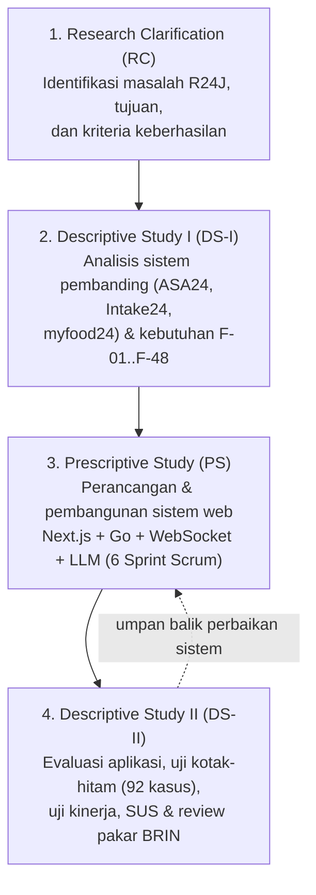

**Uraian empat tahap DRM dalam penelitian ini:**

| Tahap DRM                               | Kegiatan Penelitian                                                                                                                                                                           | Luaran / Artefak                                                                     |
| --------------------------------------- | --------------------------------------------------------------------------------------------------------------------------------------------------------------------------------------------- | ------------------------------------------------------------------------------------ |
| **1. _Research Clarification_ (RC)**    | Analisis disparitas data stunting, bias metode R24J konvensional, ketiadaan pendampingan pada sistem mandiri, dan perumusan kriteria keberhasilan                                             | Rumusan masalah Bab I & kriteria keberhasilan                                        |
| **2. _Descriptive Study I_ (DS-I)**     | Tinjauan literatur, analisis sistem pembanding (ASA24, Intake24, myfood24), serta penurunan daftar kebutuhan fungsional (F-01 s.d. F-48) dan nonfungsional                                       | Sintesis literatur Bab II (Tabel 2.1–2.2) & spesifikasi kebutuhan (Tabel 3.2–3.3)   |
| **3. _Prescriptive Study_ (PS)**        | Merancang dan membangun arsitektur sistem 3-tier, pemodelan UML, skema DB, protokol kolaborasi WebSocket, CMS anotasi poligon, dan pipeline LLM terstruktur melalui 6 sprint Scrum           | Kode sumber backend Go, frontend Next.js, dan basis data MySQL (Gambar 3.2–3.11)     |
| **4. _Descriptive Study II_ (DS-II)**   | Evaluasi aplikasi meliputi 92 uji kotak-hitam, pengukuran kinerja latensi WebSocket (2–20 concurrent clients), uji kebergunaan SUS, dan validasi rekomendasi gizi bersama 5–7 evaluator pakar BRIN | Data hasil uji, temuan cacat & perbaikan (Tabel 4.5–4.12), serta naskah Bab IV–V     |

## 3.2 Subjek Evaluasi Penelitian (Partisipan Evaluasi Artefak)

Penelitian ini merupakan penelitian rekayasa perangkat lunak dengan pendekatan _Design Research Methodology_ (DRM) tipe ke-3. Tahap _Descriptive Study II_ dilaksanakan pada tingkat **awal (_initial_)** karena evaluasi dilakukan melalui pengujian terkendali dan pemakaian terbatas bersama evaluator ahli — bukan melalui survei gizi populasi berskala penuh (Blessing & Chakrabarti, 2009). Oleh karena itu, subjek pengujian tidak melibatkan sampel responden publik dalam jumlah besar, melainkan dilakukan melalui **pengujian internal terfokus bersama 5–7 orang evaluator ahli dari Pusat Riset Kesehatan Masyarakat dan Gizi, Badan Riset dan Inovasi Nasional (BRIN)** selaku institusi mitra penyusun _Atlas Makananku_.

Ukuran 5–7 orang partisipan pakar ini merujuk pada standar evaluasi kebergunaan Nielsen dan Landauer (1993), Lewis & Sauro (2021), serta Alhadreti (2021), yang menyatakan bahwa pengujian kebergunaan formatif berbasis penelusuran tugas (_task walkthrough_) dengan 5–7 partisipan sudah mencapai titik efisiensi optimal (_point of diminishing returns_) yang mampu mengungkap 80%–85% cacat interaksi antarmuka dan friksi alur pengisian sebelum evaluasi sumatif lapangan. Faulkner (2003) juga membuktikan secara empiris bahwa 5 partisipan menemukan rerata 85,5% masalah kebergunaan dan kelompok 6–7 partisipan mengidentifikasi >90% masalah kritis. Evaluator dari BRIN memiliki keahlian ganda sebagai peneliti gizi (_domain experts_), penyusun standar porsi makan Indonesia, serta praktisi yang terbiasa melakukan survei _dietary recall_ 24 jam di lapangan.

### 3.2.1 Karakteristik dan Pembagian Peran Evaluator Internal

Sebanyak 5–7 orang evaluator dari tim BRIN menjalankan skenario evaluasi artefak sesuai dengan pembagian peran berikut:

| Peran Skenario                 | Jumlah Partisipan | Latar Belakang / Kualifikasi                             | Fokus Pengujian Artefak                                                                                                                                                                |
| ------------------------------ | ----------------- | -------------------------------------------------------- | -------------------------------------------------------------------------------------------------------------------------------------------------------------------------------------- |
| **Responden Uji**              | 2–3 orang         | Peneliti gizi BRIN (berperan sebagai responden awam)     | Menguji kemudahan pengisian alur _wizard_ R24J, kejelasan estimasi porsi visual (_series_, _range_, _guide_), dan responsivitas aplikasi web pada perangkat bergerak                      |
| **Pendamping (Enumerator)**    | 2 orang           | Tenaga riset survei gizi BRIN berpengalaman R24J         | Menguji efektivitas pendampingan jarak jauh real-time: sinkronisasi langkah _wizard_, obrolan kursor, kanvas penunjuk interaktif, serta penegakan hak akses peran _editor_ vs _viewer_ |
| **Administrator & Pakar Gizi** | 2 orang           | Peneliti utama/pengelola data gizi dan porsi pangan BRIN | Menguji fungsionalitas CMS anotasi poligon foto porsi, manajemen survei, serta memvalidasi keakuratan hitungan zat gizi deterministik dan kelayakan narasi rekomendasi AI              |

### 3.2.2 Kriteria Pemilihan Evaluator (_Purposive Sampling_)

Penetapan subjek pengujian dilakukan secara terarah (_purposive sampling_) dengan kriteria inklusi sebagai berikut:

1. Merupakan peneliti, staf periset, atau tenaga survei aktif pada Pusat Riset Kesehatan Masyarakat dan Gizi BRIN.
2. Memahami metodologi survei konsumsi pangan individu (khususnya _dietary recall_ 24 jam) dan memahami struktur instrumen _Atlas Makananku_.
3. Mengoperasikan perangkat komputer/laptop atau ponsel pintar dengan peramban modern untuk mengakses sistem Atlas Food.
4. Bersedia menuntaskan seluruh skenario pengujian fungsional terpandu dan mengisi kuesioner evaluasi kebergunaan _System Usability Scale_ (SUS) serta instrumen validasi kelayakan klinis rekomendasi gizi.

## 3.3 Alat dan Bahan Penelitian

**Tabel 3.1 Alat dan bahan penelitian**

| Kategori                    | Komponen              | Spesifikasi/Versi                                    | Fungsi                                |
| --------------------------- | --------------------- | ---------------------------------------------------- | ------------------------------------- |
| Perangkat keras             | Komputer pengembangan | `[⚠ ISI spesifikasi: prosesor, RAM, sistem operasi]` | Pengodean dan pengujian               |
|                             | Perangkat uji         | Laptop dan telepon pintar `[⚠ ISI]`                  | Uji responsivitas & UAT               |
| Perangkat lunak — antarmuka | Next.js (App Router)  | Terbaru                                              | Kerangka kerja aplikasi web           |
|                             | React + TypeScript    | —                                                    | Pustaka antarmuka & bahasa bertipe    |
|                             | Tailwind CSS          | v4                                                   | Penataan gaya berbasis _design token_ |
|                             | Zustand               | v5                                                   | Pengelolaan keadaan kolaborasi        |
|                             | TanStack Query        | —                                                    | Pengelolaan keadaan server            |
|                             | Zod + React Hook Form | —                                                    | Validasi formulir admin               |
|                             | lucide-react          | —                                                    | Pustaka ikon                          |

| | uuid | — | Pembangkit kunci idempotensi (`local_id`) |
| | Canvas 2D API | API peramban | Perenderan kanvas langsung di atas foto porsi |
| Perangkat lunak — layanan | Go | 1.22 | Bahasa pemrograman layanan |
| | Gin | 1.9.1 | Kerangka kerja HTTP |
| | gorilla/websocket | 1.5.3 | Implementasi WebSocket |
| | GORM + driver MySQL | 1.30 / 1.5.7 | Pemetaan objek-relasional |
| | golang-jwt/jwt | v5 | Autentikasi berbasis token |
| | bcrypt (`golang.org/x/crypto`) | — | _Hashing_ kata sandi |
| | gin-metrics | 0.1.13 | Ekspor metrik HTTP dalam format Prometheus |
| Basis data | MySQL | 8.x, InnoDB, utf8mb4 | Penyimpanan data |
| Layanan eksternal | Groq API | Model bawaan `llama-3.3-70b-versatile` (dapat dikonfigurasi) | Pembangkitan rekomendasi gizi |
| Pemantauan & penyebaran | Docker Compose, Prometheus, Grafana | — | Penyebaran layanan dan pemantauan metrik |
| Perkakas | Visual Studio Code, Git, Postman | — | Pengodean, versi, uji API |
| Bahan | Tabel komposisi pangan | Tabel Komposisi Pangan Indonesia (TKPI) 2020 (Kementerian Kesehatan Republik Indonesia, 2020) (sementara) | Sumber nilai zat gizi acuan (energi, protein, lemak, karbohidrat per 100 g BDD) |
| | Foto porsi _as served_ (tipe `series` & `range`) | Terinspirasi Atlas Makananku (BRIN × UPI) | Estimasi porsi visual |
| | Instrumen SUS | Brooke (1996), 10 butir | Pengukuran kebergunaan |

## 3.4 Metode Pengumpulan Data

| Teknik                        | Sumber                                                  | Data yang diperoleh                                       | Tahap DRM                        |
| ----------------------------- | ------------------------------------------------------- | --------------------------------------------------------- | -------------------------------- |
| Studi literatur               | Artikel jurnal, dokumentasi resmi, RFC                  | Landasan teori, celah penelitian, praktik baku            | RC & DS-I                        |
| Analisis sistem sejenis       | ASA24, Intake24, myfood24 (berdasarkan publikasi)       | Perbandingan fitur (Tabel 2.1)                            | DS-I                             |
| Observasi & pengujian mandiri | Sistem yang dibangun                                    | Hasil uji kotak-hitam, penelusuran skenario, temuan cacat | PS & DS-II                       |
| Instrumentasi perangkat lunak | _Log_ aplikasi, tabel `ai_result_logs`, `/collab/stats` | Latensi, jumlah token, _throughput_                       | DS-II                            |
| Kuesioner                     | Responden & pendamping                                  | Skor SUS, umpan balik kualitatif                          | DS-II                            |
| Penilaian pakar               | Ahli gizi                                               | Kelayakan klinis keluaran LLM                             | DS-II                            |

Catatan metodologis: sebagian data kinerja **tidak memerlukan instrumentasi tambahan** karena sistem sudah merekamnya secara rutin — tabel `ai_result_logs` menyimpan `model_used`, `token_used`, dan `latency_ms` untuk setiap analisis yang benar-benar dijalankan, sehingga evaluasi dapat dilakukan terhadap keluaran yang sungguh diterima responden.

## 3.5 Analisis Kebutuhan

### 3.5.1 Kebutuhan Fungsional

**Tabel 3.2 Kebutuhan fungsional sistem**

| Kode  | Kebutuhan                                                                                                                                                                                                     | Aktor                 | Prioritas                   |
| ----- | ------------------------------------------------------------------------------------------------------------------------------------------------------------------------------------------------------------- | --------------------- | --------------------------- |
| F-01  | Sistem dapat mendaftarkan dan mengautentikasi pengguna dengan peran admin atau responden                                                                                                                      | Semua                 | Wajib                       |
| F-02  | Sistem dapat menampilkan daftar survei berstatus aktif                                                                                                                                                        | Responden             | Wajib                       |
| F-02a | Sistem menyediakan katalog makanan (_Find Your Food_) di luar alur survei untuk mencari makanan dan melihat foto porsi interaktif; data dilayani _endpoint_ `/public/*` tanpa token ⚠                         | Pengguna katalog      | Wajib                       |
| F-02b | Halaman _Find Your Food_ menampilkan 13 kategori makanan dan mendukung pencarian _full-text_ minimal 3 karakter                                                                                               | Pengguna katalog      | Wajib                       |
| F-02c | Halaman detail makanan menampilkan foto porsi sesuai `photo_type` (`series` dengan deret _thumbnail_ A–H, atau `range` berupa satu foto panduan berlabel), tabel berat per foto, dan informasi gizi per 100 g | Pengguna katalog      | Wajib                       |
| F-02d | Pengguna katalog dapat menandai makanan sebagai tersimpan (_bookmark_) di perambannya                                                                                                                         | Pengguna katalog      | Opsional                    |
| F-03  | Sistem dapat mendaftarkan responden sebagai partisipan survei dan menerbitkan token akses                                                                                                                     | Responden             | Wajib                       |
| F-04  | Sistem dapat menampilkan pilihan waktu makan sesuai konfigurasi survei beserta jam bawaan                                                                                                                     | Responden             | Wajib                       |
| F-05  | Sistem dapat mencari makanan dan minuman berdasarkan kata kunci minimal tiga karakter                                                                                                                         | Responden             | Wajib                       |
| F-06  | Sistem dapat mencatat makanan yang tidak ditemukan di basis data sebagai catatan manual                                                                                                                       | Responden             | Wajib                       |
| F-07  | Sistem dapat menampilkan foto porsi _as served_ beserta beratnya dan menerima pilihan responden                                                                                                               | Responden             | Wajib                       |
| F-08  | Sistem dapat menerima masukan berat porsi manual dengan batas maksimal 5.000 gram                                                                                                                             | Responden             | Wajib                       |
| F-09  | Sistem dapat mencatat bahan tambahan beserta takaran dan satuannya                                                                                                                                            | Responden             | Opsional                    |
| F-10  | Sistem dapat menghitung nilai gizi per porsi dan total harian untuk energi, protein, karbohidrat, dan lemak                                                                                                   | Sistem                | Wajib                       |
| F-11  | Sistem dapat menampilkan ringkasan laporan sebelum pengiriman                                                                                                                                                 | Responden             | Wajib                       |
| F-12  | Sistem dapat memvalidasi kelengkapan laporan sebelum pengiriman                                                                                                                                               | Sistem                | Wajib                       |
| F-13  | Sistem dapat menyimpan laporan _recall_ ke basis data                                                                                                                                                         | Sistem                | Wajib                       |
| F-14  | Sistem dapat menyimpan progres pengisian sehingga tidak hilang saat halaman dimuat ulang                                                                                                                      | Sistem                | Wajib                       |
| F-15  | Sistem dapat membuat ruang kolaborasi untuk sesi _recall_                                                                                                                                                     | Sistem                | Wajib                       |
| F-16  | Sistem dapat menampilkan daftar peserta yang sedang aktif di ruang                                                                                                                                            | Semua                 | Wajib                       |
| F-17  | Sistem dapat menampilkan kursor peserta lain secara real-time                                                                                                                                                 | Semua                 | Wajib                       |
| F-18  | Sistem dapat menyelaraskan posisi gulir, halaman, **dan langkah _wizard_** peserta yang diikuti                                                                                                               | Semua                 | Wajib                       |
| F-19  | Sistem dapat menerbitkan tautan undangan berperan _editor_ atau _viewer_ dengan masa berlaku terbatas                                                                                                         | Pemilik ruang         | Wajib                       |
| F-20  | Sistem dapat mencegah peserta berperan _viewer_ mengubah data melalui antarmuka, klien, maupun server                                                                                                         | Sistem                | Wajib                       |
| F-21  | Sistem dapat menampilkan umpan aktivitas peserta di ruang                                                                                                                                                     | Semua                 | Opsional                    |
| F-22  | Sistem dapat mengunci entitas yang sedang disunting dan menampilkan penyuntingnya                                                                                                                             | Admin                 | **Tidak jadi lingkup v1** ⚠ |
| F-23  | Sistem dapat menjalankan analisis gizi berbasis LLM atas satu laporan                                                                                                                                         | Responden             | Wajib                       |
| F-24  | Sistem dapat menyimpan hasil analisis beserta model, jumlah token, dan latensi                                                                                                                                | Sistem                | Wajib                       |
| F-25  | Sistem dapat menyajikan hasil analisis tersimpan tanpa memanggil ulang LLM                                                                                                                                    | Sistem                | Wajib                       |
| F-26  | Sistem dapat menangani keluaran LLM yang tidak sesuai skema tanpa merusak halaman                                                                                                                             | Sistem                | Wajib                       |
| F-27  | Sistem dapat mengelola (CRUD) survei beserta konfigurasi waktu makannya                                                                                                                                       | Admin                 | Wajib                       |
| F-28  | Sistem dapat mengelola (CRUD) makanan, kategori, dan zat gizi                                                                                                                                                 | Admin                 | Wajib                       |
| F-29  | Sistem dapat mengelola set foto porsi _as served_ beserta berat gramnya                                                                                                                                       | Admin                 | Wajib                       |
| F-30  | Sistem dapat menganotasi foto makanan dengan poligon area dan menautkannya ke entri makanan                                                                                                                   | Admin                 | Wajib                       |
| F-31  | Sistem dapat menerbitkan dan menarik terbit anotasi (siklus _draft_–_published_)                                                                                                                              | Admin                 | Wajib                       |
| F-32  | Sistem dapat menampilkan dan mengekspor daftar _submission_ per survei                                                                                                                                        | Admin                 | Wajib                       |
| F-33  | Sistem dapat menyimpan progres penyuntingan anotasi secara otomatis (_autosave_)                                                                                                                              | Admin                 | Wajib                       |
| F-39  | Sistem dapat menghitung ulang nilai gizi laporan di server dari basis data pangan dan menetapkan partisipan dari identitas login, bukan dari kiriman klien                                                    | Sistem                | Wajib                       |
| F-40  | Peserta berperan _owner_/_editor_ dapat menggambar di atas foto porsi (pensil, persegi, lingkaran, penghapus) dan coretannya tampil pada seluruh peserta ruang                                                | Responden, Pendamping | Opsional                    |
| F-41  | Peserta berperan _owner_/_editor_ dapat menggunakan penunjuk laser yang memudar otomatis                                                                                                                      | Responden, Pendamping | Opsional                    |
| F-42  | Peserta yang bergabung belakangan menerima coretan kanvas yang masih aktif di ruang                                                                                                                           | Sistem                | Opsional                    |
| F-43  | Peserta dapat mengirim pesan singkat yang menempel pada kursornya (obrolan kursor)                                                                                                                            | Semua                 | Opsional                    |
| F-44  | Pemilik ruang dapat mengubah peran peserta menjadi _editor_ atau _viewer_ selama sesi berlangsung                                                                                                             | Pemilik ruang         | **Sebagian** ⚠              |
| F-45  | Pengguna dapat melihat dan mengubah profil (nama, telepon, jenis kelamin, tanggal lahir, foto) serta mengganti kata sandi                                                                                     | Semua                 | Wajib                       |
| F-46  | Responden dapat melihat riwayat dan rincian laporan miliknya sendiri                                                                                                                                          | Responden             | Wajib                       |
| F-47  | Admin dapat mengunggah gambar (JPG, PNG, WebP; maksimal 10 MB) untuk makanan dan porsi                                                                                                                        | Admin                 | Wajib                       |
| F-48  | Admin dapat menggandakan survei dan menerbitkan ulang token akses survei                                                                                                                                      | Admin                 | Opsional                    |

> **Catatan status F-02a.** _Endpoint_ `/public/*` memang tidak mensyaratkan token. Namun pada kode versi 1, rute halaman `/find-food` terdaftar sebagai rute terlindung pada `middleware.ts`, dan kotak pencarian di halaman beranda mengarahkan pengunjung ke halaman login terlebih dahulu. Dengan kata lain, **datanya publik, halamannya belum**. Lihat keputusan yang perlu diambil pada Subbab 4.1.4.

> **Catatan status F-44.** Layanan sudah menangani pesan `update_user_role` (hanya diterima dari _owner_, hanya ke peran _editor_/_viewer_), memperbarui seluruh koneksi aktif milik peserta sasaran, dan menyiarkan `user_role_updated`; klien pun sudah menerapkan perubahan itu saat diterima. Yang belum ada adalah kontrol antarmuka untuk mengirimnya. F-44 tidak disertakan dalam perhitungan tingkat keberhasilan pengujian.

> **Catatan status F-22.** Kebutuhan penguncian entitas **tidak diwujudkan sebagai fitur v1**. Mekanismenya tersedia pada lapis layanan (`LockManager` di sisi Go dan tipe pesan `db_edit_*` pada protokol) serta komponen penanda `LockIndicator` di sisi antarmuka, namun **belum ada satu pun halaman portal admin yang mengaktifkannya** — sesi kolaborasi (`CollabSession`) hanya dipasang pada halaman _recall_ dan pencarian makanan. F-22 karena itu dinyatakan sebagai kebutuhan yang teridentifikasi tetapi ditangguhkan, dan dicatat pada Subbab 5.2.1 sebagai saran pengembangan. Kebutuhan ini **tidak** disertakan dalam perhitungan tingkat keberhasilan pengujian pada Subbab 4.2.

### 3.5.2 Kebutuhan Non-Fungsional

**Tabel 3.3 Kebutuhan non-fungsional sistem**

| Kode  | Kategori       | Kebutuhan                                                                            | Kriteria keberhasilan                                                      |
| ----- | -------------- | ------------------------------------------------------------------------------------ | -------------------------------------------------------------------------- |
| NF-01 | Kinerja        | Latensi sinkronisasi kursor antar peserta                                            | ≤ 300 ms pada jaringan lokal `[⚠ VERIFIKASI]`                              |
| NF-02 | Kinerja        | Latensi sinkronisasi langkah _wizard_                                                | ≤ 500 ms `[⚠ VERIFIKASI]`                                                  |
| NF-03 | Kinerja        | Sistem menahan beban pesan tanpa kehilangan data                                     | Tidak ada _drop_ pada ≤ 50 pesan/detik/klien                               |
| NF-04 | Kinerja        | Waktu tanggap analisis LLM                                                           | ≤ 60 detik (batas waktu klien)                                             |
| NF-05 | Keandalan      | Sistem memulihkan koneksi otomatis setelah putus                                     | Rekoneksi berhasil dengan _backoff_ maksimal 30 detik                      |
| NF-06 | Keandalan      | Progres pengisian tidak hilang saat halaman dimuat ulang                             | Sesi bertahan hingga 24 jam                                                |
| NF-07 | Keandalan      | Kegagalan analisis LLM tidak merusak alur utama                                      | Halaman hasil tetap tampil dengan pesan galat                              |
| NF-08 | Keamanan       | Seluruh _endpoint_ selain publik memerlukan autentikasi                              | 401 untuk permintaan tanpa token                                           |
| NF-09 | Keamanan       | Peran _viewer_ tidak dapat mengubah data melalui jalur mana pun                      | Ditolak pada tiga lapis                                                    |
| NF-10 | Keamanan       | Peran tidak dapat dinaikkan melalui navigasi ulang tanpa parameter undangan          | Peran diingat server per pengguna                                          |
| NF-11 | Kebergunaan    | Sistem memperoleh skor SUS kategori _acceptable_                                     | Skor ≥ 68 (rerata acuan SUS; Hyzy et al., 2022)                            |
| NF-12 | Kebergunaan    | Antarmuka dapat digunakan pada layar telepon pintar                                  | Tidak ada gulir horizontal pada lebar 360 px                               |
| NF-13 | Aksesibilitas  | Kontrol yang dinonaktifkan tetap terbaca pembaca layar sebagai nonaktif              | Atribut `aria-disabled`/`inert` terpasang                                  |
| NF-14 | Pemeliharaan   | Kode terorganisasi per domain bisnis                                                 | Tidak ada ketergantungan melingkar antar domain                            |
| NF-15 | Pemeliharaan   | Kode lolos pemeriksaan tipe dan _linter_                                             | `tsc --noEmit` dan `eslint` bersih                                         |
| NF-16 | Keamanan       | Koneksi WebSocket dan permintaan lintas-asal hanya diterima dari asal yang terdaftar | Asal di luar daftar putih ditolak pada CORS dan pada _handshake_ WebSocket |
| NF-17 | Keamanan       | Kata sandi tidak disimpan dalam bentuk asli                                          | Tersimpan sebagai _hash_ bcrypt                                            |
| NF-18 | Observabilitas | Metrik layanan dapat dipantau                                                        | _Endpoint_ `/metrics` berformat Prometheus dan `/health` tersedia          |

## 3.6 Perancangan Sistem

### 3.6.1 Arsitektur Sistem

**Gambar 3.2 Arsitektur sistem Atlas Food**

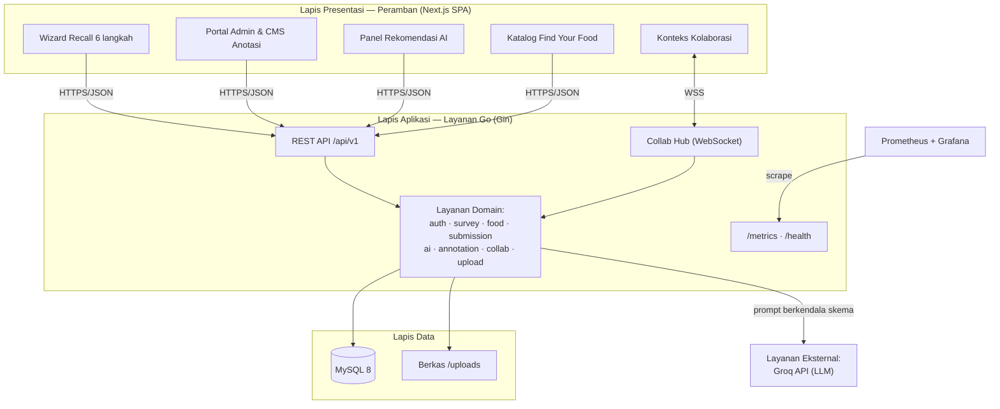

Sistem menerapkan arsitektur **tiga lapis** dengan pemisahan tegas antara presentasi, aplikasi, dan data. Layanan Go menyediakan dua kanal komunikasi dalam satu proses: REST untuk operasi permintaan–tanggapan dan WebSocket untuk komunikasi dua arah real-time.

Struktur kode kedua sisi disusun **per domain bisnis** (_domain-driven modular_), bukan per jenis berkas, sehingga setiap fitur dapat ditelusuri sebagai satu unit. Di sisi layanan, tiap domain memuat `model.go`, `dto.go`, `repository.go`, `service.go`, dan `handler.go`. Di sisi antarmuka, tiap domain memuat `components/`, `hooks/`, `services/`, `store/`, dan `types/`. Aturan ketergantungan bersifat searah: `app/` → `internal/domain/*` → `internal/lib|pkg`, tanpa ketergantungan melingkar antar domain (memenuhi NF-14).

### 3.6.2 _Use Case Diagram_

**Tabel 3.4 Definisi aktor sistem**

| Aktor         | Deskripsi                                                                            |
| ------------- | ------------------------------------------------------------------------------------ |
| Responden     | Pengguna yang mengisi laporan _recall_ atas dirinya sendiri                          |
| Pendamping    | Responden lain yang diundang ke ruang kolaborasi dengan peran _editor_ atau _viewer_ |
| Administrator | Pengelola survei, basis data pangan, dan aset anotasi                                |
| Sistem LLM    | Aktor sistem eksternal yang menghasilkan rekomendasi gizi                            |

**Gambar 3.3 _Use case diagram_ sistem**

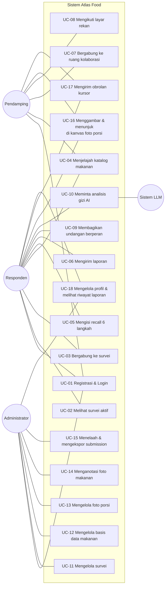

### 3.6.3 Skenario _Use Case_

**Tabel 3.5 Skenario _use case_ UC-05 (Mengisi recall)**

| Bagian                   | Uraian                                                                                                                                                                                                                                                                                                                                                                                                                                                                                                                                                                                                                                                                                                                                                                                                                                      |
| ------------------------ | ------------------------------------------------------------------------------------------------------------------------------------------------------------------------------------------------------------------------------------------------------------------------------------------------------------------------------------------------------------------------------------------------------------------------------------------------------------------------------------------------------------------------------------------------------------------------------------------------------------------------------------------------------------------------------------------------------------------------------------------------------------------------------------------------------------------------------------------- |
| **Kode / Nama**          | UC-05 / Mengisi _recall_ enam langkah                                                                                                                                                                                                                                                                                                                                                                                                                                                                                                                                                                                                                                                                                                                                                                                                       |
| **Aktor**                | Responden                                                                                                                                                                                                                                                                                                                                                                                                                                                                                                                                                                                                                                                                                                                                                                                                                                   |
| **Deskripsi**            | Responden mencatat seluruh konsumsi pada satu waktu makan hingga siap dikirim                                                                                                                                                                                                                                                                                                                                                                                                                                                                                                                                                                                                                                                                                                                                                               |
| **Prakondisi**           | Responden sudah masuk sebagai partisipan survei dan memiliki token akses                                                                                                                                                                                                                                                                                                                                                                                                                                                                                                                                                                                                                                                                                                                                                                    |
| **Pascakondisi**         | Laporan tersimpan di sesi lokal dan siap dikirim                                                                                                                                                                                                                                                                                                                                                                                                                                                                                                                                                                                                                                                                                                                                                                                            |
| **Alur utama**           | 1. Sistem menampilkan pilihan waktu makan sesuai `meals_config`<br/>2. Responden memilih jenis waktu makan dan menyetel jam<br/>3. Sistem berpindah ke langkah tambah makanan<br/>4. Responden mengetik kata kunci minimal tiga karakter<br/>5. Sistem menampilkan hasil pencarian<br/>6. Responden memilih makanan; sistem menambahkannya ke daftar<br/>7. Responden mengulangi langkah 4–6 untuk seluruh item<br/>8. Sistem berpindah ke langkah porsi<br/>9. Responden memilih foto porsi atau mengisi berat manual untuk tiap makanan<br/>10. Sistem menghitung nilai gizi tiap porsi secara deterministik (TKPI 2020)<br/>11. Responden mengisi bahan tambahan (opsional)<br/>12. Sistem menampilkan ringkasan dan total gizi harian<br/>13. Responden menekan "Kirim laporan" dan sistem memvalidasi serta mengirim laporan ke server |
| **Alur alternatif A1**   | Pada langkah 5, hasil pencarian kosong → sistem menawarkan pencatatan manual → item masuk `missing_foods` dan ditampilkan terpisah dengan penanda "tanpa nilai gizi"                                                                                                                                                                                                                                                                                                                                                                                                                                                                                                                                                                                                                                                                        |
| **Alur alternatif A2**   | Pada langkah 9, pemuatan foto porsi gagal → sistem menampilkan galat dan responden tetap dapat mengisi berat manual                                                                                                                                                                                                                                                                                                                                                                                                                                                                                                                                                                                                                                                                                                                         |
| **Alur alternatif A3**   | Pada langkah 12, responden menekan "Tambah waktu makan" → sistem kembali ke langkah 1 dengan mempertahankan data waktu makan sebelumnya dan mengatur ulang indeks porsi                                                                                                                                                                                                                                                                                                                                                                                                                                                                                                                                                                                                                                                                     |
| **Alur pengecualian E1** | Validasi gagal (tidak ada waktu makan terisi, atau ada porsi bernilai nol) → tombol kirim dinonaktifkan disertai pesan sebab                                                                                                                                                                                                                                                                                                                                                                                                                                                                                                                                                                                                                                                                                                                |
| **Alur pengecualian E2** | Pengiriman ke server gagal → sistem menampilkan pesan galat dan mempertahankan seluruh isian                                                                                                                                                                                                                                                                                                                                                                                                                                                                                                                                                                                                                                                                                                                                                |

**Tabel 3.6 Skenario _use case_ UC-08 (Mengikuti layar rekan)**

| Bagian                   | Uraian                                                                                                                                                                                                                                                                                                                                                                                                                                                                                                                                  |
| ------------------------ | --------------------------------------------------------------------------------------------------------------------------------------------------------------------------------------------------------------------------------------------------------------------------------------------------------------------------------------------------------------------------------------------------------------------------------------------------------------------------------------------------------------------------------------- |
| **Kode / Nama**          | UC-08 / Mengikuti layar rekan (_follow mode_)                                                                                                                                                                                                                                                                                                                                                                                                                                                                                           |
| **Aktor**                | Pendamping                                                                                                                                                                                                                                                                                                                                                                                                                                                                                                                              |
| **Deskripsi**            | Pendamping menyelaraskan tampilannya dengan peserta lain, termasuk langkah _wizard_ aktif                                                                                                                                                                                                                                                                                                                                                                                                                                               |
| **Prakondisi**           | Pendamping berada di ruang kolaborasi yang sama dan koneksi berstatus tersambung                                                                                                                                                                                                                                                                                                                                                                                                                                                        |
| **Pascakondisi**         | Tampilan pendamping mengikuti halaman, posisi gulir, dan langkah pemimpin                                                                                                                                                                                                                                                                                                                                                                                                                                                               |
| **Alur utama**           | 1. Pendamping menekan avatar peserta yang ingin diikuti<br/>2. Sistem mengirim `follow_user`<br/>3. _Hub_ menetapkan pemimpin dan memberitahu kedua pihak melalui `follow_started`<br/>4. _Hub_ menyiarkan `follow_state` ke seluruh ruang<br/>5. _Hub_ mengirim _viewport_ terakhir pemimpin yang tersimpan<br/>6. Sistem memindahkan pendamping ke halaman, posisi gulir, dan **langkah** pemimpin<br/>7. Setiap perubahan pemimpin dikirim sebagai `viewport_update` dan diteruskan sebagai `viewport_sync` hanya kepada pengikutnya |
| **Alur alternatif A1**   | Pendamping menekan "Stop following" → sistem mengirim `unfollow_user` dan penyelarasan berhenti                                                                                                                                                                                                                                                                                                                                                                                                                                         |
| **Alur alternatif A2**   | Pemimpin meninggalkan ruang → sistem menghapus status ikut dan mengosongkan _viewport_ pemimpin                                                                                                                                                                                                                                                                                                                                                                                                                                         |
| **Alur pengecualian E1** | Pendamping mencoba mengikuti dirinya sendiri → permintaan ditahan di klien sebelum dikirim                                                                                                                                                                                                                                                                                                                                                                                                                                              |
| **Alur pengecualian E2** | Pengguna target tidak ada di ruang → _hub_ mengirim galat `NOT_FOUND`                                                                                                                                                                                                                                                                                                                                                                                                                                                                   |
| **Aturan khusus**        | Selama mengikuti, pendamping berhenti menyiarkan kursor dan pencariannya sendiri, serta tidak memantulkan balik langkah pemimpin, untuk mencegah _loop_ pemantulan                                                                                                                                                                                                                                                                                                                                                                      |

`[⚠ LENGKAPI skenario untuk UC-01 s.d. UC-15 dengan format yang sama bila pembimbing meminta seluruhnya]`

### 3.6.4 _Activity Diagram_

**Gambar 3.4 _Activity diagram_ pengisian recall**

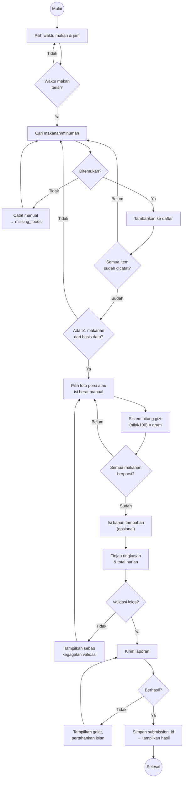

**Gambar 3.5 _Activity diagram_ sesi kolaborasi**

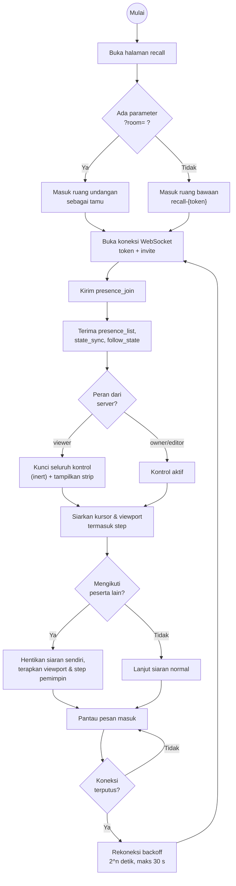

### 3.6.5 _Sequence Diagram_

**Gambar 3.6 _Sequence diagram_ pengisian hingga analisis AI**

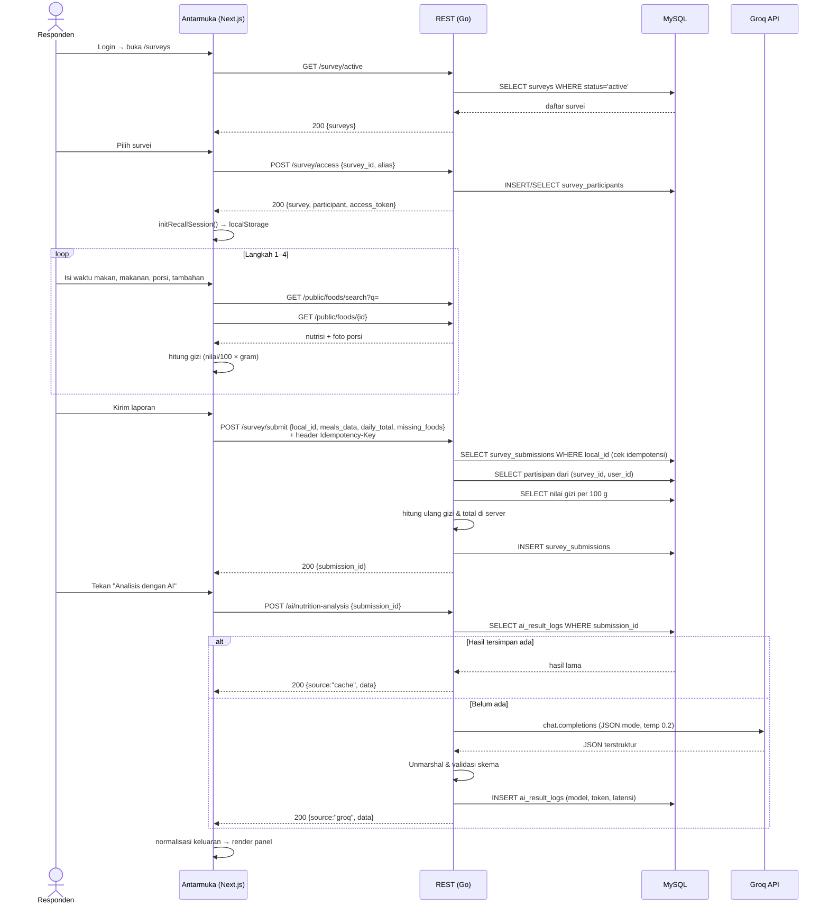

**Gambar 3.7 _Sequence diagram_ mode ikut dan sinkronisasi langkah**

```mermaid
sequenceDiagram
    participant P as Pendamping (pengikut)
    participant H as Collab Hub
    participant R as Responden (pemimpin)

    Note over P,R: Keduanya sudah tersambung ke ruang yang sama
    P->>H: follow_user {user_id: R}
    H->>H: set FollowingUserID
    H-->>P: follow_started {leader_id, leader_name, leader_color}
    H-->>R: follow_started (pemberitahuan diikuti)
    H-->>P: follow_state (snapshot graf ikut)
    H-->>R: follow_state
    H-->>P: viewport_sync (viewport tersimpan terakhir, termasuk step)
    P->>P: Terapkan halaman + gulir + goToStep(step)

    Note over R: Responden berpindah dari langkah 2 ke 3
    R->>H: viewport_update {page, path, scroll, step:"portion"}
    H->>H: Simpan Viewport terakhir R (replace)
    H-->>P: viewport_sync {…, step:"portion"}
    P->>P: Validasi step terhadap daftar langkah sah
    P->>P: goToStep("portion")

    Note over R: Responden menggulir halaman
    R->>H: viewport_update {scroll, step:"portion"}
    Note right of R: step WAJIB disertakan;<br/>tanpa itu viewport tersimpan<br/>kehilangan jejak langkah
    H-->>P: viewport_sync
    P->>H: unfollow_user
    H-->>P: follow_stopped
```

### 3.6.6 Diagram Keadaan _Wizard_

**Gambar 3.10 Diagram keadaan _wizard_ enam langkah**

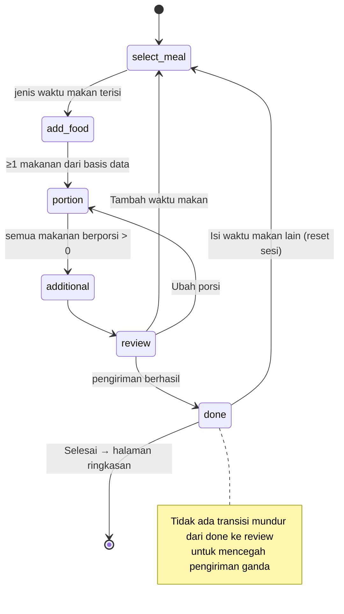

Pemetaan enam langkah ini terhadap metode lintasan berganda (Subbab 2.1): langkah 1–2 setara lintasan daftar cepat dan penggalian item terlupakan; langkah 3 setara lintasan rincian porsi; langkah 4 setara penggalian bahan; langkah 5 setara tinjauan akhir.

### 3.6.7 _Class Diagram_

**Gambar 3.8 _Class diagram_ domain inti**

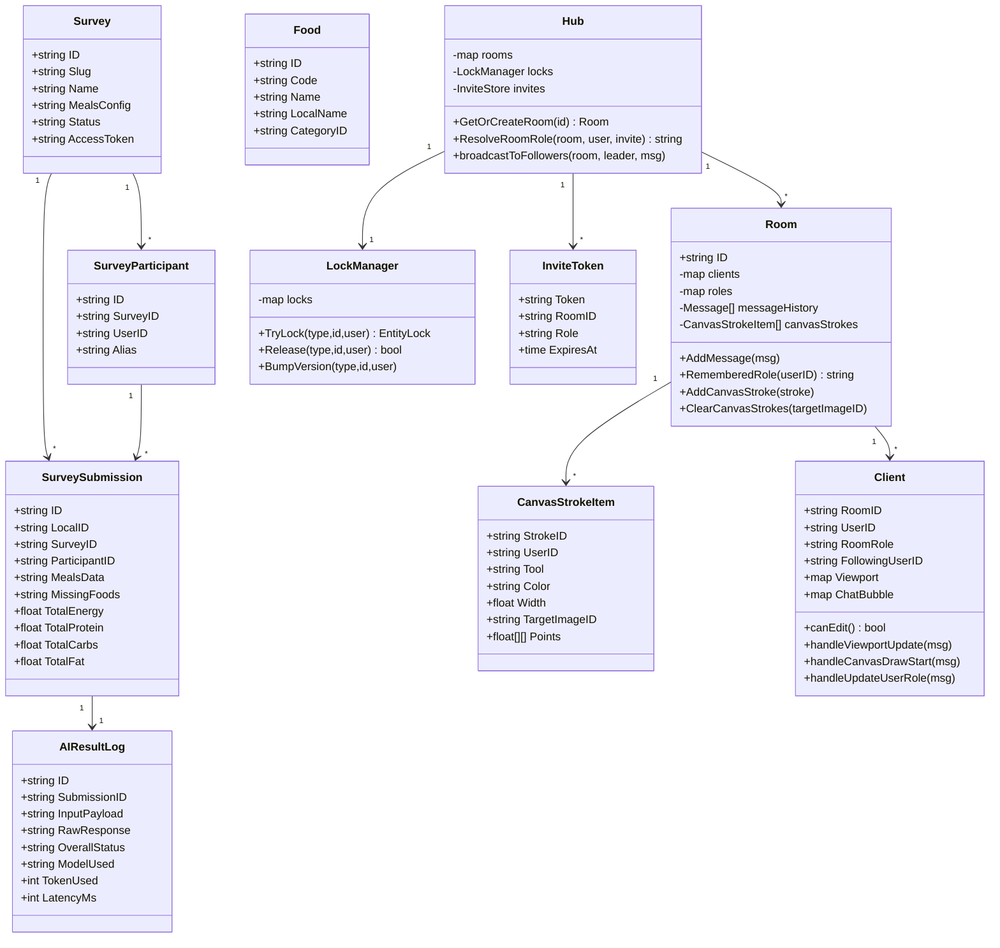

### 3.6.8 Perancangan Basis Data

**Gambar 3.9 _Entity Relationship Diagram_**

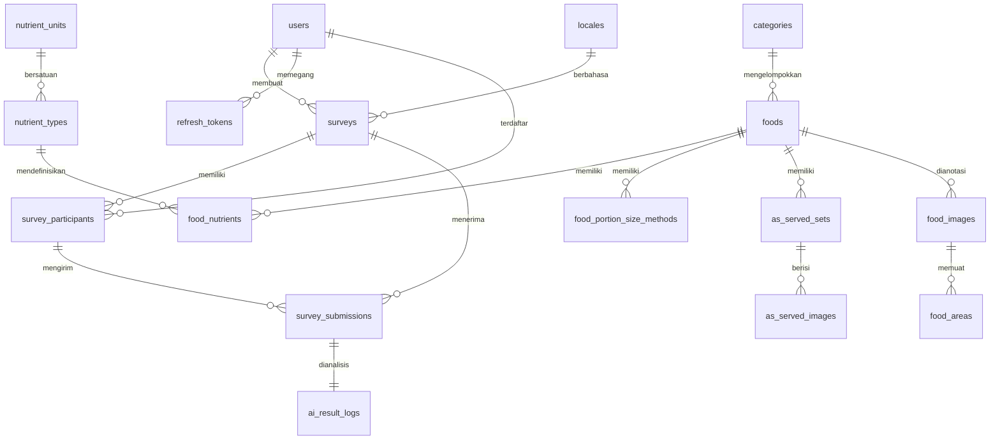

**Tabel 3.7 Struktur tabel basis data (ringkas)**

| Tabel                                                | Kolom kunci                                                                                                                                                                    | Keterangan                                                                                                                 |
| ---------------------------------------------------- | ------------------------------------------------------------------------------------------------------------------------------------------------------------------------------ | -------------------------------------------------------------------------------------------------------------------------- |
| `users`                                              | `id`, `email`, `password_hash`, `role`, `phone`, `gender`, `birth_date`, `photo_url`                                                                                           | `role` ∈ {admin, respondent}; empat kolom terakhir adalah data profil (migrasi 009)                                        |
| `refresh_tokens`                                     | `user_id`, _hash_ token, masa berlaku                                                                                                                                          | Token penyegar disimpan dalam bentuk _hash_, bukan nilai aslinya                                                           |
| `surveys`                                            | `id`, `slug`, `meals_config` (JSON), `status`, `access_token`, `created_by`                                                                                                    | `meals_config` menentukan pilihan waktu makan pada langkah 1                                                               |
| `survey_participants`                                | `id`, `survey_id`, `user_id` (wajib), `alias`                                                                                                                                  | Menautkan pengguna ke survei; partisipan anonim tidak didukung (migrasi 006)                                               |
| `survey_submissions`                                 | `id`, **`local_id` (UNIQUE)**, `survey_id`, `participant_id`, `meals_data` (JSON), `missing_foods` (JSON), `total_energy`, `total_protein`, `total_carbs`, `total_fat`         | Laporan _recall_ final; `local_id` adalah kunci idempotensi dari klien (migrasi 010)                                       |
| `ai_result_logs`                                     | `id`, `submission_id` (**UNIQUE**), `input_payload`, `raw_response`, `overall_status`, `model_used`, `token_used`, `latency_ms`                                                | Hasil analisis + jejak audit                                                                                               |
| `categories`                                         | `id`, `code`, `name`, `display_order`                                                                                                                                          | Kategori makanan                                                                                                           |
| `foods`                                              | `id`, `code`, `name`, `local_name`, `category_id`, **`photo_type`**                                                                                                            | Indeks **FULLTEXT** pada (`name`, `local_name`); `photo_type` ∈ {series, range} menentukan komponen visualisasi foto porsi |
| `nutrient_types`, `nutrient_units`, `food_nutrients` | —                                                                                                                                                                              | Nilai zat gizi per 100 g bahan pangan (sementara merujuk data TKPI 2020)                                                   |
| `food_portion_size_methods`                          | `food_id`, `method_type`, `config` (JSON)                                                                                                                                      | `method_type` ∈ {as_served, guide_image, weight}                                                                           |
| `as_served_sets`, `as_served_images`                 | `set_id`, `weight_gram`, `image_url`, `label`                                                                                                                                  | Aset foto porsi; `label` berupa kode A–H untuk tipe _series_                                                               |
| `food_images`, `food_areas`                          | `food_images`: `image_url`, `width`, `height`, `status` ∈ {draft, published, archived}, `primary_food_id`; `food_areas`: `polygon` (JSON), `food_id`, `z_index`, `weight_gram` | CMS anotasi; `weight_gram` per area (migrasi 011) memungkinkan satu foto panduan memuat berat tiap ukuran                  |
| `locales`                                            | `code`, `name`                                                                                                                                                                 | Multi-bahasa (id, en)                                                                                                      |

**Penyimpanan sisi klien.** Selain basis data server, antarmuka memakai tiga tempat penyimpanan di peramban, masing-masing dengan peran berbeda:

| Penyimpanan    | Isi                                                       | Masa hidup                |
| -------------- | --------------------------------------------------------- | ------------------------- |
| `localStorage` | Sesi pengisian _wizard_ (`RecallSession`)                 | 24 jam                    |
| _Cookie_       | Token akses dan token penyegar; daftar _bookmark_ katalog | 24 jam / 30 hari; 1 tahun |

**Catatan migrasi basis data.** Skema dibangun melalui sebelas berkas migrasi bernomor (`001`–`011`). Kolom `photo_type ENUM('series', 'range') DEFAULT 'series'` dan indeks `FULLTEXT` pada (`name`, `local_name`) ditambahkan ke tabel `foods` melalui `007_update_foods_photo_type.sql`, sehingga nilai lama secara otomatis dianggap bertipe `series` tanpa pembaruan data massal. Pencarian pada _endpoint_ publik menggunakan `MATCH(name, local_name) AGAINST(? IN BOOLEAN MODE)` untuk memanfaatkan indeks tersebut. Kata kunci pengguna dibersihkan lebih dahulu dari operator mode Boolean (`+ - > < ( ) ~ * : " & | @`) dan setiap kata dijadikan pencocokan awalan (`nasi*`); tanpa pembersihan ini, tanda kutip yang tidak berpasangan membuat MySQL melempar galat sintaks dan pencarian membalas 500. Karakter _wildcard_ `%` dan `_` pada cabang `LIKE` juga di-_escape_.

**Justifikasi penggunaan kolom JSON.** Struktur satu laporan _recall_ bersifat bersarang dan variatif: jumlah waktu makan, makanan, dan bahan tambahan berbeda tiap responden. Normalisasi penuh akan menghasilkan banyak tabel dengan _join_ dalam untuk satu kali baca, padahal laporan **selalu dibaca sebagai satu kesatuan** dan tidak pernah dikueri per baris makanan. Total gizi tetap didenormalisasi ke kolom numerik agar agregasi lintas responden tetap murah. Konsekuensi metodologis yang menguntungkan: nilai gizi yang tersimpan merupakan _snapshot_ pada saat pengisian, sehingga perubahan basis data makanan di kemudian hari tidak mengubah laporan historis.

### 3.6.9 Perancangan Antarmuka

`[⚠ LAMPIRKAN wireframe/mockup untuk: (1) halaman daftar survei, (2) enam layar wizard, (3) bilah kolaborasi + avatar kehadiran, (4) modal berbagi undangan, (5) panel rekomendasi AI, (6) dasbor admin, (7) editor anotasi]`

Prinsip perancangan antarmuka yang diterapkan:

1. **Satu keputusan per layar.** Setiap langkah _wizard_ meminta satu jenis keputusan untuk menekan beban kognitif responden.
2. **Progres selalu terlihat.** Bilah progres, penomoran langkah, dan bilah samping menunjukkan posisi responden dalam alur.
3. **Umpan balik segera atas kegagalan.** Pencarian yang gagal, pemuatan porsi yang gagal, dan validasi yang tidak lolos ditampilkan sebagai pesan spesifik — bukan kegagalan senyap.
4. **Kolaborasi tidak mengganggu.** Elemen kolaborasi ditempatkan pada bilah terpisah di atas konten agar tidak menutupi alur pengisian.
5. **Keadaan terkunci terbaca jelas.** Peserta _viewer_ memperoleh strip penjelas dan tampilan meredup, bukan kontrol yang diam-diam tidak berfungsi.

## 3.7 Teknik Pengujian

**Tabel 3.8 Instrumen pengujian dan teknik analisis**

| Jenis pengujian          | Instrumen                                                                       | Responden/Objek                | Teknik analisis                                |
| ------------------------ | ------------------------------------------------------------------------------- | ------------------------------ | ---------------------------------------------- |
| Kotak-hitam              | Tabel kasus uji berbasis kebutuhan fungsional F-01…F-48 (kecuali F-22 dan F-44) | Sistem                         | Persentase kasus uji berstatus "Sesuai"        |
| Penelusuran _end-to-end_ | Skenario alur lengkap responden dan pendamping                                  | Sistem                         | Klasifikasi cacat berdasarkan jenis            |
| Kinerja real-time        | Instrumentasi waktu pada klien dan `/collab/stats`                              | 2, 5, 10, 20 klien             | Statistik deskriptif: rerata, p50, p95         |
| Penerimaan pengguna      | Kuesioner SUS 10 butir                                                          | ≥ 20 responden, ≥ 5 pendamping | Perhitungan skor SUS                           |
| Penilaian pakar          | Lembar penilaian keluaran LLM                                                   | 2–3 ahli gizi                  | Rerata skor Likert + kesepakatan antar-penilai |

### 3.7.1 Pengujian Kotak-Hitam

Pengujian kotak-hitam menguji sistem dari sisi masukan dan keluaran tanpa memeriksa struktur internal. Setiap kebutuhan fungsional diturunkan menjadi satu atau lebih kasus uji dengan format: kode, skenario, masukan, hasil yang diharapkan, hasil yang diperoleh, dan status (Sesuai/Tidak Sesuai). Rancangan kasus uji disajikan pada Subbab 4.2.

Tingkat keberhasilan dihitung dengan:

$$\text{Tingkat keberhasilan} = \frac{\text{jumlah kasus uji berstatus Sesuai}}{\text{jumlah seluruh kasus uji}} \times 100\%$$

### 3.7.2 Pengujian Kinerja

Metrik yang diukur dan definisi operasionalnya:

| Metrik                       | Definisi operasional                                                                      | Cara ukur                                                            |
| ---------------------------- | ----------------------------------------------------------------------------------------- | -------------------------------------------------------------------- |
| Latensi kursor               | Selisih waktu antara `cursor_move` dikirim pemimpin dan `cursor_update` dirender pengikut | Sisipkan `t_send` pada muatan; catat `performance.now()` saat render |
| Latensi sinkronisasi langkah | Selisih waktu antara pemimpin berpindah langkah dan pengikut berada di langkah sama       | Instrumentasi `viewport_update` → `goToStep`                         |
| _Throughput_ _hub_           | Pesan per detik yang dilayani tanpa _drop_                                                | `/collab/stats` + penghitung _drop_ pada buffer kirim                |
| Skalabilitas                 | Latensi p50/p95 pada 2, 5, 10, 20 klien serentak                                          | Klien sintetis WebSocket                                             |
| Efektivitas _batching_       | Rasio pesan kursor masuk terhadap pesan tersiar                                           | Bandingkan penghitung sebelum dan sesudah _coalescing_               |
| Waktu pemulihan              | Waktu hingga status kembali "tersambung" setelah pemutusan paksa                          | Simulasi putus jaringan                                              |

Rancangan pembanding yang digunakan adalah **dengan dan tanpa mekanisme _batching_ + _coalescing_** pada beban identik. Rancangan ini menghasilkan klaim yang dapat dipertahankan tanpa perlu membandingkan dengan produk pihak ketiga yang kondisi ujinya tidak dapat dikendalikan.

### 3.7.3 Pengujian Penerimaan Pengguna

Instrumen yang digunakan adalah _System Usability Scale_ (SUS) yang dikembangkan Brooke (1996), terdiri atas 10 pernyataan dengan skala Likert 1–5. Butir bernomor ganjil bernada positif dan bernomor genap bernada negatif.

Perhitungan skor:

1. Butir ganjil: skor = (nilai jawaban − 1)
2. Butir genap: skor = (5 − nilai jawaban)
3. Skor SUS = (jumlah seluruh skor) × 2,5

**Tabel 3.9 Interpretasi skor SUS (Bangor et al., 2008; Brooke, 1996)**

| Rentang skor | Predikat         | Tingkat penerimaan |
| ------------ | ---------------- | ------------------ |
| > 80,3       | A — Excellent    | Acceptable         |
| 68–80,3      | B — Good         | Acceptable         |
| = 68         | C — Okay (batas) | Marginal           |
| 51–67,9      | D — Poor         | Marginal           |
| < 51         | F — Awful        | Not acceptable     |

Nilai 68 dipakai sebagai batas karena merupakan rerata acuan SUS (SB 12,5) menurut penentuan empiris Bangor et al. (2008). Meta-analisis atas 117 skor SUS dari 114 aplikasi kesehatan digital menyimpulkan bahwa acuan tersebut tetap sesuai untuk menilai aplikasi kesehatan digital (Hyzy et al., 2022).

Instrumen SUS versi bahasa Indonesia yang digunakan dilampirkan pada Lampiran B.

### 3.7.4 Pengujian Keluaran LLM

Tiga aspek diuji:

1. **Validitas skema** — persentase respons yang lolos penguraian JSON tanpa perbaikan, dari N laporan uji.
2. **Konsistensi** — laporan identik dianalisis ulang M kali dengan penyimpanan hasil dinonaktifkan; diukur kesamaan `overall_status` dan tumpang tindih `recommended_foods` menggunakan indeks Jaccard.
3. **Kelayakan klinis** — panel ahli gizi menilai relevansi dan keamanan rekomendasi pada skala Likert; kesepakatan antar-penilai dihitung dengan Cohen's/Fleiss' κ.

## 3.8 Jadwal Penelitian

**Tabel 3.10 Jadwal penelitian**

| No  | Kegiatan                             | Bulan 1 | Bulan 2 | Bulan 3 | Bulan 4 | Bulan 5 | Bulan 6 |
| --- | ------------------------------------ | ------- | ------- | ------- | ------- | ------- | ------- |
| 1   | Studi literatur & analisis kebutuhan | ██      | ██      |         |         |         |         |
| 2   | Perancangan sistem                   |         | ██      | ██      |         |         |         |
| 3   | Implementasi backend                 |         |         | ██      | ██      |         |         |
| 4   | Implementasi frontend                |         |         | ██      | ██      | ██      |         |
| 5   | Pengujian kotak-hitam & perbaikan    |         |         |         |         | ██      |         |
| 6   | Pengujian kinerja & UAT              |         |         |         |         | ██      | ██      |
| 7   | Penyusunan laporan                   |         |         |         | ██      | ██      | ██      |

`[⚠ SESUAIKAN dengan jadwal sebenarnya]`

---

---

# BAB IV HASIL DAN PEMBAHASAN

## 4.1 Hasil Implementasi Sistem

Sistem berhasil diimplementasikan sesuai rancangan pada BAB III. Verifikasi teknis yang telah dijalankan: pemeriksaan tipe `tsc --noEmit` tanpa galat, proses `next build` berhasil, dan pemeriksaan `eslint` bersih pada seluruh berkas modul _recall_, kolaborasi, dan AI — memenuhi NF-15.

### 4.1.1 Implementasi Modul Responden

Modul ini diwujudkan sebagai _wizard_ enam langkah dalam satu rute (`/surveys/{accessToken}/recall`) dengan keadaan langkah dikelola oleh _hook_ `useRecallSession`.

**Pengelolaan keadaan.** Seluruh keadaan sesi disimpan dalam satu objek `RecallSession` yang memuat identitas survei, langkah aktif, waktu makan aktif, indeks porsi, daftar waktu makan beserta makanannya, daftar makanan yang tidak ditemukan, dan `submission_id`. Setiap mutasi menulis ulang objek tersebut ke `localStorage` dalam _envelope_ `{savedAt, session}` ber-TTL 24 jam (memenuhi F-14 dan NF-06).

**Perhitungan gizi (F-10).** Diimplementasikan secara deterministik:

```
nilai_gizi_porsi = (nilai_per_100g ÷ 100) × berat_porsi_gram
```

dibulatkan satu desimal, kemudian diakumulasi menjadi total per waktu makan dan total harian.

**Perhitungan ulang di server (F-39).** Angka yang dihitung antarmuka berfungsi sebagai umpan balik segera bagi responden, tetapi **bukan** angka yang disimpan. Saat laporan diterima, layanan menghitung ulang nilai gizi setiap makanan dari nilai per 100 g di basis data dan berat porsi yang dilaporkan, lalu menyusun ulang total per waktu makan dan total harian (`calculateTotals`). Makanan yang tidak dikenali basis data memakai nilai kiriman klien apa adanya. Dengan cara yang sama, partisipan ditetapkan server dari pasangan (`survey_id`, identitas login), bukan dari `participant_id` kiriman klien, dan survei diperiksa masih berstatus aktif. Rancangan ini mencegah klien yang dimodifikasi mengirim angka gizi sembarang atau mengirim laporan atas nama partisipan lain.

**Validasi (F-12).** Tiga aturan ditegakkan sebelum pengiriman: `survey_id` harus ada; minimal satu waktu makan berisi makanan; seluruh makanan pada waktu makan terisi wajib memiliki `portion_gram > 0`.

`[⚠ LAMPIRKAN Gambar 4.3–4.8: tangkapan layar keenam langkah wizard]`

### 4.1.2 Implementasi Modul Kolaborasi

**Gambar 4.1 Topologi _hub_–_room_–_client_**

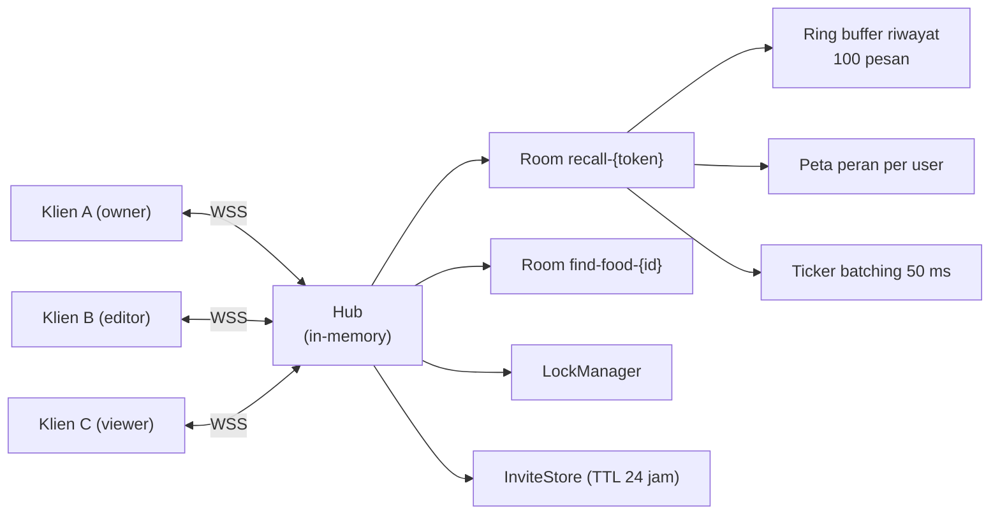

**Tabel 4.2 Protokol pesan WebSocket**

| Arah | Tipe pesan                                                                                                                             | Muatan utama                                                         | Mutasi data   |
| ---- | -------------------------------------------------------------------------------------------------------------------------------------- | -------------------------------------------------------------------- | ------------- |
| K→S  | `presence_join`                                                                                                                        | `user_id`, `display_name`, `role`                                    | Tidak         |
| K→S  | `cursor_move`                                                                                                                          | `x`, `y`, `scroll_x`, `scroll_y`, `page`                             | Tidak         |
| K→S  | `viewport_update`                                                                                                                      | `page`, `path`, `scroll_x`, `scroll_y`, **`step`**, `zoom`           | Tidak         |
| K→S  | `follow_user` / `unfollow_user`                                                                                                        | `user_id`                                                            | Tidak         |
| K→S  | `food_search`                                                                                                                          | `query`, `filters`                                                   | **Ya**        |
| K→S  | `food_select`                                                                                                                          | `food_id`, `food_name`                                               | **Ya**        |
| K→S  | `meal_add`                                                                                                                             | `meal_type`, `food_id`, `food_name`                                  | **Ya**        |
| K→S  | `portion_set`                                                                                                                          | `food_id`, `portion_gram`, `image_label`                             | **Ya**        |
| K→S  | `review_submit`                                                                                                                        | `survey_id`                                                          | **Ya**        |
| K→S  | `db_edit_start/field/save/cancel` ⚠                                                                                                    | `entity_type`, `entity_id`, `version`                                | **Ya**        |
| K→S  | `canvas_draw_start`                                                                                                                    | `stroke_id`, `tool`, `color`, `width`, `target_image_id`, `x`, `y`   | **Ya**        |
| K→S  | `canvas_draw_move` / `canvas_draw_end`                                                                                                 | `stroke_id`, `points[]`                                              | **Ya**        |
| K→S  | `canvas_laser_move`                                                                                                                    | `x`, `y`, `color`, `target_image_id`                                 | **Ya**        |
| K→S  | `canvas_clear`                                                                                                                         | `target_image_id` (kosong = seluruh ruang)                           | **Ya**        |
| K→S  | `cursor_chat_open` / `cursor_chat_update` / `cursor_chat_close`                                                                        | `x`, `y`, `text`                                                     | Tidak         |
| K→S  | `update_user_role` ⚠⚠                                                                                                                  | `target_user_id`, `new_role`                                         | Hanya _owner_ |
| K→S  | `get_history`, `ping`                                                                                                                  | —                                                                    | Tidak         |
| S→K  | `presence_list`, `presence_joined`, `presence_left`                                                                                    | daftar/identitas peserta                                             | —             |
| S→K  | `cursor_update`, `viewport_sync`                                                                                                       | posisi, halaman, **langkah**                                         | —             |
| S→K  | `follow_started`, `follow_stopped`, `follow_state`                                                                                     | relasi pemimpin–pengikut                                             | —             |
| S→K  | `food_search_shared`, `food_selected`, `meal_updated`, `portion_updated`                                                               | siaran aktivitas                                                     | —             |
| S→K  | `db_locked`, `db_unlocked`, `db_edit_saved`                                                                                            | status kunci entitas                                                 | —             |
| S→K  | `canvas_stroke_started`, `canvas_stroke_updated`, `canvas_stroke_ended`, `canvas_laser_updated`, `canvas_cleared`, `canvas_state_sync` | coretan, laser, dan cuplikan kanvas bagi peserta yang baru bergabung | —             |
| S→K  | `cursor_chat_updated`, `cursor_chat_closed`                                                                                            | posisi jangkar, teks, warna, peran                                   | —             |
| S→K  | `user_role_updated`                                                                                                                    | `target_user_id`, `new_role`, `changed_by`                           | —             |
| S→K  | `state_sync`, `history`, `activity_log`, `error`, `pong`                                                                               | sinkronisasi & sistem                                                | —             |

Kolom "Mutasi data" menandai pesan yang melewati gerbang peran: pesan bertanda **Ya** ditahan klien dan ditolak server bila pengirimnya _viewer_. Pesan kanvas ikut digolongkan demikian meskipun tidak mengubah laporan, agar _viewer_ benar-benar hanya menjadi pengamat.

⚠⚠ `update_user_role` ditangani penuh oleh _hub_ dan `user_role_updated` diterapkan klien, tetapi belum ada kontrol antarmuka yang mengirimkannya (catatan status F-44, Subbab 3.5.1).

⚠ Tipe pesan `db_edit_*` beserta pasangannya `db_locked`/`db_unlocked`/`db_edit_saved` **tersedia dan tertangani pada protokol maupun _hub_, tetapi belum ada klien yang mengirimkannya** pada versi 1 karena penguncian entitas belum diintegrasikan ke portal admin (catatan status F-22, Subbab 3.5.1).

**Tabel 4.3 Parameter kendali transport real-time**

| Mekanisme                   | Nilai                                                                                       | Justifikasi                                                                                                     |
| --------------------------- | ------------------------------------------------------------------------------------------- | --------------------------------------------------------------------------------------------------------------- |
| Batas ukuran pesan          | 64 KB                                                                                       | Menolak muatan abnormal                                                                                         |
| Batas laju                  | 50 pesan/detik/klien                                                                        | Melindungi _hub_ dari banjir pesan (NF-03)                                                                      |
| _Throttling_ di klien       | Kursor 66 ms; _viewport_ 100 ms; titik coretan kanvas dikumpulkan dan dikirim tiap 16 ms    | Menekan frekuensi sejak dari pengirim                                                                           |
| _Batching_                  | _Ticker_ 50 ms; _flush_ paksa pada 50 pesan antre                                           | Meredam frekuensi tinggi kursor/_viewport_/kanvas                                                               |
| _Coalescing_ kursor & laser | Hanya posisi terakhir per pengguna dikirim                                                  | Membuang bingkai antara                                                                                         |
| Riwayat kanvas              | 50 coretan terakhir per ruang, di memori                                                    | Menyediakan cuplikan bagi peserta yang bergabung belakangan tanpa membengkakkan memori                          |
| Penunjuk laser              | Memudar setelah 1,5 detik di klien; tidak disimpan                                          | Penunjuk sesaat, bukan coretan                                                                                  |
| Obrolan kursor              | Teks maksimal 200 karakter; _debounce_ 120 ms; tutup otomatis setelah 7 detik tanpa ketikan | Pesan singkat kontekstual, bukan kanal percakapan                                                               |
| Riwayat                     | _Ring buffer_ 100 pesan; kursor & `viewport_sync` tidak dicatat                             | Mencegah riwayat dibanjiri                                                                                      |
| _Heartbeat_                 | Klien `ping` tiap 25 s; server `pongWait` 60 s                                              | Deteksi koneksi mati                                                                                            |
| Rekoneksi                   | _Backoff_ `2^n` detik, batas 30 s                                                           | Mencegah badai rekoneksi (NF-05)                                                                                |
| Buffer kirim                | 256 pesan/klien; kelebihan di-_drop_ dan dicatat                                            | Klien lambat tidak memblokir _hub_                                                                              |
| Pembersihan ruang           | _Ticker_ 30 detik menghapus ruang yang kosong **lebih dari 10 menit**                       | Mencegah kebocoran memori tanpa menghapus peran, riwayat, dan coretan saat peserta sekadar memuat ulang halaman |
| Asal koneksi                | Daftar putih asal yang sama dengan CORS diperiksa pada _handshake_                          | Menolak halaman pihak ketiga membuka koneksi kolaborasi (NF-18)                                                 |

**Implementasi sinkronisasi langkah (F-18, kontribusi K-1).** Tiga persoalan diselesaikan:

1. _Path_ pemimpin disalin ke pengikut, tetapi parameter `room` dan `invite` milik pengikut dipertahankan; navigasi memakai `router.replace` agar riwayat peramban pengikut tidak menumpuk.
2. Langkah aktif disiarkan sebagai atribut `step`, disimpan server sebagai bagian _viewport_ terakhir pemimpin, dan diterapkan pengikut setelah divalidasi terhadap daftar langkah yang sah — nilai `step` dari jaringan tidak pernah dipercaya mentah.
3. Karena server menyimpan _viewport_ secara _replace_ dan bukan _merge_, **setiap** `viewport_update` wajib menyertakan `step`. Langkah aktif karena itu disimpan pada _store_ kolaborasi dan dibaca oleh seluruh pengirim, termasuk yang dipicu peristiwa gulir dan ubah ukuran.

**Implementasi otorisasi berlapis (F-20, kontribusi K-2).**

**Tabel 4.4 Penegakan peran berlapis tiga**

| Lapis         | Mekanisme                                                                                                                                                                        | Sifat      |
| ------------- | -------------------------------------------------------------------------------------------------------------------------------------------------------------------------------- | ---------- |
| 1 — Antarmuka | Komponen `ViewerLock` membungkus isi setiap langkah dengan atribut `inert`, mengeluarkan seluruh subpohon dari urutan tab, peristiwa penunjuk, dan pohon aksesibilitas sekaligus | Preventif  |
| 2 — Klien     | Fungsi `send()` menyaring himpunan tipe pesan mutasi; bila berada dalam ruang dan peran belum diketahui server, pengiriman **ditahan** (_fail-closed_)                           | Preventif  |
| 3 — Server    | `Client.canEdit()` menolak pesan mutasi dari peran `viewer`                                                                                                                      | Otoritatif |

Pemilihan atribut `inert` dan bukan `pointer-events: none` didasari kenyataan bahwa `pointer-events` hanya memblokir tetikus, sementara navigasi papan ketik, pengisian otomatis, dan pembaca layar masih dapat menembusnya (sekaligus memenuhi NF-13).

**Ketahanan peran (NF-10).** Ruang mengingat peran per-`user_id`. Tanpa mekanisme ini, peserta _viewer_ yang berpindah halaman — sehingga parameter `invite` hilang dari URL — akan naik menjadi `editor` pada koneksi berikutnya. Selain itu, tab kedua milik pengguna yang sama mewarisi peran tab pertama, dan _socket_ lama tidak ditendang karena penendangan memicu siklus rekoneksi saling-tendang tanpa henti.

**Kanvas langsung di atas foto porsi (F-40, F-41, F-42).** Pendampingan estimasi porsi sering kali berbentuk kalimat "yang ini, bukan yang itu" — sesuatu yang sulit disampaikan hanya dengan kursor. Komponen `LiveCanvasOverlay` menumpangkan elemen kanvas transparan di atas foto porsi pada langkah 3 _wizard_ dan pada halaman detail katalog, sedangkan `CanvasToolbar` menyediakan lima perkakas: pensil, persegi, lingkaran, penunjuk laser, dan penghapus, beserta pilihan warna dan ketebalan. Empat keputusan rancangan menentukan perilakunya:

1. **Koordinat ternormalisasi.** Setiap titik disimpan sebagai pecahan 0–1 terhadap lebar dan tinggi foto, bukan piksel, sehingga coretan jatuh di tempat yang sama pada layar berukuran berbeda.
2. **Terikat pada foto.** Setiap coretan membawa `target_image_id`; kanvas suatu foto hanya merender coretan miliknya, dan penghapusan dapat dibatasi pada satu foto.
3. **Laser bukan coretan.** Posisi laser di-_coalesce_ seperti kursor, memudar sendiri dalam 1,5 detik, dan tidak masuk riwayat.
4. **Cuplikan bagi yang datang belakangan.** Ruang menyimpan 50 coretan terakhir di memori dan menyertakannya pada pesan `state_sync` (medan `canvas_strokes`) bagi peserta yang baru tersambung.

Coretan tidak pernah ditulis ke basis data dan tidak ikut terkirim dalam laporan; kanvas adalah sarana komunikasi, bukan data penelitian. Seluruh pesan kanvas melewati gerbang peran yang sama dengan pesan mutasi lain, sehingga _viewer_ tidak dapat menggambar melalui ketiga lapis pada Tabel 4.4.

**Obrolan kursor (F-43).** Menekan tombol `/` di luar kolom isian memunculkan gelembung teks yang menempel pada posisi kursor saat itu (_hook_ `useCursorChat`). Teks disiarkan ke peserta lain selagi diketik, dibatasi 200 karakter di klien maupun server, dan gelembung ditutup oleh Enter, Esc, atau setelah 7 detik tanpa ketikan. Server menyimpan keadaan gelembung per koneksi dan mengabaikan pembaruan teks yang tidak didahului pembukaan. Fitur ini sengaja tidak menyimpan riwayat percakapan.

**Perubahan peran selama sesi (F-44, sebagian).** _Hub_ menyediakan `UpdateUserRole`: hanya _owner_ yang boleh memanggilnya, peran sasaran terbatas pada _editor_ atau _viewer_, perubahan diterapkan ke seluruh koneksi aktif milik peserta sasaran sekaligus ke peta peran ruang, lalu daftar kehadiran dan umpan aktivitas disiarkan ulang. Klien menerapkan `user_role_updated` begitu diterima sehingga kunci antarmuka _viewer_ langsung aktif atau lepas. Kontrol antarmuka untuk memicunya belum tersedia pada versi 1.

`[⚠ LAMPIRKAN Gambar 4.9–4.10: tangkapan layar bilah kolaborasi, avatar kehadiran, kursor peserta, dan modal berbagi undangan]`

`[⚠ LAMPIRKAN Gambar 4.17–4.18: tangkapan layar kanvas langsung di atas foto porsi (dua peserta) dan gelembung obrolan kursor]`

### 4.1.3 Implementasi Modul Kecerdasan Buatan (AI) (F-23 s.d. F-26)

Setelah laporan _recall_ dikirim dan seluruh zat gizi (termasuk bahan tambahan/`additionals` dengan konversi URT ke gram) dihitung secara deterministik oleh server dari tabel TKPI 2020 dan gramasi porsi BRIN, sistem menyediakan fasilitas analisis gizi pasca-laporan berbasis LLM.

**Gambar 4.2 _Pipeline_ analisis gizi LLM pasca-laporan**

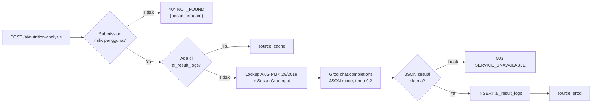

**Kendala skema dan AKG dinamis PMK No. 28 Tahun 2019.** _System prompt_ mengunci peran model sebagai penganalisis gizi dan mewajibkan keluaran JSON yang cocok dengan skema tetap berisi `overall_status`, `overall_message`, `nutritional_analysis`, `ai_recommendation`, `recommended_foods`, `health_insight`, dan `suggested_activities`. Target Angka Kecukupan Gizi (AKG) disuntikkan secara dinamis berdasarkan jenis kelamin dan tanggal lahir responden (mengacu pada **Permenkes RI Nomor 28 Tahun 2019**, dengan fallback rata-rata dewasa 2.150 kkal bila profil belum terisi). Parameter: `temperature = 0,2`, `response_format = {"type":"json_object"}`. Model bawaan adalah `llama-3.3-70b-versatile` (`GROQ_MODEL`) dengan batas waktu server 45 detik.

**Pertahanan terhadap keluaran model (F-26).** Keluaran LLM diperlakukan sebagai masukan tidak tepercaya melalui tiga lapis: penguraian dan pemetaan galat ke 503 di server; normalisasi paksa tiap medan ke tipe aman di klien (array bukan-array menjadi `[]`, string bukan-string menjadi `""`, item tanpa label maupun deskripsi dibuang); serta pemetaan nilai status tak dikenal ke gaya visual netral.

**Penyimpanan hasil dan audit (F-24, F-25).** Kolom `submission_id` bersifat unik sehingga permintaan berulang dilayani dari basis data dengan penanda `source: "cache"`. Setiap analisis meninggalkan jejak `model_used`, `token_used`, dan `latency_ms`.

**Keputusan pemicuan manual.** Analisis dijalankan hanya atas penekanan tombol oleh responden, bukan otomatis, agar tidak menghabiskan kuota token dan tidak menahan pengguna bila hanya ingin menyelesaikan pencatatan cepat.

`[⚠ LAMPIRKAN Gambar 4.11: tangkapan layar panel rekomendasi AI dalam keadaan belum dianalisis, memuat, berhasil, dan gagal]`

### 4.1.4 Implementasi Modul Katalog Publik (_Find Your Food_)

Modul ini diimplementasikan sebagai tiga rute Next.js — `/find-food` (beranda katalog dan pencarian), `/find-food/[id]` (detail makanan), dan `/find-food/category/[code]` (daftar per kategori) — yang memanfaatkan _endpoint_ `/public/*` di layanan Go tanpa menambahkan tabel basis data baru. Sesi kolaborasi dipasang pada _layout_ `/find-food` (bukan per halaman) dengan `autoConnect` nonaktif, sehingga koneksi, kehadiran, dan status ikut bertahan ketika pengguna berpindah antar-halaman katalog.

> **Catatan akses versi 1.** Meskipun _endpoint_ `/public/*` tidak mensyaratkan token untuk keperluan pembacaan data referensi, rute halaman `/find-food` pada versi 1 tetap ditempatkan di balik autentikasi melalui `middleware.ts` karena fokus utama penelitian ini berada pada alur survei _recall_ terotentikasi.

**Komponen utama:**

- **`PortionPhotoViewer`** — komponen tunggal yang merender dua mode sesuai `photo_type`. Mode _series_ menampilkan satu foto utama dengan deret _thumbnail_ berlabel A–H yang dapat digulir; klik _thumbnail_ mengganti foto utama dengan animasi transisi, dan berat porsi serta kodenya tampil langsung di bawah gambar. Mode _range_ menampilkan **foto panduan**: satu foto besar yang memuat seluruh ukuran, dengan label kode dan berat tiap ukuran sebagai _overlay_ serta tabel seluruh ukuran di bawahnya.
- **Area poligon terbitan** — bila foto memiliki anotasi berstatus _published_ dari CMS (Subbab 4.1.5), `AnnotationHoverOverlay` menumpangkan area poligonnya di atas foto. Area dapat ditampilkan atau disembunyikan, dan deret "bagian makanan" di bawah foto memungkinkan pengguna memilih satu area. Inilah titik temu antara CMS anotasi dan tampilan responden.
- **Kanvas langsung** — `LiveCanvasOverlay` dipasang di atas foto pada kedua mode sehingga peserta ruang dapat saling menunjuk bagian foto (Subbab 4.1.2).
- **Pencarian _full-text_** — memanggil `GET /public/foods/search?q=` dengan _debounce_ 300 ms; menggunakan `MATCH … AGAINST … IN BOOLEAN MODE` di sisi _repository_ untuk memanfaatkan indeks `FULLTEXT` pada (`name`, `local_name`).
- **Navigasi prev/next** — halaman detail menyediakan navigasi ke makanan sebelumnya dan berikutnya dalam kategori yang sama tanpa memuat ulang halaman penuh.
- **Fitur Simpan (_Bookmark_)** — daftar makanan tersimpan dicatat di _cookie_ peramban (`atlas_bookmarks`, masa berlaku satu tahun) tanpa tabel di server; data lama dari `localStorage` dimigrasikan otomatis saat pertama kali dibaca.

`[⚠ LAMPIRKAN Gambar 4.13–4.15: tangkapan layar halaman Find Your Food (landing), detail makanan mode series, detail makanan mode range]`

### 4.1.5 Implementasi Modul Admin

Portal admin mengimplementasikan F-27 sampai F-33, F-47, dan F-48 melalui dasbor dan tujuh kelompok rute: survei, _submission_, makanan, kategori, set foto _as served_, metode porsi, dan anotasi. Akses dijaga dua kali: `middleware.ts` mengalihkan pengguna non-admin menjauh dari `/admin` berdasarkan klaim peran pada token (semata untuk pengarahan halaman, tanpa verifikasi tanda tangan), sedangkan penolakan yang sesungguhnya dilakukan _middleware_ `AdminOnly` pada setiap _endpoint_ `/admin/*` di layanan.

**Pengelolaan survei (F-27, F-48).** Selain CRUD dan konfigurasi waktu makan, admin dapat menggandakan survei (`/clone`) untuk mengulang rancangan yang sama pada periode berikutnya, dan menerbitkan ulang token akses (`/regenerate-token`) bila tautan lama perlu dimatikan.

**Foto makanan terpadu dan unggah gambar (F-29, F-47).** Halaman sunting makanan memuat bagian foto yang menyatukan pengelolaan foto porsi per makanan (`/admin/foods/{id}/photos` dengan aksi terbit/tarik terbit). Berkas gambar diunggah melalui `POST /upload` yang hanya menerima JPG, PNG, dan WebP berukuran maksimal 10 MB, menamai ulang berkas dengan UUID, dan hanya menerima nama folder tujuan yang terdiri atas huruf, angka, garis bawah, atau tanda hubung (maksimal 64 karakter), agar nama folder kiriman klien tidak dapat dipakai untuk menulis di luar direktori unggahan (_path traversal_).

**CMS anotasi (F-30, F-31, F-33).** Domain anotasi memisahkan aset gambar (`food_images`) dari area poligon (`food_areas`) dengan siklus _draft_ → _published_. Operasi `PUT /{id}/areas` mengganti seluruh himpunan area sekaligus — operasi idempoten yang menjadi dasar mekanisme penyimpanan otomatis.

**Penyimpanan otomatis (F-33).** Editor anotasi dilengkapi _autosave_ melalui _hook_ `useAnnotationAutosave` dengan penanda status `AutosaveIndicator` yang menampilkan keadaan penyimpanan beserta waktu simpan terakhir; perubahan yang masih tertahan di antrean dipaksa tersimpan (`flush`) sebelum aksi penerbitan dijalankan. Rancangan ini penting karena penganotasian poligon merupakan pekerjaan panjang yang mudah hilang bila bergantung pada penyimpanan manual.

**Pemisahan draf dan terbitan.** _Endpoint_ publik hanya menyajikan anotasi berstatus _published_ — ditegakkan pada lapis repositori melalui `FindPublishedByID` dan `ListPublished` yang menyaring `status = published`, bukan sekadar disembunyikan di antarmuka.

`[⚠ LAMPIRKAN Gambar 4.12: tangkapan layar dasbor admin dan editor anotasi]`

### 4.1.6 Implementasi Profil, Autentikasi, dan Pemantauan

**Autentikasi (F-01).** Kata sandi disimpan sebagai _hash_ bcrypt. Login menghasilkan token akses JWT (masa berlaku bawaan 24 jam) dan token penyegar (bawaan 7 hari) yang disimpan di basis data dalam bentuk _hash_. Antarmuka menyimpan keduanya di _cookie_ dan memperbarui token akses melalui `POST /auth/refresh` ketika kedaluwarsa. _Middleware_ layanan menerima token dari _header_ `Authorization` untuk REST dan dari parameter _query_ `token` khusus untuk _handshake_ WebSocket.

**Profil dan riwayat (F-45, F-46).** Halaman `/profile` memungkinkan pengguna mengubah nama, nomor telepon, jenis kelamin, dan tanggal lahir (`PATCH /auth/me`), mengganti foto (`POST /auth/me/photo`), dan mengganti kata sandi (`PUT /auth/me/password`) dengan indikator kekuatan kata sandi. Halaman yang sama menampilkan riwayat laporan milik pengguna (`GET /survey/my-submissions`) beserta rinciannya; layanan menyaring berdasarkan identitas login sehingga laporan pengguna lain tidak dapat dibuka dengan menebak pengenal.

**Pemantauan (NF-20).** Layanan mengekspos `/health` dan `/metrics`. Metrik HTTP (jumlah permintaan, durasi, permintaan lambat) dikumpulkan oleh _middleware_ `gin-metrics` dalam format Prometheus; berkas Docker Compose menyertakan Prometheus dan Grafana untuk mengikis dan menampilkannya. Metrik ini melengkapi `/collab/stats` (keadaan _hub_) dan tabel `ai_result_logs` (latensi LLM) sebagai sumber data pengujian kinerja pada Subbab 4.4.

**Tabel 4.1 Kontrak API sistem**

| Kelompok             | Metode & _Endpoint_                                                                                                                                                                                              | Kebutuhan              |
| -------------------- | ---------------------------------------------------------------------------------------------------------------------------------------------------------------------------------------------------------------- | ---------------------- |
| Publik (tanpa token) | `GET /public/foods/search`, `/public/foods/{id}`, `/public/foods/{id}/images`, `/public/categories`, `/public/categories/{code}/foods`, `/public/food-images`, `/public/food-images/{id}`                        | F-02a–c, F-05, F-07    |
| Autentikasi & profil | `POST /auth/register`, `/auth/login`, `/auth/refresh`; `GET\|PATCH /auth/me`; `PUT /auth/me/password`; `POST /auth/me/photo`                                                                                     | F-01, F-45             |
| Responden            | `GET /survey/active`; `POST /survey/access`; `GET /survey/{id}/info`; `POST /survey/submit`; `GET /locales`                                                                                                      | F-02, F-03, F-13, F-39 |
| Riwayat Responden    | `GET /survey/my-submissions`, `/survey/my-submissions/{id}`                                                                                                                                                      | F-46                   |
| AI                   | `POST /ai/nutrition-analysis`                                                                                                                                                                                    | F-23                   |
| Admin — survei       | `/admin/surveys` (CRUD, `/clone`, `/regenerate-token`), `/admin/surveys/{id}/submissions`, `/admin/surveys/{id}/export`, `/admin/submissions/{id}`                                                               | F-27, F-32, F-48       |
| Admin — pangan       | `/admin/foods` (CRUD, `/portion-methods`, `/photos` beserta `/publish` dan `/unpublish`), `/admin/categories`, `/admin/as-served-sets` (termasuk `/images`), `/admin/as-served-images`, `/admin/portion-methods` | F-28, F-29             |
| Admin — anotasi      | `/admin/food-images` (CRUD, `/areas`, `/publish`, `/unpublish`, `/export`)                                                                                                                                       | F-30, F-31             |
| Admin — unggah       | `POST /upload`                                                                                                                                                                                                   | F-47                   |
| Kolaborasi           | `GET /collab/rooms/{id}/ws`, `GET /collab/rooms/{id}`, `POST /collab/rooms/{id}/invite`, `DELETE /collab/invites/{token}`, `GET /collab/stats`                                                                   | F-15, F-19             |
| Operasional          | `GET /health`, `GET /metrics`                                                                                                                                                                                    | NF-20                  |

Seluruh _endpoint_ berada di bawah awalan `/api/v1`, kecuali `/health`, `/metrics`, dan berkas statis `/uploads`. Kelompok admin dijaga `AdminOnly`; kelompok responden dan AI dijaga `RespondentOnly`.

## 4.2 Hasil Pengujian Kotak-Hitam

> **Cara mengisi:** jalankan tiap kasus uji pada sistem, catat hasil yang benar-benar teramati pada kolom "Hasil Diperoleh", lalu isi kolom "Status" dengan Sesuai/Tidak Sesuai. Kolom "Hasil Diharapkan" sudah diturunkan dari spesifikasi dan tidak perlu diubah.

**Tabel 4.5 Hasil pengujian kotak-hitam modul recall**

| Kode  | Kebutuhan | Skenario                               | Masukan                                                          | Hasil Diharapkan                                                          | Hasil Diperoleh | Status |
| ----- | --------- | -------------------------------------- | ---------------------------------------------------------------- | ------------------------------------------------------------------------- | --------------- | ------ |
| UK-01 | F-02      | Menampilkan survei aktif               | Login sebagai responden                                          | Daftar survei berstatus aktif tampil                                      |                 |        |
| UK-02 | F-03      | Bergabung ke survei                    | Tekan tombol "Mulai"                                             | Sesi _recall_ terbentuk, diarahkan ke _wizard_                            |                 |        |
| UK-03 | F-04      | Pilihan waktu makan sesuai konfigurasi | Survei dengan `meals_config` berisi 3 waktu makan                | Hanya 3 pilihan tampil, jam bawaan sesuai                                 |                 |        |
| UK-04 | F-04      | Konversi jam 12/24                     | Setel jam ke 19:30                                               | Tampil "07:30 PM", nilai tersimpan "19:30"                                |                 |        |
| UK-05 | F-05      | Pencarian kurang dari 3 karakter       | Ketik "na"                                                       | Muncul petunjuk minimal 3 karakter, tidak ada permintaan ke server        |                 |        |
| UK-06 | F-05      | Pencarian normal                       | Ketik "nasi goreng"                                              | Daftar hasil tampil ≤ 10 item                                             |                 |        |
| UK-07 | F-05      | Pencarian gagal (server mati)          | Matikan layanan, ketik kata kunci                                | Pesan galat tampil, bukan kegagalan senyap                                |                 |        |
| UK-08 | F-05      | Penambahan duplikat                    | Tambahkan makanan yang sama dua kali                             | Pesan "sudah ada di daftar", item tidak berganda                          |                 |        |
| UK-09 | F-06      | Pencatatan manual                      | Cari kata kunci tanpa hasil, tekan "Catat manual"                | Item masuk daftar "Dicatat manual" dengan penanda tanpa nilai gizi        |                 |        |
| UK-10 | F-06      | Duplikat catatan manual                | Catat nama yang sama dua kali                                    | Ditolak, daftar tidak berganda                                            |                 |        |
| UK-11 | F-06      | Hanya item manual                      | Tambahkan hanya catatan manual tanpa makanan basis data          | Tombol "Lanjut" nonaktif dengan penjelasan                                |                 |        |
| UK-12 | F-07      | Pemilihan foto porsi                   | Pilih foto porsi 150 g                                           | Total berat menampilkan 150 g                                             |                 |        |
| UK-13 | F-08      | Berat manual valid                     | Isi 200                                                          | Total berat 200 g                                                         |                 |        |
| UK-14 | F-08      | Berat melebihi batas                   | Isi 9999                                                         | Nilai dijepit ke 5.000 g                                                  |                 |        |
| UK-15 | F-08      | Berat tidak valid                      | Isi −50                                                          | Total berat 0, tombol simpan nonaktif                                     |                 |        |
| UK-16 | F-07      | Kegagalan pemuatan foto porsi          | Putus jaringan saat membuka langkah 3                            | Pesan galat tampil, isian berat manual tetap dapat digunakan              |                 |        |
| UK-17 | F-10      | Perhitungan gizi                       | Makanan 130 kkal/100 g, porsi 150 g                              | Energi tercatat 195 kkal                                                  |                 |        |
| UK-18 | F-09      | Bahan tambahan                         | Tambah "Minyak" 5 ml                                             | Tercatat pada makanan yang bersangkutan                                   |                 |        |
| UK-19 | F-09      | Bahan tambahan bernilai negatif        | Isi −3                                                           | Nilai dijepit ke 0                                                        |                 |        |
| UK-20 | F-09      | Persistensi saat mundur                | Isi takaran, tekan "Kembali", maju lagi                          | Takaran tetap tersimpan                                                   |                 |        |
| UK-21 | F-11      | Ringkasan                              | Buka langkah 5                                                   | Seluruh item, item manual, dan total harian tampil                        |                 |        |
| UK-22 | F-12      | Validasi porsi kosong                  | Kosongkan porsi satu makanan                                     | Tombol kirim nonaktif dengan pesan sebab                                  |                 |        |
| UK-23 | F-13      | Pengiriman berhasil                    | Tekan "Kirim laporan"                                            | Laporan tersimpan, `submission_id` diterima                               |                 |        |
| UK-24 | F-13      | Pengiriman gagal                       | Matikan layanan, tekan kirim                                     | Pesan galat tampil, isian tidak hilang                                    |                 |        |
| UK-25 | —         | Pencegahan kirim ganda                 | Setelah berhasil kirim, cari jalan kembali ke ringkasan          | Tidak tersedia tombol kembali pada langkah hasil                          |                 |        |
| UK-26 | F-14      | Persistensi sesi                       | Muat ulang halaman di tengah pengisian                           | Seluruh progres tetap ada                                                 |                 |        |
| UK-27 | —         | Tambah waktu makan                     | Dari ringkasan tekan "Tambah waktu makan", isi waktu makan kedua | Data waktu makan pertama tetap; langkah porsi tidak buntu                 |                 |        |
| UK-28 | —         | Halaman ringkasan akhir                | Tekan "Selesai"                                                  | Ringkasan menampilkan jumlah waktu makan, item, dan total gizi yang benar |                 |        |

**Tabel 4.6 Hasil pengujian kotak-hitam modul kolaborasi**

| Kode  | Kebutuhan | Skenario                           | Masukan                                                                        | Hasil Diharapkan                                             | Hasil Diperoleh | Status |
| ----- | --------- | ---------------------------------- | ------------------------------------------------------------------------------ | ------------------------------------------------------------ | --------------- | ------ |
| UK-29 | F-15      | Pembentukan ruang                  | Buka halaman _recall_                                                          | Koneksi WebSocket terbentuk, status "Live"                   |                 |        |
| UK-30 | F-16      | Kehadiran                          | Peserta kedua bergabung                                                        | Avatar peserta tampil pada kedua sisi                        |                 |        |
| UK-31 | F-16      | Multi-tab                          | Buka tab kedua dengan akun sama                                                | Peserta tidak terhitung ganda; tab lama tidak terputus       |                 |        |
| UK-32 | F-17      | Kursor bersama                     | Gerakkan tetikus pada satu peserta                                             | Kursor bernama tampil pada layar peserta lain                |                 |        |
| UK-33 | F-18      | Mode ikut — halaman                | Tekan avatar untuk mengikuti                                                   | Pengikut berpindah ke halaman pemimpin                       |                 |        |
| UK-34 | F-18      | Mode ikut — gulir                  | Pemimpin menggulir                                                             | Posisi gulir pengikut menyesuaikan                           |                 |        |
| UK-35 | F-18      | **Mode ikut — langkah**            | Pemimpin berpindah dari langkah 2 ke 3                                         | Pengikut ikut berpindah ke langkah 3                         |                 |        |
| UK-36 | F-18      | **Langkah bertahan setelah gulir** | Pemimpin berpindah langkah lalu menggulir; peserta ketiga baru mulai mengikuti | Peserta ketiga mendarat di langkah yang benar                |                 |        |
| UK-37 | F-18      | Pencegahan _loop_                  | Dua peserta saling mengikuti                                                   | Tidak terjadi perpindahan langkah berulang tanpa henti       |                 |        |
| UK-38 | F-18      | Berhenti mengikuti                 | Tekan "Stop following"                                                         | Penyelarasan berhenti, kendali kembali                       |                 |        |
| UK-39 | F-19      | Pembuatan undangan                 | Tekan "Share", pilih peran _editor_                                            | Tautan berisi `room` dan `invite` terbentuk                  |                 |        |
| UK-40 | F-19      | **Tamu membuka undangan**          | Akun berbeda membuka tautan undangan                                           | Tamu masuk ke ruang yang sama, bukan diarahkan ke `/surveys` |                 |        |
| UK-41 | F-19      | Undangan kedaluwarsa               | Gunakan tautan setelah masa berlaku habis                                      | Akses ditolak dengan pesan yang jelas                        |                 |        |
| UK-42 | F-20      | Kunci antarmuka _viewer_           | Masuk dengan undangan _viewer_                                                 | Seluruh kontrol tidak dapat diklik maupun di-tab             |                 |        |
| UK-43 | F-20      | Penolakan di klien                 | _Viewer_ memicu peristiwa mutasi                                               | Pesan ditahan, muncul pemberitahuan mode "Can view"          |                 |        |
| UK-44 | F-20      | Penolakan di server                | Kirim pesan mutasi langsung melalui WebSocket sebagai _viewer_                 | Server menolak pesan                                         |                 |        |
| UK-45 | NF-10     | Ketahanan peran                    | _Viewer_ berpindah halaman sehingga `invite` hilang dari URL                   | Peran tetap _viewer_, tidak naik menjadi _editor_            |                 |        |
| UK-46 | F-21      | Umpan aktivitas                    | Peserta lain menambahkan makanan                                               | Aktivitas tampil dengan nama waktu makan yang benar          |                 |        |
| UK-47 | NF-05     | Rekoneksi                          | Putuskan jaringan 10 detik lalu sambungkan                                     | Status kembali "Live" tanpa muat ulang halaman               |                 |        |
| UK-48 | NF-03     | Batas laju                         | Kirim > 50 pesan/detik                                                         | Server membalas `RATE_LIMITED`, koneksi tetap hidup          |                 |        |

**Tabel 4.7 Hasil pengujian kotak-hitam modul AI**

| Kode  | Kebutuhan | Skenario                    | Masukan                                                 | Hasil Diharapkan                                     | Hasil Diperoleh | Status |
| ----- | --------- | --------------------------- | ------------------------------------------------------- | ---------------------------------------------------- | --------------- | ------ |
| UK-49 | F-23      | Analisis pertama            | Tekan "Analisis dengan AI"                              | Hasil tampil dengan penanda sumber AI                |                 |        |
| UK-50 | F-25      | Pemanggilan ulang           | Tekan "Analisis ulang"                                  | Hasil tampil dengan penanda sumber tersimpan         |                 |        |
| UK-51 | F-23      | Tanpa `submission_id`       | Buka panel sebelum mengirim laporan                     | Tombol nonaktif disertai penjelasan                  |                 |        |
| UK-52 | F-23      | Otorisasi                   | Minta analisis atas `submission_id` milik pengguna lain | Ditolak dengan 404 berpesan seragam                  |                 |        |
| UK-53 | F-26      | Kegagalan layanan           | Nonaktifkan kunci API                                   | Pesan galat + tombol "Coba lagi"; halaman tetap utuh |                 |        |
| UK-54 | F-26      | Keluaran tidak sesuai skema | Simulasikan respons non-JSON                            | Ditangani sebagai 503, halaman tidak rusak           |                 |        |
| UK-55 | F-24      | Jejak audit                 | Periksa tabel `ai_result_logs`                          | Tercatat model, jumlah token, dan latensi            |                 |        |
| UK-56 | NF-04     | Batas waktu                 | Analisis berjalan lama                                  | Klien menunggu hingga 60 detik sebelum menyerah      |                 |        |

**Tabel 4.8 Hasil pengujian kotak-hitam modul admin**

| Kode  | Kebutuhan | Skenario                     | Masukan                                              | Hasil Diharapkan                                                   | Hasil Diperoleh | Status |
| ----- | --------- | ---------------------------- | ---------------------------------------------------- | ------------------------------------------------------------------ | --------------- | ------ |
| UK-57 | F-01      | Otorisasi peran              | Responden membuka rute admin                         | Akses ditolak                                                      |                 |        |
| UK-58 | F-27      | CRUD survei                  | Buat, ubah, hapus survei                             | Data tersimpan dan tampil sesuai                                   |                 |        |
| UK-59 | F-27      | Konfigurasi waktu makan      | Setel `meals_config` 4 waktu makan                   | Pilihan responden ikut berubah menjadi 4                           |                 |        |
| UK-60 | F-28      | CRUD makanan                 | Tambah makanan + nilai gizi                          | Makanan muncul pada pencarian responden                            |                 |        |
| UK-61 | F-29      | Set foto _as served_         | Tambah foto dengan berat 150 g                       | Foto muncul pada langkah porsi responden                           |                 |        |
| UK-62 | F-30      | Anotasi poligon              | Gambar area, tautkan ke makanan                      | Area tersimpan                                                     |                 |        |
| UK-63 | F-31      | Siklus terbit                | Simpan sebagai draf, lalu terbitkan                  | Draf tidak tampil publik; terbitan tampil                          |                 |        |
| UK-64 | F-32      | Telaah _submission_          | Buka daftar _submission_ survei                      | Daftar dan detail tampil benar                                     |                 |        |
| UK-65 | F-32      | Ekspor CSV                   | Tekan "Export CSV" pada daftar _submission_          | Berkas CSV terunduh berisi data yang sesuai                        |                 |        |
| UK-66 | F-33      | Penyimpanan otomatis anotasi | Gambar area lalu tunggu tanpa menekan simpan         | Penanda _autosave_ berubah menjadi tersimpan disertai waktu simpan |                 |        |
| UK-67 | F-33      | _Flush_ sebelum terbit       | Ubah area lalu langsung tekan "Terbitkan"            | Perubahan terakhir ikut tersimpan sebelum penerbitan               |                 |        |
| UK-68 | F-31      | Draf tidak bocor ke publik   | Akses _endpoint_ publik untuk anotasi berstatus draf | Ditolak/tidak ditemukan                                            |                 |        |

**Tabel 4.13 Hasil pengujian kotak-hitam kanvas langsung, katalog, dan profil**

| Kode  | Kebutuhan   | Skenario                               | Masukan                                                                                       | Hasil Diharapkan                                                                             | Hasil Diperoleh | Status |
| ----- | ----------- | -------------------------------------- | --------------------------------------------------------------------------------------------- | -------------------------------------------------------------------------------------------- | --------------- | ------ |
| UK-69 | F-39        | Hitung ulang gizi di server            | Kirim laporan dengan nilai `nutrients` yang sengaja diubah                                    | Nilai tersimpan mengikuti perhitungan server, bukan kiriman klien                            |                 |        |
| UK-70 | F-39        | Partisipan dari identitas login        | Kirim laporan dengan `participant_id` milik pengguna lain                                     | Laporan tercatat atas partisipan pengirim yang sebenarnya                                    |                 |        |
| UK-71 | F-40        | Coretan bersama                        | Peserta A menggambar dengan pensil di atas foto porsi                                         | Coretan tampil pada layar peserta B di posisi foto yang sama                                 |                 |        |
| UK-72 | F-40        | Konsistensi posisi lintas ukuran layar | Peserta A memakai laptop, peserta B telepon pintar                                            | Coretan jatuh pada bagian foto yang sama                                                     |                 |        |
| UK-73 | F-41        | Penunjuk laser                         | Peserta A menggerakkan laser                                                                  | Titik laser tampil pada peserta B dan memudar sekitar 1,5 detik setelah berhenti             |                 |        |
| UK-74 | F-42        | Peserta yang datang belakangan         | Peserta C bergabung setelah coretan dibuat                                                    | Peserta C melihat coretan yang masih aktif                                                   |                 |        |
| UK-75 | F-40        | Hapus kanvas                           | Tekan "hapus" pada satu foto                                                                  | Coretan pada foto itu hilang di seluruh peserta                                              |                 |        |
| UK-76 | F-20, F-40  | _Viewer_ tidak dapat menggambar        | Masuk sebagai _viewer_, coba menggambar; kirim `canvas_draw_start` langsung melalui WebSocket | Antarmuka terkunci; server membalas `FORBIDDEN`                                              |                 |        |
| UK-77 | F-43        | Obrolan kursor                         | Tekan `/`, ketik pesan, tekan Enter                                                           | Gelembung tampil di dekat kursor pada peserta lain lalu hilang                               |                 |        |
| UK-78 | F-43        | Tombol `/` tidak membajak isian        | Tekan `/` saat fokus berada di kolom pencarian                                                | Karakter `/` terketik di kolom; gelembung tidak muncul                                       |                 |        |
| UK-79 | F-02a–c     | Pencarian katalog                      | Ketik "nasi" pada _Find Your Food_                                                            | Daftar hasil tampil beserta tipe foto                                                        |                 |        |
| UK-80 | F-02c       | Detail tipe _series_                   | Buka makanan bertipe `series`                                                                 | Foto utama dan deret _thumbnail_ A–H tampil; klik _thumbnail_ mengganti foto utama dan berat |                 |        |
| UK-81 | F-02c       | Detail tipe _range_                    | Buka makanan bertipe `range`                                                                  | Satu foto panduan tampil dengan label kode dan berat tiap ukuran                             |                 |        |
| UK-82 | F-02c, F-31 | Area poligon terbitan                  | Buka foto yang memiliki anotasi terbitan                                                      | Area dapat ditampilkan/disembunyikan dan dipilih                                             |                 |        |
| UK-83 | F-02d       | _Bookmark_                             | Tekan "Simpan", muat ulang halaman                                                            | Status "Tersimpan" bertahan                                                                  |                 |        |
| UK-84 | F-05        | Karakter khusus pada pencarian         | Ketik `ayam "goreng` dan `nasi +`                                                             | Hasil tampil atau kosong; tidak ada galat 500                                                |                 |        |
| UK-85 | F-45        | Ubah profil                            | Ubah nama dan nomor telepon                                                                   | Perubahan tersimpan dan tampil setelah muat ulang                                            |                 |        |
| UK-86 | F-45        | Ganti kata sandi                       | Isi kata sandi lama yang salah, lalu yang benar                                               | Yang salah ditolak; yang benar berhasil dan login berikutnya memakai kata sandi baru         |                 |        |
| UK-87 | F-46        | Riwayat laporan sendiri                | Buka halaman profil setelah mengirim laporan                                                  | Laporan tampil; rincian dapat dibuka                                                         |                 |        |
| UK-88 | F-46        | Laporan pengguna lain                  | Minta `GET /survey/my-submissions/{id}` dengan pengenal milik pengguna lain                   | Ditolak/tidak ditemukan                                                                      |                 |        |
| UK-89 | F-47        | Unggah gambar                          | Unggah berkas `.gif`, lalu berkas JPG 12 MB, lalu JPG 1 MB                                    | Dua pertama ditolak dengan pesan yang jelas; yang ketiga berhasil                            |                 |        |
| UK-90 | F-48        | Gandakan survei                        | Tekan gandakan pada satu survei                                                               | Survei baru terbentuk dengan konfigurasi yang sama                                           |                 |        |
| UK-91 | NF-18       | Asal tidak terdaftar                   | Buka koneksi WebSocket dari asal di luar daftar putih                                         | _Handshake_ ditolak                                                                          |                 |        |
| UK-92 | NF-20       | Metrik                                 | Akses `/health` dan `/metrics`                                                                | `/health` membalas status ok; `/metrics` berformat Prometheus                                |                 |        |

**Rekapitulasi:**

`[⚠ ISI SETELAH PENGUJIAN]`

| Modul                                        | Jumlah kasus uji | Sesuai | Tidak Sesuai | Tingkat keberhasilan |
| -------------------------------------------- | ---------------- | ------ | ------------ | -------------------- |
| Recall                                       | 28 (UK-01…UK-28) |        |              |                      |
| Kolaborasi                                   | 20 (UK-29…UK-48) |        |              |                      |
| AI                                           | 8 (UK-49…UK-56)  |        |              |                      |
| Admin                                        | 12 (UK-57…UK-68) |        |              |                      |
| Luring, kanvas, katalog, profil, operasional | 24 (UK-69…UK-92) |        |              |                      |
| **Total**                                    | **92**           |        |              |                      |

Catatan: kebutuhan F-22 (penguncian entitas) dan F-44 (perubahan peran selama sesi) tidak memiliki kasus uji karena belum terwujud utuh pada versi 1 — lihat catatan status pada Subbab 3.5.1. Kasus uji katalog UK-79 sampai UK-83 dijalankan dalam keadaan login, sesuai keadaan kode (catatan pada Subbab 4.1.4).

## 4.3 Hasil Penelusuran _End-to-End_ dan Perbaikan Cacat

Selain pengujian kotak-hitam berbasis kebutuhan, dilakukan penelusuran alur _end-to-end_ yang menelaah keterhubungan antar modul. Metode ini menemukan sebelas cacat yang tidak terdeteksi oleh pemeriksaan tipe maupun proses _build_, karena seluruhnya bersifat kesalahan logika lintas-komponen, bukan kesalahan sintaksis.

**Tabel 4.9 Temuan cacat dan perbaikan**

| Kode | Modul      | Gejala                                                                                               | Akar masalah                                                                                                                     | Klasifikasi                     | Perbaikan                                                                                                        |
| ---- | ---------- | ---------------------------------------------------------------------------------------------------- | -------------------------------------------------------------------------------------------------------------------------------- | ------------------------------- | ---------------------------------------------------------------------------------------------------------------- |
| D-01 | Recall     | Halaman ringkasan akhir selalu kosong (0 waktu makan, 0 item) dan analisis AI tidak dapat dijalankan | Sesi direset **sebelum** navigasi ke halaman ringkasan, padahal halaman tersebut membaca sesi yang sama                          | Kesalahan urutan operasi        | Reset dipindahkan ke aksi eksplisit "Isi survey lagi"                                                            |
| D-02 | Recall     | Langkah porsi menampilkan "belum ada makanan" padahal daftar terisi; alur buntu                      | Indeks porsi tidak diatur ulang saat waktu makan berganti dan tidak dijepit saat makanan dihapus                                 | Inkonsistensi keadaan           | Pengaturan ulang indeks saat pergantian waktu makan; penjepitan saat penghapusan dan saat memasuki langkah porsi |
| D-03 | Recall     | Laporan berpotensi terkirim ganda                                                                    | Tombol kembali tetap aktif pada langkah hasil                                                                                    | Integritas data                 | Tombol dihilangkan pada langkah hasil                                                                            |
| D-04 | Recall     | Makanan yang dicatat manual hilang dari antarmuka                                                    | `missing_foods` disimpan dan dikirim, tetapi tidak pernah ditampilkan                                                            | Ketiadaan umpan balik           | Ditampilkan pada langkah 2 dan 5 dengan penanda "tanpa nilai gizi"; duplikat ditolak                             |
| D-05 | Recall     | Takaran bahan tambahan hilang saat menekan "Kembali"                                                 | Persistensi hanya dilakukan pada aksi maju                                                                                       | Kehilangan data senyap          | Persistensi juga pada aksi mundur                                                                                |
| D-06 | Kolaborasi | Tautan undangan sesi _recall_ selalu berakhir di `/surveys`                                          | Gerbang halaman menolak pengguna yang token akses pada URL bukan miliknya, padahal tautan undangan memang membawa URL pengundang | Kontrol akses terlalu ketat     | Gerbang mengizinkan tamu bila terdapat parameter `room`, disertai panel penjelas                                 |
| D-07 | Kolaborasi | Tamu yang lolos gerbang tetap sendirian di ruangnya                                                  | Ruang bawaan selalu diprioritaskan di atas parameter `room`                                                                      | Kesalahan prioritas konfigurasi | Parameter `room` diprioritaskan pada halaman _recall_                                                            |
| D-08 | Kolaborasi | Mode ikut tidak pernah menyelaraskan langkah                                                         | _Wizard_ berbagi satu URL; atribut `step` didukung protokol tetapi tidak pernah diisi klien                                      | Fitur tidak lengkap             | Penyiaran dan penerapan `step`; langkah disimpan pada _store_ agar setiap `viewport_update` membawanya           |
| D-09 | Kolaborasi | Umpan aktivitas menampilkan jenis pencarian, bukan waktu makan                                       | `meal_add` mengirim `"food"`/`"drink"` pada medan `meal_type`                                                                    | Pelanggaran kontrak pesan       | Mengirim nama waktu makan yang sebenarnya                                                                        |
| D-10 | Kolaborasi | Indikator "sedang mencari" saling tumpang tindih                                                     | Peserta yang sedang mengikuti tetap menyiarkan pencariannya                                                                      | Inkonsistensi antar-halaman     | Penyiaran ditahan saat mode ikut aktif                                                                           |
| D-11 | Kolaborasi | _Viewer_ masih dapat mengirim pesan mutasi pada jeda _handshake_                                     | Peran kosong dianggap "boleh"                                                                                                    | Celah otorisasi                 | Penerapan prinsip _fail-closed_: peran kosong berarti tolak                                                      |

**Analisis klasifikasi cacat:**

| Klasifikasi                             | Jumlah                           | Persentase |
| --------------------------------------- | -------------------------------- | ---------- |
| Kehilangan data senyap / kebuntuan alur | 5 (D-01, D-02, D-04, D-05, D-08) | 45,5%      |
| Kesalahan kontrol akses                 | 3 (D-06, D-07, D-11)             | 27,3%      |
| Pelanggaran kontrak/konsistensi         | 2 (D-09, D-10)                   | 18,2%      |
| Integritas data                         | 1 (D-03)                         | 9,1%       |

Temuan yang layak dibahas: hampir separuh cacat tergolong **kehilangan data senyap atau kebuntuan alur** — jenis cacat yang tidak menimbulkan pesan galat apa pun sehingga tidak terdeteksi oleh pemeriksaan otomatis maupun oleh pengguna yang tidak membandingkan hasil dengan harapannya. Hal ini menunjukkan bahwa untuk sistem dengan keadaan berlapis (keadaan lokal _wizard_, keadaan tersimpan di peramban, dan keadaan bersama di server), **penelusuran alur end-to-end tetap diperlukan** dan tidak tergantikan oleh pemeriksaan tipe maupun proses _build_ yang berhasil.

## 4.4 Hasil Pengujian Kinerja

**Tabel 4.10 Hasil pengujian kinerja real-time**

`[⚠ ISI SETELAH PENGUJIAN — jangan mengisi dengan angka perkiraan]`

| Metrik                                     | 2 klien | 5 klien | 10 klien | 20 klien | Target (NF)   |
| ------------------------------------------ | ------- | ------- | -------- | -------- | ------------- |
| Latensi kursor — rerata (ms)               |         |         |          |          | ≤ 300 (NF-01) |
| Latensi kursor — p95 (ms)                  |         |         |          |          |               |
| Latensi sinkronisasi langkah — rerata (ms) |         |         |          |          | ≤ 500 (NF-02) |
| Latensi sinkronisasi langkah — p95 (ms)    |         |         |          |          |               |
| _Throughput_ (pesan/detik)                 |         |         |          |          |               |
| Pesan _drop_                               |         |         |          |          | 0 (NF-03)     |
| Waktu pemulihan koneksi (detik)            |         |         |          |          | ≤ 30 (NF-05)  |

**Perbandingan dengan dan tanpa _batching_:**

| Kondisi                          | Pesan kursor masuk | Pesan tersiar | Rasio reduksi |
| -------------------------------- | ------------------ | ------------- | ------------- |
| Tanpa _batching_ + _coalescing_  |                    |               |               |
| Dengan _batching_ + _coalescing_ |                    |               |               |

**Latensi analisis LLM** (diambil dari kolom `latency_ms` pada tabel `ai_result_logs`):

| Statistik           | Nilai (ms) |
| ------------------- | ---------- |
| Jumlah analisis (N) |            |
| Rerata              |            |
| Median              |            |
| p95                 |            |
| Rerata jumlah token |            |

## 4.5 Hasil Pengujian Penerimaan Pengguna

**Tabel 4.11 Karakteristik responden UAT**

`[⚠ ISI SETELAH PENGUJIAN]`

| Karakteristik                     | Kategori                       | Jumlah | Persentase |
| --------------------------------- | ------------------------------ | ------ | ---------- |
| Jenis kelamin                     | Laki-laki / Perempuan          |        |            |
| Usia                              | 17–25 / 26–35 / > 35           |        |            |
| Peran uji                         | Responden / Pendamping / Admin |        |            |
| Pengalaman aplikasi survei daring | Pernah / Belum pernah          |        |            |

**Tabel 4.12 Hasil kuesioner SUS**

`[⚠ ISI SETELAH PENGUJIAN]`

| No  | Pernyataan                                                                   | Rerata skor (1–5) |
| --- | ---------------------------------------------------------------------------- | ----------------- |
| 1   | Saya merasa ingin sering menggunakan sistem ini                              |                   |
| 2   | Saya merasa sistem ini terlalu rumit                                         |                   |
| 3   | Saya merasa sistem ini mudah digunakan                                       |                   |
| 4   | Saya merasa membutuhkan bantuan teknis untuk menggunakan sistem ini          |                   |
| 5   | Saya merasa fungsi-fungsi dalam sistem ini terintegrasi dengan baik          |                   |
| 6   | Saya merasa ada terlalu banyak ketidaksesuaian dalam sistem ini              |                   |
| 7   | Saya membayangkan kebanyakan orang akan cepat belajar menggunakan sistem ini |                   |
| 8   | Saya merasa sistem ini sangat kaku untuk digunakan                           |                   |
| 9   | Saya merasa percaya diri saat menggunakan sistem ini                         |                   |
| 10  | Saya perlu belajar banyak hal sebelum dapat menggunakan sistem ini           |                   |
|     | **Skor SUS akhir**                                                           |                   |
|     | **Predikat**                                                                 |                   |
|     | **Tingkat penerimaan**                                                       |                   |

**Perbandingan sesi mandiri dan sesi berpendamping** (bila menerapkan rancangan eksperimen dua kelompok):

| Variabel                         | Kelompok A (mandiri) | Kelompok B (berpendamping) | Selisih |
| -------------------------------- | -------------------- | -------------------------- | ------- |
| Jumlah item tercatat per laporan |                      |                            |         |
| Proporsi `missing_foods`         |                      |                            |         |
| Proporsi porsi diisi manual      |                      |                            |         |
| Waktu penyelesaian (menit)       |                      |                            |         |
| Skor SUS                         |                      |                            |         |

Seluruh variabel tersebut sudah terekam sistem tanpa instrumentasi tambahan.

## 4.6 Hasil Penilaian Pakar terhadap Keluaran LLM

`[⚠ ISI SETELAH PENGUJIAN]`

| Aspek penilaian                             | Rerata skor | Kesepakatan antar-penilai (κ) |
| ------------------------------------------- | ----------- | ----------------------------- |
| Relevansi rekomendasi terhadap data laporan |             |                               |
| Kesesuaian dengan prinsip gizi seimbang     |             |                               |
| Keamanan (tidak mengandung saran berisiko)  |             |                               |
| Kejelasan bahasa bagi awam                  |             |                               |

| Metrik objektif                                      | Nilai |
| ---------------------------------------------------- | ----- |
| Validitas skema (% respons lolos penguraian JSON)    |       |
| Konsistensi `overall_status` pada M pengulangan      |       |
| Indeks Jaccard `recommended_foods` antar pengulangan |       |

## 4.7 Pembahasan

### 4.7.1 Menjawab RM-1 — Sistem R24J dan Estimasi Porsi Visual (`Series`, `Range`, `Guide`)

Sistem berhasil dibangun dengan alur enam langkah yang memetakan metode lintasan berganda (Subbab 3.6.6), dilengkapi tiga tipe visualisasi foto porsi terpadu (`series`, `range`, dan `guide`) yang dikelola melalui CMS anotasi poligon mandiri. Keputusan perancangan yang menentukan adalah **penyimpanan progres di sisi peramban dengan masa berlaku 24 jam**, yang menjawab sifat pengisian R24J yang kerap bertahap sepanjang hari. Perhitungan gizi dilakukan secara deterministik dua kali — di antarmuka sebagai umpan balik segera dan di server sebagai angka yang disimpan (mencakup makanan utama serta konversi URT bahan tambahan/`additionals`) — lalu dibekukan sebagai _snapshot_ pada saat laporan diterima, sehingga laporan historis tidak berubah ketika basis data pangan diperbarui.

`[⚠ TAMBAHKAN pembahasan berdasarkan tingkat keberhasilan uji kotak-hitam modul recall]`

### 4.7.2 Menjawab RM-2 — Kolaborasi Real-Time dan Kontrol Peran _Fail-Closed_

Persoalan inti yang ditemukan adalah bahwa mekanisme _follow_ konvensional — yang memantulkan _path_ dan posisi gulir — **tidak memadai** untuk _wizard_ pada aplikasi satu halaman, karena seluruh langkah berbagi satu URL. Solusi yang diterapkan memperluas unsur "lokasi" dalam kerangka _workspace awareness_ (Gutwin & Greenberg, 2002) menjadi **posisi dalam alur kerja** melalui atribut `step` pada setiap pesan _viewport_, dilengkapi kanvas penunjuk foto porsi dan obrolan kursor.

Selain itu, model otorisasi tiga lapis berhasil diterapkan untuk menjawab **mengapa tiga lapis diperlukan padahal lapis server sudah otoritatif**. Lapis server menjamin keamanan data, tetapi tanpa lapis antarmuka (`inert`) dan lapis klien (_fail-closed_), peserta `viewer` akan menekan tombol lalu menerima galat beruntun. Cacat D-11 dan NF-10 memperlihatkan pentingnya prinsip _fail-closed_ sejak koneksi dibuka serta penyimpanan peran per-pengguna di sisi ruang agar tidak bergantung pada parameter URL.

`[⚠ TAMBAHKAN pembahasan berdasarkan hasil UK-33 s.d. UK-45 dan latensi NF-01/NF-02]`

### 4.7.3 Menjawab RM-3 — Rekomendasi Gizi LLM dan Evaluasi Sistem

_Pipeline_ rekomendasi gizi pasca-laporan yang dibangun menempatkan LLM pada peran interpretasi naratif di atas angka deterministik tabel TKPI 2020 dan gramasi porsi BRIN, dibandingkan terhadap acuan AKG dinamis Permenkes RI Nomor 28 Tahun 2019 (berdasarkan jenis kelamin dan tanggal lahir responden). Tiga mekanisme mendukung reproduktibilitas dan auditabilitas: keluaran berkendala skema JSON dengan _temperature_ rendah; normalisasi dua lapis yang memperlakukan keluaran model sebagai masukan tidak tepercaya; serta penyimpanan hasil per-_submission_ yang sekaligus berfungsi sebagai jejak audit (model, token, latensi).

Pada aspek evaluasi DS-II, pengujian sistem yang memadukan verifikasi kotak-hitam (92 kasus uji), penelusuran alur _end-to-end_ (menemukan sebelas cacat logika yang seluruhnya telah dimitigasi), pengukuran kinerja real-time WebSocket, evaluasi kebergunaan SUS, dan validasi pakar gizi BRIN disiapkan untuk membuktikan kesiapan sistem pada skenario penggunaan terbatas.

`[⚠ ISI SETELAH SELURUH PENGUJIAN SELESAI: rangkum tingkat keberhasilan kotak-hitam, hasil kinerja terhadap target NF, skor SUS dan predikatnya, serta penilaian pakar Subbab 4.6]`

### 4.7.4 Pembahasan Modul Katalog Publik

Modul _Find Your Food_ menjawab kebutuhan yang tidak terpenuhi oleh sistem sejenis: referensi porsi pangan yang dapat dijelajahi di luar alur pengisian survei. Datanya dilayani _endpoint_ tanpa token, meskipun halaman webnya pada versi 1 masih berada di balik login (catatan pada Subbab 4.1.4). Desain pemisahan _endpoint_ publik (`/public/*`) dari _endpoint_ terotentikasi memungkinkan modul ini berjalan di atas data yang sama tanpa duplikasi pemeliharaan. Pemilihan `photo_type` sebagai atribut di tabel `foods` (bukan logika _hardcode_ di antarmuka) berarti pengelola basis data dapat menentukan tampilan yang sesuai untuk setiap makanan tanpa penyebaran ulang aplikasi — prinsip yang sama dengan pemisahan _draft/published_ pada CMS anotasi.

Optimasi pencarian dari `LIKE` ke `MATCH … AGAINST IN BOOLEAN MODE` berdampak langsung pada responsivitas modul ini karena _endpoint_ publik tidak memiliki caching query pada sisi server (berbeda dengan _endpoint_ terautentikasi yang dapat memanfaatkan koneksi yang sudah terbangun). Indeks `FULLTEXT` yang sudah dirancang sejak awal pada `(name, local_name)` membuktikan nilai dari keputusan desain skema awal yang berorientasi ke depan.

`[⚠ TAMBAHKAN pembahasan berdasarkan hasil UK-90 s.d. UK-95]`

### 4.7.5 Pembahasan Kanvas Langsung dan Obrolan Kursor

Kedua fitur ini memperluas unsur "aksi" pada kerangka _workspace awareness_ tanpa melanggar batasan bahwa pendamping tidak menulis ke laporan. Kursor bersama menjawab "di mana rekan saya berada"; kanvas menjawab "bagian mana yang ia maksud" — pembedaan yang menentukan pada langkah estimasi porsi, ketika pendamping perlu menunjuk satu potongan pada foto yang memuat beberapa ukuran. Penggunaan koordinat ternormalisasi terhadap foto, bukan terhadap layar, adalah syarat agar penunjukan itu bermakna ketika responden memakai telepon pintar dan pendamping memakai laptop.

Keputusan menggolongkan pesan kanvas sebagai pesan yang digerbangi peran patut dicatat. Secara data, coretan tidak mengubah apa pun; namun membiarkan _viewer_ menggambar akan mengaburkan arti peran tersebut bagi pengguna. Konsistensi model mental di sini didahulukan daripada kelonggaran fitur.

`[⚠ TAMBAHKAN pembahasan berdasarkan hasil UK-82 s.d. UK-89, dan — bila tersedia — tanggapan pendamping pada pertanyaan terbuka kuesioner]`

### 4.7.6 Perbandingan dengan Sistem Terdahulu

| Aspek                                     | ASA24                   | Intake24                      | myfood24                                             | Atlas Food                                                                                        |
| ----------------------------------------- | ----------------------- | ----------------------------- | ---------------------------------------------------- | ------------------------------------------------------------------------------------------------- |
| Pendampingan jarak jauh di dalam aplikasi | Tidak                   | Tidak                         | Tidak                                                | **Ya** (kolaborasi real-time)                                                                     |
| Kontrol peran sesi                        | —                       | —                             | —                                                    | **Tiga lapis, _fail-closed_**                                                                     |
| Penyelarasan langkah _wizard_             | —                       | —                             | —                                                    | **Ya**                                                                                            |
| Penunjuk visual bersama pada foto porsi   | Tidak                   | Tidak                         | Tidak                                                | **Ya** (kanvas langsung, laser)                                                                   |
| Umpan balik ke responden                  | Terbatas                | Terbatas                      | Ringkasan gizi                                       | **Rekomendasi LLM berkendala skema**                                                              |
| Katalog porsi di luar alur survei         | Tidak ada               | Tidak ada                     | Tidak ada                                            | **Ada** (_Find Your Food_; API tanpa token, halaman web v1 memerlukan login)                      |
| Tipe visualisasi foto porsi               | Deret foto              | Deret foto & _guide images_   | Deret foto & ukuran kemasan                          | **Tiga tipe terpadu** (`series` deret foto, `range` foto bertingkat, `guide` komposit multi-item) |
| CMS anotasi foto                          | Dikelola internal NCI   | Ada (_Admin Tool Image Maps_) | Terbatas (kurasi internal)                           | **Ada** (_Food Annotation CMS_ mandiri berbasis web)                                              |
| Cakupan zat gizi                          | Luas (puluhan zat gizi) | Luas                          | Luas                                                 | **Empat makronutrien**                                                                            |
| Ukuran basis data pangan                  | Besar, nasional         | Besar, nasional               | Besar, termasuk produk bermerek                      | **Terbatas** `[⚠ ISI jumlah makanan pada basis data saat pengujian]`                              |
| Validasi terhadap standar emas            | Ya                      | Ya (_doubly labelled water_)  | Ya (biomarker urin, versi Jerman; Koch et al., 2021) | **Belum** (di luar cakupan)                                                                       |
| Skala penggunaan                          | Nasional (AS)           | Nasional (Britania Raya)      | Riset & pendidikan (Britania Raya)                   | **Prototipe**                                                                                     |

Isi kolom sistem pembanding bersumber dari dokumentasi resmi dan publikasi rujukan yang telah diverifikasi pada Subbab 2.2; kolom ASA24 merujuk pada NCI (2012), kolom Intake24 pada Bradley et al. (2016) dan repositori terbuka MRC Epidemiology Unit (2024), serta kolom myfood24 pada Carter et al. (2015) dan Koch et al. (2021).

Perbandingan ini harus disampaikan secara berimbang: Atlas Food unggul pada dimensi kolaborasi, kontrol peran, umpan balik, dan ketahanan terhadap koneksi buruk di lapangan, namun **tertinggal jauh** pada cakupan zat gizi dan ukuran basis data pangan, **belum tervalidasi secara gizi**, dan belum diuji pada skala nasional seperti ketiga sistem pembanding. Klaim penelitian ini terbatas pada ranah rekayasa perangkat lunak, bukan pada ranah validitas pengukuran asupan.

---

---

# BAB V PENUTUP

## 5.1 Kesimpulan

**Tabel 5.1 Pemetaan rumusan masalah dan kesimpulan**

| Rumusan | Kesimpulan                                                                                                                                                                                                                                                                                                                                                                                                                                                                                                                     |
| ------- | ------------------------------------------------------------------------------------------------------------------------------------------------------------------------------------------------------------------------------------------------------------------------------------------------------------------------------------------------------------------------------------------------------------------------------------------------------------------------------------------------------------------------------ |
| RM-1    | Sistem survei R24J berbasis web berhasil dirancang dan dibangun dengan alur _wizard_ enam langkah, tiga tipe foto porsi _as served_ terpadu (`series`, `range`, dan `guide`), CMS anotasi poligon, perhitungan gizi deterministik (TKPI 2020 & gramasi BRIN) termasuk bahan tambahan, penyimpanan progres 24 jam, dan validasi ulang di server. `[⚠ TAMBAHKAN tingkat keberhasilan uji]`                                    |
| RM-2    | Mekanisme kolaborasi real-time berbasis WebSocket berhasil diterapkan (kehadiran, kursor bersama, penyelarasan langkah `step`, mode ikut, kanvas foto porsi, dan obrolan kursor) disertai penegakan kontrol peran `owner`/`editor`/`viewer` tiga lapis secara _fail-closed_ sehingga pendamping tidak dapat mengubah data responden. `[⚠ TAMBAHKAN hasil uji & latensi]` |
| RM-3    | Generator rekomendasi gizi pasca-laporan berbasis LLM berkendala skema JSON berhasil diintegrasikan mengacu pada AKG dinamis PMK No. 28 Tahun 2019 dengan penyimpanan hasil dan jejak audit (model, token, latensi), serta `[⚠ ISI hasil uji kotak-hitam 92 kasus, skor SUS, dan penilaian pakar BRIN]`.                                                                                                                                                                                                       |

**Kesimpulan umum.** Penelitian ini menunjukkan bahwa tantangan klasik R24J mandiri (beban kognitif estimasi porsi, ketiadaan pendampingan langsung, dan bias pengukuran asupan gizi) dapat diatasi secara komprehensif melalui sinergi tiga pilar utama:

1. **Metode _Recall_ Terstruktur & Estimasi Porsi Visual:** Alur enam langkah terpandu metode lintasan berganda dengan penaksiran porsi visual foto _as served_ bertipe _series_, _range_, dan _guide images_ (gramasi BRIN × gizi TKPI 2020).
2. **Kolaborasi Real-Time Multi-Peran:** Pendampingan jarak jauh interaktif via WebSocket hub dengan penyelarasan langkah alur kerja (_wizard step synchronization_), mode ikut (_follow mode_), obrolan kursor, kanvas anotasi langsung ternormalisasi, serta penegakan hak akses tiga lapis _fail-closed_ (_owner_, _editor_, _viewer_).
3. **Rekomendasi Hasil Berbasis LLM:** Pemisahan tegas antara komputasi gizi makro deterministik berbasis Tabel Komposisi Pangan Indonesia (TKPI) 2020 dengan generasi interpretasi naratif rekomendasi berbasis Large Language Model berkendala skema JSON terstruktur mengacu pada AKG PMK No. 28 Tahun 2019.

## 5.2 Saran

### 5.2.1 Saran Pengembangan Sistem

1. **Persistensi keadaan kolaborasi.** _Hub_, kunci entitas, dan token undangan saat ini disimpan di memori proses sehingga seluruh sesi hilang saat layanan dimulai ulang dan sistem tidak dapat disebar ke banyak instans. Disarankan memindahkannya ke Redis dengan Pub/Sub.
2. **Pengamanan _handshake_ WebSocket.** Token JWT saat ini dikirim melalui parameter _query_ sehingga berpotensi tercatat pada log proksi. Disarankan menggunakan tiket sekali pakai berumur pendek yang ditukar sebelum proses _upgrade_.
3. **Pengetatan pemeriksaan asal.** `CheckOrigin` pada WebSocket kini memakai daftar putih yang sama dengan CORS, tetapi permintaan **tanpa** _header_ `Origin` masih diterima agar klien non-peramban dapat tersambung (JWT tetap wajib). Untuk produksi, kelonggaran ini sebaiknya dapat dimatikan melalui konfigurasi.
4. **Integrasi penguncian entitas ke portal admin (F-22).** `LockManager`, tipe pesan `db_edit_*`, dan komponen `LockIndicator` sudah tersedia tetapi belum terhubung. Menyematkan `CollabSession` pada rute admin dan mengirim `db_edit_start` saat formulir dibuka akan melengkapi kebutuhan ini dengan pekerjaan yang relatif kecil, karena seluruh lapis pendukungnya sudah ada.
5. **Pengujian otomatis.** Sisi layanan telah memiliki enam berkas uji (uji asap perutean, anotasi, _hub_ dan konkurensi kolaborasi, pembersihan kueri pencarian, serta _middleware_), tetapi belum terdapat berkas uji pada sisi antarmuka, dan belum ada uji untuk idempotensi pengiriman. Disarankan menambahkan uji unit untuk `SyncEngine` dan jalur idempotensi `local_id`, uji unit untuk mesin keadaan `useRecallSession` dan perutean pesan kolaborasi, serta uji _end-to-end_ berbasis Playwright agar cacat sejenis D-01 hingga D-08 terdeteksi otomatis.
6. **Privasi data pada layanan LLM.** Laporan dikirim ke penyedia pihak ketiga. Disarankan menganonimkan nama responden sebelum pengiriman, atau mengevaluasi penggunaan model yang dijalankan secara lokal.
7. **Pembersihan rute lama.** Terdapat rute _wizard_ versi terdahulu yang tidak tertaut dari mana pun namun masih dapat dibuka langsung dan berperilaku berbeda; disarankan dihapus atau dialihkan.
8. **Pengembangan kapabilitas luring (_offline-first_ PWA).** Sistem versi ini beroperasi secara daring penuh (_strictly online-only_). Pada pengembangan lanjutan, sistem dapat ditingkatkan dengan kapabilitas luring berbasis _Progressive Web App_ (PWA) dan antrean sinkronisasi lokal (IndexedDB) agar pengumpulan data di wilayah dengan konektivitas buruk dapat tetap berjalan tanpa kehilangan data.
9. **Pembukaan katalog dan kontrol peran.** Mengeluarkan `/find-food` dari rute terlindung agar katalog benar-benar publik (catatan pada Subbab 4.1.4), serta menambahkan kontrol antarmuka bagi pemilik ruang untuk mengubah peran peserta selama sesi (F-44), yang lapis layanannya sudah tersedia.
10. **Persistensi kanvas.** Coretan kini hanya hidup di memori ruang dan hilang saat layanan dimulai ulang. Bila kelak dibutuhkan sebagai bukti proses pendampingan, coretan dapat disimpan terpisah dari laporan, dengan persetujuan responden.
11. **Perluasan cakupan zat gizi.** Perhitungan saat ini terbatas pada empat makronutrien, jauh di bawah sistem pembanding. Skema `nutrient_types` sudah mendukung zat gizi lain; yang diperlukan adalah pengisian data dan perluasan agregasi pada layanan.
12. **Perluasan dan pemutakhiran katalog pangan.** Penggunaan data Tabel Komposisi Pangan Indonesia (TKPI) 2020 pada sistem ini berstatus sementara untuk memvalidasi alur fungsional dan perhitungan. Pada pengembangan lanjutan, modul _Find Your Food_ dan basis data sistem disarankan diintegrasikan secara dinamis melalui API dengan basis data komposisi pangan nasional terkini, serta memperluas cakupan makanan olahan dan jajanan lokal.

### 5.2.2 Saran Penelitian Lanjutan

1. **Validasi gizi terhadap standar emas.** Membandingkan estimasi asupan sistem dengan metode penimbangan makanan (_weighed food record_) atau _doubly labelled water_, sebagaimana dilakukan pada Intake24 (Foster et al., 2019).
2. **Eksperimen efektivitas pendampingan.** Menguji hipotesis bahwa pendampingan real-time menurunkan proporsi `missing_foods` dan proporsi porsi yang diisi manual, menggunakan rancangan antar-subjek dua kelompok. Seluruh variabel terikatnya sudah terekam sistem.
3. **Evaluasi mendalam keluaran LLM.** Melibatkan panel ahli gizi berjumlah lebih besar dan sampel laporan yang lebih beragam, termasuk pengujian terhadap laporan ekstrem (asupan sangat rendah atau sangat tinggi) untuk menguji keamanan rekomendasi.
4. **Penerapan pada populasi khusus.** Menguji kebergunaan sistem pada kelompok lanjut usia dan kelompok dengan literasi digital rendah, yang justru paling membutuhkan pendampingan.
5. **Estimasi porsi berbantu penglihatan komputer.** Mengembangkan anotasi otomatis untuk mengurangi beban pengelolaan aset foto porsi.

---

---

# DAFTAR PUSTAKA

> **Catatan format:** daftar berikut menggunakan gaya APA edisi ke-7. **Sesuaikan dengan pedoman institusimu** (banyak kampus mewajibkan IEEE atau gaya selingkung sendiri). Rujukan berbahasa Indonesia maupun regulasi pemerintah (TKPI 2020, PMK No. 28 Tahun 2019, SKI 2023) telah diselaraskan dengan standar sitasi; rujukan yang lebih lama dipertahankan karena merupakan sumber primer dari metodologi, instrumen baku, atau standar yang dipakai (DRM, SUS, _workspace awareness_, CRDT, RFC WebSocket, dan publikasi awal sistem pembanding).

Amoutzopoulos, B., Page, P., Roberts, C., Roe, M., Cade, J., Steer, T., Baker, R., Hawes, T., Galloway, C., Yu, D., & Almiron-Roig, E. (2020). Portion size estimation in dietary assessment: A systematic review of existing tools, their strengths and limitations. _Nutrition Reviews, 78_(11), 885–900. https://doi.org/10.1093/nutrit/nuz107

Alhadreti, O. (2021). Assessing the usability of university websites: An empirical comparison of usability testing methods. _International Journal of Human-Computer Interaction, 37_(14), 1362–1375. https://doi.org/10.1080/10447318.2021.1898828

Badan Kebijakan Pembangunan Kesehatan, Kementerian Kesehatan Republik Indonesia. (2023). _Survei Kesehatan Indonesia (SKI) 2023: Hasil utama_. Kementerian Kesehatan Republik Indonesia. https://www.badankebijakan.kemkes.go.id/hasil-ski-2023/

Bangor, A., Kortum, P. T., & Miller, J. T. (2008). An empirical evaluation of the system usability scale. _International Journal of Human-Computer Interaction, 24_(6), 574–594. https://doi.org/10.1080/10447310802205776

Blessing, L. T. M., & Chakrabarti, A. (2009). _DRM, a design research methodology_. Springer. https://doi.org/10.1007/978-1-84882-587-1

Bhagtani, D., Amoutzopoulos, B., Steer, T., Collins, D., Abraham, S., Holmes, B. A., Rai, B. K., Pradeepa, R., Mahmood, S., Shamim, A. A., Mathur, P., Athauda, L., De Silva, L., Khawaja, K. I., Jha, V., Kasturiratne, A., Katulanda, P., Mridha, M. K., Anjana, R. M., . . . Forouhi, N. G. (2025). The adaptation, implementation, and performance evaluation of Intake24, a digital 24-h dietary recall tool for South Asian populations: The South Asia Biobank. _Current Developments in Nutrition, 9_(2), 104543. https://doi.org/10.1016/j.cdnut.2025.104543

Bradley, J., Simpson, E., Poliakov, I., Matthews, J. N. S., Olivier, P., Adamson, A. J., & Foster, E. (2016). Comparison of INTAKE24 (an online 24-h dietary recall tool) with interviewer-led 24-h recall in 11–24 year-old. _Nutrients, 8_(6), 358. https://doi.org/10.3390/nu8060358

Brooke, J. (1996). SUS: A "quick and dirty" usability scale. In P. W. Jordan, B. Thomas, B. A. Weerdmeester, & I. L. McClelland (Eds.), _Usability evaluation in industry_ (pp. 189–194). Taylor & Francis.

Carter, M. C., Albar, S. A., Morris, M. A., Mulla, U. Z., Hancock, N., Evans, C. E., Alwan, N. A., Greenwood, D. C., Hardie, L. J., Frost, G. S., Wark, P. A., & Cade, J. E. (2015). Development of a UK online 24-h dietary assessment tool: myfood24. _Nutrients, 7_(6), 4016–4032. https://doi.org/10.3390/nu7064016

Dalakleidi, K. V., Papadelli, M., Kapolos, I., & Papadimitriou, K. (2022). Applying image-based food-recognition systems on dietary assessment: A systematic review. _Advances in Nutrition, 13_(6), 2590–2619. https://doi.org/10.1093/advances/nmac078

Faulkner, L. (2003). Beyond the five-user assumption: Benefits of increasing sample size in usability testing. _Behavior Research Methods, Instruments, & Computers, 35_(3), 379–383. https://doi.org/10.3758/BF03195514

Fette, I., & Melnikov, A. (2011). _The WebSocket protocol_ (RFC 6455). Internet Engineering Task Force. https://doi.org/10.17487/RFC6455

Follong, B., Haliburton, C., Mackay, S., Maiquez, M., Grey, J., & Ni Mhurchu, C. (2024). Evaluating user experiences and preferred features of a web-based 24-hour dietary assessment tool: Usability study. _JMIR Formative Research, 8_, e63823. https://doi.org/10.2196/63823

Foster, E., Lee, C., Imamura, F., Hollidge, S. E., Westgate, K. L., Venables, M. C., Poliakov, I., Rowland, M. K., Osadchiy, T., Bradley, J. C., Simpson, E. L., Adamson, A. J., Olivier, P., Wareham, N., Forouhi, N. G., & Brage, S. (2019). Validity and reliability of an online self-report 24-h dietary recall method (Intake24): A doubly labelled water study and repeated-measures analysis. _Journal of Nutritional Science, 8_, e29. https://doi.org/10.1017/jns.2019.20

Fridolfsson, J., Sjöberg, E., Thiwång, M., & Pettersson, S. (2025). Performance evaluation of 3 large language models for nutritional content estimation from food images. _Current Developments in Nutrition, 9_(10), 107556. https://doi.org/10.1016/j.cdnut.2025.107556

Gutwin, C., & Greenberg, S. (2002). A descriptive framework of workspace awareness for real-time groupware. _Computer Supported Cooperative Work (CSCW), 11_(3–4), 411–446. https://doi.org/10.1023/A:1021271517844

Hyzy, M., Bond, R., Mulvenna, M., Bai, L., Dix, A., Leigh, S., & Hunt, S. (2022). System Usability Scale benchmarking for digital health apps: Meta-analysis. _JMIR mHealth and uHealth, 10_(8), e37290. https://doi.org/10.2196/37290

Kementerian Kesehatan Republik Indonesia. (2019). _Peraturan Menteri Kesehatan Republik Indonesia Nomor 28 Tahun 2019 tentang Angka Kecukupan Gizi yang Dianjurkan untuk Masyarakat Indonesia_. Kementerian Kesehatan Republik Indonesia.

Kementerian Kesehatan Republik Indonesia. (2020). _Tabel komposisi pangan Indonesia (TKPI) 2020_. Direktorat Gizi Masyarakat, Direktorat Jenderal Kesehatan Masyarakat, Kementerian Kesehatan Republik Indonesia.

Koch, S. A. J., Conrad, J., Cade, J. E., Weinhold, L., Alexy, U., & Nöthlings, U. (2021). Validation of the web-based self-administered 24-h dietary recall myfood24-Germany: Comparison with a weighed dietary record and biomarkers. _European Journal of Nutrition, 60_(7), 4069–4082. https://doi.org/10.1007/s00394-021-02547-7

Laddad, S., Power, C., Milano, M., Cheung, A., Crooks, N., & Hellerstein, J. M. (2022). Keep CALM and CRDT on. _Proceedings of the VLDB Endowment, 16_(4), 856–863. https://doi.org/10.14778/3574245.3574268

Lewis, J. R., & Sauro, J. (2021). Usability and user experience: Design and evaluation. In G. Salvendy & W. Karwowski (Eds.), _Handbook of Human Factors and Ergonomics_ (5th ed., pp. 972–1015). John Wiley & Sons. https://doi.org/10.1002/9781119634782.ch38

Moshfegh, A. J., Rhodes, D. G., Baer, D. J., Murayi, T., Clemens, J. C., Rumpler, W. V., Paul, D. R., Sebastian, R. S., Kuczynski, K. J., Ingwersen, L. A., Staples, R. C., & Cleveland, L. E. (2008). The US Department of Agriculture Automated Multiple-Pass Method reduces bias in the collection of energy intakes. _The American Journal of Clinical Nutrition, 88_(2), 324–332. https://doi.org/10.1093/ajcn/88.2.324

MRC Epidemiology Unit. (2024). _Intake24: An open-source dietary assessment system_. University of Cambridge. https://github.com/intake24

Murai, U., Tajima, R., Matsumoto, M., Sato, Y., Horie, S., Fujiwara, A., Koshida, E., Okada, E., Sumikura, T., Yokoyama, T., Ishikawa, M., Kurotani, K., & Takimoto, H. (2023). Validation of dietary intake estimated by web-based dietary assessment methods and usability using dietary records or 24-h dietary recalls: A scoping review. _Nutrients, 15_(8), 1816. https://doi.org/10.3390/nu15081816

Nakadate, M., Kobayashi, S., Ishihara, J., Takachi, R., Sugawara, S., Hoshina, Y., Kito, K., Kotemori, A., Maruya, S., Suzuki, A., Obara, T., Ishikuro, M., Ueno, F., Noda, A., Aizawa, M., Takahashi, I., Yonezawa, Y., Yamashita, T., Suzuki, S., . . . Kuriyama, S. (2024). Validity of a web-based 24-hour dietary recall of energy and nutrient intakes in Japanese adults. _Nutrients, 16_(23), 4140. https://doi.org/10.3390/nu16234140

National Cancer Institute. (2012). _ASA24® dietary assessment tool_. Epidemiology and Genomics Research Program, National Cancer Institute. https://epi.grants.cancer.gov/asa24/

Nielsen, J., & Landauer, T. K. (1993). A mathematical model of the finding of usability problems. In _Proceedings of the INTERACT '93 and CHI '93 Conference on Human Factors in Computing Systems_ (pp. 206–213). ACM. https://doi.org/10.1145/169059.169166

O'Hara, C., Kent, G., Flynn, A. C., Gibney, E. R., & Timon, C. M. (2025). An evaluation of ChatGPT for nutrient content estimation from meal photographs. _Nutrients, 17_(4), 607. https://doi.org/10.3390/nu17040607

Pigat, S., Soshina, M., Berezhnaya, Y., & Kryzhanovskaya, E. (2023). Web-based 24-hour dietary recall tool for Russian adults and school-aged children: Validation study. _JMIR Formative Research, 7_, e41774. https://doi.org/10.2196/41774

Rowland, M. K., Adamson, A. J., Poliakov, I., Bradley, J., Simpson, E., Olivier, P., & Foster, E. (2018). Field testing of the use of Intake24—An online 24-hour dietary recall system. _Nutrients, 10_(11), 1690. https://doi.org/10.3390/nu10111690

Schwaber, K., & Sutherland, J. (2020). _The Scrum Guide: The definitive guide to Scrum: The rules of the game_. Scrum.org. https://scrumguides.org/

Shapiro, M., Preguiça, N., Baquero, C., & Zawirski, M. (2011). Conflict-free replicated data types. In X. Défago, F. Petit, & V. Villain (Eds.), _Stabilization, Safety, and Security of Distributed Systems (SSS 2011)_ (Lecture Notes in Computer Science, Vol. 6976, pp. 386–400). Springer. https://doi.org/10.1007/978-3-642-24550-3_29

Singhal, K., Azizi, S., Tu, T., Mahdavi, S. S., Wei, J., Chung, H. W., Scales, N., Tanwani, A., Cole-Lewis, H., Pfohl, S., Payne, P., Seneviratne, M., Gamble, P., Kelly, C., Babiker, A., Schärli, N., Chowdhery, A., Mansfield, P., Demner-Fushman, D., . . . Natarajan, V. (2023). Large language models encode clinical knowledge. _Nature, 620_(7972), 172–180. https://doi.org/10.1038/s41586-023-06291-2

Subar, A. F., Kirkpatrick, S. I., Mittl, B., Zimmerman, T. P., Thompson, F. E., Bingley, C., Willis, G., Islam, N. G., Baranowski, T., McNutt, S., & Potischman, N. (2012). The Automated Self-Administered 24-hour dietary recall (ASA24): A resource for researchers, clinicians, and educators from the National Cancer Institute. _Journal of the Academy of Nutrition and Dietetics, 112_(8), 1134–1137. https://doi.org/10.1016/j.jand.2012.04.016

Thirunavukarasu, A. J., Ting, D. S. J., Elangovan, K., Gutierrez, L., Tan, T. F., & Ting, D. S. W. (2023). Large language models in medicine. _Nature Medicine, 29_(8), 1930–1940. https://doi.org/10.1038/s41591-023-02448-8

`[⚠ TAMBAHKAN bila tersedia]` Rujukan resmi buku cetak _Atlas Makananku_ (BRIN × UPI) serta rujukan berbahasa Indonesia mengenai penerapan R24J di Indonesia (jurnal gizi nasional terindeks SINTA).

---

# LAMPIRAN

## Lampiran A — Peta Berkas Kode Sumber

| Fungsi                                                | Berkas                                                                                                                           |
| ----------------------------------------------------- | -------------------------------------------------------------------------------------------------------------------------------- |
| Mesin keadaan _wizard_                                | `internal/domain/recall/hooks/useRecallSession.ts`                                                                               |
| Kerangka _wizard_ + sinkronisasi langkah              | `internal/domain/recall/components/RecallWizard.tsx`                                                                             |
| Langkah 1–6                                           | `internal/domain/recall/components/Step1SelectMeal.tsx` … `Step6Result.tsx`                                                      |
| Persistensi sesi                                      | `internal/domain/recall/services/recallStorage.ts`                                                                               |
| Perhitungan gizi                                      | `internal/domain/recall/utils/nutrients.ts`                                                                                      |
| Konteks kolaborasi & peran                            | `internal/domain/collab/components/CollabSession.tsx`                                                                            |
| Klien WebSocket + gerbang mutasi                      | `internal/domain/collab/hooks/useWebSocket.ts`                                                                                   |
| Perutean pesan                                        | `internal/domain/collab/lib/messageRouter.ts`                                                                                    |
| _Store_ kolaborasi                                    | `internal/domain/collab/store/collabStore.ts`                                                                                    |
| Kursor & _viewport_                                   | `internal/domain/collab/hooks/useLiveCursor.ts`                                                                                  |
| Mode ikut                                             | `internal/domain/collab/hooks/useFollowMode.ts`                                                                                  |
| Kunci antarmuka _viewer_                              | `internal/domain/collab/components/ViewerLock.tsx`                                                                               |
| Kanvas langsung                                       | `internal/domain/collab/components/LiveCanvasOverlay.tsx`, `CanvasToolbar.tsx`; `hooks/useLiveCanvas.ts`; `store/canvasStore.ts` |
| Obrolan kursor                                        | `internal/domain/collab/hooks/useCursorChat.ts`; `components/CursorChatOverlay.tsx`                                              |
| Pengiriman laporan                                    | `internal/domain/submission/services/submissionService.ts`                                                                       |
| Penampil foto porsi `series`/`range`                  | `internal/components/PortionPhotoViewer.tsx`                                                                                     |
| Halaman katalog                                       | `app/find-food/`                                                                                                                 |
| Profil & riwayat laporan                              | `internal/domain/auth/components/ProfileCard.tsx`                                                                                |
| Penjaga rute antarmuka                                | `middleware.ts`                                                                                                                  |
| Panel rekomendasi AI                                  | `internal/domain/ai/components/AiRecommendationPanel.tsx`                                                                        |
| Normalisasi keluaran LLM                              | `internal/domain/ai/services/aiService.ts`                                                                                       |
| _Hub_ WebSocket                                       | `internal/domain/collab/hub.go`                                                                                                  |
| Klien WS & penanganan pesan                           | `internal/domain/collab/client.go`                                                                                               |
| Ruang, _batching_, riwayat                            | `internal/domain/collab/room.go`                                                                                                 |
| Kunci entitas                                         | `internal/domain/collab/lock.go`                                                                                                 |
| Token undangan                                        | `internal/domain/collab/invite.go`                                                                                               |
| Layanan AI                                            | `internal/domain/ai/service.go`                                                                                                  |
| Klien Groq & _prompt_                                 | `internal/pkg/groq/`                                                                                                             |
| Laporan: idempotensi, _batch sync_, hitung ulang gizi | `internal/domain/submission/service.go`, `handler.go`                                                                            |
| Pembersihan kueri pencarian                           | `internal/domain/food/search_query.go`                                                                                           |
| Unggah gambar                                         | `internal/domain/upload/handler.go`                                                                                              |
| Autentikasi & profil                                  | `internal/domain/auth/`; `internal/pkg/middleware/auth.go`                                                                       |
| Perutean HTTP & metrik                                | `internal/router/router.go`                                                                                                      |
| Pemantauan                                            | `docker-compose.monitoring.yml`; `monitoring/prometheus.yml`                                                                     |
| Migrasi basis data                                    | `migrations/001…011`                                                                                                             |

Berkas pada paruh atas tabel berada di repositori antarmuka (`atlas_food_frontend`); berkas `.go`, `migrations/`, dan berkas pemantauan berada di repositori layanan (`atlas_food_backend`).

## Lampiran B — Instrumen Kuesioner SUS (Bahasa Indonesia)

**Petunjuk:** Berilah tanda pada kolom yang paling sesuai dengan pendapat Anda setelah menggunakan sistem. 1 = Sangat Tidak Setuju, 5 = Sangat Setuju.

| No  | Pernyataan                                                                                | 1   | 2   | 3   | 4   | 5   |
| --- | ----------------------------------------------------------------------------------------- | --- | --- | --- | --- | --- |
| 1   | Saya merasa ingin sering menggunakan sistem ini                                           | ☐   | ☐   | ☐   | ☐   | ☐   |
| 2   | Saya merasa sistem ini terlalu rumit                                                      | ☐   | ☐   | ☐   | ☐   | ☐   |
| 3   | Saya merasa sistem ini mudah digunakan                                                    | ☐   | ☐   | ☐   | ☐   | ☐   |
| 4   | Saya merasa membutuhkan bantuan orang lain yang paham teknis untuk menggunakan sistem ini | ☐   | ☐   | ☐   | ☐   | ☐   |
| 5   | Saya merasa fungsi-fungsi dalam sistem ini terintegrasi dengan baik                       | ☐   | ☐   | ☐   | ☐   | ☐   |
| 6   | Saya merasa ada terlalu banyak hal yang tidak konsisten dalam sistem ini                  | ☐   | ☐   | ☐   | ☐   | ☐   |
| 7   | Saya membayangkan kebanyakan orang akan cepat belajar menggunakan sistem ini              | ☐   | ☐   | ☐   | ☐   | ☐   |
| 8   | Saya merasa sistem ini membingungkan untuk digunakan                                      | ☐   | ☐   | ☐   | ☐   | ☐   |
| 9   | Saya merasa percaya diri saat menggunakan sistem ini                                      | ☐   | ☐   | ☐   | ☐   | ☐   |
| 10  | Saya perlu mempelajari banyak hal sebelum dapat menggunakan sistem ini                    | ☐   | ☐   | ☐   | ☐   | ☐   |

**Pertanyaan terbuka:**

1. Bagian mana dari sistem yang paling membantu Anda? **\_\_\_**
2. Bagian mana yang paling membingungkan? **\_\_\_**
3. Saran perbaikan: **\_\_\_**

**Khusus peserta sesi berpendamping:** 4. Apakah kehadiran pendamping di layar membantu Anda? **\_\_\_** 5. Apakah Anda merasa privasi Anda terjaga selama sesi berpendamping? **\_\_\_**

## Lampiran C — Lembar Penilaian Ahli Gizi terhadap Keluaran LLM

| No  | Aspek                                                          | 1   | 2   | 3   | 4   | 5   | Catatan |
| --- | -------------------------------------------------------------- | --- | --- | --- | --- | --- | ------- |
| 1   | Rekomendasi relevan dengan data laporan yang dianalisis        | ☐   | ☐   | ☐   | ☐   | ☐   |         |
| 2   | Rekomendasi sesuai prinsip gizi seimbang                       | ☐   | ☐   | ☐   | ☐   | ☐   |         |
| 3   | Rekomendasi tidak mengandung saran yang berisiko               | ☐   | ☐   | ☐   | ☐   | ☐   |         |
| 4   | Bahasa mudah dipahami awam                                     | ☐   | ☐   | ☐   | ☐   | ☐   |         |
| 5   | Daftar makanan yang disarankan tersedia dan lazim di Indonesia | ☐   | ☐   | ☐   | ☐   | ☐   |         |
| 6   | Saran aktivitas fisik proporsional dan aman                    | ☐   | ☐   | ☐   | ☐   | ☐   |         |

## Lampiran D — Lembar Persetujuan Responden (_Informed Consent_)

`[⚠ SUSUN sesuai ketentuan komisi etik institusi. Wajib memuat: tujuan penelitian; prosedur yang akan dijalani responden; pernyataan bahwa data laporan makanan akan dikirim ke layanan LLM pihak ketiga untuk analisis; hak mengundurkan diri kapan saja tanpa konsekuensi; jaminan kerahasiaan identitas; kontak peneliti.]`

## Lampiran E — Tangkapan Layar Sistem

`[⚠ LAMPIRKAN minimal: (1) halaman login, (2) daftar survei aktif, (3) enam layar wizard, (4) bilah kolaborasi dengan avatar kehadiran, (5) kursor peserta lain, (6) modal berbagi undangan, (7) tampilan mode viewer terkunci, (8) panel AI empat keadaan, (9) halaman ringkasan akhir, (10) dasbor admin, (11) editor anotasi, (12) daftar submission, (14) kanvas langsung di atas foto porsi, (15) obrolan kursor, (16) katalog Find Your Food mode series dan range, (17) halaman profil dan riwayat laporan]`

## Lampiran F — Kode Sumber Terpilih

`[⚠ LAMPIRKAN potongan kode kunci sesuai permintaan pembimbing — umumnya: mesin keadaan wizard, penanganan viewport_update di hub, penegakan peran tiga lapis, pipeline analisis LLM]`

---

_Draf ini disusun berdasarkan pembacaan langsung kode sumber sistem Atlas Food. Seluruh nilai konfigurasi, nama endpoint, struktur data, dan perilaku sistem yang disebutkan dapat diverifikasi pada berkas yang dirujuk di Lampiran A._

# PEDOMAN FORMAT DAN TATA TULIS SKRIPSI

Gunakan seluruh ketentuan berikut sebagai standar pemformatan dan tata tulis dalam penyusunan skripsi.

## 1. Bahasa Penulisan

- Gunakan Bahasa Indonesia baku sesuai EYD Edisi V dan KBBI.
- Gunakan ragam bahasa formal, ilmiah, objektif, dan konsisten.
- Hindari bahasa percakapan, bahasa informal, singkatan tidak baku, dan ungkapan subjektif.
- Gunakan kalimat efektif, jelas, lugas, dan tidak bertele-tele.
- Hindari penggunaan kata ganti orang pertama seperti saya, aku, kami, dan penulis.
- Gunakan istilah asing secara konsisten dan cetak miring apabila diwajibkan oleh kaidah penulisan.
- Pertahankan konsistensi penggunaan istilah, singkatan, dan istilah teknis dari awal hingga akhir dokumen.

## 2. Format Paragraf

- Setiap paragraf harus memiliki satu gagasan utama.
- Susun paragraf secara runtut dan saling berkesinambungan.
- Gunakan kalimat pembuka yang memperkenalkan pokok pembahasan.
- Kembangkan gagasan dengan penjelasan yang relevan dan dukungan referensi apabila diperlukan.
- Hindari paragraf yang terlalu pendek, terlalu panjang, atau hanya terdiri atas satu kalimat tanpa alasan yang jelas.
- Hindari pengulangan gagasan dan informasi.
- Jangan membuat daftar bernomor atau berpoin apabila penjelasan naratif lebih sesuai.
- Gunakan format paragraf yang konsisten di seluruh dokumen.

## 3. Hierarki Judul dan Subjudul

- Gunakan penomoran bab dan subbab secara konsisten.
- Judul bab, subbab, dan sub-subbab harus memiliki hierarki yang jelas.
- Gunakan kapitalisasi sesuai ketentuan pedoman UPI.
- Hindari penggunaan tanda baca yang tidak diperlukan pada akhir judul.
- Jangan membuat subbab tanpa isi atau pembahasan yang memadai.
- Pastikan setiap judul memiliki hubungan langsung dengan materi yang dibahas.

## 4. Penomoran

- Gunakan sistem penomoran bab, subbab, tabel, gambar, dan persamaan secara konsisten.
- Pastikan nomor setiap elemen sesuai dengan bab tempat elemen tersebut berada apabila menggunakan penomoran berbasis bab.
- Jangan melewatkan nomor atau menggunakan nomor yang sama untuk elemen berbeda.
- Pastikan seluruh nomor sesuai dengan daftar isi, daftar tabel, daftar gambar, dan daftar persamaan.

## 5. Sitasi dan Daftar Pustaka

- Gunakan format sitasi sesuai pedoman resmi UPI.
- Pastikan setiap kutipan memiliki sumber yang jelas.
- Bedakan kutipan langsung dan kutipan tidak langsung.
- Gunakan kutipan langsung secara proporsional.
- Utamakan parafrasa dengan tetap mempertahankan makna sumber.
- Pastikan seluruh sitasi dalam teks tercantum dalam daftar pustaka.
- Pastikan seluruh referensi dalam daftar pustaka benar-benar dirujuk dalam teks.
- Jangan mengarang identitas penulis, tahun publikasi, judul, DOI, maupun informasi bibliografi lainnya.

## 6. Format Tabel

- Setiap tabel harus memiliki nomor dan judul.
- Letakkan judul tabel sesuai posisi yang ditentukan dalam pedoman UPI.
- Gunakan judul yang singkat, jelas, dan menggambarkan isi tabel.
- Pertahankan konsistensi ukuran huruf, garis, perataan, dan jarak.
- Cantumkan sumber apabila tabel berasal dari referensi lain.
- Pastikan tabel dirujuk dan dijelaskan dalam paragraf pembahasan.
- Hindari tabel yang terpotong atau sulit dibaca.

## 7. Format Gambar

- Setiap gambar harus memiliki nomor dan keterangan.
- Letakkan keterangan gambar sesuai pedoman UPI.
- Gunakan gambar dengan resolusi dan kualitas yang memadai.
- Pastikan teks di dalam diagram dapat dibaca.
- Cantumkan sumber apabila gambar bukan hasil dokumentasi atau rancangan sendiri.
- Rujuk setiap gambar dalam paragraf sebelum atau sesudah penyajiannya.
- Gunakan ukuran gambar yang proporsional dan konsisten.

## 8. Format Persamaan

- Gunakan notasi matematika yang konsisten.
- Berikan nomor persamaan apabila diwajibkan.
- Jelaskan setiap variabel dan simbol yang digunakan.
- Pastikan persamaan dirujuk dalam pembahasan.
- Gunakan format penulisan matematika yang rapi dan mudah dibaca.

## 9. Konsistensi Tata Letak

- Pertahankan konsistensi jenis dan ukuran huruf.
- Pertahankan konsistensi spasi antarbaris dan antarparagraf.
- Gunakan perataan teks sesuai ketentuan pedoman.
- Terapkan indentasi paragraf secara konsisten.
- Perhatikan batas margin dan tata letak halaman.
- Pastikan penempatan nomor halaman sesuai ketentuan.
- Hindari perubahan format yang tidak diperlukan antarhalaman.

## 10. Ketentuan Utama Pemformatan

Gunakan Pedoman Penulisan Karya Ilmiah Universitas Pendidikan Indonesia Tahun 2024 dan Peraturan Rektor UPI Nomor 68 Tahun 2024 sebagai acuan utama.

Jangan mengasumsikan ukuran kertas, margin, jenis huruf, ukuran huruf, spasi, indentasi, penomoran halaman, format judul, atau ketentuan teknis lainnya berdasarkan standar umum.

Apabila dokumen pedoman resmi tersedia, periksa dan ikuti ketentuan yang tercantum di dalamnya secara tepat.

Jika terdapat ketentuan yang belum dapat diverifikasi, jangan mengarang format. Tandai bagian tersebut untuk dikonfirmasi.

## 11. Standar Hasil Akhir

Setiap teks yang dihasilkan harus:

- Siap disalin ke dokumen skripsi.
- Menggunakan Bahasa Indonesia akademik yang baku.
- Memiliki format yang konsisten.
- Tidak mengandung pengulangan yang tidak diperlukan.
- Memiliki struktur paragraf yang rapi.
- Mempertahankan konsistensi istilah dan penomoran.
- Sesuai dengan pedoman penulisan karya ilmiah UPI.
